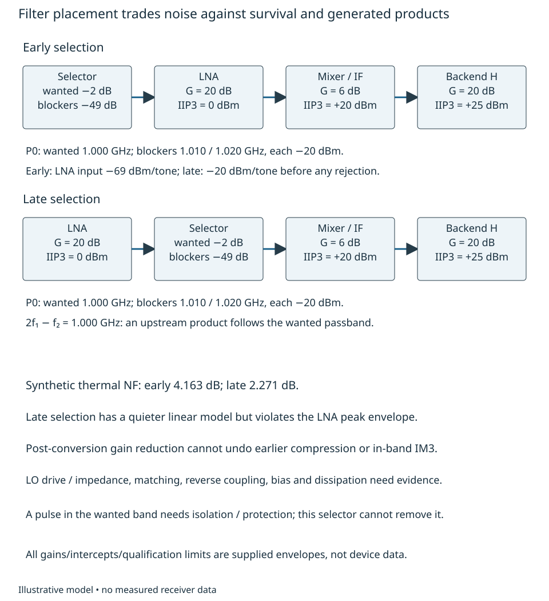
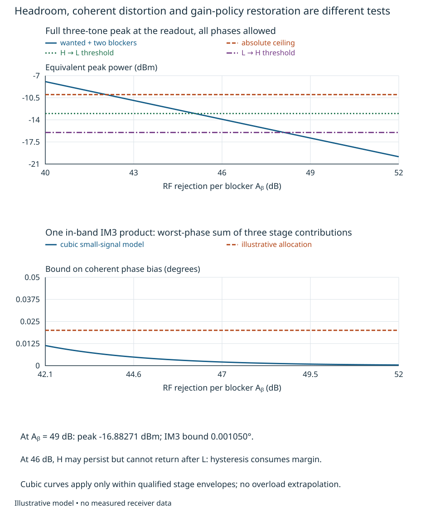
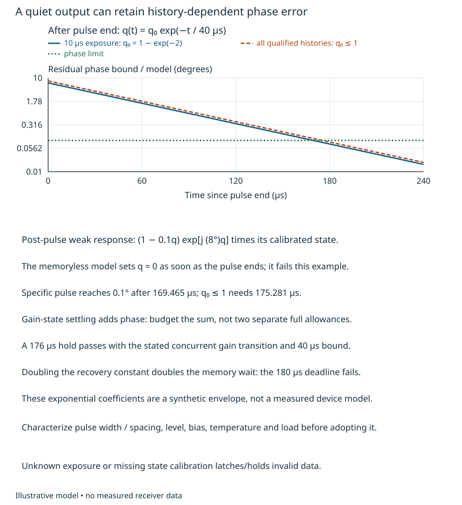
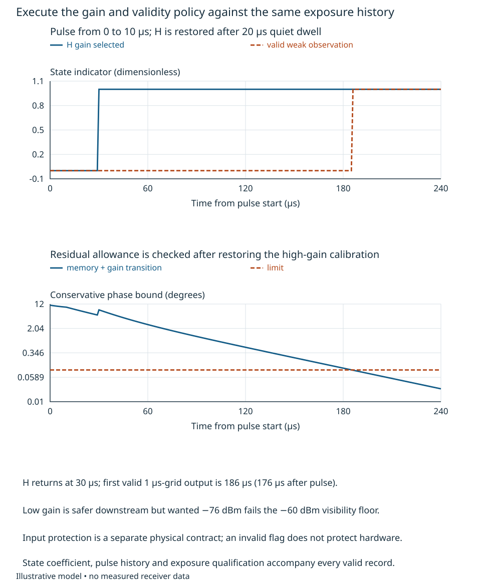

# Analog information preservation and gain policy {#sec-analog-preservation}

A weak return can be absent from a digital record for two very different reasons:
there was no return, or the analog path had not recovered enough to observe it.
The second case cannot be repaired by lowering a detection threshold. The
[feasibility and allocation treatment](feasibility-architecture-allocations.qmd)
used supplied headroom and disturbance interfaces. Here we ask how an engineer
could specify the stages and operating policy behind such an interface.

The bounded task is a coherent radar receive path, with wanted power −100 dBm at
1.000 GHz and two simultaneous blockers, each −20 dBm, at 1.010 and 1.020 GHz.
All powers are delivered into matched 50 Ω planes. The desired output must exceed
−60 dBm, the equivalent worst peak must remain below −10 dBm, and a steady
in-band distortion phasor is allocated at most 0.02° phase displacement. After a
known transmit exposure ends, usable weak-return data are required within 180 μs,
with the incremental weak-signal transfer, relative to its unexposed same-state
calibration, within 1 percent in magnitude and 0.1° in phase. The steady
contamination and transient-response limits are separate subsystem criteria;
neither is a total phase-measurement uncertainty requirement.
These are illustrative requirements, not a radar specification or measured device
behavior. They are a new multitone/pulse contrast, not a replacement for the
single-blocker noise interfaces in Chapters 11–12.

By the end of the argument, the reader should be able to allocate stage gain,
noise and linearity; distinguish a low-level nonlinear approximation from a
recovery model; execute a gain/valid-data policy; and identify the measurements
needed before relying on that policy. Circuit synthesis and actual converter
selection remain external or later refinements. A missing component guarantee
will remain a conditional interface rather than a convenient numerical assumption.

## Place prevention before the vulnerable stage {#sec-analog-stage-placement}

Use four synthetic blocks: a selector with wanted loss 2 dB and blocker rejection
$A_B$; an LNA with gain 20 dB and noise figure 2 dB; a conversion/IF block with
gain 6 dB and noise figure 8 dB; and a backend with gain 20 dB and noise figure
6 dB in its high state H. Noise figures describe linear, matched, 290 K small-signal
conditions at the wanted frequency. Input third-order intercepts are respectively
0, +20 and +25 dBm for the active blocks. Their qualified equivalent input peak
ceilings are −15, −10 and −5 dBm. These ceilings delimit the intended linear/
weakly nonlinear model; they are neither damage ratings nor inferred compression
points. The readout ceiling is an additional interface.

For state H, wanted gain from input P0 to output O is
$-2+20+6+20=44$ dB, hence wanted power at O is −56 dBm. Selecting $A_B=49$ dB
gives the following stage inputs:

| Plane | Wanted, dBm | Each blocker, dBm | Worst composite peak, approximately dBm |
|---|---:|---:|---:|
| LNA input, after selector | −102 | −69 | −62.883 |
| Conversion input | −82 | −49 | −42.883 |
| Backend input | −76 | −43 | −36.883 |
| Readout O | −56 | −23 | −16.883 |

Equivalent peak power means $V_{\rm peak}^2/(2R)$, so that a single sinusoid has
its ordinary delivered power. For coherent tones with arbitrary phases, add peak
**voltages** before squaring. Writing powers in dBm, the conservative bound at O is

$$
P_{\rm pk}=20\log_{10}\!\left(2\,10^{P_B/20}+10^{P_S/20}\right)\ \mathrm{dBm}.
$$ {#eq-analog-peak}

The factors inside the logarithm are proportional to square roots of milliwatts;
$P_B=26-A_B$ and $P_S=-56$ here. All phases can align at one instant, so the bound
is attainable for the stated tones. With $A_B=49$, it gives −16.88271 dBm, or
about 45.28 mV peak, comfortably below 100 mV. The weak tone belongs in the sum:
even here its addition changes the two-blocker-only bound by 0.09669 dB. A modulated
waveform requires a justified crest-factor bound over its actual support, not its
average RMS alone. For $M$ equal tones, aligned peak power exceeds a single tone
by $20\log_{10}M$, and exceeds their summed average power by $10\log_{10}M$.

Moving the selector after the LNA preserves net wanted gain but exposes the LNA
to −20 dBm per blocker: their aligned peak is about −13.979 dBm, above its −15 dBm
qualification ceiling. The later filter cannot establish that the LNA remained
linear. Nor does a backend attenuator protect that input.
@fig-analog-prevention-paths makes the ordering and in-band generation explicit.

{#fig-analog-prevention-paths fig-alt="Early and late selector arrangements have the same gain blocks. Early rejection reduces each blocker to minus69dBm at the LNA; late rejection leaves minus20dBm there. A third-order product coincides with the wanted1GHz frequency. Late selection has lower modeled noise figure but violates the LNA input envelope."}

The noise cost follows by referring each stage's added noise to P0. If stage $i$
has power gain $g_i$ and noise factor $F_i$, its added input-equivalent noise is
$kT_0(F_i-1)$ W/Hz. The preceding power gains divide that contribution when
referred farther upstream, giving

$$
F_{\rm total}=F_1+\frac{F_2-1}{g_1}
 +\frac{F_3-1}{g_1g_2}+\cdots.
$$

A matched passive loss $L$ at $T_0$ has $g=1/L$ and $F=L$: the output remains at
thermal equilibrium although the available wanted power falls. Substituting
$L=10^{2/10}$ and the declared active stages gives **4.16292 dB** noise figure
with early selection, versus **2.27054 dB** with selection immediately after the
LNA. At a hypothetical 1 kHz rectangular noise bandwidth the early chain's
input-equivalent thermal noise is −139.81227 dBm. That is only this analog linear
model; it neither includes all later observation noise nor replaces Chapter 12's
supplied complete floor. Correlated or mismatched noise requires Chapter 9's
loaded source model rather than this scalar cascade.

Isolation, drive and power are interfaces too. For an additive coherent aggressor
of −20 dBm whose effective path ends at O, a 0.02° allocation with wanted −56 dBm
requires its retained power below
$-56+20\log_{10}(\sin0.02^\circ)\simeq-125.142$ dBm: at least 105.142 dB path
loss from that aggressor plane, if it consumes the whole allocation. A component's
reverse isolation alone is not that path; board, supply, enclosure and conversion
paths can bypass it. Multiplicative supply-to-phase coupling instead needs its
own sensitivity. Supplying 5 V at assumed currents 20, 30, 40 and 10 mA for the
three active blocks and controls consumes 0.50 W/channel, before reference,
converter and processing power. Three channels would spend 1.50 W of Chapter
12's illustrative 2.4 W total envelope, leaving an **unproved** 0.90 W. Actual
bias, LO drive/loading, impedance, thermal resistance and stage dissipation must
be reconciled; this arithmetic selects no compatible component set.

## Predict small distortion without extrapolating overload {#sec-analog-nonlinearity}

For a real memoryless stage, begin with
$y=a_1x+a_2x^2+a_3x^3$. Multiplying two cosine tones shows sum/difference and
second-harmonic terms from $a_2$, and third-order components at $2f_1-f_2$ and
$2f_2-f_1$. For equal peak input amplitudes $A$, the latter have amplitude
$3|a_3|A^3/4$. The linear fundamental is $|a_1|A$. Their extrapolated equality
defines $A_I^2=4|a_1|/(3|a_3|)$; with $P_I=A_I^2/(2R)$ this yields, in dBm,

$$
P_{{\rm IM3,in}}\simeq3P_{B,{\rm in}}-2\,\mathrm{IIP3}.
$$ {#eq-analog-im3}

This is the input-referred power of **one** product in the weak cubic region,
not its actual measured value at arbitrary drive. Second-order products require
analogous IP2 information and the full conversion/exclusion map in Chapter 11.
[MT-012, Rev. A, pp. 2–4](https://www.analog.com/media/en/training-seminars/tutorials/MT-012.pdf#page=2)
explains the extrapolated RF intercept construction and why a generic intercept
interpretation should not be transferred to converter clipping. Its plotted
regimes do not certify our stages [@kesterMT012].

Here $2(1.010)-1.020=1.000$ GHz: one IM3 product lands exactly on the wanted
frequency. Refer each stage contribution through its remaining gain to O.
For 49 dB rejection, the LNA, converter and backend generate output-equivalent
products of **−161, −161 and −159 dBm**. Relative to −56 dBm wanted, their
amplitude ratios add conservatively to

$$
r=10^{(-161+56)/20}+10^{(-161+56)/20}
 +10^{(-159+56)/20}=1.83263\times10^{-5}.
$$

Unknown product phases require a phasor sum or its triangle bound, not an RSS of
powers. The disk geometry from Chapter 12 gives phase displacement at most
$\arcsin r=0.00105002^\circ$. Subsequent IM interactions and level-dependent
transfer are neglected at this small-error order and need checking against the
allocated margin. This result covers this product, not every spur or compression
mechanism. @fig-analog-blocker-region compares it with the separate peak and
operating-policy constraints.

{#fig-analog-blocker-region fig-alt="Composite wanted-plus-two-blocker peak decreases with selector rejection. It crosses minus10, minus13 and minus16dBm at different rejections. A second plot shows the cubic in-band phase bound falling below0.02degree. At49dB all illustrated inequalities pass; at46dB high gain cannot return after a low-state transition."}

A band-centered complex envelope can represent narrowband AM-to-AM/PM behavior as
$z_o=a z+b|z|^2z$. For the real cubic's selected band, $b=3a_3/4$; a complex $b$
is a phenomenological envelope model of phase conversion, not a literal real
instantaneous voltage polynomial. With $\eta=(b/a)|z|^2$, gain magnitude is
$|a|\sqrt{(1+\Re\eta)^2+(\Im\eta)^2}$ and extra phase is
$\operatorname{atan2}(\Im\eta,1+\Re\eta)$. These identities explain why amplitude
calibration alone misses AM-to-PM. Fitting a complex coefficient requires complex
response data at specified level, frequency and state.

For example, write the selected input envelope as wanted amplitude $S$ and
blocker amplitudes $B_1,B_2$ at offsets 10 and 20 MHz. In $|z|^2z$, products
whose two positive offsets minus the conjugated offset equal zero contribute
at the wanted frequency. Collecting them gives

$$
z_{o,0}=aS+b\left[S(|S|^2+2|B_1|^2+2|B_2|^2)+B_1^2B_2^*\right].
$$

The last term is additive contamination; the terms multiplying $S$ change the
wanted transfer. For a weak wanted tone beside two strong blockers, that coefficient
also contains $2(b/a)(|B_1|^2+|B_2|^2)$. In the pure cubic model,
$|b/a|=1/(2RP_I)$, so a conservative per-stage perturbation radius is
$2(P_{B1}+P_{B2})/P_I$. At the worked inputs, their sum is $1.64110\times10^{-6}$,
or approximately 0.00009403° if entirely quadrature. It is distinct from the
new additive IM3 tone. The still smaller wanted self-term contributes
$P_S/P_I$ per stage (about $2.06\times10^{-10}$ in total here). Real AM/PM versus level, fifth-order terms, frequency
spacing and memory can invalidate either cubic reduction; a single intercept
does not establish this entire model.

For a misleading alternative, reduce both unselected input blockers to −30 dBm
and put the selector after the LNA. This qualified low-level contrast still gives
$3(-30)-2(0)=-90$ dBm input-referred IM3, 10 dB **above** the −100 dBm wanted.
The later wanted-passband filter attenuates that product and wanted equally.
At the original −20 dBm blockers the LNA's peak qualification fails, so extending
the −90 dBm calculation to a purported accurate −60 dBm product is unjustified.
A polynomial that predicts negative large-signal gain, or an impressive IP3
unaccompanied by modulated-signal evidence, is not an overload model.

## Recovery belongs to the exposure history {#sec-analog-recovery}

Now apply a 10 μs pulse at the wanted frequency. For a separate illustrative
+10 dBm P0 pulse, the 2 dB wanted loss leaves +8 dBm at the LNA; reaching the
−15 dBm qualification boundary requires at least **23 dB additional isolation**.
This necessary inequality is not a protection design: residual peaks, component
ratings, pulse energy and recovery need actual evidence. The pulse cannot be
removed by a selector that must pass the wanted frequency. Known-transmit blanking
can precede it; a late output-clip detector only reports what already happened.

Even a protected, qualified exposure may leave bias, charge or thermal memory.
Use a dimensionless synthetic state $q$, driven by normalized exposure $p$:
$\dot q=(p-q)/(5\ \mu\mathrm{s})$ during the pulse, and
$\dot q=-q/(40\ \mu\mathrm{s})$ afterward. Assume $0\le p\le1$ and initially
$0\le q\le1$. These equations preserve that interval. A rested receiver exposed
to $p=1$ for 10 μs ends with $q_0=1-e^{-2}=0.864665$; other qualified histories
may end closer to one. For a weak post-pulse signal, suppose the response relative
to its calibrated gain state is

$$
\frac{z_o}{G_s z_i}=(1-0.1q)\exp[j(8\pi/180)q].
$$ {#eq-analog-memory}

The 1 percent magnitude limit needs $q\le0.1$; the 0.1° phase limit needs
$q\le0.0125$. Phase controls the wait. A specific rested pulse needs
$40\ln(0.864665/0.0125)=169.46453$ μs; the all-qualified-history bound needs
$40\ln80=175.28107$ μs. @fig-analog-memory-recovery shows why zero incident pulse
power does not imply zero residual error. These coefficients are **supplied
synthetic recovery envelopes**, not demonstrated physical constants.

{#fig-analog-memory-recovery fig-alt="Residual phase decays exponentially with40microsecond recovery constant on a logarithmic ordinate. The rested10microsecond pulse crosses0.1degree after169.465microseconds; the q0atmostone bound crosses after175.281microseconds. Gain-transition phase must also fit the allowance."}

A gain transition has its own complex response. Let H and low state L have
steady transfer $G_H=10^{44/20}e^{j12^\circ}$ and
$G_L=10^{24/20}e^{-j6^\circ}$ from P0 to O at the wanted frequency. Dividing by
a scalar nominal gain leaves the 18° phase change between these states. A declared
complex calibration coefficient for each state is required; this is a supplied
interface, not an observability or calibration procedure. Following any state
change, suppose remaining magnitude error is bounded by $0.02e^{-a/5}$ and phase
by $3e^{-a/15}$ degrees, where age $a$ is in μs. A supplied filter-history guard
also requires $a\ge10$ μs. Sum the memory and transition bounds:

$$
0.1q+0.02e^{-a/5}\le0.01,\qquad
8q+3e^{-a/15}\le0.1\quad\text{(degrees)}.
$$ {#eq-analog-validity}

Giving each mechanism the entire phase allowance separately would overrun it.
A gain-state logic deadline, output magnitude settling, thermal recovery and a
corrected phase deadline are different observables.

## Execute a policy and specify its evidence {#sec-analog-policy}

A simple conditional policy demonstrates the method. A predictive monitor supplies
the peak expected in H, including the full input waveform; its lead time must
cover sensing/control/settling latency if it is to prevent downstream clipping.
Known transmit exposure commands L and invalid data. It does **not** thereby
protect the upstream LNA; physical protection is a separate contract. Unknown
exposure outside the characterized envelope latches a fault rather than starting
an unearned recovery timer.

Away from a pulse, H changes to L when its predicted peak exceeds −13 dBm. L
returns to H only after the predicted H peak stays at or below −16 dBm for 20 μs.
Validity then requires the actual state's peak at most −10 dBm, wanted output
at least −60 dBm, its known complex coefficient, the filter-history guard, both
inequalities in @eq-analog-validity, and no pulse/fault. Store gain state,
coefficient identity, time since transition and exposure qualification with each
record. The bounded executable `GainPolicy` in
`engineering/examples/subsystem_models.py` implements these conditions; `policy_trace`
executes the pulse example. The code expresses the supplied policy, not a driver
for actual equipment.

Solving @eq-analog-peak gives minimum rejection **42.06424 dB** for the absolute
ceiling, **45.08231 dB** to avoid leaving H, and **48.10790 dB** to qualify the
return to H. Thus a 46 dB selector can support H until an exposure commands L,
but the same subsequent steady waveform cannot restore H. This is a consequential
state/history dependence: L puts wanted power at −76 dBm and fails visibility.
A 49 dB selector meets the return threshold; alternative hysteresis thresholds,
earlier isolation or different gain placement require a new transient/headroom
argument, not a preference for more rejection.

For the execution in @fig-analog-validity-policy, a pulse occupies $0\le t<10$ μs.
The monitor then reports the 49 dB case. H returns at 30 μs. Conservatively reset
the recovery bound to $q=1$ at pulse end, then decay it with 40 μs constant.
The first valid point on a 1 μs grid is **186 μs**, or **176 μs after the pulse**:
total phase bound is about 0.09831°, and magnitude error about 0.123 percent.
The 180 μs deadline closes **only under these supplied bounds**, although the
specific rested-pulse trajectory would recover earlier. Calibration absence,
another pulse or an out-of-envelope event blocks that conclusion.

{#fig-analog-validity-policy fig-alt="Pulse lasts until10microseconds. High gain returns at30microseconds after a20microsecond quiet dwell. The valid indicator remains zero until186microseconds, when the summed memory and transition phase bound meets0.1degree. Low gain fails weak-signal visibility."}

Actual documentation shows why these distinctions matter. The ADL5240 Rev. A
has separately accessible amplifier/attenuator blocks and alternative orderings
(pp. 1, 20–21); its gain-settling entries (p. 6), typical phase-versus-attenuation
and transition examples (p. 12), and condition-specific modulated-drive discussion
(p. 22) describe different evidence [@adiADL5240]. A gain-settling entry is not a
0.1° post-overload phase guarantee. No numerical device characteristic is imported
into our recovery model, and this part is not selected for this receiver.

An engineer would need complex transfer versus gain, level, frequency and
load; simultaneous wanted/blocker and multitone tests; pulse amplitude/width/
spacing recovery with temperature/bias variation; measured exposure-monitor
latency and saturation behavior; and protected test access before and after each
vulnerable stage. Vary the test source/reference paths so common errors do not
cancel silently. Bound pulse energy and component ratings separately from the
weak-signal measurement. Verify the retained wanted response on held-out signals,
not just a quieter noise trace. Matching, bias stability, protection devices,
LO-drive dependence, supply coupling and thermal implementation need circuit/
device expertise and actual characterization. None was measured here.

For transfer, replace the isolated pulse by a train whose spacing is shorter than
the 40 μs recovery constant. Propagate $q$ through both intervals; do not reset it
to a rested state at every pulse. Then let the recovery constant rise to 80 μs
while the pulse monitor still sees the same power. The memory wait for all qualified
histories becomes 350.562 μs, so the 180 μs deadline cannot close through backend
gain changes. Identify whether reduced exposure, a different physical recovery
mechanism or a revised receive interval can restore the requirement. Finally,
replace the blockers by a wideband modulated interferer with the same average
power. Explain which crest-factor, spectral-regrowth, AM/PM and memory evidence
must replace the two-tone intercept calculation. Equal average power is not an
equivalent analog or coherent-response test.
