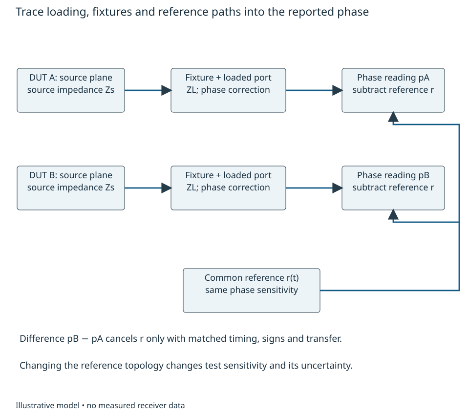
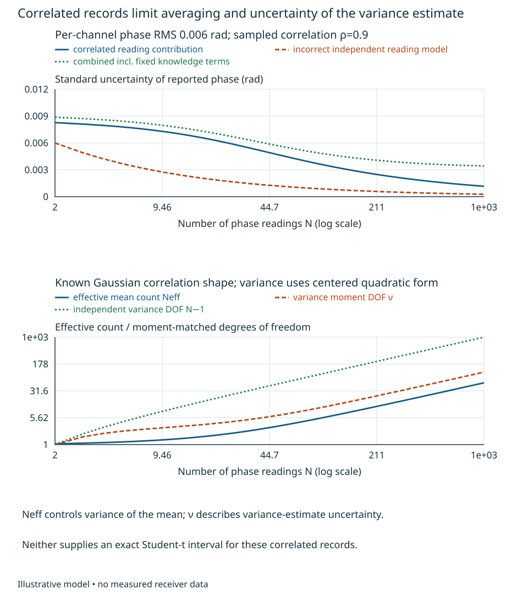
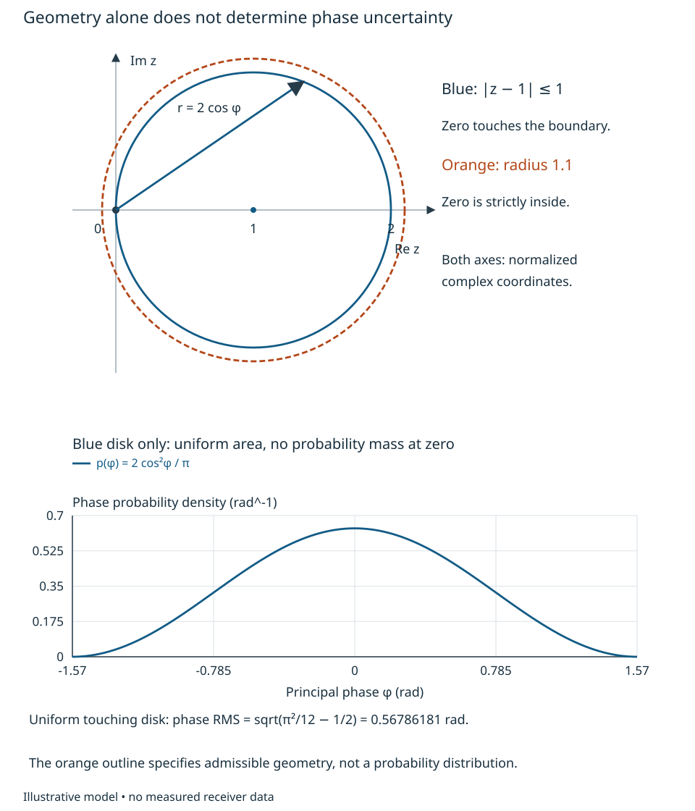
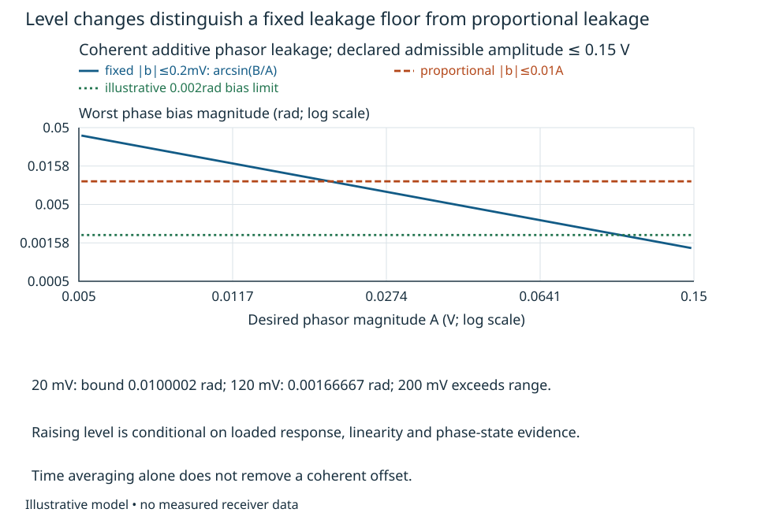

# Calibration observability and operational metrology {#sec-metrology}

A two-channel receiver agrees perfectly with its injected test signal. Does that
establish the phase difference of two incident fields? The answer depends on
which paths the test traversed and what was already known about its reference.
Before asking how precisely to estimate a correction, an engineer must establish
**which combinations of physical parameters the observations can distinguish**.
This chapter connects the observable and inference reasoning of Chapters 1 and 5
to measurement access. Chapter 4 supplies rank; Chapter 6 supplies sensitivity and
uncertainty. Electronic response, sensor response and propagation remain distinct.

## Calibration measurement freedoms {#sec-calibration-freedoms}

At one declared signed baseband frequency and fixed operating state, let a source
produce complex envelope $S c_k$, where $c_k$ is a commanded probe multiplier.
A fixture transfers it by $P_i^{\rm cal}$ to receiver input plane $i$. The loaded
receiver response is $H_i$, its constant output offset is $b_i$, and additive
observation noise is $n_{ik}$. With the conversion orientation already normalized,

$$
 Y_{ik}=H_i P_i^{\rm cal}S c_k+b_i+n_{ik}. \tag{13.1}
$$

The $Y$, $S$, $b$ and $n$ have peak-envelope voltage scaling; the transfers are
dimensionless. Source frequency, loading, probe timing and reference state are
conditions of this equation. A shared frequency reference alone does not establish
the complex $S$ at both inputs or a repeatable receiver phase after restart.

{#fig-calibration-access fig-alt="An external field passes through a sensor path into a receiver and complex output. A separate probe source enters through a fixture after the sensor. Annotations distinguish constant offsets, synchronous leakage, common-source cancellation and unknown differential fixture response."}

Even with no noise, the transformation $H_i\mapsto cH_i$, $S\mapsto S/c$ for
any nonzero complex $c$ leaves all observations unchanged. It is a reference
freedom, not poor numerical precision. If each fixture path is unknown, the
additional transformation $H_i\mapsto H_i/d_i$,
$P_i^{\rm cal}\mapsto d_iP_i^{\rm cal}$ also changes nothing. The receiver
responses cannot then be separated from the fixture responses. In small phase
coordinates, the measured phase is a sum of source, fixture and receiver phases.
The row $[1\;1]$ measuring fixture plus receiver has rank one, with null direction
$[1\;-1]^T$. Repeating it reduces random noise but never supplies the missing
second constraint. Chapter 5's identifiability argument applies before fitting.

A simultaneous ratio with nonzero reference-channel output can remove common
$S$ and its common phase. After offset removal,
$Z_B/Z_A=(H_B/H_A)(P_B^{\rm cal}/P_A^{\rm cal})$. It identifies relative receiver
response only if the differential fixture transfer is known or separately
identified. It does not provide absolute gain or absolute phase. A weak denominator
also makes the ratio noisy and biased; Chapter 6's small-error propagation needs
both outputs safely away from zero. Swapping fixture arms can add information
only if their loaded behavior and the receiver state remain the same during the
swap. A reciprocal label does not prove those conditions.

For a worked single-frequency example, supply true relative receiver gain
$0.9e^{j0.08}$ and fixture ratio $0.98e^{j0.03}$. Their observable product is
$0.882e^{j0.11}$. An indistinguishable alternative has fixture ratio one and
receiver ratio equal to that product. Dividing operational receiver data by the
product gives $1/(0.98e^{j0.03})$: gain **1.020408** and unwanted phase
**−0.03 rad**, or **−1.71887°**. Perfect training agreement has introduced a 2.04%
gain error and a phase error. Characterizing the fixture at the actual loaded
planes supplies information that a tighter fit cannot.

Offsets illustrate another access choice. Apply four coherent multipliers
$c_k=1,j,-1,-j$ while the source, receiver and offset remain fixed. Since
$\sum c_k=0$ and $\sum|c_k|^2=4$, projection gives

$$
 Z_i={1\over4}\sum_k c_k^*Y_{ik}
     =H_iP_i^{\rm cal}S+{1\over4}\sum_k c_k^*n_{ik}. \tag{13.2}
$$

The unweighted mean estimates the constant $b_i$ in this model. Independent
proper complex noise with $E|n|^2=\sigma_n^2$ gives projected variance
$\sigma_n^2/4$; correlated or drifting observations require the actual covariance.
Leakage proportional to $c_k$ survives projection and is indistinguishable from
a response contribution at this access point. Turning the source off, changing
its route or comparing a second characterized input can test different hypotheses.
These tests need a physical model for their changed loading and coherent state.

In operation an incident field may traverse an additional sensor or external
path $A_i$ before $H_i$. Injection after $A_i$ supplies no constraint on it.
A desired displacement or arrival angle can therefore change operational phase
without changing the calibration record. Conversely, estimating "receiver drift"
from unknown operational phase can absorb that wanted information. A calibration
observable must be linked to the wanted observable and to the paths it excludes.
Chapter 8 owns the field-to-voltage model; this equation does not replace it.

Kast and colleagues' examined system-level VSA study distinguishes receiver
calibration from subsequent waveform comparison, requires common reference planes
or de-embedding, and restricts validity to the selected instrument configuration
[@kastReceiverCalibration2025]. Its experiment uses particular reference hardware
and waveforms; it does not establish the identifiability or performance of our
illustrative two-channel arrangement. Its time-alignment step is also a reminder
to preserve the task definition: removing arbitrary record delay would remove
information if that delay were itself the intended observable.

Before specifying access, an engineer should draw the stimulus, reference and
science paths through actual switches, couplers, loads and conversion states.
Identify which quantities a characterized standard supplies and which are fitted.
Check parameter freedoms, offset/leakage alternatives and desired-signal transfer
before selecting a correction. Actual fixture S-parameters, mismatch, isolation,
phase stability, level linearity and uncertainty must come from examined component
information or measurements at those planes. Mathematical full rank does not
establish a realizable low-disturbance calibration port.

For a swap with unchanged loading and state, let $h=H_B/H_A$ and
$p=P_B^{\rm cal}/P_A^{\rm cal}$. Ratios $r_1=hp$ and $r_2=h/p$ give
$h^2=r_1r_2$. Besides the common absolute reference freedom, a discrete ambiguity
remains: $(h,p)$ and $(-h,-p)$ fit equally well. A unique relative phase needs
additional branch information.

For transfer, replace the characterized fixture by two unknown arms, but allow a
swap. Write both ratio equations and identify the remaining common complex
freedom and discrete phase ambiguity. Then let reconnecting one arm change its loaded phase by an unknown
amount: decide which receiver quantity is still identifiable. Finally inject
after the antenna while the desired quantity is angle of arrival; specify an
additional observation that constrains the missing sensor/geometry response.

The remaining sections develop measurement equations and uncertainty before the
executable procedure in Chapter 23. Precise estimation, feasible correction and
sensitive verification are separate engineering obligations.

## Operational measurement equations {#sec-operational-measurement}

Consider a phase-sensitive instrument comparing two source outputs at 1 GHz.
The engineer wants their relative phase **at two stated planes with 50 Ω loads**,
for a fixed operating state and an arithmetic average of 100 unwrapped phase
readings spaced 1 ms apart, at epochs 0 through 99 ms. The reference epoch and phase branch are established
externally. The 1 ms spacing is the phase-reporting interval, not an RF sampling
period; analog phase comparison or sampled extraction could supply these readings. Here the supplied DUT phase is constant; later changing it during
the 100-reading record changes the stated average. This is a bounded port-measurement
example, not a selected instrument or a completed reference design.

Intentional observation weighting belongs to the measurand. Imperfect realization
of that weighting, loading and instrument corrections belong to the measurement
model and uncertainty. For example, phases 0 and 0.2 rad have arithmetic mean
0.1 rad, whereas complex-product weights 1 and 9 give
$\arg(1+9e^{j0.2})\simeq0.18010$ rad. Neither is the unique "phase of the record."
Chapter 3 develops that distinction. NIST TN1297 Appendix D.4.1 treats explicitly
method-defined measurands [@taylor1994uncertainty]; our custom observation is not
a claim of implementing a particular standardized method.

Let $p_A$ and $p_B$ be input-oriented phase readings after their stated extraction.
For the supplied fixed-state model,

$$
 \begin{aligned}
 p_A[k]&=\phi_A[k]-r[k]+e_A[k],\\
 p_B[k]&=\phi_B[k]+c_L+c_F+c_I-r[k]+e_B[k],\\
 \widehat\theta&={1\over N}\sum_k(p_B[k]-p_A[k])
                -\widehat c_L-\widehat c_F-\widehat c_I .
 \end{aligned} \tag{13.3}
$$

The desired phase is $\theta=\phi_B-\phi_A$ under the stated 50 Ω condition.
The loading difference $c_L$, differential fixture phase $c_F$ and instrument
phase bias $c_I$ are radians. Placing their differential contributions in the
second equation is bookkeeping; both physical channels can contribute. The
common reference phase $r$ cancels only with identical signs, transfer and time
weighting. Mismatched delay or reference sensitivity leaves a residual, as
Chapters 3 and 15 show. The local errors $e_A,e_B$ remain. A common reference
can improve this differential measurement without establishing either source's
phase relative to an independent external reference.

{#fig-metrology-planes fig-alt="Two DUT source planes feed loaded fixtures and phase-reading channels. A common reference enters both phase readings with subtraction. The diagram identifies source impedance, loaded ports, correction access and the requirement for equal reference timing and transfer."}

Loading is not a label attached after measurement. At the declared RF plane,
use a linear Thevenin source $V_s$ with source impedance $Z_s$ and load $Z_L$.
Kirchhoff's law gives $V_L=V_s Z_L/(Z_s+Z_L)$. With known real $Z_s=50$ Ω, channel
A has the specified 50 Ω load but channel B's test input is $45+j5$ Ω at 1 GHz.
The loading factor in B is **0.4751381+j0.0276243**, rather than the real matched
factor 0.5. Thus $c_L=\arg[Z_L/(50+Z_L)]=\mathbf{0.0580742}$ rad. Ignoring it
would produce a 3.3274° error while still allowing an extremely repeatable result.
A counterfactual matched-load phase can be inferred only if this linear source
model remains valid under the changed load. Nonlinearity or load-dependent source
state requires new characterization rather than algebraic de-embedding.

A differential of the argument gives
$\delta c_L=\operatorname{Im}[(1/Z_L-1/(50+Z_L))\delta Z_L]$ for the stipulated
known source impedance. Independent real and imaginary load standard uncertainties
of 0.2 Ω each then give **0.00232166 rad** loading uncertainty. For uncertain complex $Z_s$, compare test loading with the matched-load
**target**, rather than differentiating test voltage alone. With $R_0=50$ Ω,

$$
 \begin{aligned}
 c_L&=\arg\left[{Z_L/(Z_s+Z_L)\over R_0/(Z_s+R_0)}\right],\\
 \delta c_L\big|_{Z_s}
 &=\operatorname{Im}\left[\left({1\over Z_s+R_0}-{1\over Z_s+Z_L}\right)
             \delta Z_s\right].
 \end{aligned}
$$

The worked known-real-50 Ω case retains its stated numbers. Unknown source
impedance requires this additional sensitivity and its covariances. Actual
selection needs calibrated complex impedances, their correlations, connector
repeatability and drift at these planes. An open-circuit voltage, incident power
wave and loaded voltage are different quantities; the declared model must specify
which is inferred.

More general fixtures require multiport/wave equations, mismatch and their
uncertainty. Dividing by a small known fixture transmission also enlarges output
noise and fixture-parameter uncertainty. Chapter 20 owns inverse feasibility;
knowing an attenuation does not recover lost SNR. A calibration standard cannot
remove a path that the calibration never observed. The examined Anritsu
VectorStar manual, revision AE, identifies source-power calibration, mismatch,
receiver linearity and trace noise as setup-dependent receiver-calibration terms
[@anritsuReceiverUncertaintyAE]. Its typical amplitude examples are not phase
specifications or guarantees for the hypothetical instrument here.

## Uncertainty, finite records and traceability {#sec-metrology-uncertainty}

We now critically evaluate supplied readings rather than invent physical
measurements. The accompanying
[CSV](data/metrology-phase.csv) contains two synthetic
100-reading configurations, generated with seed2201. Each includes a common
reference process with 0.02 rad RMS and two independent local phase-error
processes with 0.006 rad RMS each. All three are stationary Gaussian processes
with covariance $\sigma^2\rho^{|k-l|}$, $\rho=0.9$. They can be generated by
$x_k=\rho x_{k-1}+\sigma\sqrt{1-\rho^2}\,\xi_k$, independent standard-normal
$\xi_k$ and stationary initial variance $\sigma^2$. Equivalently this is a sampled
first-order filtered-white-noise model with time constant
$-1\,\mathrm{ms}/\ln0.9=9.4912$ ms. It is physically admissible; no instrument has
been shown to have these parameters. The model excludes slips, fades and drift.

The common reference cancels sample by sample. The local difference variance is
$\sigma_d^2=2(0.006)^2$ rad² and its normalized correlation is still
$R_{kl}=\rho^{|k-l|}$. Expanding the mean's double covariance sum counts $N-k$
pairs at each positive lag:

$$
 \operatorname{var}\bar d=\sigma_d^2 F_N,\qquad
 F_N={N+2\sum_{k=1}^{N-1}(N-k)\rho^k\over N^2},\qquad
 N_{\rm eff}=1/F_N . \tag{13.4}
$$

This is Chapter 4's propagation through the declared averaging operator, not an
extra uncertainty theory. At $N=100$, $F_N=0.17200048$, $N_{\rm eff}=5.81394$ and
standard uncertainty of the mean is **0.00351910 rad**. Assuming independence
would give 0.000848528 rad and understate this component by a factor of 4.15.
Increasing record length reduces this stationary term, but not fixed calibration
knowledge errors or coherent floors. If $\rho$ is estimated from the same short
record, its uncertainty also enters; it cannot silently become a known constant.

For the normal fixture orientation, supplied true values are $\theta=0.1$ rad,
$c_F=0.015$ rad and $c_I=-0.004$ rad. The first raw difference mean is
**0.17324412 rad**. Correcting the known nominal terms, including loading, gives
**0.10416996 rad**. Its deviation from the supplied truth is a synthetic
realization error, not its uncertainty. Supply independent standard uncertainties
$u_F=0.002$ rad, $u_I=0.001$ rad and the loading value above, independent of the
reading noise. Chapter 6's law gives

$$
 \begin{aligned}
 u_c^2&=(0.00351910)^2+(0.002)^2\\
      &\quad +(0.001)^2+(0.00232166)^2,\\
 u_c&=\mathbf{0.00477223}\ {\rm rad}.
 \end{aligned} \tag{13.5}
$$

This conditionally meets an illustrative standard-uncertainty allocation of
0.005 rad. It does not bound all errors or establish a 95% interval. The
uncertainties describe incomplete knowledge of applied corrections; the known
nominal 0.0580742 rad loading correction is not itself a standard uncertainty.
NIST TN1297 sections5.1–5.2 and AppendixA support this distinction and require
significant measurement-process inputs and covariances, as Chapter 6 explains.
The stated independence must be replaced when the same calibration reference or
fixture characterization links those inputs.

The uncertainty of a noise estimate matters too. A sample variance from correlated
data is not assigned $N-1$ independent degrees of freedom. Let
$P=I-\mathbf1\mathbf1^T/N$ remove the unknown mean, and assume the correlation
shape $R$ is known while the scale $\sigma_d^2$ is unknown. Then
$\widehat\sigma_d^2=d^TPd/\operatorname{tr}(PR)$ is unbiased. To see its variance,
write $d$ as a mean plus $\sigma_d R^{1/2}z$, with independent unit Gaussian
coordinates $z$. Diagonalizing the symmetric quadratic form gives
$\sigma_d^2\sum_i\lambda_i z_i^2$; its mean is $\sigma_d^2\sum\lambda_i$ and its
variance is $2\sigma_d^4\sum\lambda_i^2$. Thus the variance estimate has
moment-matched degrees of freedom

$$
 \nu={\{\operatorname{tr}(PR)\}^2\over\operatorname{tr}(PRPR)},\qquad
 {\operatorname{sd}(\widehat\sigma_d^2)\over\sigma_d^2}=\sqrt{2/\nu}.
 \tag{13.6}
$$

For these 100 readings $\nu=11.4011$, not $N_{\rm eff}-1$ or 99. The relative
standard deviation of the variance estimate is about **41.9%**. The two supplied
records estimate variances **0.0000415642** and **0.0000850361** rad² against true
0.000072 rad². That scatter is compatible with limited variance information;
the smaller estimate alone is weak evidence of improved instrument behavior.
The ordinary denominator $N-1$ would additionally bias the estimate for this
correlation model. Equation (13.6) is a moment characterization, not an exact
chi-square distribution when the eigenvalues differ. Nor are mean and variance
estimates automatically independent here. Substituting $\nu$ into a Student-t
table therefore does not create an exact interval. NIST TN1297 AppendixB's
coverage-factor procedure also states approximation and applicability conditions;
its independent-component formula is not a license to ignore correlated records.

{#fig-metrology-records fig-alt="Standard uncertainty versus record size compares correlated readings, an incorrect independence assumption and a combined budget with fixed knowledge terms. A second log-log plot distinguishes effective samples for the mean, moment degrees of freedom for variance and the independent-data N-minus-one rule."}

Near a complex amplitude zero, first-order phase propagation can fail even if
voltage uncertainty is well characterized. A disk with zero strictly inside
admits every nonzero phase direction; a disk merely touching zero need not.
At zero itself phase is undefined. Geometric membership alone, however, does not
determine the probability distribution or rule out scalar phase reporting.
A phase result needs an explicit branch and a joint input distribution; any
nonzero probability of exactly zero needs an invalid-phase outcome or a clearly
stated conditional result. An unwrapped cycle cannot be inferred from voltage
uncertainty alone.

A useful counterexample is a phasor uniformly distributed over the disk
$|z-1|\le1$ in normalized complex coordinates. Zero is on its boundary but has
probability zero. The principal phase lies between $-\pi/2$ and $+\pi/2$.
For a direction $\phi$, the radial extent is $0<r<2\cos\phi$. Integrating
uniform area density $1/\pi$ with polar area element $r\,dr\,d\phi$ gives
$p_\phi(\phi)=2\cos^2\phi/\pi$ on that interval. This symmetric distribution
has zero phase mean and

$$
 u_\phi^2={2\over\pi}\int_{-\pi/2}^{\pi/2}
                 \phi^2\cos^2\phi\,d\phi
          ={\pi^2\over12}-{1\over2},\qquad
 u_\phi=0.56786181\ {\rm rad}.
$$

Thus nonlinear scalar reporting is meaningful for this declared branch and
continuous distribution. Linearizing at the disk center would give 0.5 rad from
the imaginary-coordinate variance and understates the exact value. A symmetric
standard uncertainty is not automatically a chosen-coverage interval. In other
cases use complex coordinates, a circular/ambiguous report or changed observation
when the distribution and task warrant it. Numerical nonlinear propagation must
retain supplied correlations; it cannot supply missing loading, noise or
reference evidence.

{#fig-metrology-phase-disk fig-alt="Equal-scale complex axes show a disk centered at one touching zero and a larger outline containing zero strictly inside. A positive phase ray reaches radius two cosine phi in the touching disk. Its uniform-area principal-phase density is plotted on minus pi over two to plus pi over two, peaking at zero."}

Metrological traceability also concerns the result. VIM3 entry2.41 connects it to
an identified reference through documented calibrations, each with uncertainty;
its note5 distinguishes traceability from adequacy for purpose
[@jcgmTraceabilityVIM3]. A coefficient file or instrument serial number alone is
insufficient. Preserve the operator, planes, frequency/level/load/state, raw data,
corrections, reference certificates, calibration dates, uncertainty components and
correlations, calculation version and relevant environmental history. This
synthetic example has no calibration certificates and makes no traceability claim.

## Independent configurations and a sensitive decision {#sec-metrology-configurations}

A good follow-up deliberately changes a suspected instrument path while preserving
the declared DUT quantity, or states how the measurand changed. Compare a changed
fixture orientation, reference topology and level; do not interpret every changed
reading as DUT drift.

For a fixture reversal, assume the source state, loading and observation branch
are unchanged and the differential fixture phase changes sign. The second supplied
mean is **0.13738382 rad**. Half the sum of the two means removes $c_F$; subtract
$c_I$ and $c_L$ to obtain **0.10123981 rad**. Half their difference estimates
fixture phase **0.01793015 rad**. These are finite noisy results, not proof that
the fixture has no other effect. The sign/π ambiguity of section13.1 requires the
supplied unwrapped branch here. Reconnection that changes loading or creates an
unknown phase invalidates the sign-only reversal model.

The two reading records are independent in this supplied case, so their averaged
reading variance halves. The common loading and instrument knowledge terms do
not halve. Supply an additional 0.0015 rad standard uncertainty as a contribution to the reported half-sum phase from reversal
repeatability. The resulting conditional combined standard uncertainty is
**0.00385125 rad**. This alternative reduces fixture-offset sensitivity but costs
a second acquisition, switching and settling, and depends on preserved loading
and state. Actual repeats must test those assumptions; a reversal cannot cancel
an unknown common instrument phase.

Now change only the test reference architecture to independent references with
0.02 rad RMS each and the same $\rho=0.9$ correlation shape, independent of the
local errors. Their difference no longer cancels. The predicted total becomes
**0.0126639 rad**, including the original fixture/loading/instrument terms. It
fails the illustrative 0.005 rad allocation. The quieter common-reference test
was a useful differential measurement, but was not evidence for this independent-
reference operating condition. To test common DUT phase relative to an external
standard, the shared reference can also create a blind direction; supply an
independent witness with characterized transfer and uncertainty. Independence
alone does not make a witness accurate enough.

Finally consider an uncorrected coherent leakage phasor $b$ in the B comparison
channel, bounded by $B=0.2$ mV, while the reference-channel contribution is
negligible in this illustrative envelope. For desired phasor magnitude $A>B$,
the tangent geometry of Chapter 12 gives worst phase bias $\arcsin(B/A)$. Two
nonnegligible channel floors require both contributions and their possible
correlation. A longer average does not remove a coherent phasor. At $A=20$ mV,
the bound is **0.0100002 rad**, exceeding a separate illustrative 0.002 rad
unmodeled-bias allowance despite equation (13.5)'s precision result. These leakage
bounds are supplied envelopes; they were not injected into the CSV or measured.

If a separately characterized instrument admits at most 0.15 V desired amplitude,
raising the level to **0.12 V** would reduce the fixed-floor bound to
**0.00166667 rad**, conditionally below that bias allowance. The minimum is
$B/\sin(0.002)=0.10000007$ V. A proposed 0.2 V test exceeds the supplied range.
If instead $B=0.01A$, level increase leaves the 0.0100002 rad bound unchanged.
Only examined level-dependent gain/phase, compression, leakage and state evidence
can justify selecting the higher-level test or extrapolating its result to the
low-level operational receiver. Neither the Anritsu manual's typical amplitude
figures nor this illustrative envelope supplies that evidence.

{#fig-metrology-level-floor fig-alt="Worst phase bias versus desired phasor amplitude falls for a fixed 0.2-millivolt coherent leakage bound but remains constant for one-percent proportional leakage. The plot marks a separate two-milliradian bias allowance and restricts the amplitude range to the illustrative 0.15-volt maximum."}

The defensible decision is conditional. The declared common-reference model
meets the standard-uncertainty allocation, but the low-level coherent-floor
allowance fails. A characterized higher-level or lower-leakage configuration and
adequate loading/reference evidence could change that result. Independent
references require a different budget. The supplied records do not qualify an
instrument, establish hardware compliance or demonstrate actual receiver accuracy.
The planned canonical Chapter 24, *Verification coverage and bounded conclusions*,
owns formal requirement-evidence decision rules.

For transfer, keep 100 readings but increase the correlation to 0.99. Recalculate
both $N_{\rm eff}$ and $\nu$, and identify which extra records or measurements
would justify a noise estimate. Next make the fixture and instrument correction
uncertainties share a calibrated reference with known nonzero covariance: rebuild
the budget with the correct signs. Finally let reversal alter the B load and let
leakage scale with the stimulus. Decide which nominal cancellation and higher-level
remedy fail, and specify a topology/level comparison that can distinguish the
remaining hypotheses without removing the wanted phase.
