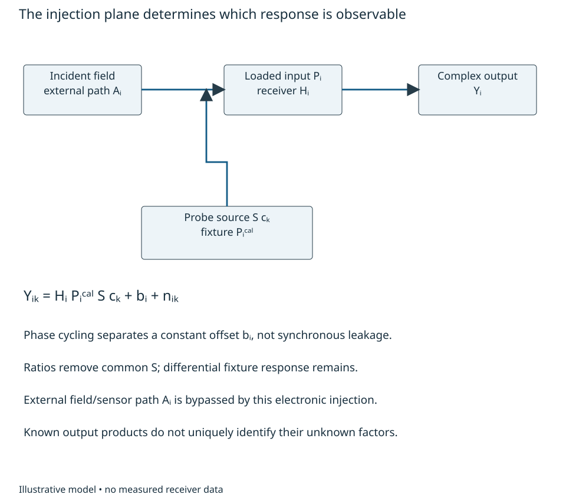

# Calibration observability and operational metrology {#sec-metrology}

A two-channel receiver agrees perfectly with its injected test signal. Does that
establish the phase difference of two incident fields? The answer depends on
which paths the test traversed and what was already known about its reference.
Before asking how precisely to estimate a correction, an engineer must establish
**which combinations of physical parameters the observations can distinguish**.
This chapter connects the observable and inference reasoning of Chapters 1 and 5
to measurement access. Chapter 4 supplies rank; Chapter 6 supplies sensitivity and
uncertainty. Electronic response, sensor response and propagation remain distinct.

## Calibration measurement freedoms {#sec-calibration-freedoms}

At one declared signed baseband frequency and fixed operating state, let a source
produce complex envelope $S c_k$, where $c_k$ is a commanded probe multiplier.
A fixture transfers it by $P_i^{\rm cal}$ to receiver input plane $i$. The loaded
receiver response is $H_i$, its constant output offset is $b_i$, and additive
observation noise is $n_{ik}$. With the conversion orientation already normalized,

$$
 Y_{ik}=H_i P_i^{\rm cal}S c_k+b_i+n_{ik}. \tag{13.1}
$$

The $Y$, $S$, $b$ and $n$ have peak-envelope voltage scaling; the transfers are
dimensionless. Source frequency, loading, probe timing and reference state are
conditions of this equation. A shared frequency reference alone does not establish
the complex $S$ at both inputs or a repeatable receiver phase after restart.

{#fig-calibration-access fig-alt="An external field passes through a sensor path into a receiver and complex output. A separate probe source enters through a fixture after the sensor. Annotations distinguish constant offsets, synchronous leakage, common-source cancellation and unknown differential fixture response."}

Even with no noise, the transformation $H_i\mapsto cH_i$, $S\mapsto S/c$ for
any nonzero complex $c$ leaves all observations unchanged. It is a reference
freedom, not poor numerical precision. If each fixture path is unknown, the
additional transformation $H_i\mapsto H_i/d_i$,
$P_i^{\rm cal}\mapsto d_iP_i^{\rm cal}$ also changes nothing. The receiver
responses cannot then be separated from the fixture responses. In small phase
coordinates, the measured phase is a sum of source, fixture and receiver phases.
The row $[1\;1]$ measuring fixture plus receiver has rank one, with null direction
$[1\;-1]^T$. Repeating it reduces random noise but never supplies the missing
second constraint. Chapter 5's identifiability argument applies before fitting.

A simultaneous ratio with nonzero reference-channel output can remove common
$S$ and its common phase. After offset removal,
$Z_B/Z_A=(H_B/H_A)(P_B^{\rm cal}/P_A^{\rm cal})$. It identifies relative receiver
response only if the differential fixture transfer is known or separately
identified. It does not provide absolute gain or absolute phase. A weak denominator
also makes the ratio noisy and biased; Chapter 6's small-error propagation needs
both outputs safely away from zero. Swapping fixture arms can add information
only if their loaded behavior and the receiver state remain the same during the
swap. A reciprocal label does not prove those conditions.

For a worked single-frequency example, supply true relative receiver gain
$0.9e^{j0.08}$ and fixture ratio $0.98e^{j0.03}$. Their observable product is
$0.882e^{j0.11}$. An indistinguishable alternative has fixture ratio one and
receiver ratio equal to that product. Dividing operational receiver data by the
product gives $1/(0.98e^{j0.03})$: gain **1.020408** and unwanted phase
**−0.03 rad**, or **−1.71887°**. Perfect training agreement has introduced a 2.04%
gain error and a phase error. Characterizing the fixture at the actual loaded
planes supplies information that a tighter fit cannot.

Offsets illustrate another access choice. Apply four coherent multipliers
$c_k=1,j,-1,-j$ while the source, receiver and offset remain fixed. Since
$\sum c_k=0$ and $\sum|c_k|^2=4$, projection gives

$$
 Z_i={1\over4}\sum_k c_k^*Y_{ik}
     =H_iP_i^{\rm cal}S+{1\over4}\sum_k c_k^*n_{ik}. \tag{13.2}
$$

The unweighted mean estimates the constant $b_i$ in this model. Independent
proper complex noise with $E|n|^2=\sigma_n^2$ gives projected variance
$\sigma_n^2/4$; correlated or drifting observations require the actual covariance.
Leakage proportional to $c_k$ survives projection and is indistinguishable from
a response contribution at this access point. Turning the source off, changing
its route or comparing a second characterized input can test different hypotheses.
These tests need a physical model for their changed loading and coherent state.

In operation an incident field may traverse an additional sensor or external
path $A_i$ before $H_i$. Injection after $A_i$ supplies no constraint on it.
A desired displacement or arrival angle can therefore change operational phase
without changing the calibration record. Conversely, estimating "receiver drift"
from unknown operational phase can absorb that wanted information. A calibration
observable must be linked to the wanted observable and to the paths it excludes.
Chapter 8 owns the field-to-voltage model; this equation does not replace it.

Kast and colleagues' examined system-level VSA study distinguishes receiver
calibration from subsequent waveform comparison, requires common reference planes
or de-embedding, and restricts validity to the selected instrument configuration
[@kastReceiverCalibration2025]. Its experiment uses particular reference hardware
and waveforms; it does not establish the identifiability or performance of our
illustrative two-channel arrangement. Its time-alignment step is also a reminder
to preserve the task definition: removing arbitrary record delay would remove
information if that delay were itself the intended observable.

Before specifying access, an engineer should draw the stimulus, reference and
science paths through actual switches, couplers, loads and conversion states.
Identify which quantities a characterized standard supplies and which are fitted.
Check parameter freedoms, offset/leakage alternatives and desired-signal transfer
before selecting a correction. Actual fixture S-parameters, mismatch, isolation,
phase stability, level linearity and uncertainty must come from examined component
information or measurements at those planes. Mathematical full rank does not
establish a realizable low-disturbance calibration port.

For a swap with unchanged loading and state, let $h=H_B/H_A$ and
$p=P_B^{\rm cal}/P_A^{\rm cal}$. Ratios $r_1=hp$ and $r_2=h/p$ give
$h^2=r_1r_2$. Besides the common absolute reference freedom, a discrete ambiguity
remains: $(h,p)$ and $(-h,-p)$ fit equally well. A unique relative phase needs
additional branch information.

For transfer, replace the characterized fixture by two unknown arms, but allow a
swap. Write both ratio equations and identify the remaining common complex
freedom and discrete phase ambiguity. Then let reconnecting one arm change its loaded phase by an unknown
amount: decide which receiver quantity is still identifiable. Finally inject
after the antenna while the desired quantity is angle of arrival; specify an
additional observation that constrains the missing sensor/geometry response.

The remaining sections develop measurement equations and uncertainty before the
executable procedure in Chapter 23. Precise estimation, feasible correction and
sensitive verification are separate engineering obligations.
