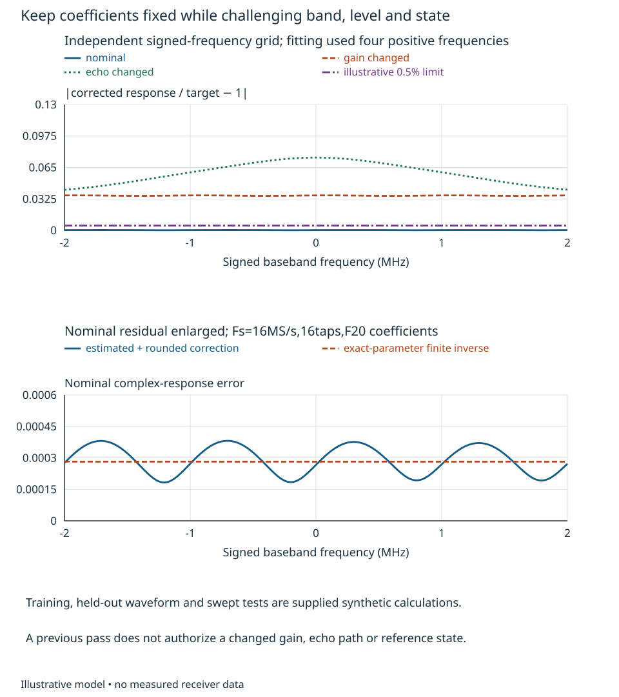
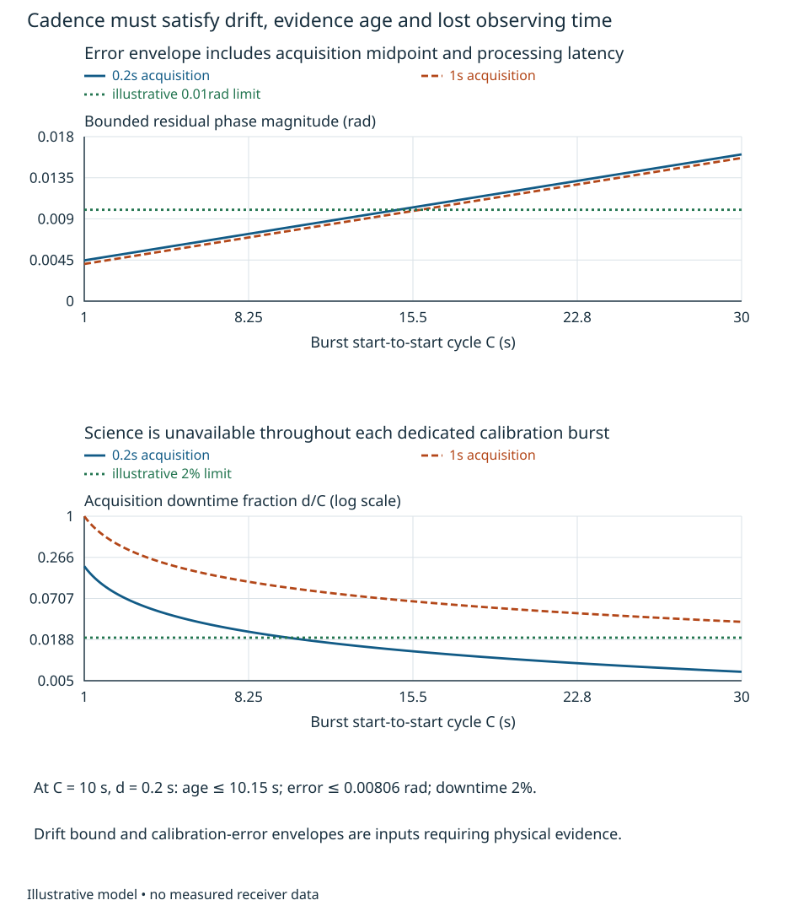
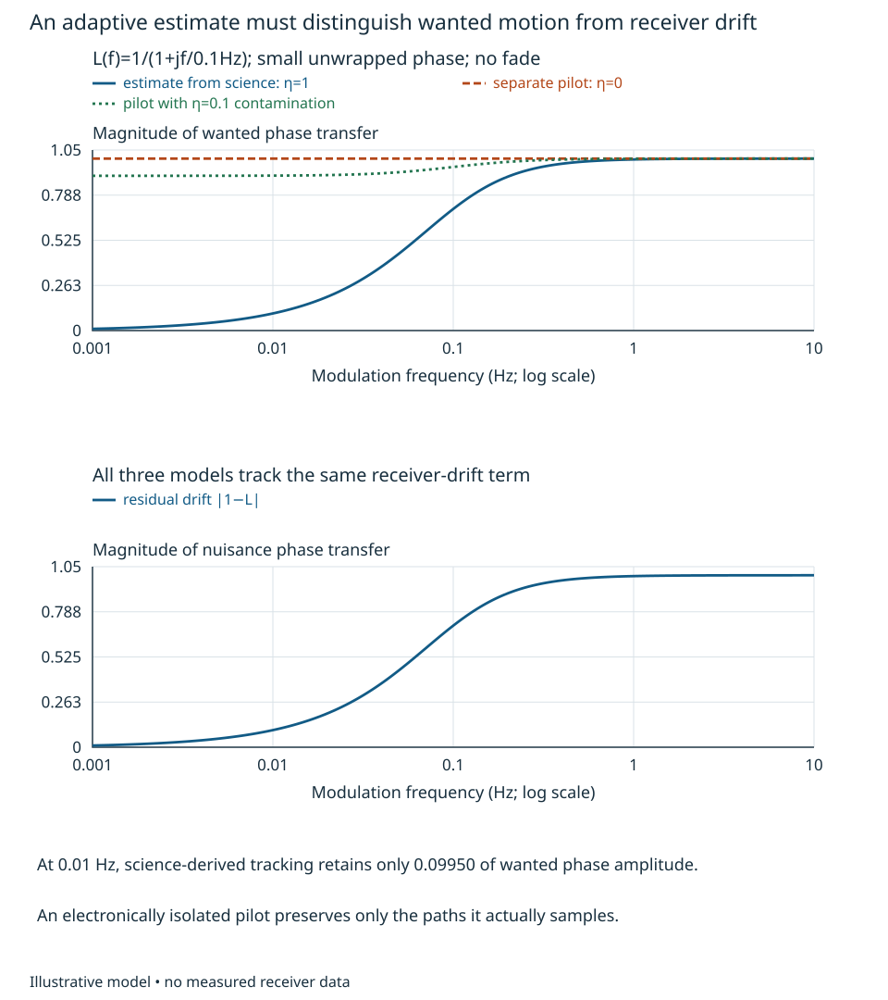

# Calibration procedures and continued coherence {#sec-calibration-procedure}

An observable response and an implementable inverse are necessary, but a receiver
still needs a procedure that acquires the right evidence, applies the right
coefficients and stops using them when their conditions fail. Our problem is to
keep two complex channels aligned without erasing wanted modulation or motion.
The observable is corrected response relative to a declared common input and
target epoch, together with retained wanted information during operation.

Chapter 13 supplies measurement freedoms and metrology, Chapter 6 uncertainty,
and Chapters 18–20 the selected correction models. We use Chapter 20's finite
echo inverse rather than derive a second inverse theory. The state and environmental
inputs below are explicit supplied contracts; complete transition causality and
physical realization remain Chapters 21 and 22. Their reserved slots do not
constitute developed prerequisites or hardware qualification. All records and
numerical envelopes here are synthetic and reproducible, not receiver measurements.

## Acquire, estimate and apply at identified planes

Retain separate raw complex channels. Fix conversion orientation, sample epochs,
gain, filter/rate, loading and reference state. Record the stimulus route, input
level, observation weighting and calibration reference. In this bounded example,
$F_s=16$ MS/s, $H_A=z^{-2}$ and $H_B=gz^{-5}(1-a z^{-1})$, with supplied nominal
$g=0.9e^{j0.08}$ and $a=0.6$. A characterized calibration-fixture ratio is
$P_B^{\rm cal}/P_A^{\rm cal}=0.98e^{j0.03}z^{-2}$. It is removed from the
measurement equation; it is not part of the operational receiver correction.
The delays are known for this example. An unknown delay would require its own
identifiable model, branch and estimation uncertainty before this fit is valid.

Use four frequencies, 0.25, 0.75, 1.25 and 1.75 MHz. At each, the common source
is $S(f)=0.05\exp[j(0.7+0.2 f/(1\,\mathrm{MHz}))]$ V. The estimator need not know
that phase or amplitude because simultaneous ratios remove it. At each frequency,
64 repetitions of Chapter 13's four-phase probe remove constant offsets. Supply
$b_A=1+j2$ mV and $b_B=3-j1$ mV. Each complex phasor reading has independent proper
zero-mean noise with 20 μV RMS; it is noise of the stated reading, not a broadband
ADC noise specification. The $b_i$ are biases of this defined phasor readout;
they are not assumed to equal offsets in subsequent raw science samples. Each 256-reading projected mean has 1.25 μV RMS noise.
The fixed-seed Gaussian generator defines one synthetic realization, not a bounded
hardware noise claim.

Remove the known fixture ratio from $Z_B/Z_A$ and advance the known three-sample
relative delay in the **estimation equation only**. Fit
$R(f)e^{j3\omega}=c_0+c_1e^{-j\omega}$, $\omega=2\pi f/F_s$, by complex least
squares. Under the supplied positive real echo model, use $\widehat g=c_0$ and
$\widehat a=\operatorname{Re}(-c_1/c_0)$; inspect the discarded imaginary part
and residual rather than treating the constraint as evidence. A complex or
multi-echo path needs a different model and feasibility assessment. Positive-only
training frequencies do not by themselves qualify the negative-frequency band.

The executed realization gives $\widehat g=0.89710742+j0.07184002$ and
$\widehat a=0.60000342$, with unconstrained complex training residual **0.0036276%**. The discarded
imaginary part of the echo estimate is −0.00003308; after imposing the real-echo
constraint, the actual selected model has training residual **0.0072475%**. Omitting
the fixture gives **6.5886%** unconstrained residual, but **46.1345%** for the
selected real-echo model, with $\widehat a=1.64858$ and discarded imaginary part
−0.553909. The inside-zero correction selected below is then inapplicable;
a more flexible fit could absorb it and conceal the wrong reference plane.
Neither a small nor a large residual identifies the cause without further access.
Kast and colleagues' study explicitly forms correction from reference/user
measurements and then evaluates another waveform, with configuration and reference
uncertainties retained [@kastReceiverCalibration2025, sections II.C–E and III].
Our procedure is an original teaching calculation, not a reproduction of that
28 GHz experiment or its standard-based comparison.

Select Chapter 20's length-16 causal correction
$Q_B=\widehat g^{-1}\sum_{k=0}^{15}\widehat a^kz^{-k}$, $Q_A=z^{-3}$ and common
target $T=z^{-5}$. Round real and imaginary coefficients to signed 24-bit words
with 20 fractional bits. Use the signed 24-bit/$F=21$ input/output and checked
64-bit/$F=41$ accumulation interface of Chapter 20. Their ranges, rounding and
valid sample support remain part of this implementation. The source-level advance
in the fit has not introduced a noncausal runtime filter.

The correction record must identify its channel order, planes, input orientation,
rate, gain/reference/filter state, fit model, raw-record identity, coefficient
encoding, target epoch and application sample. Preserve the uncorrected data and
fit residuals. Atomically loading coefficients and declaring their sample/support
validity are platform obligations; this calculation supplies no device-specific
startup or retune sequence. Reordering channels or applying a previously good
coefficient version to another gain state invalidates the assumed response.

## Hold coefficients fixed and test what matters

Operational offsets need separate access. Before science acquisition, supply a
known-zero raw input while retaining the declared load, gain, reference and filter
state. Assume that this condition leaves the receiver's additive raw-output offset
$o_B=3-j1$ mV unchanged. A 1024-sample blank record with independent proper 20 μV
sample-RMS noise estimates $o_B$ by its mean. This is a separate acquisition from
the phasor-readout projection; it has its own supplied constancy and independence
assumptions. Actual hardware must demonstrate the zero-input loading, settling,
offset stability and noise correlation. Subtract this externally identified offset
from subsequent raw samples before the finite correction. Never estimate it by
the science-record mean when real wanted DC is allowed.

With synthetic generator seed2102, the estimate is
$\widehat o_B=2.99992094-j1.00007658$ mV. Its standard complex RMS uncertainty
is $20/\sqrt{1024}=0.625$ μV under the stated white-noise model. The constant
estimation error persists across a science record. Its corrected uncertainty is
$|\sum_kq_k|\,0.625$ μV, approximately **1.736 μV**, rather than the white-sample
coefficient-energy gain. At a 10 mV DC wanted input this adds about **0.01736%**
relative standard RMS uncertainty; at a signal zero a relative phase statement
is undefined. This additive component is separate from the multiplicative response
budget below. A changed or unknown operational offset invalidates this subtraction.

An independent waveform uses 4096 samples of 6, 3 and 1 mV tones at −1.625,
+0.375 and +1.625 MHz, with phases 0.2, −0.4 and 0.7 rad. Convolve the actual
supplied echo path and the estimated, quantized correction. Exclude $n<21$, where
full support is unavailable, and compare against $s[n-5]$. After adding the supplied raw offset and subtracting its independent blank estimate,
the integer reference has **0.0367707%** relative record-norm error and no range overflow in this record.
Without offset subtraction, the same waveform has **129.464%** error.
No random science-sample noise is added to these response records; its separate
noise budget is evaluated below. A separate 10 mV constant input gives mean corrected gain approximately
**0.9997845+j0.0000477**, after support becomes valid. It tests genuine DC wanted
information; a rotating tone at a frequency tending to zero is a different test.

A held-out 401-point signed-frequency grid from −2 to +2 MHz gives maximum complex
response error **0.0381377%**. Apply two further supplied changes while keeping
coefficients fixed. Multiplying $g$ by $0.97e^{j0.02}$ gives **3.61951%** maximum
error. Changing $a$ from 0.6 to 0.63 gives **7.52319%**. An illustrative 0.5%
response limit admits the nominal modeled condition and rejects both changed
conditions. This comparison covers those supplied grids and records, not every
frequency, modulation, level, temperature or transition of a physical receiver.

{#fig-calibration-heldout fig-alt="Complex-response error across both frequency signs stays small for the nominal state but exceeds the illustrative limit when gain or echo changes. An enlarged nominal plot compares the estimated rounded correction with the exact-parameter finite inverse residual."}

Noise and uncertainty can reject a correction that fits. For independent white
post-path sample noise, the estimated unrounded coefficient energy is **1.9291134**;
20 μV total sample RMS would become about **27.7785 μV**. A colored or correlated
source requires Chapter 4's complete transfer, including cross terms. This noise
observation is distinct from the calibration phasor readings above. Coefficient
range, sum of magnitudes, accumulator partial sums and actual platform timing
must also be checked; a software execution is not positive hardware timing closure.

For a declared calibration-reference knowledge model, supply common differential
fixture relative-amplitude standard uncertainty 0.002 and phase standard
uncertainty 0.001 rad, independent of each other and of reading noise. First-order
complex relative RMS uncertainty is $\sqrt{0.002^2+0.001^2}=0.0022361$, or
**0.22361%**. The same fixture error affects all training frequencies here; it
must not shrink by $\sqrt{4}$ or $\sqrt{256}$. These values are illustrative
knowledge inputs requiring reference/fixture characterization. For the supplied independent reading noises, write $r_k=Z_B/Z_A$ and
$P_k=P_B^{\rm cal}/P_A^{\rm cal}$ at each training frequency. Linearizing the
ratio gives $\delta r_k\simeq(n_B-r_kn_A)/Z_A$. The variance of the fixture-removed,
delay-normalized datum is therefore
$\sigma_{d,k}^2=\sigma_z^2(1+|r_k|^2)/(|Z_A|^2|P_k|^2)$, with
$\sigma_z=1.25$ μV and $|Z_A|=0.05$ V. Different frequencies are independent
for these reading noises, but not for the common fixture knowledge error.
For design matrix $X_k=[1\;e^{-j\omega_k}]$ and unweighted fit map
$B=(X^HX)^{-1}X^H$, the coefficient covariance is
$C_c=B\operatorname{diag}(\sigma_{d,k}^2)B^H$. Propagate its four real coordinates
through $\operatorname{Re}(-c_1/c_0)$ and the underlying unrounded finite correction
using Chapter 6. Coefficient rounding is checked separately by the finite-word
response/record calculations; this derivative is not a derivative of a staircase
quantizer.
The executed first-order maximum complex relative RMS uncertainty on the held-out
grid is **0.0095094%** from reading noise, or **0.223878%** after adding the
independent common fixture terms with their actual response scale. At each frequency
$R=QH/T$, that fixture contribution is $|R|^2(0.002^2+0.001^2)$; the same two
real latent errors are shared by every training frequency. These numbers retain the supplied source/path
covariance; they are not estimated by the small training residual alone.
Near a weak reference, a changed noise spectrum, correlated readings or an
incorrect echo model, this linearization and budget must be replaced or expanded. Chapter 13 develops
finite-record and correction uncertainty, including reference correlations.
The nominal 0.5% modeled-error screen therefore is not an uncertainty-qualified
hardware acceptance rule; Chapter 24 owns that later decision.

Choose an operational policy from the results. Fixed coefficients avoid adaptive
wanted-signal suppression when state and drift remain within bounds. Separate
calibration bursts improve observability but cost access and observing time.
Continuous pilot tracking can reduce downtime but needs isolation, sufficient
pilot SNR, dynamic range and a demonstrated relation between pilot and science
paths. Blindly minimizing science residual has no such guarantee. Reject a changed
condition or explicitly provide degraded operation with a different declared
observable; do not relabel a failed correction as a valid calibrated interval.

## Derive the maintenance interval from evidence age

Suppose the residual phase immediately represented by a calibration has envelope
$e_0$, including the chosen calibration-error allowance. Between calibrations,
supply a physical derivative bound $|\dot d|\le r$ for receiver drift in the
same configuration and environment. Integration gives
$|e(t)|\le e_0+rA$, where $A$ is age since the estimate's effective epoch. This
is a deterministic envelope conditional on its inputs, not a Gaussian confidence
interval. A standard uncertainty cannot be substituted for $e_0$ without a stated
coverage choice. In particular, the earlier 0.001 rad standard uncertainty does
not prove the following 0.003 rad bounded allowance.

Let bursts start every $C$ seconds, last $d$ seconds, and represent their midpoint.
Supply a processing/application latency $\ell$ after acquisition finishes.
The new estimate is already $d/2+\ell$ old when applied. Immediately before its
replacement the previous one is $C+d/2+\ell$ old. Thus a sufficient phase-envelope
condition and the dedicated-burst downtime are

$$
 e_0+r(C+d/2+\ell)\le e_{\max},\qquad D_{\rm off}=d/C. \tag{23.1}
$$

This timing assumes acquisition makes science unavailable but processing can run
concurrently with science using the prior coefficients. If processing also blanks
science, downtime changes. Switching/filter settling must be included in $d$ or
explicit invalid intervals. During a burst the old coefficient may be the one
available; the age bound above conservatively includes that interval too.

For a worked choice, supply $e_{\max}=0.01$ rad, $\ell=0.05$ s and
$r=0.0004$ rad/s. One possible origin is differential sensitivity 0.02 rad/K
and temperature-rate envelope 0.02 K/s; those are illustrative inputs, not material
or component guarantees. Supply $e_0(d)=0.003+0.001\sqrt{0.2\,\mathrm{s}/d}$ rad:
a nonaveraging allowance plus an acquisition term whose square-root scaling is
assumed only over these records. With $d=0.2$ s, $e_0=0.004$ rad. Equation (23.1)
requires $C\le14.85$ s. Downtime at most 2% requires $C\ge10$ s. Choose
**C=10 s**: maximum age is **10.15 s**, phase envelope **0.00806 rad** (0.4618°),
and downtime **2%**.

Lengthening acquisition to 1 s reduces its assumed random term, but the 2%
downtime condition now requires $C\ge50$ s while the phase condition permits
only about **15.832 s**. That alternative is infeasible under both envelopes.
A 60 s cycle with 0.2 s acquisition saves downtime but permits **0.02806 rad**,
well above the phase limit. Conversely, arbitrarily frequent calibration loses
science without removing the fixed allowance. The correct choice follows from
both constraints, not a preference for the longest record or fastest update.

{#fig-calibration-cadence fig-alt="Phase-error envelopes rise with calibration cycle for short and long bursts. A second plot shows downtime falling with cycle. The short burst has a feasible interval while the one-second burst cannot meet both illustrative limits."}

The ILAC-G24/OIML D10:2022 guidance, sections 4–6, calls for interval choice and
revision from uncertainty needs, drift, use, environment and calibration history
rather than a universal best interval [@oimlRecalibration2022]. It concerns measuring
equipment generally; it supplies neither our drift law nor our numerical cadence.
Actual operation needs characterized drift under gradients, motion, warmup and
outages, including bounds on paths the pilot bypasses.

If a burst fails its amplitude/reference/state checks, do not reset the evidence
age. Under the same continuing derivative bound and $e_0=0.004$ rad, the maximum
permitted age is 15 s. Beyond that, gate calibrated validity or report an explicitly
qualified degraded result. A reference outage that destroys the drift bound or
introduces an unknown phase jump invalidates this extrapolation immediately.
Reacquisition requires new observable reference data and held-out/retained-signal
checks for the restored state; elapsed time or an asserted lock bit is insufficient.
Full causal sequencing remains Chapter 21.

## Preserve wanted information during adaptation

For small unwrapped phase with nonzero amplitude, write science phase
$y=w+d+n$, where $w$ is wanted motion, $d$ receiver drift and $n$ measurement noise.
Suppose a pilot gives $p=d+\eta w+n_p$ in the same phase coordinates. The real
coefficient $\eta$ expresses wanted contamination of this illustrative pilot.
Subtract a filtered estimate $Lp$ from science. Chapter 7's transfer reasoning gives

$$
 y_{\rm corr}=(1-\eta L)w+(1-L)d+n-Ln_p. \tag{23.2}
$$

A pilot that truly excludes wanted motion has $\eta=0$, so wanted transfer is one.
Using science itself as the drift estimate corresponds instead to $\eta=1$ and
shared measurement noise; $n$ and $n_p$ must then not be counted independently.
For the first-order model $L(f)=1/(1+jf/f_b)$, $f_b=0.1$ Hz, a 0.01 Hz wanted
motion survives with magnitude only $0.0995037$ if inferred from science. A 1 mm
motion amplitude would be reported as about 0.0995 mm after consistent linear
phase-to-displacement conversion. An isolated pilot retains it in this model;
a contaminated pilot with $\eta=0.1$ retains about 0.90104. Lower apparent drift
can therefore mean loss of the information the receiver was built to observe.

{#fig-calibration-wanted fig-alt="Wanted-phase transfer versus modulation frequency is strongly attenuated when tracking uses science, remains one for an isolated pilot, and has partial low-frequency loss for a contaminated pilot. Nuisance drift has the same high-pass residual transfer in all three models."}

Compare wanted and nuisance injections independently at the intended input planes.
Test slow motion, band edges, real near-DC content and level/state changes while
holding the correction policy fixed. Verify pilot isolation and its mapping to
science response; an internal pilot cannot characterize a bypassed antenna or
external path. In fades the small-phase model and phase unwrapping may fail.
Disable updates or change the declared observable until adequate amplitude and
reference information return. A tracking loop tuned by a small operational residual
alone has not passed this retained-information test.

For transfer, double the drift-rate envelope and allow only 1% downtime. Recompute
the feasible cycle interval for the short burst, and decide what measurement,
access or specification change could restore feasibility. Then let the pilot
coupling be frequency-dependent complex $\eta(f)$ with unknown delay: determine
what independent wanted injection is needed before using (23.2). Finally remove
the characterized fixture while keeping the same training and fit residual:
identify which uncertainty and observability claims must be withdrawn.
