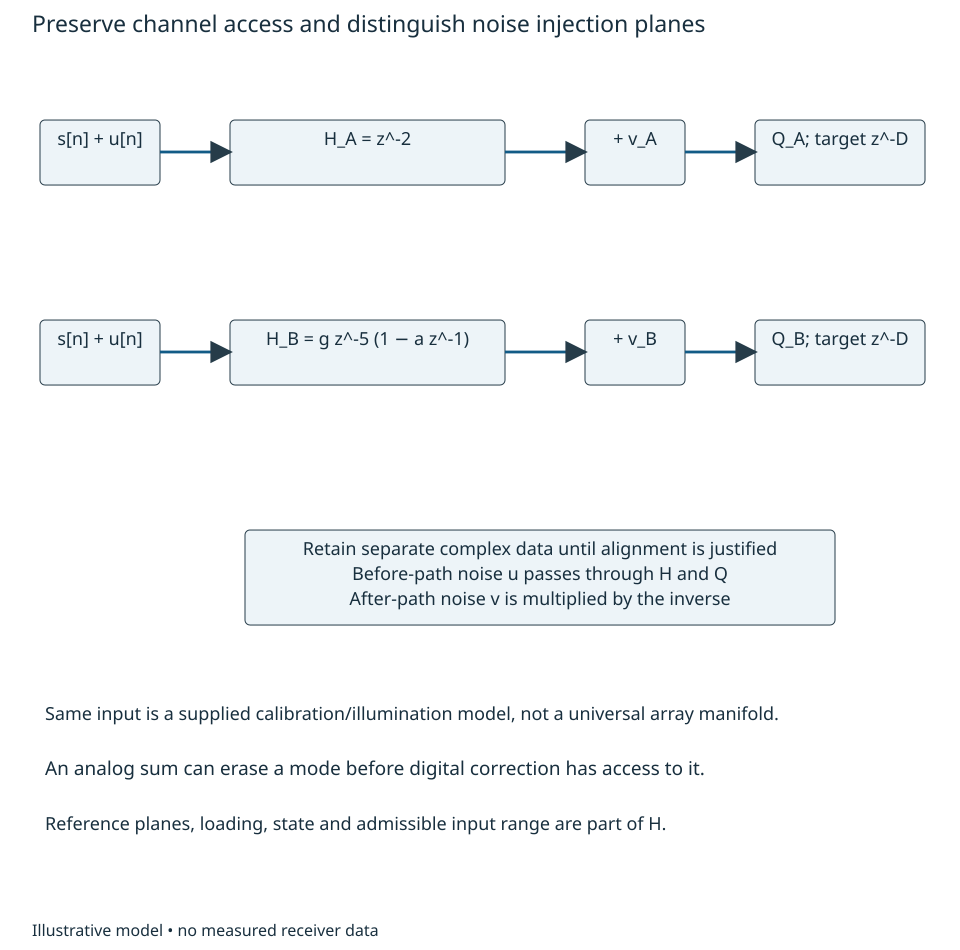
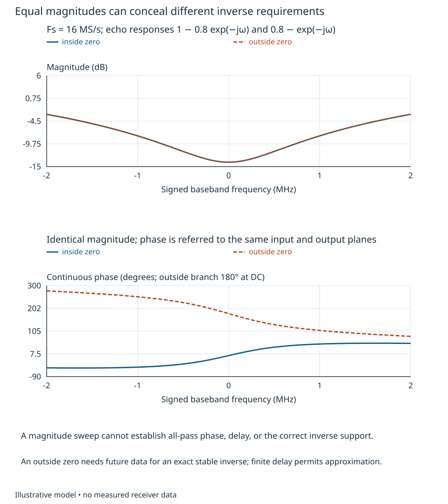
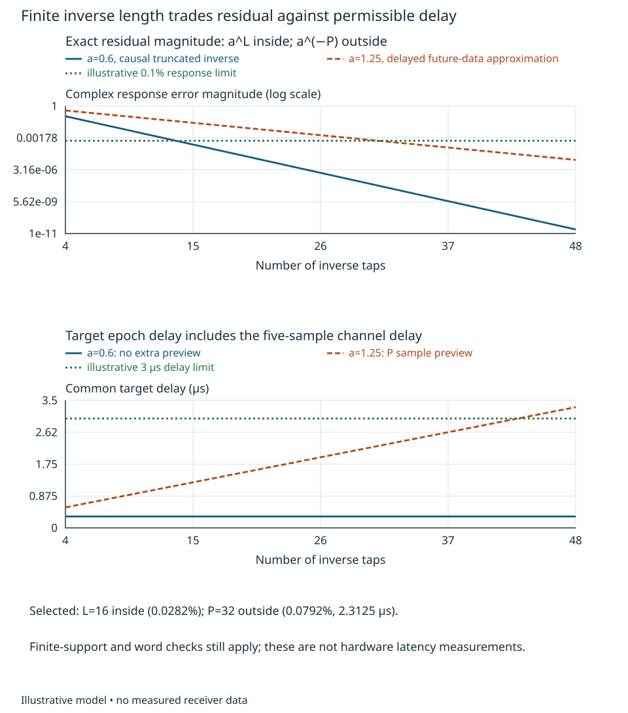
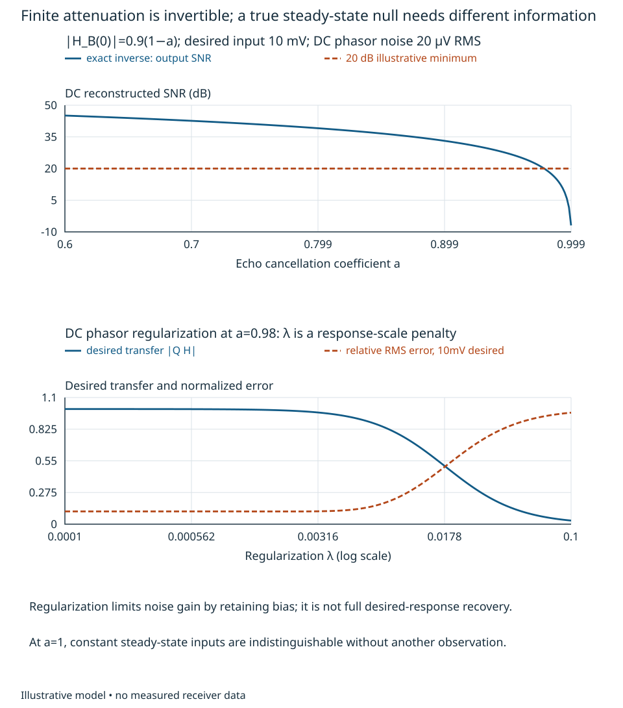

# Complex-response alignment and feasible correction {#sec-response-alignment}

Two receivers can have accurately known amplitude and phase responses and still
be impossible to align within the allowed noise, range and latency. Our question
is **which response can an engineer actually deliver before combining channels?**
The observable is the complex response of each corrected channel relative to a
common, explicitly delayed input envelope. A useful result states both its
remaining mismatch and its noise and implementation costs.

Chapters 4, 6, 11 and 12 supply conditioning, error propagation, transfer signs
and allocations. We develop the necessary inverse-systems bridge here. Analog
matching remains an option; the sampled examples additionally use Chapter 19.
Calibration access and coefficient validity are conditions, not consequences of
an algebraic inverse. All numerical envelopes below are illustrative; no device
response, FPGA timing or physical alignment has been measured.

## Specify the common response before dividing

At fixed loading, gain, temperature and reference state, write two complex
baseband outputs as $Y_i(f)=H_i(f)S(f)+V_i(f)$, $i=A,B$. The input envelope has
Chapter 1's peak-voltage scaling and a known common input plane. Frequencies are
signed offsets from the declared carrier; original RF conversion orientation
has already been preserved. The common-input model describes this calibration
or illumination case, not an arbitrary array manifold. Different fields or
polarizations require Chapter 8's input model.

Choose a target $T(f)$ and correction $Q_i(f)$, then inspect

$$
 E_i(f)=Q_i(f)H_i(f)-T(f). \tag{20.1}
$$

For a common delay $T=e^{-j2\pi f\tau_D}$, a tone's normalized error is
$R_i=Q_iH_i/T-1$. If $|R_i|\le\epsilon<1$, the corrected gain lies between
$1-\epsilon$ and $1+\epsilon$, and its phase displacement is at most
$\arcsin\epsilon$. This is the phasor geometry already used in Chapter 12.
For modulation, use a waveform norm and specify occupied bandwidth; instantaneous
phase near an envelope zero has no such guarantee. If every occupied spectral
component has the same error bound, Parseval's relation bounds the full-record
energy error for the corresponding complete LTI signals. Truncated observation
windows and missing prehistory need their own treatment.

A relative gain, phase or delay trim only represents restricted forms of
$H_B/H_A$. Dispersion means that phase slope changes with frequency. Fitting a
straight line through a few phase points does not establish that curvature is
absent. Conversely, targeting the healthier channel need not require a perfectly
flat response. Delaying the faster path or intentionally retaining a common
band limit can avoid a large inverse gain. Specify whether the task needs a
flat input-referred waveform, a matched pair, or only one weighted combination.

{#fig-alignment-access fig-alt="Two parallel receiver paths carry a common supplied envelope through different responses and post-path noise additions into separate correction filters. Annotations distinguish pre-path noise from noise added after attenuation and identify the risk of combining too early."}

For example, with pre-path disturbance $U$ and post-path disturbance $V$,
$Y=H(S+U)+V$ becomes $QHS+QHU+QV$. An exact inverse would restore $U$ along with
$S$ and multiply $V$ by $1/H$. It cannot restore SNR already degraded by the
post-path noise. For a channel vector, Chapter 4 gives $C_{\rm out}=Q C_{\rm in}Q^H$;
shared physical sources and correlated receiver noise must retain their cross
terms. Calling every amplified disturbance independent white noise is unjustified.

## A stable inverse may need information from the future

A sampled delay by one interval is denoted $z^{-1}$; on a tone,
$z=e^{j\omega}$ with $\omega=2\pi f/F_s$. A polynomial in $z^{-1}$ specifies
ordinary causal delayed samples. For an LTI filter, absolute summability of its
impulse response bounds the output to every bounded input. This is bounded-input,
bounded-output stability. A finite impulse response is stable, but an arbitrarily
large coefficient sum may still violate range or noise requirements.

Consider the echo difference

$$
 H_0(z)=1-a z^{-1},\qquad a>0. \tag{20.2}
$$

It has a zero at $z=a$. Solving $x[n]=y[n]-a y[n-1]$ recursively gives
$y[n]=x[n]+a y[n-1]$. For $a<1$, the causal inverse is the convergent geometric
series $\sum_{k\ge0}a^kz^{-k}$. For $a>1$, that recursion grows rather than
forgets its initial error. The same rational expression instead has the stable
future-data expansion

$$
 {1\over1-a z^{-1}}=-\sum_{j\ge1}a^{-j}z^j,\qquad a>1. \tag{20.3}
$$

Substitution and cancellation verify both series in their respective domains.
The latter uses $x[n+1],x[n+2],\ldots$; it is not an exact real-time causal
implementation. A finite delay cannot make an infinite future requirement exact.

For rational discrete-time systems, a causal stable response with a causal stable
inverse has its poles and zeros strictly inside the unit circle, after treating
explicit delay factors appropriately. This minimum-phase distinction and the
need to specify convergence are developed in Oppenheim and Verghese, sections
2.4.2 and 3.3.2 [@oppenheimVergheseSystems2010]. Minimum phase does not promise
small coefficients, acceptable noise or sufficient known bandwidth. A pure delay
has unit magnitude but its inverse advances time. In continuous time even a
minimum-phase $H(s)=1/(1+s\tau)$ has a formal inverse $1+s\tau$ with unbounded
high-frequency gain: properness and physical bandwidth still matter.

As a misleading alternative, infer phase and correction support from a magnitude
sweep alone. The two responses $1-0.8z^{-1}$ and $0.8-z^{-1}$ have exactly the
same squared magnitude $1.64-1.6\cos\omega$. Their zeros lie at 0.8 and 1.25,
and their phase and inverse support differ. Additional all-pass response or pure
delay creates further ambiguity. Figure @fig-alignment-phase-access shows the
phase distinction at $F_s=16$ MS/s and the same planes; the outside-zero phase uses a continuous
branch through 180° at DC.

{#fig-alignment-phase-access fig-alt="Two equal-magnitude echo responses are plotted across minus two to plus two MHz. Their continuous phase responses differ because one zero is inside and one outside the unit circle. The outside-zero phase branch passes through one hundred eighty degrees at DC."}

## Trade a finite approximation against delay and noise

At $F_s=16$ MS/s, use supplied complex responses

$$
 H_A=z^{-2},\qquad H_B=g z^{-5}(1-a z^{-1}),\qquad
 g=0.9e^{j0.08}. \tag{20.4}
$$

These are loaded small-signal models; their gain, delay and echo values are not
component guarantees. First let $a=0.6$. A length-$L$ correction and common target
are

$$
 Q_B={1\over g}\sum_{k=0}^{L-1}a^kz^{-k},\qquad
 Q_A=z^{-3},\qquad T=z^{-5}. \tag{20.5}
$$

Multiplying the geometric sum gives $Q_BH_B=z^{-5}(1-a^Lz^{-L})$.
The complex response error therefore has magnitude $a^L$ at **every** frequency.
Its phase depends on frequency even though this magnitude is constant. This is
an exact finite-polynomial statement, not a dense-grid guess.

For $a=1.25$, truncate (20.3) to $P$ terms and wait $P$ samples:

$$
 \begin{aligned}
 Q_B&=-{1\over g}\sum_{j=1}^{P}a^{-j}z^{j-P},&
 Q_A&=z^{-(3+P)},\\
 T&=z^{-(5+P)},&
 Q_BH_B&=z^{-5}(z^{-P}-a^{-P}).
 \end{aligned} \tag{20.6}
$$

All powers in $Q_B$ are now nonpositive: this finite filter is causal. Its
residual is an early echo of amplitude $a^{-P}$ relative to the target, rather
than the late echo of (20.5). It approximates a future-data inverse at a declared
latency; it does not turn the exact inverse into a causal stable system.

Supply a 0.1% maximum complex-response error and a 3 μs common target-delay limit.
$L=16$ gives $0.6^{16}=0.000282111$, or **0.0282111%**, with target delay
$5/F_s=0.3125$ μs. $P=32$ gives $1.25^{-32}=0.000792282$, or **0.0792282%**,
with target delay $37/F_s=2.3125$ μs. Both pass these two model criteria.
A 16-tap causal recursion-style approximation for the outside zero fails: its
error is $1.25^{16}$, not $1.25^{-16}$. These choices are conditional candidates,
not optimal hardware designs.

{#fig-alignment-latency-residual fig-alt="Residual magnitude on a logarithmic scale decreases with inverse length for two echo cases. A second plot shows a fixed five-sample target delay for the inside-zero case and increasing preview delay for the outside-zero case, compared with illustrative response and delay limits."}

For independent complex white noise $v[n]$ added **after** $H_B$, define its
RMS by $E|v|^2=\sigma_v^2$. A finite filter has output variance
$\sigma_v^2\sum_k|q_k|^2$; expanding the double sum makes the independence
assumption explicit. The selected coefficient energies are **1.92901219** and
**2.19478600**, respectively. Thus a supplied 20 μV complex-RMS post-path noise
becomes **27.7778 μV** and **29.6296 μV**. A colored input needs its complete
covariance or spectrum. Pre-path noise and shared sources follow different
transfers and must not be charged as the same post-path term.

The corresponding absolute coefficient sums are **2.77699414** and **4.44092319**.
They bound internal response to an admitted complex input magnitude. If the
post-path input to this correction is bounded by 0.1 V, the output bounds are
about 0.278 and 0.445 V before rounding, compatible with the supplied 24-bit,
21-fractional-bit $[-4,4)$ V component interface. That does not admit arbitrary
full-range input words. The actual component must provide peak/noise/transient
bounds, and intermediate products must have adequate signed range.

For a concrete finite-word check, round each real and imaginary correction
coefficient to 20 fractional bits in signed 24-bit words. With length $N_q$,
$|\delta Q|\le N_q\sqrt2\,2^{-21}$, hence
$|\delta Q H_B|\le N_q\sqrt2\,2^{-21}\,0.9(1+a)$ over the full sampled band.
The resulting conservative extra response errors are approximately 0.00155%
and 0.00437%. The coefficient-only candidates retain the 0.1% criterion.
Input/output encoding, arithmetic and observation must also be checked; this
bound alone does not cover converter error or total receiver noise.

Four noiseless, coherent supplied response observations at 0.25, 0.75, 1.25 and
1.75 MHz fit the two complex coefficients in
$[H_B/H_A]e^{j3\omega}=c_0+c_1e^{-j\omega}$. Two distinct complex columns identify
$c_0=g$ and $a=-c_1/c_0$ under this model. A physical source, reference or fixture
may confound those quantities; Chapter 13 owns those freedoms. A fit is not
proof of that stimulus model.

Hold the fitted correction fixed. An executed independent waveform uses 4096
samples of 6, 3 and 1 mV complex tones at −1.625, +0.375 and +1.625 MHz, with
phases 0.2, −0.4 and 0.7 radians. Convolve the physical echo response and then the
finite correction. Evaluate only $n\ge5+N_q$, where every support is available;
compare against $s[n-D]$. The floating normalized record errors are **0.0282123%**
and **0.0792253%**. Quantize input and output to signed 24-bit/$F=21$ words,
coefficients as above, and use checked signed 64-bit/$F=41$ complex accumulation.
Nearest-even output rounding gives **0.0281945%** and **0.0804384%** error against
the synthetic desired target. The arithmetic-only differences from the floating
chains are **0.0049390%** and **0.0053629%**. No overflow occurs in these records.
Those distinctions prevent input encoding error from being renamed correction
error or physical noise. Exact code and operation rules accompany the example;
Chapter 19 supplies the more general finite-resource bridge.

Swept checks at both frequency signs, not used for fitting, verify the analytical
response identities. Changing $a$ by +0.03 while retaining the old correction
produces approximately **7.5261%** and **11.9113%** maximum errors among −2, 0
and +2 MHz. Successful fitting and the earlier held-out waveform therefore do
not authorize a changed state. Coefficient loading needs an identified application
sample, support validity, channel order and version; full transition causality
belongs to the reserved state-integration treatment in Chapter 21.

## Deep attenuation, true nulls and correction access

Change both the path to $a=0.98$ and the observation to a **single DC phasor**
measured with fixed bandwidth and weighting. Supply 20 μV complex-RMS additive
noise in that phasor observation, after the path; it is not the earlier total
white sample-noise RMS. Keep the same observation before and after correction.
At DC, $|H_B|=0.018$ and exact inversion requires gain
**55.5556**. A 10 mV desired component reaches the post-path plane as 0.18 mV;
20 μV RMS noise gives **19.0849 dB** SNR. Inversion produces the original 10 mV
along with 1.11111 mV noise: the SNR remains 19.0849 dB and fails an illustrative
20 dB criterion. Finite attenuation is not a rank-null, but a formally invertible
path may still be unacceptable. A length-16 version would leave $0.98^{16}$,
about 72.38%, response error. More taps, lower post-path noise, physical prevention
or a changed target are different engineering choices.

For comparison, if 20 μV instead denotes white sample RMS, the infinite causal
inverse has output RMS $20\,\mu{\rm V}/[0.9\sqrt{1-0.98^2}]=111.671$ μV,
using the coefficient-energy calculation above. A constant reconstructed 10 mV
signal then has 39.0412 dB against the integrated output sample noise. These are
different observation operators and noise bandwidths; that case does not support
the preceding 20 dB rejection. Neither calculation establishes a measured noise floor.

A pointwise regularized alternative for the scalar phasor observation minimizes
$|H\widehat s-y|^2+\lambda^2|\widehat s|^2$ for dimensionless response $H$ and
penalty $\lambda$. Differentiating in the two real coordinates of $\widehat s$
gives

$$
 Q_\lambda={H^*\over |H|^2+\lambda^2},\quad
 Q_\lambda H={|H|^2\over |H|^2+\lambda^2}. \tag{20.7}
$$

For zero-mean additive phasor noise with $E|V|^2=\sigma_v^2$,
@fig-alignment-null-noise plots normalized RMS error
$r_\lambda=\sqrt{|Q_\lambda H-1|^2+|Q_\lambda|^2\sigma_v^2/|S|^2}$
against the fixed nonzero desired phasor $S$. A nonzero noise mean needs its
bias and cross term. Noise gain is capped at $1/(2\lambda)$, but desired response is biased towards
zero. At $|H|=0.018$, $\lambda=0.01$, the desired gain is 0.764151: a lower noise
output is not full signal recovery. This frequency-by-frequency expression is a
bias/noise benchmark; its sampled frequency values do not establish a causal,
finite-latency filter. A realizable filter needs the support and resource checks
just developed. Choosing a prior or penalty needs task information, not an
unexplained desire to make an inverse well-conditioned.

Rezac and colleagues' examined deconvolution paper, equations (3)–(7), explicitly
includes noise, response uncertainty and regularization bias under source and
kernel assumptions [@rezacDeconvolution2018]. Its examples are simulations; they
supply neither a universal receiver uncertainty bound nor a device guarantee.
Our complex covariance orientation remains Chapter 4's, rather than an imported
real-matrix convention.

{#fig-alignment-null-noise fig-alt="Reconstructed DC SNR falls as an echo coefficient approaches one. A second plot compares desired transfer and relative RMS error under pointwise regularization for a deep but nonzero response, showing bias rather than complete recovery."}

At $a=1$, an everlasting constant input produces zero steady-state echo-difference
output. Different constant amplitudes are indistinguishable at that output.
There is no bounded full-band inverse that restores the required DC component.
A known startup boundary can provide extra transient information; it is excluded
from this steady-state statement. A zero at one frequency does not mean that
every arbitrary finite-energy waveform has vanished: the inverse may instead
be unbounded near that frequency, and a task restricted away from it can differ.
Clipping and aliasing also identify distinct inputs without additional information;
no linear equalizer reverses those identifications.

Correction access matters just as much. If analog combination gives
$Y_\Sigma=Y_A+Y_B$ with $H_A=-H_B$ at a required frequency, that common signal
vanishes even though the separate outputs were nonzero. Unknown independent
channel inputs are still more restrictive: one sum cannot reconstruct two
arbitrary complex inputs. Chapter 4's rank test applies before irreversible
combination. Digitizing separate channels, preventing the cancellation, reducing
post-path noise, retaining a known reference channel, or changing the required
band are defensible alternatives only when their interfaces and task permit them.

For actual selection, measure complex response over both frequency signs, levels,
loads, temperatures and required states at the declared planes. Record stimulus
purity and reference uncertainty; obtain pre/post-path noise spectra and cross
terms, impulse tails, coefficient range/resolution, update behavior and actual
causal implementation timing. Assess held-out responses before applying array
weights or combining. Analog matching can reduce the required inverse gain;
its insertion loss, drift and adjustment range need the same scrutiny. The
calibration procedure is developed separately in Chapter 23; this treatment
establishes bounded feasibility and its failure cases.

For transfer, keep the deep attenuation but move the dominant noise from after
the echo path to before it. Recalculate input-referred error and explain which
benefit is genuine. Then move the echo delay from one to four samples and allow
only 1 μs target latency. Construct the revised causal/delayed supports and decide
whether prevention, approximate correction, a changed band or more access is
necessary. Finally make the desired DC unknown and remove the startup record:
identify what a second observation must add before claiming recovery.
