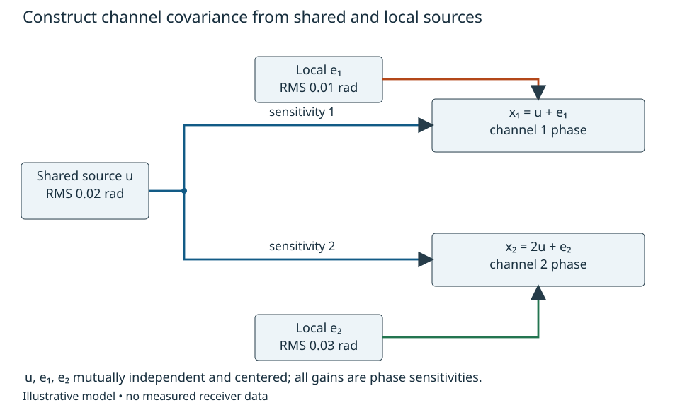
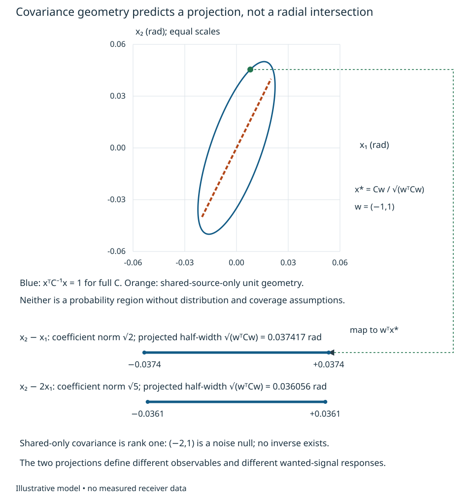
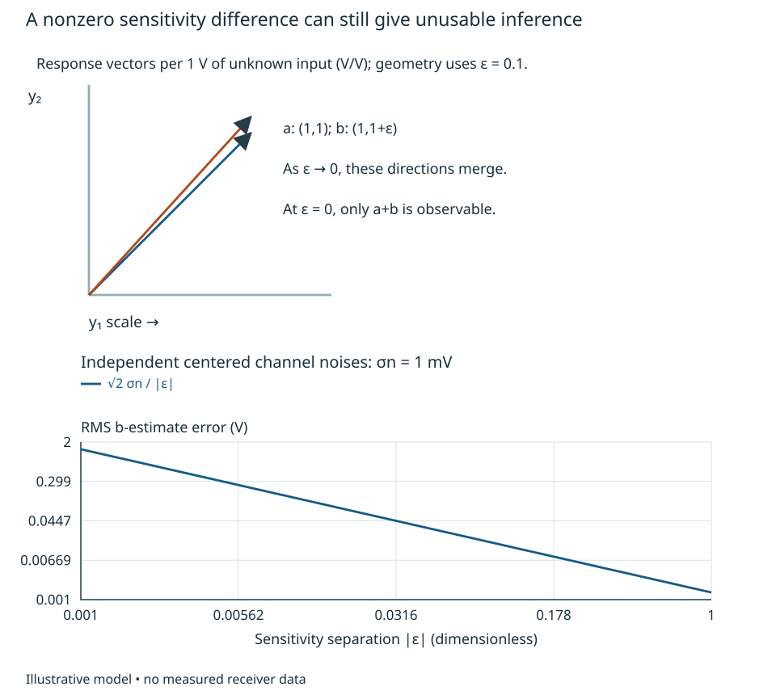

# Coupled errors, covariance and quadratic forms {#sec-covariance-forms}

Two receiver channels rarely have completely separate error sources. A reference
can enter both paths with different gains, while local electronics contribute
additional disturbances. A scalar variance for each channel loses the relationship
needed to predict a difference or a weighted combination. We will build that
relationship from declared source paths, then ask which combinations are quiet,
which are blind, and which are sensitive to small errors.

Use the scalar and complex definitions in
[Random signals and complex phase](scalar-stochastic-phase.qmd). The motivating
phase measurements retain the output planes and channel-2-relative-to-1 orientation
of [the phase-comparison unit](phase-comparison.qmd). Phase perturbations here are
unwrapped, small enough for the stated linear response, conditioned on a fixed
operating and calibration state. These models are synthetic. They do not establish
antenna noise coupling, a direction-finding manifold or receiver compliance.

## A vector is an ordered set of observables

Write x=(x1,x2,...,xm)^T as a column. The superscript T transposes rows and columns;
H denotes conjugate transpose. Channel order, units and reference planes are part
of the definition. A matrix A maps source coordinates u to channel coordinates
x=Au: its entry A_ik is the contribution in channel i per unit of source k.
Matrix multiplication means summing those source contributions. Complex entries
represent quadrature response at a declared frequency; a real phase vector is a
special case. Adding or comparing coordinates with different units requires an
explicit dimensional mapping.

Let mu=E[x] and define the centered covariance

$$
 C=E[(x-\mu)(x-\mu)^H],\qquad C_{ij}=E[(x_i-\mu_i)(x_j-\mu_j)^*].
$$

Its diagonal entries are nonnegative variances. Reversing indices conjugates an
off-diagonal entry, so C=C^H: it is Hermitian. This extends scalar complex
covariance; pseudo-covariance P=E[(x-mu)(x-mu)^T] is also needed for a complete
second-order description of improper complex data. C alone is enough for the
variance of a complex linear combination considered below, but does not specify
every quadrature statistic or general non-Gaussian distribution.

Take a fixed deterministic weight vector w and output y=w^H x, where the components of w* specify the combining
coefficients. Multiplying out the centered output gives

$$
 E[|y-Ey|^2]=w^H Cw\geq0.
$$

This expression is called a quadratic form: each pair of coefficients weights
one covariance entry. Its nonnegativity for every w makes C positive semidefinite
(PSD). A matrix with positive diagonal entries can still fail this condition.
For example C=[[1,1.2],[1.2,1]] rad² predicts variance -0.4 rad² for w=(-1,1)^T.
No real random vector can have that covariance. More generally, applying the
scalar Cauchy–Schwarz inequality to centered channels gives
|C_ij|² <= C_ii C_jj. Pairwise bounds are necessary but not sufficient for larger
matrices; the full quadratic form must remain nonnegative.

## Build covariance from sources rather than choosing correlations

For centered source vector u with covariance Q and deterministic response A,
expand the outer product:

$$
 C=E[Au u^H A^H]=AQA^H.
$$

Independent sources with finite variances have diagonal Q. Correlated sources
require off-diagonal entries justified by their joint model. A passive network,
shared supply or coupled noise source cannot be declared independent merely
because its channels have different names. The complex linear-transformation
construction is supported by Gallager, Chapter 7, equations (7.72)–(7.74)
([MIT text](https://ocw.mit.edu/courses/6-450-principles-of-digital-communications-i-fall-2006/49163236e20779bae41639ff9dec1ac4_book_7.pdf));
the expansion here applies to finite second moments without requiring Gaussianity.
Detailed physical noise-network construction remains in its later canonical home.

For a worked phase example, let

$$
 x_1=u+e_1,\qquad x_2=2u+e_2,
$$

where u, e1 and e2 are mutually independent centered phase sources. Their RMS
values are 0.02, 0.01 and 0.03 rad. The coefficient 2 is a declared effective
linearized phase-path sensitivity, not an unexplained oscillator voltage gain.
Thus

$$
 A=\begin{pmatrix}1&1&0\\2&0&1\end{pmatrix},\quad
 Q=\operatorname{diag}(0.0004,0.0001,0.0009)\ {\rm rad}^2,
 \quad
 C=\begin{pmatrix}0.0005&0.0008\\0.0008&0.0025\end{pmatrix}\ {\rm rad}^2.
$$

For channel 2 minus channel 1, w=(-1,1)^T, so w^T Cw=0.0014 rad², or
0.037417 rad RMS. The direct source expression u+e2-e1 gives the same variance.
Adding diagonal entries alone gives 0.003 rad²; the cross term subtracts
0.0016 rad². Calling the reference shared and deleting it entirely would instead
give 0.001 rad² and understate the result. Sharing and cancellation are different
claims. If an illustrative requirement is 0.035 rad RMS, the declared difference
fails even though deleting the shared source would suggest success.

Now consider y=x2-2x1. The shared source cancels, leaving e2-2e1 with variance
0.0013 rad². That is a different observable: a wanted signal common to both
channels no longer has the same response. Quiet weights are useful only together
with the wanted-signal response and calibration access. In an array, x might
instead contain voltages and a direction-dependent manifold a(theta). Then the
wanted response is w^H a(theta); a noise-null direction can also null the wanted
field. This is a motivating interface, not an array sensitivity or DF ambiguity
solution. Those require the application's physical manifold and evidence.

The paths in @fig-source-covariance generate the off-diagonal covariance: both channels contain the same draw of u. Their difference retains u because its path sensitivities differ. A shared source is therefore neither two independent sources nor an automatically cancelled term.

{#fig-source-covariance fig-alt="A shared phase source branches with sensitivities one and two into two channels, while independent local errors enter their own channels."}

## Null directions, coordinates and what rank means

If only u is present, C=0.0004 aa^T with a=(1,2)^T. The vector (-2,1)^T is a
null direction because its inner product with a is zero. A covariance null means
that this combination of centered fluctuations is zero in mean square; it says
nothing about a deterministic bias in the same combination. Adding e1 and e2
removes this exact noise null. Positive definite means w^H Cw>0 for every nonzero
w; semidefinite permits null directions.

An eigenvector v satisfies Cv=lambda v: covariance scales that direction without
turning it. For Hermitian C, orthogonal eigenvectors can be chosen and eigenvalues
are real. Expanding w in that orthonormal basis gives w^H Cw=sum lambda_i |alpha_i|².
Thus PSD corresponds to nonnegative eigenvalues. This explains why a negative
eigenvalue is a model or numerical alarm rather than a negative physical noise
power. A tiny negative numerical value needs a rounding/conditioning assessment,
not automatic clipping of an arbitrary physical model.

For the full example the eigenvalues are approximately 0.002780625 and
0.000219375 rad², both positive. The determinant is 0.00000061 rad^4. These checks
support algebraic consistency of the declared model, not the source values or
hardware applicability.

Rank is the number of independent directions in a matrix's range. A linear
mapping with m input coordinates and rank r has m-r independent null directions:
those input changes produce zero output. A square nonsingular matrix has full
rank and an inverse, so it loses no coordinate direction. A change of coordinates
x'=Tx gives C'=TCT^H. If T is nonsingular it preserves
rank and physical combinations. Here T^{-H} means (T^H)^{-1}, the inverse
of the conjugate transpose. The weight w'=T^{-H}w gives w'^H x'=w^H x. A real example
is the common coordinate (x1+x2)/2 together with the difference x2-x1. Scaling
units changes eigenvalues and numerical conditioning. Comparing eigenvalues across
mixed-unit coordinates without declaring a scale has no invariant engineering
meaning. Subtracting a reference is a measurement mapping; if it discards a common
mode, T is singular and information has been removed.

The equal-scale geometry in @fig-covariance-projections distinguishes a covariance ellipse from a probability region. For w=(-1,1), the marked support point maximizes w-transpose-x on the unit ellipse; its mapped value is the projected half-width, not the radius where a line in direction w intersects the ellipse. The shared-only limit degenerates to a line, so an inverse-ellipse equation cannot describe it. The two scalar projections use different coefficient norms and retain different wanted signals.

{#fig-covariance-projections fig-alt="A full covariance ellipse and rank-one line share equal radian axes; a marked support point maps to the channel-difference projection, whose half-width is the square root of its quadratic-form variance."}

## Invertibility is not reliable inference

Consider two voltage observations y1=a+b+n1 and y2=a+(1+epsilon)b+n2. The source
coordinates a,b are unknown voltages; epsilon is a known dimensionless sensitivity
difference. The response matrix is invertible for every nonzero epsilon, but

$$
 \widehat b={y_2-y_1\over\epsilon}
 =b+{n_2-n_1\over\epsilon}.
$$

Centered independent channel noises each of variance sigma_n² (and hence RMS
sigma_n) therefore produce b-estimate RMS error
sqrt(2) sigma_n/|epsilon|. With sigma_n=1 mV, epsilon=0.01 gives about 0.141421 V;
epsilon=0.001 gives about 1.41421 V. If the channel noises instead have means mu1 and mu2, the mean-square error is
[var(n1)+var(n2)+(mu2-mu1)²]/epsilon². Equal common biases cancel, while differential
bias is amplified. Independence alone does not justify treating RMS as standard
deviation. Invertibility alone gives no useful accuracy
guarantee. At epsilon=0, only a+b is observable. Calibration error in epsilon can
also dominate; arithmetic precision cannot repair missing physical sensitivity.

Singular values describe this response geometry: s_i=sqrt(lambda_i(A^H A)).
The forward gain along the corresponding unit input direction is s_i, and the
inverse gain for a nonzero mode is 1/s_i. For A=diag(4,1), these forward gains
are 4 and 1, not 2 and 1.
A small singular value means large inverse amplification in that direction, under
the declared input/output scales. The ratio of largest to smallest is a norm-based
condition number when full rank. Covariance eigenmodes describe error geometry;
response singular modes describe distinguishability. These are related tools, not
interchangeable claims about observability. Least squares, inferential meaning,
constraints and regularization need their later bounded developments. Adding a
constraint supplies information or bias; it does not create new measurements.

For transfer, change only the common phase sensitivity from 2 to 1. The difference
now rejects u, while x2-2x1 does not. Rebuild A before calculating C or choosing
weights. Then change the wanted-signal manifold while holding C fixed: the quietest
combination may cease to be useful. A receiver budget needs both the physical
response and its evidence, not merely a positive covariance matrix.

As the response directions merge in @fig-inverse-conditioning, the inverse must amplify their small difference. The lower panel quantifies that penalty under the centered independent-noise model. Numerical invertibility cannot supply the missing physical sensitivity.

{#fig-inverse-conditioning fig-alt="Two nearly parallel response vectors become indistinguishable as sensitivity separation vanishes; inverse estimate RMS grows as one over the separation."}
