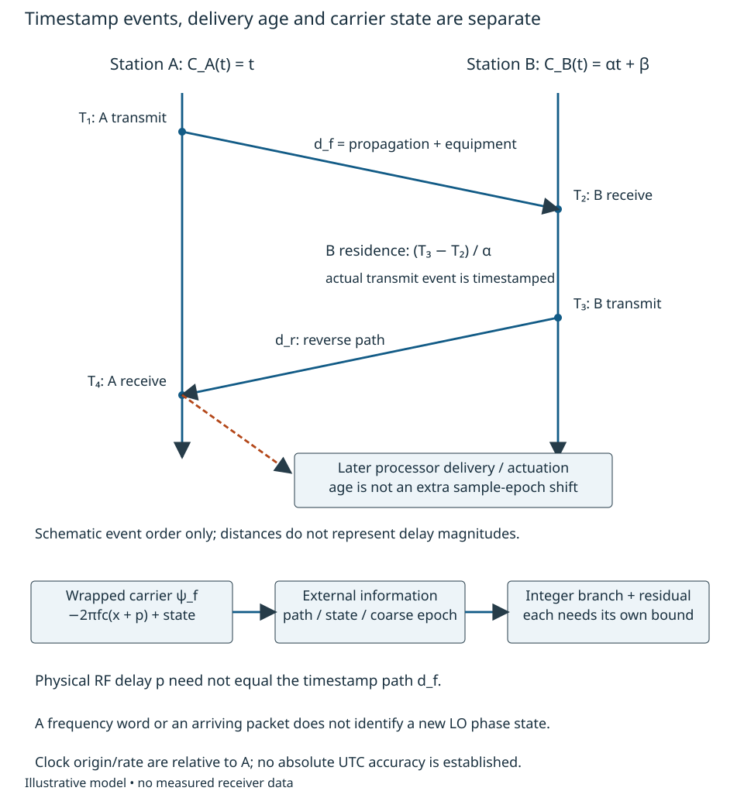
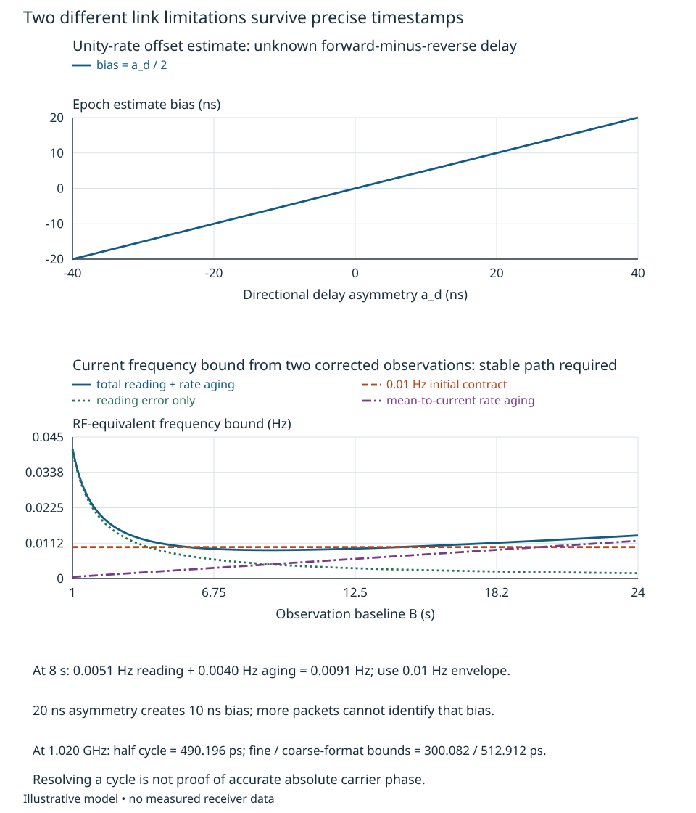
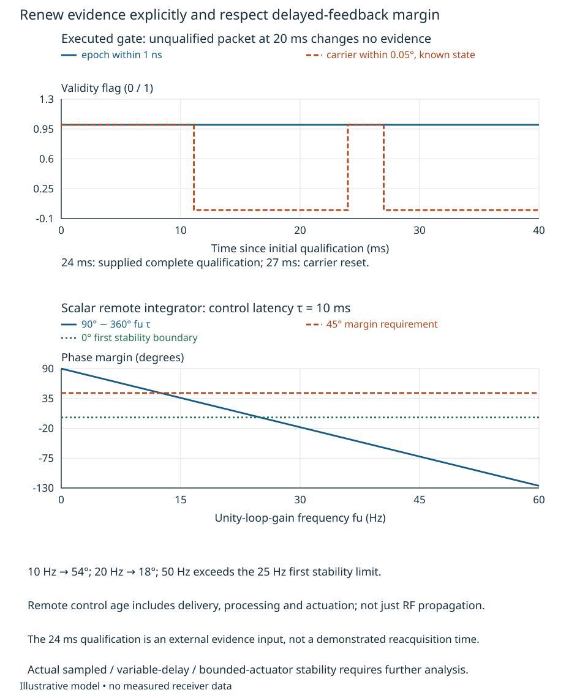

# Distributed timing and carrier-reference inference {#sec-distributed-reference}

Two remote receivers can agree on frequency and still disagree on which instant,
which carrier cycle, or which oscillator state their data represent. For a
bistatic version of the radar path, or an interferometer comparing separated
stations, the engineering question is: **what remote relationship has actually
been established, and how long does its evidence remain valid after the link
fails?** A packet arriving on time is not that relationship.

We will construct clock/link observations, expose their unresolved freedoms, and
execute a bounded alignment and recovery rule. The reader should be able to
calculate asymmetry bias, distinguish epoch/rate/carrier residuals, choose an
observation baseline and control bandwidth, and identify the additional
calibration needed to restore valid data. [Chapter 5](phase-delay-inference.qmd)
owns general identifiability; [Chapter 7](tracking-signal-retention.qmd) owns local
tracking. Here those ideas acquire remote clock and link reference planes.
All numerical envelopes are illustrative. No timing protocol, oscillator,
timestamp circuit or physical link is qualified by this example.

## Write the clocks at the events being observed

Choose station A's clock as the coordinate $t$ in seconds over this bounded
interval: $C_A(t)=t$. This fixes a reference freedom; it does not prove that A is
an ideal realization of UTC. Write B's reading as $C_B(t)=t+x(t)$, where positive
time error $x$ means an advance, consistent with Chapter 1. Its fractional rate
error is $y=\dot x$ (seconds per second), and its rate drift is $\dot y$ in
$\mathrm{s}^{-1}$. Locally,

$$
 x(t_0+a)=x_0+y_0a+\tfrac12\dot y_0a^2
$$

is exact for constant drift and otherwise a bounded approximation requiring a
remainder or derivative bound. Relative clock information alone cannot determine
an absolute time origin or prove A's rate.

Place timestamp planes at the transmit/receive event interfaces, not at software
receipt of a notification. Let $d_f$ be the effective forward delay from A's
transmit timestamp event to B's receive timestamp event; $d_r$ is its reverse
counterpart. Each includes the directional propagation and the equipment delays
between those planes: for example, $d_f=p_f+\ell_{A,\mathrm{tx}}+
\ell_{B,\mathrm{rx}}$. Cable, modulation/detection, queue and trigger delays belong
where the actual timestamp hardware places them. Known corrections can be
subtracted; unknown residuals remain in $d_f,d_r$ or the timestamp error.

For A transmit reading $T_1$, B receive $T_2$, B reply transmit $T_3$ and A final
receive $T_4$, an affine B clock $C_B(t)=\alpha t+\beta$ gives the exact noiseless
event equations

$$
 T_2=\alpha(T_1+d_f)+\beta,\qquad
 T_3=\alpha(T_4-d_r)+\beta. \tag{16.1}
$$

Here $\alpha=1+y>0$ is dimensionless and $\beta$ is seconds at the chosen origin.
B's turnaround $T_3-T_2$ is measured in B seconds; its duration in A seconds is
$(T_3-T_2)/\alpha$. An arbitrary turnaround cancels when the actual transmit event
is timestamped. An unmeasured delay between that event and the RF connector does
not cancel. Add actual timestamp errors to (16.1) before constructing uncertainty;
their correlations can include a shared counter, supply, detector or clock.
Chapter 4's physical source/path method applies, rather than automatically
assigning independent errors to four readings.

With $\alpha$ established and directional delays constant during the observation,
define $r_f=T_2-\alpha T_1$ and $r_r=T_3-\alpha T_4$. Then

$$
 \widehat\beta_{\mathrm{sym}}={r_f+r_r\over2}
     =\beta+{\alpha(d_f-d_r)\over2},\qquad
 \widehat d_{\mathrm{mean}}={r_f-r_r\over2\alpha}
     ={d_f+d_r\over2}. \tag{16.2}
$$

The familiar four-timestamp expressions follow for $\alpha=1$.
[RFC 5905 §8](https://www.rfc-editor.org/rfc/rfc5905.html#section-8)
defines those offset and round-trip calculations; its §6 specifies a timestamp
with 32 fractional bits [@rfc5905]. We derive (16.1)–(16.2) in our orientation to
retain rate and asymmetry. This use of timestamp algebra does not adopt an NTP
implementation or its accuracy.

{#fig-remote-event-planes fig-alt="Two vertical station clocks show A transmit T1, B receive T2, B transmit T3 and A receive T4 with directed forward and reverse paths. B turnaround and later transport to a processor are distinct. A second chain shows a wrapped carrier observation requiring path, equipment state and integer-cycle information."}

For a numerical event check, supply $\alpha=1+2\times10^{-8}$, $\beta=80$ ns,
$d_f=5.010$ μs and $d_r=4.990$ μs. With $T_1=0$ and B turnaround 2 ms,
$T_2=5.0900001002$ μs, $T_3=2005.0900001002$ μs and
$T_4=2009.9999600000$ μs. Equation (16.2) gives
$\widehat\beta_{\mathrm{sym}}=90.0000002$ ns and mean delay 5 μs.
The raw unity-rate four-timestamp estimate is instead 90.0201002 ns; it describes
neither the origin intercept nor a clock that stayed at 80 ns during the exchange.
Use the affine correction, or evaluate a time-varying offset at an explicit
epoch, rather than hiding the turnaround's rate contribution.

## Determine what the link cannot identify

The transformations

$$
 \beta'=\beta+\alpha\kappa,\qquad
 d_f'=d_f-\kappa,\qquad d_r'=d_r+\kappa \tag{16.3}
$$

leave every observation in (16.1) unchanged. Positive physical delays restrict
$\kappa$ but do not select it. For $\alpha=1$, the two cases
$(\beta,d_f,d_r)=(80\ \mathrm{ns},5010\ \mathrm{ns},4990\ \mathrm{ns})$ and
$(90\ \mathrm{ns},5000\ \mathrm{ns},5000\ \mathrm{ns})$ give exactly the same
$r_f=5090$ ns and $r_r=-4910$ ns. Averaging more exchanges cannot distinguish them.
The misleading alternative is to call the stable 90 ns estimate a verified
80 ns clock correction. A low residual scatter would only make this wrong
interpretation look precise.

Write asymmetry $a_d=d_f-d_r$. If external calibration supplies
$\widehat a_d$, use $\widehat\beta=\widehat\beta_{\mathrm{sym}}-
\alpha\widehat a_d/2$. With known $\alpha$, an asymmetry uncertainty bound
$U_a$ contributes at most $\alpha U_a/2$ to intercept error, or $U_a/2$ to
the mapped A-time error $(C_B-\widehat\beta)/\alpha$. This is a bound, not an
independent Gaussian variance. Equipment drift, frequency-dependent propagation,
different routes and motion can all change $a_d$. NIST's
[two-way discussion](https://www.nist.gov/pml/time-and-frequency-division/time-distribution/two-way-satellite-time-and-frequency-transfer)
explicitly retains transmitter/receiver and propagation asymmetries in its
differenced result [@nistTwoWay]. Its simultaneous satellite example does not
guarantee reciprocity of our sequential terrestrial exchange.

Rate is also an inference. Repeated forward arrivals with constant $d_f$ give
$\alpha=(T_{2,j}-T_{2,i})/(T_{1,j}-T_{1,i})$ for an affine clock. A changing
forward delay can imitate a rate error. In the general model,
$T_2=T_1+d_f+x(T_1+d_f)$, so its slope includes $(1+\dot x)\dot d_f$ as well
as $\dot x$. NIST's
[one-way explanation](https://www.nist.gov/pml/time-and-frequency-division/time-services/one-way-gnss-time-transfer)
distinguishes knowing a delay from knowing its variation [@nistOneWay].
Precise frequency transfer can tolerate an unknown constant delay; accurate
epoch transfer cannot.

Consider an alignment contract after calibration: mapped epoch error at most
1 ns; residual frequency at the 1.020 GHz reference at most 0.01 Hz; and
unwrapped carrier-phase error at most 0.05° in a known state. These are separate
interfaces, not a declaration that Chapter 12's complete budget closes. Supply
$U_a=0.36$ ns and a combined timestamp/correction error bound 20 ps in A time.
The initial epoch bound is $180+20=200$ ps. The asymmetry evidence must cover
equipment, path, frequency and operating state; the numbers are not measured.

For rate qualification, suppose two corrected forward observations have total
error at most 20 ps each, the forward delay is constant over their baseline
$B$, and RF-equivalent frequency drift is bounded by
$D=0.001$ Hz/s. A secant slope estimates mean rate, whereas holdover needs the
rate at the last observation. Differencing the two errors and integrating the
drift bound gives

$$
 U_f(B)\le {f_c(40\ \mathrm{ps})\over B}+{DB\over2}
       ={0.0408\over B}+0.0005B\quad\mathrm{Hz}, \tag{16.4}
$$

with $B$ numerically in seconds and $f_c=1.020$ GHz. The second term follows because
the mean rate can differ from its endpoint by at most $DB/2$.
At 2, 8 and 20 s this is respectively 0.0214, 0.0091 and 0.01204 Hz.
Eight seconds meets the 0.01 Hz contract; merely lengthening a two-point
baseline eventually worsens the endpoint bound. Its minimum is about
0.009033 Hz at 9.033 s. A more informative drift fit is an alternative only with
additional observations and a defensible curvature/error model.

The rate observation and coarse offset must refer to a common final epoch.
Transport age after that epoch consumes the holdover bounds below. Twenty
picoseconds here is a supplied bound on the *complete corrected observation*,
including path uncertainty; it is not implied by counter resolution. If the
path cannot be held or independently bounded, (16.4) cannot qualify the rate.

{#fig-remote-asymmetry-rate fig-alt="One plot shows offset bias equal to half the forward-minus-reverse delay asymmetry. Another shows a U-shaped current frequency bound versus observation baseline, with separate reading and drift terms and a 0.01 hertz criterion. The eight second case passes only under the declared stable-path assumptions."}

### A carrier cycle adds precision and ambiguity

At a declared B carrier-comparison plane let A transmit phase be
$2\pi f_ct+\chi_A$, and B local phase be $2\pi f_c[t+x(t)]+\chi_B$.
For constant forward RF delay $p$ and a calibrated added receive phase
$\gamma$, received A minus local B is

$$
 \psi_f=\operatorname{wrap}\{-2\pi f_c[x(t)+p]+\chi_A-\chi_B+\gamma\}.
 \tag{16.5}
$$

This is a carrier observation, not necessarily the timestamp path $d_f$.
The physical delay is negative phase; a positive B clock advance also makes
received-minus-local phase more negative. Frequency conversion must first be
translated to this orientation using Chapter 11. Unknown oscillator/divider
state $\chi_A-\chi_B$ cannot be inferred from a frequency word or packet epoch.
Path motion contributes $-2\pi f_c\dot p$ to phase rate and can be confused with
clock rate. In a bistatic radar, cancelling it as clock error can suppress
desired Doppler; in interferometry, unknown geometry can become a false clock
estimate. Keep the physical observable from Chapters 8 and 10.

At 1.020 GHz, one cycle is 980.392157 ps. If state and added phase are known,
coarse epoch bound 200 ps, RF-path bound 100 ps and carrier reading bound 0.03°
(0.081699 ps) give a total 300.081699 ps, less than half a cycle
(490.196078 ps). This is a sufficient nearest-branch criterion; an integer
cycle can be selected if all bounds hold at the same event. It is **not**
a 0.05° absolute clock-phase result. Path uncertainty of 100 ps alone is
36.72°, while 0.05° corresponds to only 0.136166 ps. Further path/equipment
calibration or another identifiable phase observable is indispensable.
An unknown reset state can invalidate even the branch criterion.

Timestamp representation can change that decision. The RFC's 32-bit fractional
field has step $q_t=2^{-32}$ s = 232.830644 ps. If four readings are rounded to
nearest, each error is bounded by $q_t/2$; at unity rate their offset combination
has bound $q_t$. Replacing our 20 ps observation bound by this quantization
contribution alone gives $180+232.830644+100+0.081699=512.912343$ ps, greater
than half a carrier cycle, even before other error. The epoch criterion can
still pass while guaranteed cycle selection fails. Repeated quantization errors
need not be independent or average away. The small affine-rate adjustment does
not rescue this failing example.

Implementation must preserve the numerical information too. Binary64 numbers
near $1.7\times10^9$ seconds have spacing $2^{-22}$ s, about 238 ns. Converting
absolute seconds to that format before differencing would destroy a picosecond
alignment. Preserve integer/coarse-plus-fraction timestamps and form differences
before conversion to a centered numerical representation. This is an interface
obligation, not a choice of network protocol.

## Propagate evidence through outage and recovery

After a qualified epoch/rate correction, model residual RF frequency as
$\delta f(a)=\delta f_0+\int_0^a\dot{\delta f}(u)\,du$, where $a$ is elapsed
A time since the qualification. For $|\delta f_0|\le F$ and
$|\dot{\delta f}|\le D$, integrating once more gives separate conservative bounds

$$
 B_x(a)=X_0+{Fa+\tfrac12Da^2\over f_c},\qquad
 B_\phi(a)=\Phi_0+360Fa+180Da^2\quad\text{degrees}. \tag{16.6}
$$

The frequency bound is $F+Da$. $X_0$ is initial epoch error in seconds;
$\Phi_0$ is an initial phase error bound in degrees from an additional
qualified phase observation. The bounds do not imply independent errors.
They use the same qualified frequency evolution but different intercept evidence.
This example assumes a characterized ratio ties the carrier's residual rate to
the timing clock's rate. Independent oscillator drift or changing transfer-path
phase requires additional terms; it must not silently fall outside $F,D$.

Supply $X_0=200$ ps, $F=0.01$ Hz and $D=0.001$ Hz/s. **Separately** supply a
state/path-qualified carrier residual $\Phi_0=0.01^\circ$. The preceding
100 ps path example does not provide this phase qualification. It is a required
external evidence input covering the actual receiver reference planes and state.
In a maintained phase-transfer path its delay changes and equipment phase must
be bounded; in independent-clock estimation the additional phase/path observation
must resolve those unknowns. Shared transfer avoids neither branch disturbances
nor the need for a suitable witness, as Chapter 15 demonstrates.

Solving $B_\phi=0.05^\circ$ gives **11.104945 ms**; solving $B_x=1$ ns gives
**31.617304 s**. These are valid outage bounds for their respective observables
under the supplied envelopes, not interchangeable service-availability numbers.
The 0.01 Hz initial-rate specification by itself has no positive holdover
interval at that exact ceiling; during outage publish the growing bound
$F+Da$ (or supply a separate looser holdover-rate limit).
At 20 ms the epoch bound is 200.196275 ps, but the phase bound is 0.082072°.
Returning timing packets can refresh coarse epoch/rate evidence only after
their own delay/baseline tests pass. They do not by themselves restore RF phase.

{#fig-remote-holdover-bounds fig-alt="Two logarithmic plots show conservative unwrapped phase and epoch bounds versus elapsed outage time. Phase crosses 0.05 degree near 0.0111 second; epoch crosses one nanosecond near 31.6 seconds. Inputs include a separately qualified phase intercept, frequency and drift bounds."}

A bounded validity rule can now be executed. Store separately the epoch/rate
qualification epoch and carrier qualification epoch, their uncertainty envelopes,
and an identified carrier-state flag. Evaluate (16.6) using the age of the
corresponding evidence. Accept an epoch update only with a complete qualified
offset/rate result; accept a carrier update only with additional path/state
evidence and a current rate bound. An unqualified message changes neither age.
A reset clears the carrier-state flag. Reject carrier data whenever its phase
bound or state fails, even while continuing to deliver epoch-tagged records.
This gate marks evidence validity; it does not protect hardware or implement a
complete recovery sequence.

For an executed illustrative event trace, qualify both at 0, lose the link
immediately, receive an **unqualified** packet at 20 ms, obtain a complete new
epoch/rate/phase qualification at 24 ms, and reset the carrier at 27 ms.
Epoch remains within 1 ns throughout this 40 ms trace. Carrier validity ends at
11.104945 ms, resumes at 24 ms, and ends at the reset. The 24 ms event supplies
fresh external qualification; the eight-second rate baseline cannot be
reconstructed from four milliseconds of new packets. It would require retained
trustworthy observations, an independent frequency witness or another justified
bound. No fast hardware reacquisition is demonstrated.

### Delayed correction has a different bandwidth limit

An observation may describe a precisely timestamped past event yet arrive too
late for aggressive feedback. For the simplest remote proportional frequency
correction with aggregate control latency $\tau$, a small phase perturbation
satisfies $\dot e(t)=-k e(t-\tau)$, with $k$ in $\mathrm{s}^{-1}$.
Its open loop is $k e^{-s\tau}/s$, and the characteristic equation is
$s+k e^{-s\tau}=0$. At an imaginary-axis crossing $s=j\omega$,
$k\cos(\omega\tau)=0$ and $\omega-k\sin(\omega\tau)=0$; the first positive crossing
is $\omega=k$, $k\tau=\pi/2$. The scalar delay model is stable for
$0<k\tau<\pi/2$. Its unity-gain frequency $f_u=k/(2\pi)$ has phase margin
$90^\circ-360^\circ f_u\tau$; retaining 45° requires $k\tau\le\pi/4$.

For $\tau=10$ ms, stability requires $f_u<25$ Hz and 45° margin requires
$f_u\le12.5$ Hz. Ten hertz gives 54°; 20 Hz gives only 18°; 50 Hz lies beyond
the first stability boundary. The latency is total measurement delivery,
processing and actuation age in this ideal feedback model, not simply the 5 μs
propagation above and not the 2 ms reply residence. Sampled updates, variable
latency, additional poles, quantization, actuator bounds and fades require more
analysis. Chapter 15's local 20 kHz PLL is not an available bandwidth for this
remote controller. A buffered feedforward correction of recorded data is an
alternative; its data age and observability still matter.

{#fig-remote-recovery-control fig-alt="A validity timeline shows epoch evidence remaining valid while RF phase expires, an unqualified packet arrives at 20 milliseconds, complete qualification at 24 milliseconds restores RF validity, and a reset at 27 milliseconds invalidates it. A second plot shows phase margin falling from 90 degrees with bandwidth at ten millisecond control latency; 12.5 hertz gives 45 degrees and 25 hertz reaches the stability boundary."}

## Carry the result to receiver interfaces

An executable clock alignment maps a B timestamp to A time as
$\widehat t=(T_B-\widehat\beta)/\widehat\alpha$ for the affine interval. With
timestamp error $\nu_T$, its exact residual is
$$
 \widehat t-t={(\alpha-\widehat\alpha)t+\beta-\widehat\beta+\nu_T
                    \over\widehat\alpha}.
$$
Evaluate this at the event's specified origin/age, retaining parameter
correlations. Correcting B's local reference subtracts the estimated
$2\pi f_c x+\chi_B-\chi_A$ from its LO phase. Correcting the
**received-minus-local data** in (16.5) instead adds that same quantity.
Neither operation can remove an unidentified path or desired geometric phase by
calling it clock error. Path/state and conversion terms remain.
A physical frequency/phase actuator and a numerical correction need different
drive, range, continuity and reset evidence.

For sampled records, an event tag must identify the sample aperture at the
receiver reference plane. Packet arrival identifies delivery to a processor.
Buffering can change that delivery without moving the sample event; a clock
epoch correction does not automatically repair an unknown aperture offset,
missing sample, RF phase intercept or digital oscillator state.
The continuous equations above need no digital resampler. An actual resampling
realization adds Chapters 17/19's rate conversion, interpolation/filter error,
sample identity, fixed-point precision and state obligations.

Before choosing hardware, obtain directional equipment-delay calibration and
environment/load/state dependence, path/geometry and asymmetry uncertainty,
timestamp event placement/resolution, independent rate/drift envelopes, carrier
state/cycle evidence and actual latency distributions. A verification should
alter a directional delay, restart a reference, age a record through outage,
and compare an independent reference or changed path. Separate the witness's
uncertainty/correlation from the delivered residual. Chapter 13's complete
metrology treatment and Chapter 23's sequencing remain outside this bounded
method. The executed synthetic alignment/gate is evidence about the calculation,
not a completed calibration or demonstrated receiver.

For transfer, replace the stable forward path by an unknown delay increasing
1 ns/s. Calculate the apparent RF-equivalent rate contribution
(about 1.020 Hz), compare it with 0.01 Hz, and identify what extra path observation
would separate motion from clock rate. Then replace the fine timestamp interface
by the 32-fractional-bit field and reset B's LO without resetting its counter.
Decide separately which epoch, frequency, integer-cycle and carrier-intercept
claims survive. Finally double the control latency: recompute the 45° bandwidth
limit and explain why increasing loop gain cannot cure missing geometry or state
information.
