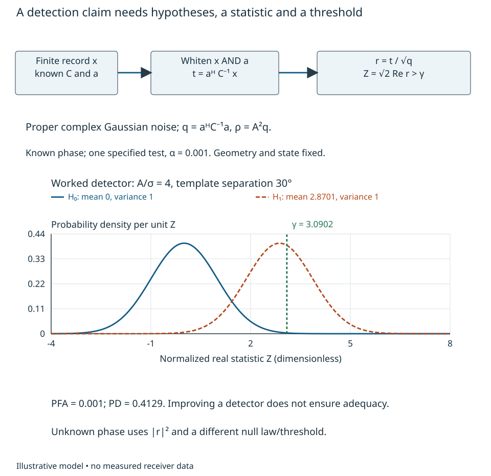
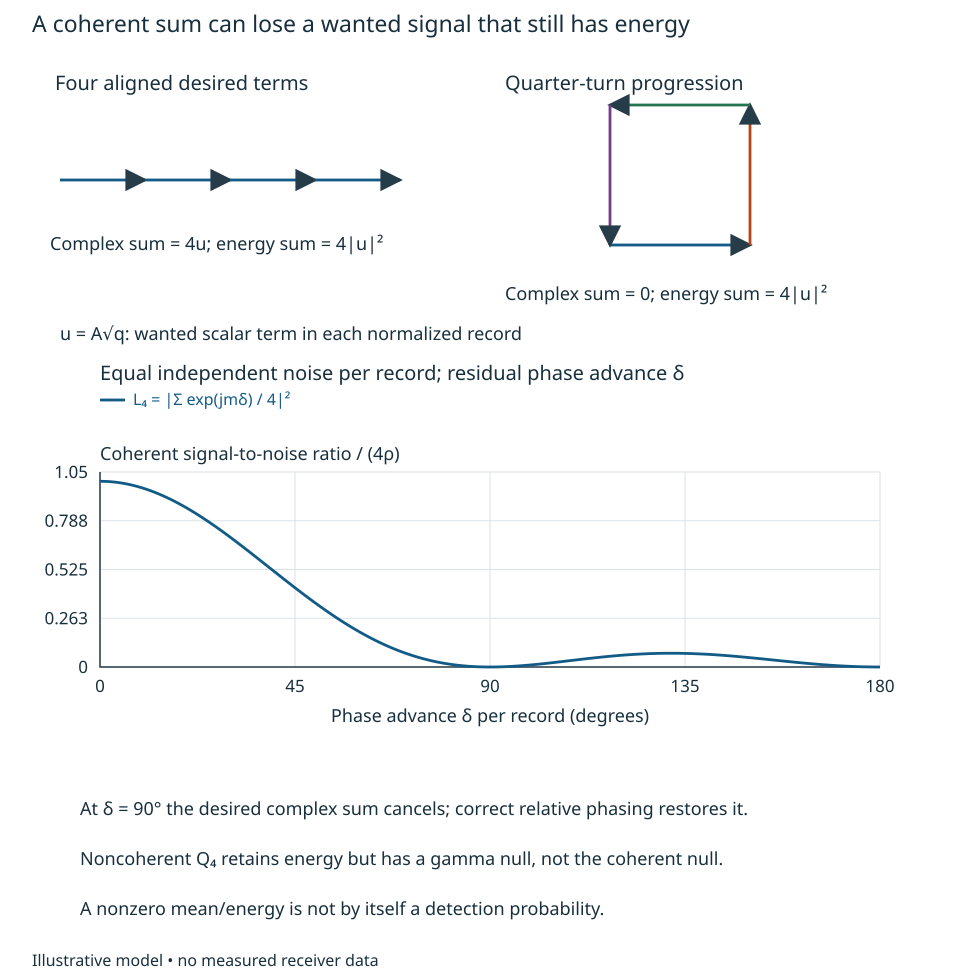
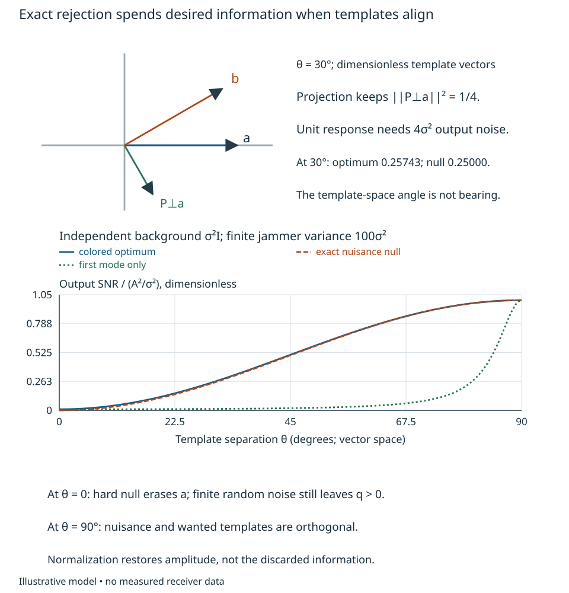
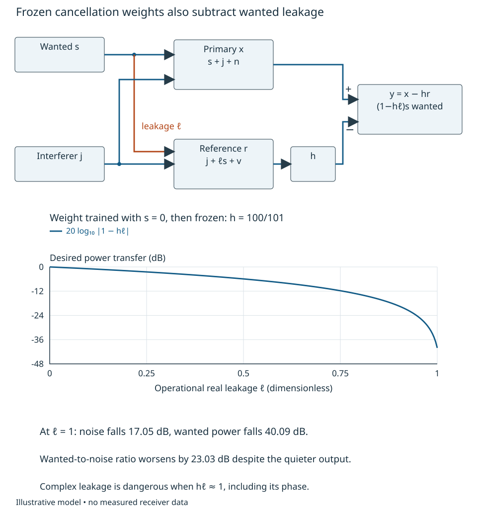

# Extraction, integration and rejection {#sec-extraction-rejection}

A cancellation operation makes the output quieter. Has detection improved, or
has the wanted signal been cancelled too? Answering requires a model for the
observation, a decision rule and a calculation of the wanted transfer. Output
noise power alone does not settle the question.

We now join the physical response of [Chapter 8](fields-geometry-transduction.qmd)
and the constructed disturbances of [Chapter 9](physical-disturbance-paths.qmd)
to finite-record extraction. The reader should be able to derive a correlation
statistic from explicit hypotheses, calculate false-alarm and detection
probabilities, compare coherent and noncoherent integration, and reject an
operation that removes wanted information. [Chapters 3–5](phase-delay-inference.qmd)
supply observation statistics, conditioned linear algebra and inference. The
new responsibility here is deciding what to retain when extracting or rejecting.
All numerical inputs describe synthetic receivers, not measured performance.

## Hypotheses, correlation and a decision {#sec-detection-correlation}

Fix the receiver configuration, reference epoch, observation operator and valid
acquisition state. Let $\mathbf x\in\mathbb C^M$ contain peak-scaled complex
voltage observations after that operator: samples, channel outputs or selected
linear coefficients. A known dimensionless template $\mathbf a$ contains its
waveform, geometric response and calibrated phase orientation. It applies only
over the stated band, geometry, loading and calibration history. Test

$$
 H_0:\ \mathbf x=\mathbf n,\qquad
 H_1:\ \mathbf x=A\mathbf a+\mathbf n,
$$

where $A>0$ is a specified peak-voltage amplitude for the simple alternative.
Assume centered, jointly proper complex Gaussian noise with known positive
definite covariance $\mathbf C=E[\mathbf n\mathbf n^H]$ in V², identical under
both hypotheses. “Proper” means the complementary covariance $E[\mathbf n\mathbf n^T]$
vanishes; Gaussianity then supplies circular quadrature statistics. Chapter 9
can construct $\mathbf C$, but neither a covariance nor a noise figure establishes
the Gaussian distribution. Impulsive interference, clipping, uncertain covariance
or signal-dependent noise requires another likelihood or a qualified detector.

The Gaussian density is proportional to
$\exp[-(\mathbf x-A\mathbf a)^H\mathbf C^{-1}(\mathbf x-A\mathbf a)]$.
The normalizing determinant is the same under the two hypotheses. Subtracting
the two quadratic exponents gives the log likelihood ratio

$$
 \log\Lambda=2A\operatorname{Re}t-A^2q,
 \qquad t=\mathbf a^H\mathbf C^{-1}\mathbf x,
 \qquad q=\mathbf a^H\mathbf C^{-1}\mathbf a>0.
$$

Here $t$ has units V⁻¹ and $q$ V⁻². For these known-phase hypotheses the data enter
the likelihood ratio only through $\operatorname{Re}t$: it is a sufficient statistic
for this decision. That assertion is scoped to the declared hypotheses, not to
all possible information in $\mathbf x$. A likelihood-ratio threshold selects the
most powerful simple-hypothesis test at a specified false-alarm probability:
moving probability mass to observations with a larger density ratio can only
increase detection probability at fixed null probability.

For $\mathbf C=\sigma^2\mathbf I$, $t=\sum_m a_m^*x_m/\sigma^2$ is correlation
with the template. For time samples, the causal finite matched-filter kernel is
$h[m]=a^*[M-1-m]$ for $0\leq m<M$, zero otherwise, evaluated at sample
$M-1$, up to a known gain. Reversal aligns
the samples at that decision epoch; conjugation aligns their complex phases.
MIT's [matched-filter lecture](https://ocw.mit.edu/courses/6-011-signals-systems-and-inference-spring-2018/dfe2855f36e44436678bfd3736c937fe_MIT6_011S18lec24.pdf),
pp. 2–5, develops the white-Gaussian detector and Gaussian-tail interpretation.
The finite complex-vector normalization above is derived here.

Normalize to $r=t/\sqrt q$, which has dimensionless proper complex Gaussian
noise variance one. Define $\rho=A^2q$. Then

$$
 Z=\sqrt2\operatorname{Re}r
 \sim\begin{cases}\mathcal N(0,1),&H_0,\\
                 \mathcal N(\sqrt{2\rho},1),&H_1.
 \end{cases}
$$

Let $\Phi$ be the standard normal CDF. A **single specified test** with
$P_{\rm FA}=\alpha$ uses $Z>\gamma$, where $\gamma=\Phi^{-1}(1-\alpha)$, and
$P_D=\Phi(\sqrt{2\rho}-\gamma)$. The factor $\sqrt2$ matters: complex variance
one gives variance one-half in each quadrature. Searching many delay, frequency
or direction cells changes the family false-alarm probability. For $K$ tests,
the union bound is $P_{\rm any}\leq K\alpha$; the exact independent-test expression
$1-(1-\alpha)^K$ requires independence, which overlapping templates rarely provide.

Detection and estimation are different outcomes. If an arbitrary complex
amplitude is to be estimated under the signal-present model, maximizing its
likelihood gives $\widehat A=t/q$ with complex error variance $1/q$. For an
unconstrained **real** amplitude it gives $\operatorname{Re}t/q$ with variance
$1/(2q)$. Enforcing nonnegative amplitude clips that estimate at zero and changes
its bias. None of those amplitude-error statements proves a desired $P_D$ or an
unambiguous phase/delay estimate.

## Colored weighting and finite accumulation {#sec-colored-extraction}

Correlated noise changes which correlation is useful. Use Chapter 4's covariance eigenvectors to construct the Hermitian whitening
map. If $\mathbf C=\mathbf U\operatorname{diag}(\lambda_i)\mathbf U^H$ with
$\lambda_i>0$, then
$\mathbf C^{-1/2}=\mathbf U\operatorname{diag}(\lambda_i^{-1/2})\mathbf U^H$
and $\mathbf C^{-1/2}\mathbf C\mathbf C^{-1/2}=\mathbf I$. Both the observation and
template must be whitened: $t=(\mathbf C^{-1/2}\mathbf a)^H
(\mathbf C^{-1/2}\mathbf x)$. Whitening only the data and keeping the original
template generally mismatches the signal. Oppenheim and Verghese's
[2010 notes](https://ocw.mit.edu/courses/6-011-introduction-to-communication-control-and-signal-processing-spring-2010/a6bddaee5966f6e73450e6fe79ab0566_MIT6_011S10_notes.pdf),
§14.3.4, pp. 259–261, explicitly match the whitened pulse in colored Gaussian
noise. Our finite matrix model does not assume an arbitrary inverse spectrum
is a realizable infinite-duration whitening filter.

For any linear output $y=\mathbf w^H\mathbf x$, its signal-to-noise power ratio is
$A^2|\mathbf w^H\mathbf a|^2/(\mathbf w^H\mathbf C\mathbf w)$. Cauchy–Schwarz
applied to $\mathbf C^{1/2}\mathbf w$ and $\mathbf C^{-1/2}\mathbf a$ gives

$$
 {|\mathbf w^H\mathbf a|^2\over\mathbf w^H\mathbf C\mathbf w}\leq q,
 \qquad \mathbf w\ \text{proportional to}\ \mathbf C^{-1}\mathbf a
 \ \text{at equality}.
$$

The SNR optimum needs only the specified second moments; optimal Gaussian
likelihood interpretation needs the stronger distributional assumptions above.
Implement the weight by solving $\mathbf C\mathbf v=\mathbf a$, checking
conditioning, and normalizing. Formal matrix inversion is not an implementation
or a guarantee of well-determined physical covariance.

A nonzero reference template $\mathbf a_{\rm ref}$ can instead be wrong.
Keeping the correct noise matrix, define $q_{\rm ref}=\mathbf a_{\rm ref}^H
\mathbf C^{-1}\mathbf a_{\rm ref}$. Its normalized correlation has signal-to-noise
power ratio

$$
 \rho_{\rm ref}=A^2
 { |\mathbf a_{\rm ref}^H\mathbf C^{-1}\mathbf a|^2\over q_{\rm ref}},
 \qquad {\rho_{\rm ref}\over A^2q}\leq1.
$$

The inequality is Cauchy–Schwarz in the whitened coordinates. Its known-phase
real statistic has mean $\sqrt2 A\operatorname{Re}\{\mathbf a_{\rm ref}^H
\mathbf C^{-1}\mathbf a\}/\sqrt{q_{\rm ref}}$. For a template-only phase error
$\mathbf a_{\rm ref}=e^{j\psi}\mathbf a$, complex output SNR is unchanged but
that real mean becomes $\sqrt{2\rho}\cos\psi$. At $\psi=90^\circ$ the declared
real detector has $P_D=\alpha$ despite the retained complex signal energy.
This is a mismatched reference, not a common coordinate rotation of both data
and template. Recovering the missing phase or using an appropriate unknown-phase
hypothesis changes the decision; a large complex SNR alone is insufficient.

For a worked two-output receiver, express observations in a calibrated orthonormal
mode basis with desired template $\mathbf a=(1,0)^T$. Background noises have
independent proper Gaussian variance $\sigma^2$ per mode, with $\sigma=1$ mV.
An independent proper Gaussian interferer has variance $100\sigma^2$ and unit
path vector $\mathbf b=(\cos\theta,\sin\theta)^T$. These physical source/path
assumptions construct

$$
 \mathbf C=\sigma^2(\mathbf I+100\mathbf b\mathbf b^H),\qquad
 q_0\equiv\sigma^2q=\sin^2\theta+{\cos^2\theta\over101}.
$$

Resolve $\mathbf a$ into its component along $\mathbf b$ and its orthogonal
component. The covariance eigenvalues in those directions are $101\sigma^2$
and $\sigma^2$; inverse weighting gives the two terms in $q_0$ directly.
$\theta$ is the separation angle between templates in this noise-normalized
vector space, **not** an antenna arrival angle. At $\theta=30^\circ$,

$$
 {\mathbf C\over\sigma^2}=
 \begin{pmatrix}76&25\sqrt3\\25\sqrt3&26\end{pmatrix},\quad
 q_0={26\over101},\quad
 \mathbf w={\mathbf C^{-1}\mathbf a\over q}
 =\begin{pmatrix}1\\-25\sqrt3/26\end{pmatrix}.
$$

The weights retain unit desired response and give output variance
$\sigma^2/q_0=(101/26)\sigma^2$. For $A=4$ mV, $\rho=16q_0=4.11881$.
At $\alpha=0.001$, $\gamma=3.09023$ and $P_D=0.41289$.
Using only the first mode gives variance $76\sigma^2$ and $P_D=0.00732$;
colored weighting greatly helps, but it still fails an illustrative $P_D\geq0.9$
requirement. That target requires

$$
 \rho\geq{[\Phi^{-1}(0.999)+\Phi^{-1}(0.9)]^2\over2}=9.55625,
 \qquad {A^2\over\sigma^2}\geq37.1223,
$$

or $A\geq6.09281$ mV at this geometry and covariance. These are conditional
receiver-model results, not established sensitivity or guaranteed processing gain.
@fig-detection-statistic shows why a substantial improvement can still leave
many missed detections: the shifted signal distribution still overlaps the null.

{#fig-detection-statistic fig-alt="A processing chain whitens both data and template before correlation and a real-part threshold. Below, unit-normal Gaussian densities have means zero and 2.8701; the threshold at 3.0902 leaves a tiny null tail but only about 41 percent of the signal distribution to its right."}

If phase is unknown, reusing the known-phase $P_D$ is wrong. Maximizing the
likelihood over arbitrary complex amplitude gives the statistic
$Q=|t|^2/q=|r|^2$. Under $H_0$, $Q$ is exponential with mean one, so the
single-test threshold is $-\log\alpha$ (6.90776 at 0.001). Under a fixed complex
signal, $2Q$ is noncentral chi-square with two real degrees of freedom and
noncentrality $2\rho$; equivalently $E Q=1+\rho$ and
$\operatorname{var}Q=1+2\rho$. This generalized-likelihood test has different
detection performance from the known-phase test. It discards phase because that
phase is a nuisance for these hypotheses, not because phase is always unwanted.

Now collect $N$ independent records of the same template and noise covariance,
with valid known relative phases $\chi_m$. The normalized complex sum
$R=N^{-1/2}\sum_m e^{-j\chi_m}r_m$ has unit noise variance and squared mean magnitude
$N\rho$. Four correctly aligned records in the example give known-phase
$P_D=0.99598$, provided the final common phase is also known. If records share
persistent interference, use the full stacked covariance instead; independence
and this factor of four are then unavailable.

With residual phase errors $\delta_m$, the complex sum instead has squared mean magnitude

$$
 \rho_{\rm acc}=N\rho L_N,\qquad
 L_N=\left|{1\over N}\sum_{m=0}^{N-1}e^{j\delta_m}\right|^2.
$$

This conditions on specified phase errors while retaining the stated Gaussian
noise law, and describes the complex accumulated mean's squared magnitude.
If the errors vary randomly across trials independently of that noise,
average the conditional detection probability, including mean rotation; inserting
$E L_N$ into a Gaussian $P_D$ formula generally gives a different result. A known-phase real
test also depends on its rotation. For four records with uncorrected phase advance
$90^\circ$ per record, $L_4=0$: the wanted terms cancel. A geometric Doppler or
reference-rate error can produce this progression even with shared clocks.
@fig-integration-retention compares the sum with adding energies.

If phase is unrelated between records, the noncoherent statistic
$Q_N=\sum_m|r_m|^2$ is a useful alternative. Under independent null records its
density is gamma with integer shape $N$ and unit scale, giving

$$
 P(Q_N>\eta\mid H_0)=e^{-\eta}\sum_{k=0}^{N-1}{\eta^k\over k!}.
$$

One way to obtain this result is to convolve $N$ unit exponential densities,
which gives $q^{N-1}e^{-q}/(N-1)!$, then integrate the tail repeatedly by parts.
For fixed signal amplitudes, $E Q_N=N+\sum_m\rho_m$ and
$\operatorname{var}Q_N=N+2\sum_m\rho_m$. Thus four rotating wanted terms still
contribute $4\rho$ above the null mean, although they cancel in the incorrect
complex sum. This is not equal detection performance: the null law and threshold
changed too. A constant but unknown common phase should generally be handled by
coherent combination followed by magnitude, rather than throwing away the valid
relative phases of each record. Chapter 3 retains ownership of general observation-
weighted coherence; this example evaluates one finite extraction rule.

For a quantitative comparison, a proper Gaussian scalar of unit noise variance
and mean $\mu$ has
$E[e^{-s|r|^2}]=(1+s)^{-1}\exp[-s|\mu|^2/(1+s)]$ for $s\geq0$, by completing
the Gaussian square. Multiplying independent records and writing
$\Lambda_s=\sum_m\rho_m$ gives the probability distribution's Laplace transform
(the expectation of an exponential of the statistic, not a receiver filter):

$$
 E[e^{-sQ_N}]=(1+s)^{-N}\exp[-\Lambda_s s/(1+s)]
 =e^{-\Lambda_s}\sum_{k=0}^{\infty}{\Lambda_s^k\over k!}(1+s)^{-(N+k)}.
$$

Each term is the transform of a gamma law with shape $N+k$. Consequently the
signal-present tail is the Poisson-weighted sum of the gamma tails above, with
weights $e^{-\Lambda_s}\Lambda_s^k/k!$. This provides a calculation using only
exponentials and convergent sums. For the same per-record $A/\sigma=4$, covariance
and single-test $\alpha=0.001$:

| Operation and available phase information | Statistic threshold | $P_D$ |
|---|---:|---:|
| One known-phase record | $Z>3.09023$ | 0.41289 |
| One record, arbitrary complex amplitude | $Q>6.90776$ | 0.24456 |
| Four independent, correctly phased records; common phase known | $Z>3.09023$ | 0.99598 |
| Four independent energy records | $Q_4>13.06224$ | 0.89947 |

Four noncoherent records narrowly miss the illustrative 0.9 target even though
they retain energy. Coherent combination meets it only with valid phase
alignment. The calculation does not supply that alignment evidence.

{#fig-integration-retention fig-alt="Four aligned arrows form a straight sum, while four quarter-turn arrows close a square. A plot of four-record coherent retention versus phase advance starts at one and reaches zero at 90 and 180 degrees. Energy summation retains four individual squared magnitudes, with a gamma rather than coherent null law."}

Correlation of stochastic signals has another uncertainty. Consider independent
observation pairs across records, each containing jointly proper Gaussian
$x=s+n_1$, $y=s+n_2$, with mutually independent centered
source and receiver noises, source variance $P_s$ and receiver variances $P_1,P_2$
in V². The estimator $\widehat c=N^{-1}\sum_m x_my_m^*$ has
$c=E\widehat c=P_s$ and complex mean-square error

$$
 E|\widehat c-c|^2={(P_s+P_1)(P_s+P_2)\over N}.
$$

For the derivation, write a jointly proper Gaussian $y=(C_{yx}/C_{xx})x+v$
with independent Gaussian residual $v$. Using $E|x|^4=2C_{xx}^2$ gives
$E|xy^*|^2=C_{xx}C_{yy}+|c|^2$; subtract $|c|^2$ and average independent samples.
The same expansion gives the estimator's complementary variance $c^2/N$.
For real positive $c$, the real-part variance is
$(C_{xx}C_{yy}+c^2)/(2N)$, and the imaginary-part variance has a minus sign.
The product estimator is therefore not itself generally proper.

At $P_s=0.01\sigma^2$, $P_1=P_2=\sigma^2$ and $N=10,000$, its complex RMS
uncertainty is $0.0101\sigma^2$ and its real-part SD is $0.007142\sigma^2$ around
mean $0.01\sigma^2$. Zero expected independent-noise correlation is not zero
measurement uncertainty. Loaded receiver-noise covariance from Chapter 9 can
also add a nonzero bias indistinguishable from source correlation in that one
comparison. Time-correlated records require the fourth-moment lag calculation
of Chapter 3; one universal effective sample count does not cover every statistic.

## Separation, constraints and contaminated references {#sec-signal-preserving-rejection}

Exact rejection has a geometric cost. Suppose arbitrary nuisance amplitudes
occupy known columns of $\mathbf U$, while background noise has covariance
$\mathbf C_w$. First whiten that background, not a covariance that already counts
the same nuisance twice. Let $\mathbf Q_U$ be an orthonormal basis for the whitened
nuisance columns. The orthogonal projector
$\mathbf P_\perp=\mathbf I-\mathbf Q_U\mathbf Q_U^H$ removes them. The usable
desired template is $\mathbf a_\perp=\mathbf P_\perp\mathbf C_w^{-1/2}\mathbf a$;
its squared norm is the retained SNR factor. At most $M-\operatorname{rank}\mathbf U$
independent coordinates remain. If the desired template is in that nuisance
space, both hypotheses can be explained by changing the unknown nuisance
amplitudes. Exact rejection then removes the desired observation as well.

For unit vectors in the white-background two-mode example,
$\|\mathbf P_\perp\mathbf a\|^2=1-|\mathbf b^H\mathbf a|^2=\sin^2\theta$.
At 30 degrees, only one-quarter of the desired template energy remains.
Renormalizing the output to unit desired response requires
$\mathbf w=(1,-\sqrt3)^T$, giving background variance $4\sigma^2$ and
$P_D=0.39674$ for $A=4$ mV. The previously derived colored optimum retains
slightly more information by allowing a little finite-power interference through.
At zero separation an exact null removes the desired signal completely, but a
finite known random-interference variance still gives $q_0=1/101>0$. These are
different nuisance models; a hard projection's information loss is not proof
that the original finite-noise observation contains no information.

@fig-rejection-information makes the distinction visible. Close template
directions make exact rejection noisy; they do not justify declaring an arbitrary
covariance inverse physically valid. Actual antenna directions and polarization
must first be mapped into those response vectors through Chapter 8.

{#fig-rejection-information fig-alt="A desired vector on the horizontal axis and a nuisance vector 30 degrees above it leave a shortened desired projection perpendicular to the nuisance. Curves compare colored optimum, exact null and first-mode-only SNR factors versus template separation; only the hard null reaches zero at zero separation."}

Now change the interface to a primary voltage and a reference intended to observe
the interferer. Define $x=s+j+n$, $r=j+\ell s+v$ and cancellation $y=x-hr$.
Write $P_J=E|j|^2$, $P_n=E|n|^2$, $P_v=E|v|^2$ in V².
All signals share the declared complex orientation. The coefficients $h,\ell$
are dimensionless; source, interferer and receiver noises are independent for
this model. Expanding before selecting $h$ gives

$$
 y=(1-h\ell)s+(1-h)j+n-hv.
$$

Training with $s=0$ and minimizing $E|x-hr|^2$ gives
$h=E[xr^*]/E|r|^2=P_J/(P_J+P_v)$; finite training replaces those expectations by
sums. The operation cannot identify which predictable part of $x$ is wanted.
With $P_J=100\sigma^2$, $P_n=P_v=\sigma^2$, $h=100/101$. If operational leakage
is $\ell=1$, the wanted amplitude becomes $s/101$: a 40.0864 dB desired-power
loss. Noise variance falls from $101\sigma^2$ to
$(1+100/101)\sigma^2=1.99010\sigma^2$, a 17.05 dB improvement in output noise.
The desired-to-noise ratio therefore becomes about 23.03 dB **worse**.
A spectacularly quieter output has suppressed the information to be detected.
@fig-reference-leakage traces that unwanted cancellation path explicitly.

{#fig-reference-leakage fig-alt="Desired s drives the primary and also reaches the reference through leakage ell. The common interferer drives both. Subtracting h times the reference gives desired transfer one minus h ell. A curve reaches minus 40.09 dB desired-power transfer at ell equals one for h equals100/101."}

Training contamination needs a similarly explicit mechanism. A learned nuisance
subspace can contain the desired vector and a projector can then erase it.
A covariance estimated on desired-containing data does **not** automatically
self-null a perfectly known template protected by an exact unit-response
constraint. Template mismatch, a learned unwanted subspace or reference leakage
must be examined rather than assumed. For an $M$-dimensional sample covariance
from $L$ training vectors, rank is at most $\min(M,L)$, or $\min(M,L-1)$ after
mean removal. Bare invertibility is weaker than adequate conditioning or
representative training. Independent held-out data must test both residual
disturbance and the wanted transfer across the intended geometry and state.

## A bounded extraction procedure and a changed decision {#sec-bounded-extraction}

The two-mode example is implementable as a finite linear combination. Precompute
the two real weights from the declared covariance; for each valid frame form
$\widehat A=\mathbf w^H\mathbf x$, divide its real part by
$\sqrt{\mathbf w^H\mathbf C\mathbf w/2}$, and compare with 3.09023 for the stated
single-test false-alarm rate. The function `bounded_extract` in
`engineering/examples/physical_models.py` realizes this rule in normalized
voltage coordinates. It rejects incomplete, extra or nonfinite observations as
invalid records, distinctly from a valid nondetection, and checks its model
parameters and false-alarm probability domain. The source-draw evaluation is in
`tests/test_physical_models_stdlib.py`, class `ExtractionModels`; the example
script's `chapter10()` separately generates the deterministic figures.
The book's calculation remains complete without executing it. A software trial
tests the encoded detector, not the physical covariance or receiver sensitivity.

Before using the rule, require valid phase orientation, current template and
covariance, an unclipped observation, and the specified record support. Freeze
weights during evaluated frames; estimating covariance or choosing a template
from those same frames changes the null distribution. Retain the complex output
when later estimation or sensing needs it. Report the hypothesis decision and
its applicable false-alarm conditions separately from any amplitude, phase or
physical-quantity estimate. Finite buffering, analog headroom and state validity
remain interface constraints even when the algebra is exact.

For transfer, change the 30-degree template separation to zero. Show that an
exact null has no desired response, while finite random interference gives
$q_0=1/101$ and a low but nonzero detection probability. Then keep the original
geometry but make four records share one Gaussian interferer draw held constant across the
four records:
the stacked covariance is not block diagonal, so recalculate the stacked weight and output normalization before applying
the standardized threshold, rather than claiming four independent-record gains. Finally let the
reference leakage be a complex $\ell$ with an uncertain phase. The dangerous
condition is $h\ell\simeq1$, not merely a large $|\ell|$; derive a retained-response
bound before choosing cancellation. These changes require a new receiver decision
because the observable or disturbance model has changed. The treatments now
connect field response, physical disturbance and retained information; they do
not constitute a complete application receiver or a demonstrated hardware design.

As answer checks, stack the desired and interference templates by repeating each
four times. Their norms squared are both four, and the shared interferer gives
$\mathbf C_{\rm stack}/\sigma^2=\mathbf I_8+100\mathbf b_{\rm stack}
\mathbf b_{\rm stack}^H$. Resolving along that one shared direction gives
$\sigma^2q_{\rm stack}=4-1200/401=404/401$ at 30 degrees and
$P_D=0.99517$ for the known-phase $A/\sigma=4$ test. The standardized threshold
is still 3.09023; the physical output variance and raw threshold have changed.
For an explicitly bounded leakage uncertainty $|\ell-\ell_0|\leq\varepsilon$,
the reverse triangle inequality gives

$$
 |1-h\ell|\geq\max(0,\ |1-h\ell_0|-|h|\varepsilon).
$$

A positive lower bound supplies a retained-amplitude guarantee **under that
uncertainty set**. Establishing the set requires independent path evidence; a
small training residual cannot supply it.
