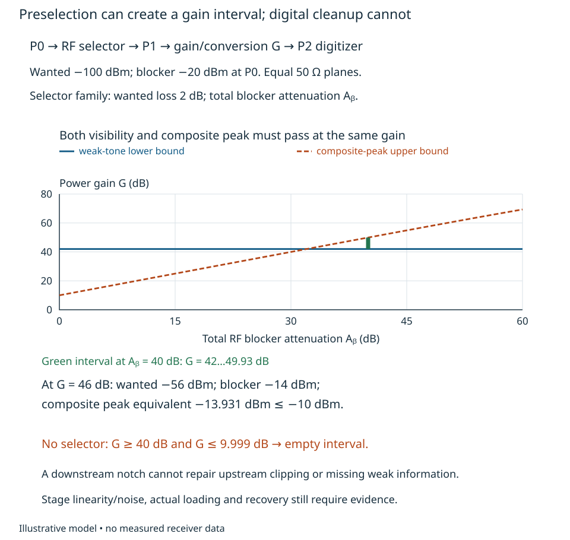
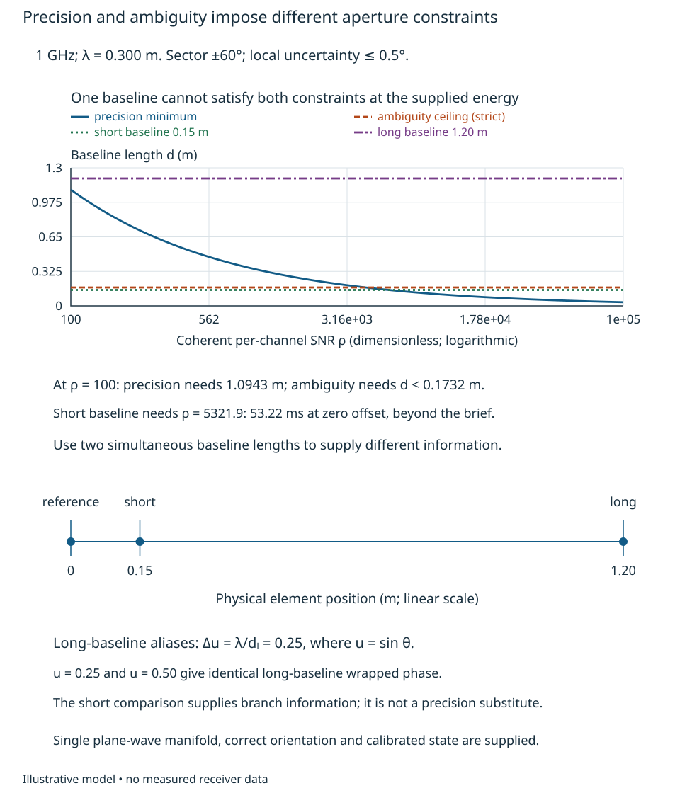
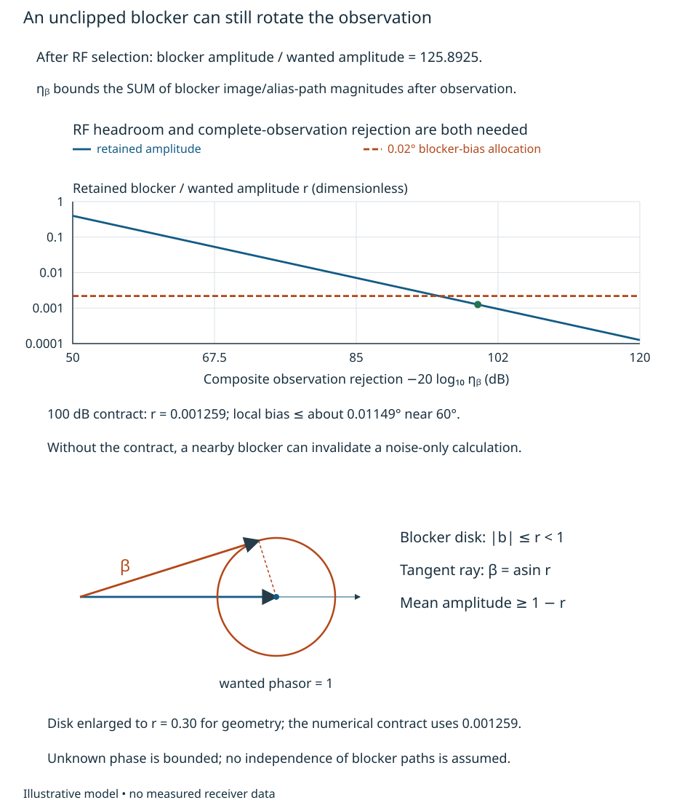
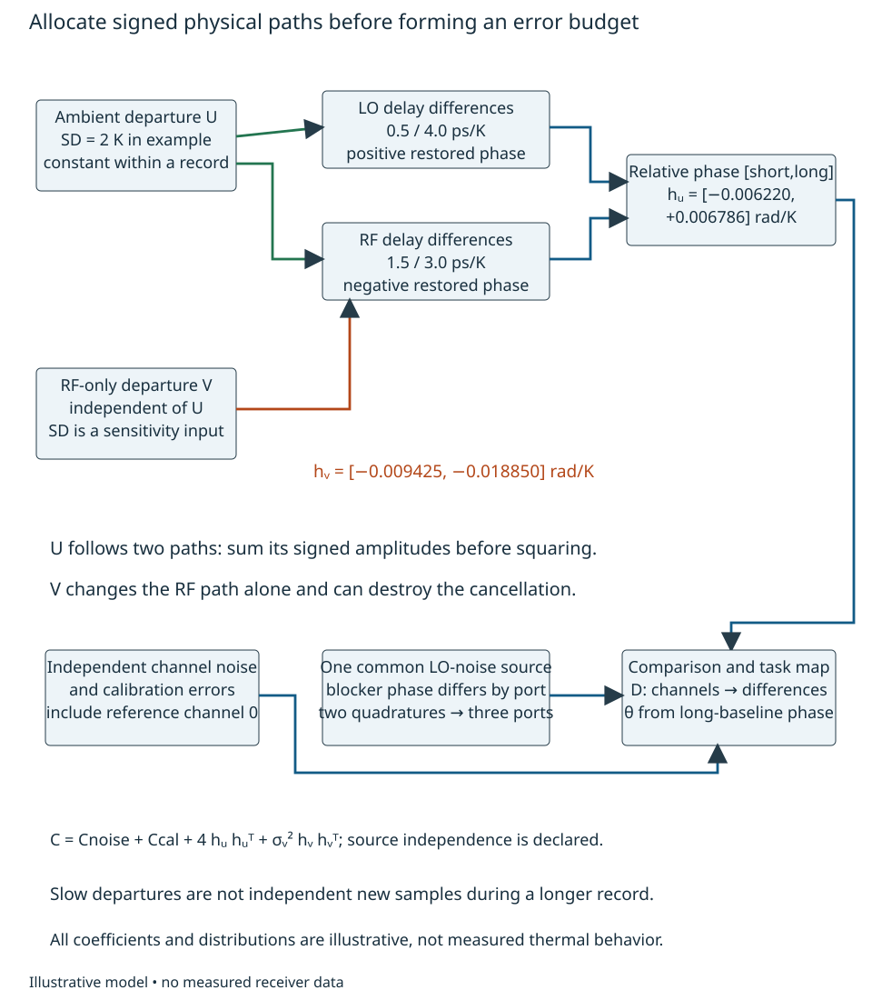
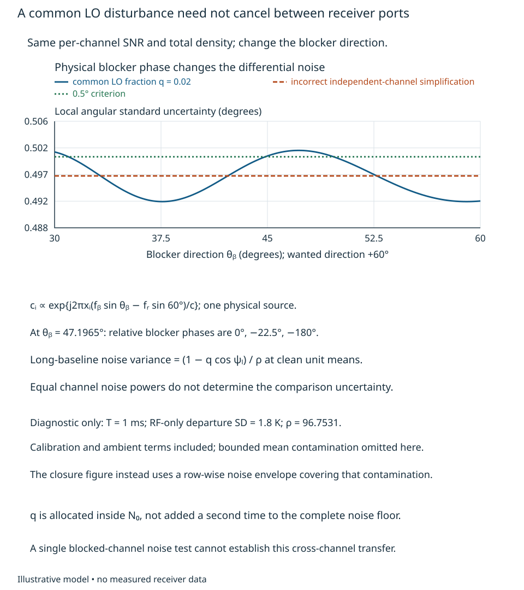
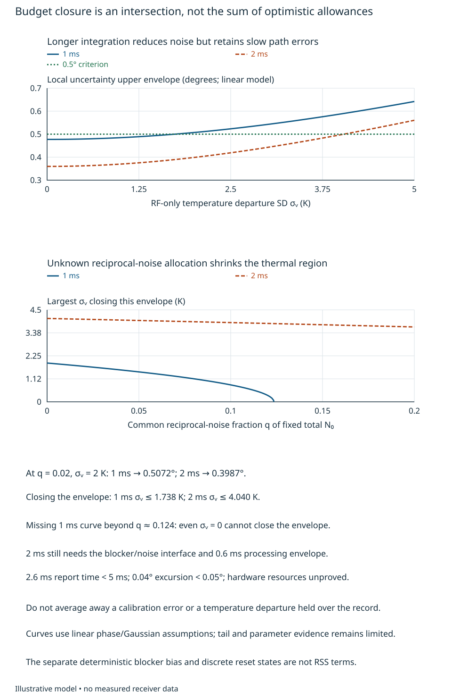

# Feasibility, architecture and correlated allocations {#sec-feasibility-allocations}

A receiver can have enough gain, a precise phase estimate and a fast data link,
yet still fail its task. The gain may clip the blocker, the phase may select the
wrong spatial branch, or the estimate may arrive after the scene has changed.
Architecture selection starts by intersecting these conditions at the same
operating point. A favorable calculation in each of several incompatible states
is not a feasible receiver.

This bounded development asks whether a small direction-comparison receiver can
meet a supplied angular, blocker and response-time brief. The reader should be
able to turn a need into a conditioned observable, calculate incompatible gain
and information constraints, compare interface/resource alternatives, and state
which missing evidence prevents a hardware recommendation. We then refine the
initial interfaces into physical correlated allocations and test budget closure. Requirement framing
begins in [Chapter 1](phase-comparison.qmd#sec-requirement-framing). We use
[Chapter 5](phase-delay-inference.qmd) to separate precision from ambiguity,
[Chapter 6](model-adequacy-uncertainty.qmd) to qualify approximations, and
[Chapters 8–10](fields-geometry-transduction.qmd) for field, disturbance and
extraction interfaces. [Chapter 11](frequency-phase-delay-transfer.qmd) fixes
conversion orientation, reference signs and sample-state prerequisites before
those interfaces are allocated. Numerical envelopes below are **synthetic design inputs**,
not selected products or measured receiver performance.

## Joint feasible regions {#sec-joint-feasibility}

### A brief that can fail

Suppose one far-field, linearly polarized narrowband source near 1 GHz is to be
located within a known front sector $|\theta|\leq60^\circ$. The observable is
source direction relative to the array normal at the record midpoint, inferred
from simultaneous, orientation-normalized channel voltages. A single plane-wave
manifold is supplied; multipath, unknown polarization and installation errors
must eventually be tested rather than included by assertion. Use rounded
propagation speed $3.00\times10^8$ m/s, hence wavelength $\lambda=0.300$ m.
The following is an illustrative operational brief, not a project requirement.

| Condition or limit | Supplied value and meaning |
|---|---|
| Wanted input and blocker at RF ports P0 | Wanted tone near 1.000 GHz, −100 dBm/channel; one CW blocker near 1.010 GHz, −20 dBm/channel; each tuning-offset uncertainty at most 100 Hz |
| Angular task | Local standard uncertainty at most 0.5° near the sector edge, conditional on the correct branch; branch-error probability at most $10^{-3}$; blocker-induced angular bias at most 0.02° |
| Time and dynamics | Report within 5 ms of record start; post-record processing/transfer 0.6 ms; angular excursion during a constant-manifold record at most 0.05°, with supplied rate bound 20°/s |
| Residual carrier offset | At most 100 Hz after supplied coarse tuning; no claim that a shared clock removes it |
| Noise/energy interface | Per-channel coherent tone SNR $\rho=100$ in 1 ms at zero offset after the selected front end; independent proper Gaussian channel noise, fixed phase and no fades |
| Digitizer interface P2 | Weak-tone floor −60 dBm; maximum composite peak voltage 0.100 V into an effective 50 Ω, equivalent to −10 dBm CW power; both are supplied qualified-interface limits |
| Complete observation interface | Desired positive-frequency component retained and orientation normalized; sum of magnitudes of all blocker-to-record image/alias paths, including conversion/filtering and the finite record, at most $10^{-5}$ of the wanted response |
| Resources | Total receiver 2.5 W; sustained link 5 Gbit/s including framing; three simultaneous channels allowed |

The specified noise SNR is after the complete observation in the selected 46 dB
gain state; another gain/filter state needs its own input-referred noise and
observation-noise gain. The noise interface can equivalently specify a wanted power −102 dBm at the
preselector output P1 and an effective power density −152 dBm/Hz there. Their
ratio is $C/N_0=10^5$ Hz and the ideal coherent tone observation gives
$\rho=(C/N_0)T$. That density must include the actual filter, amplifier and
converter-referred contributions; a passive insertion loss is not noiseless.
The stated density is an input requiring evidence, not a derivation from the
blocker level or a nominal noise figure. Chapter 9 constructs such contributions.

The weak-tone floor at P2 is likewise a supplied interface contract. Fourteen
stored bits below will set link traffic, **not** establish this floor or effective
resolution. Kester's [MT-001](https://www.analog.com/media/en/training-seminars/tutorials/MT-001.pdf),
Rev. A, p. 1, identifies the ideal converter and decorrelation assumptions behind
its quantization-noise model. It supplies no guarantee for the proposed blocker
and weak-tone combination. Driver loading, overload recovery, actual noise and
spurs remain implementation evidence needs.

For architecture variables $\mathbf x$ and environmental/state inputs
$\boldsymbol\eta$, write the conditional feasible set as

$$
 \mathcal F(\boldsymbol\eta)=
 \{\mathbf x:g_r(\mathbf x,\boldsymbol\eta)\leq0\ \text{for every required }r\}.
$$

An empty set rejects that combination of requirements, assumptions and available
alternatives. A nonempty model set is **conditional** until its technology,
physical inputs and task mapping are supported. If $\boldsymbol\eta$ lies in a
justified bounded set $\mathcal E$, robustness means satisfying the constraints
for every $\boldsymbol\eta\in\mathcal E$; choosing the most favorable unknown
value proves only existence of an optimistic case. An unspecified nuisance
cannot be silently assigned zero.

For a fixed architecture this distinction is $\exists\mathbf x\,
\forall\boldsymbol\eta\in\mathcal E$, not
$\forall\boldsymbol\eta\,\exists\mathbf x$. An adaptive architecture must
include its allowed sensing, state changes, latency and policies among the design
variables before claiming that it handles different conditions.

### Gain does not create headroom

First intersect weak-tone visibility and composite-input survival. Let $G$ be
the conversion/voltage-chain **power gain in dB** between equal 50 Ω reference
planes, $L_s$ the wanted insertion loss, and $A_B$ the blocker's total RF
attenuation in dB. At the gain input, powers in milliwatts are

$$
 p_s=10^{(-100-L_s)/10},\qquad p_b=10^{(-20-A_B)/10}.
$$

With worst relative tone phase, the peak voltage is proportional to
$\sqrt{p_s}+\sqrt{p_b}$. Thus the equivalent composite peak power before gain is
$p_{\rm pk}=(\sqrt{p_s}+\sqrt{p_b})^2$, and the two bounds are

$$
 G_{\min}=-60-(-100-L_s)=40+L_s,\qquad
 G_{\max}=-10-10\log_{10}p_{\rm pk}.
$$

This is a peak constraint, not an incoherent addition of average powers. For
more carriers replace the two amplitudes by a justified envelope or crest-factor
bound. Gain must exist in $[G_{\min},G_{\max}]$ and every intermediate stage must
also survive the waveform. Final-output headroom alone cannot establish that.

With no preselection, $L_s=A_B=0$: the bounds are 40 and 9.99913 dB. Their
intersection is empty by approximately 30 dB. A digital blocker notch after
sampling cannot restore clipped information. Now supply a selector family with
$L_s=2$ dB, and choose $A_B=40$ dB. The bounds become 42 and 49.93128 dB.
At $G=46$ dB, wanted and blocker powers at P2 are −56 and −14 dBm; the
worst composite is −13.93128 dBm, within the supplied −10 dBm limit.
The gain interval is now nonempty, conditional on linearity and noise evidence.

@fig-gain-feasibility shows how attenuation creates an interval rather than
merely changing a nominal operating point. Reducing $A_B$ to 30 dB while retaining
2 dB wanted loss leaves $G_{\max}\simeq39.98$ dB, still below 42 dB.
The architecture needs attenuation at the correct plane, not a larger gain
number or a cleaner output after clipping. The simplified first-stage input
survival envelope is −15 dBm; the selected branch sees a −60 dBm blocker, but
an actual stage-by-stage gain/drive allocation is still required.

{#fig-gain-feasibility fig-alt="Gain bounds versus total RF blocker attenuation. The weak-tone lower bound stays at42dB for a selector with2dB wanted loss. The composite-peak upper bound rises with attenuation and crosses the lower bound near32dB. At40dB attenuation a vertical bracket shows the feasible interval; a no-selector counterexample has no intersection."}

### Information, ambiguity and available time

A baseline $d$ along the array axis has relative field phase
$\phi=kd\sin\theta$, where $k=2\pi/\lambda$, using Chapter 8's sourceward
geometry and Chapter 1's normalized orientation. A phase report is modulo $2\pi$.
To avoid two noiseless directions in the closed sector sharing the same phase,
require

$$
 2kd\sin60^\circ<2\pi,\qquad
 d<d_{\rm amb}={\lambda\over2\sin60^\circ}=0.173205\ \mathrm m.
$$

The inequality is strict: equality aliases the two sector endpoints. This is a
single-baseline, single-frequency result under the supplied manifold, not a
universal aperture limit.

For a sufficiently strong tone with proper Gaussian complex noise, Chapter 2's
small-noise phase approximation gives per-channel phase variance $1/(2\rho)$.
Independent equal-noise channels therefore have relative-phase variance
$1/\rho$. Linearizing the phase-angle relation gives

$$
 \sigma_\theta\simeq{1\over kd|\cos\theta|\sqrt\rho},\qquad
 d\geq d_{\rm prec}={1\over k|\cos\theta|\sigma_{\theta,\max}\sqrt\rho}.
$$

Use radians in this calculation. At the edge approached from inside the sector,
$|\cos\theta|=1/2$, $\sigma_{\theta,\max}=0.00872665$ rad and $\rho=100$:
$d_{\rm prec}=1.094269$ m. There is no baseline satisfying both 1.094269 m
minimum precision aperture and 0.173205 m maximum unambiguous baseline. A local
precision calculation alone would have selected a globally ambiguous design.
The linearized uncertainty is conditional on the correct branch; it is not a
Gaussian model for arbitrarily large angle errors or an edge-clipped estimator.

Increasing gain does not improve this input-referred SNR when signal and dominant
analog noise are amplified together. Increasing observation time can improve
energy, but the time must exist. For a normalized rectangular tone observation
with residual frequency $\delta f$, direct integration of
$T^{-1}\int_0^T e^{j2\pi\delta f t}dt$ gives amplitude
$e^{j\pi\delta fT}\operatorname{sinc}(\delta fT)$, with
$\operatorname{sinc}x=\sin(\pi x)/(\pi x)$. Consequently

$$
 \rho(T,\delta f)=(10^5\,\mathrm{Hz})T\operatorname{sinc}^2(\delta fT).
$$

This is an explicit observation model, not a universal integration-loss rule.
The constant-manifold excursion requirement gives $T\leq0.05/20=2.5$ ms;
latency alone gives $T\leq4.4$ ms. Thus 2.5 ms is the tighter supplied limit.
A short baseline $d_s=0.150$ m would need $\rho=5321.885$ even before other
errors: 53.21885 ms at zero offset. It cannot obtain that energy within the
brief. At 100 Hz residual offset and 1 ms, $\rho=96.75312$ rather than 100.
Both the wanted response and noise normalization must follow the observation.

@fig-aperture-feasibility makes the precision/ambiguity conflict visible.
A 1.2 m baseline meets the local 0.5° target at 1 ms, but its wrapped phase
cannot select the correct direction. A 0.15 m baseline resolves the sector but
cannot meet that precision with the available energy. More information, a
restricted sector, a changed deadline/energy envelope or another measured
observable is needed.

{#fig-aperture-feasibility fig-alt="Minimum aperture for0.5degree local uncertainty near60degrees versus coherent SNR, with a horizontal0.1732m ambiguity ceiling and candidate0.15m and1.2m baselines. A lower scaled geometry places three channels at0,0.15and1.2m. Long-baseline direction-cosine aliases differ by0.25; the short baseline supplies branch information."}

## Architecture and quantitative interfaces {#sec-architecture-interfaces}

Consider three simultaneous ports at positions 0, 0.15 and 1.20 m. The long
baseline supplies local precision, while the short baseline supplies a coarse
sector estimate. This is a bounded ambiguity-restoration example, not a complete
bearing estimator or a claim that three elements solve multipath/polarization.
The source amplitude/common phase is a nuisance removed by relative comparisons.
A single analog-combined complex output cannot generally recover direction from
one unknown complex source amplitude: for any nonzero combined response $b(u)$,
its change can be absorbed into that amplitude. Multiple independent beam outputs
or scans can restore information, but their timing and manifold must be budgeted.
Analog reception is a valid alternative when those interfaces are supplied.

For the selected simultaneous case let $u=\sin\theta$ and
$\Delta u=\lambda/d_l=0.25$ be long-baseline branch spacing. Fine candidates
come from adding integer cycles to its phase; select the one nearest the short
baseline's direction cosine. Ignoring channel-noise correlation would misstate
that decision's uncertainty: both differences contain the reference channel.
If individual small phase errors $\epsilon_0,\epsilon_s,\epsilon_l$ are
independent with variance $1/(2\rho)$, the branch-comparison error is

$$
 e_u={\epsilon_s-\epsilon_0\over kd_s}
       -{\epsilon_l-\epsilon_0\over kd_l},\qquad
 \sigma_{e_u}^2={1\over\rho}
 \left[{1\over(kd_s)^2}+{1\over(kd_l)^2}-{1\over(kd_s)(kd_l)}\right].
$$

The cross term follows from the shared $\epsilon_0$ source; it is not an arbitrary
correlation coefficient. In the high-SNR Gaussian phase approximation,
$2\Phi[-\Delta u/(2\sigma_{e_u})]$ bounds a nearest-branch error when the coarse
phase has not wrapped, where $\Phi$ is the standard normal CDF. To avoid treating
that qualification as automatic, add a coarse-wrap bound. The minimum distance
to its principal-phase boundary over the sector is
$m=\pi-kd_s\sin60^\circ$. A conservative union bound is

$$
 P_{\rm branch}\ \lesssim\
 2\Phi\!\left(-{\Delta u\over2\sigma_{e_u}}\right)
 +2\Phi(-m\sqrt\rho).
$$

The approximate sign recalls the linear Gaussian phase model, not a measured
error rate. At 1 ms and worst 100 Hz residual offset, the two terms are
$4.258\times10^{-5}$ and $3.472\times10^{-5}$, totaling less than
$7.74\times10^{-5}$, below the supplied $10^{-3}$ limit. The long-baseline
local uncertainty is approximately 0.46353°. No calibration, multipath or state
error has yet been charged; the apparent margin is not available twice.
A branch failure is a large error event, not another small term to RSS into 0.46353°.

### The blocker must also pass through the observation

The preceding numbers omit retained blocker contamination. Headroom alone does
not justify that omission. After the RF selector the blocker is 42 dB above the
wanted tone, an amplitude ratio $R_B=10^{42/20}=125.8925$. For example, if a
changed operating condition placed it 100.5 kHz from the wanted tone and no
additional rejection were supplied, a 1 ms rectangular observation would retain
$R_B|\operatorname{sinc}(100.5)|=0.39873$ times the wanted amplitude. That can
change the phase and even the selected spatial branch without clipping.
Receiver passband width is not a statement of stopband rejection.

The brief therefore specifies the **composite** observation amplitude ratio
$\eta_B\leq10^{-5}$ at the allowed 1.010 GHz blocker frequencies, relative to
the wanted response. This −100 dB amplitude-transfer specification bounds the sum of path magnitudes for both
real-signal images and any aliased route into the reported record; it is not
merely a digital-filter attenuation at one nominal frequency. The 200 kHz IF
width below is a receiver passband, not an assumed arbitrary modulated waveform.
The calculation here remains a tone comparison. A real implementation must
demonstrate this rejection across frequency/state while preserving the assumed
wanted gain and the full observation noise SNR. Its filtering/digital extraction
is included in the supplied 0.6 ms processing and power envelopes; whether a
specific implementation meets all of them remains unknown.

With that contract, normalize each wanted record mean to a unit phasor. The
retained blocker phasor has magnitude at most
$r=R_B\eta_B=0.00125893$. A circle of radius $r<1$ about the wanted phasor has
maximum phase departure $\beta=\sin^{-1}r$ (the ray tangent to that circle).
Its minimum amplitude is $1-r$. Thus the long-baseline phase bias is bounded
by $2\beta$, corresponding to approximately 0.01149° angle bias near 60°,
below the separate 0.02° blocker allocation. Use the actual inverse sine of
the perturbed direction cosine if a local angle approximation is inadequate.

For a conservative high-SNR noise calculation use
$\rho_{\min}=\rho(1-r)^2=96.50966$, giving local uncertainty about 0.46412°.
Let $\sigma_{e_u,{\rm wc}}$ denote the earlier error SD calculated using this
reduced SNR, and bound the branch-comparison mean displacement by
$b_u=2\beta[1/(kd_s)+1/(kd_l)]$. Subtract these bias allowances from the
decision margins before computing tails:

$$
 P_{\rm branch}\ \lesssim\
 2\Phi\!\left(-{\Delta u/2-b_u\over\sigma_{e_u,{\rm wc}}}\right)
 +2\Phi[-(m-2\beta)\sqrt{\rho_{\min}}]
 <8.90\times10^{-5}.
$$

This requires positive margins and retains the Gaussian phase approximation;
it is a conditional model bound, not an empirical error rate. The conservative
baseline bias bounds do not assume independent blocker phases. @fig-blocker-observation shows why RF survival and retained interference are
separate constraints. Other reference, calibration, environmental and manifold
errors remain to be allocated. If the
composite rejection is unavailable, the candidate's information closure remains
open even though its headroom interval is nonempty.

{#fig-blocker-observation fig-alt="Retained blocker-to-wanted amplitude falls with composite observation rejection. The100dB contract leaves amplitude0.001259 below the0.02degree bias allocation. A magnified phasor disk about a unit wanted phasor has a tangent ray at beta equals arcsine r; the disk's nearest point has amplitude1minus r."}

The chosen analog-converted interface supplies a real 20 MHz IF with 200 kHz
receiver passband, sampled ideally at 100 MS/s, with 14 stored bits/sample.
Correct conversion orientation and reset phase are required interface conditions;
the end-to-end transfer treatment constructs them before allocations close.
Every channel includes the selector before gain/conversion. Equal nominal
frequencies are insufficient without the same spectral orientation, phase epoch
and known sample identity. The following resource values are supplied envelopes.

| Alternative | Calculated interfaces and consequence |
|---|---|
| Two unfiltered direct RF sample channels, 2.5 GS/s, 14 bits, 1.2 W/channel +0.4 W common | 70 Gbit/s raw and 2.8 W; fails link/power, no-selector gain interval and single-baseline ambiguity |
| Two analog-converted long-baseline channels, 100 MS/s, 0.6 W/channel +0.2 W selectors +0.4 W common | 1.8 W; at 10% transport overhead, 3.08 Gbit/s; gain passes but direction remains ambiguous |
| Three simultaneous short/long analog-converted channels, same per-channel envelope | 2.4 W; 4.2 Gbit/s raw and 4.62 Gbit/s at 10% overhead; passes supplied resource, gain and idealized information constraints |
| One analog beam output without another observable | Potential resource saving remains unspecified; one unknown complex source amplitude makes a single combined response insufficient for direction |

The 0.2 W selector allowance is total for the selected branch, not per channel.
The 0.4 W common allowance includes reference/control within this envelope.
For three channels, allowable framing overhead is at most
$5/4.2-1=19.0476$ percent; 25 percent would exceed the link even though the
analog and information calculations still pass. A driver that does not see
50 Ω invalidates the power-to-voltage conversion; the prescribed 0.100 V peak
limit must be translated to its actual differential/common-mode/load interface.
No part has been selected on these numbers.

Direct sampling can also use RF preselection. The rejected row is the specified
unfiltered implementation, not a limitation inherent in direct sampling. Adding
selection would address its headroom conflict, but would not by itself reduce
70 Gbit/s raw traffic, its supplied power or a single long baseline's ambiguity.

@fig-architecture-interfaces places the constraints at their physical interfaces.
Calibration injection after a selector does not measure its response or the
field manifold. Retaining all three complex channels allows relative-response
checks and later reprocessing; combining before observing them trades that access
for reduced traffic. Shared versus independent references must be compared at
these endpoints: independent sources add relative offset/drift unless estimated,
whereas a shared source still has distribution delay and reset-sensitive branch
phase. The present 0.4 W reference allowance establishes neither alternative's
physical performance.

An endpoint comparison makes the remaining reference conditions calculable.
For this comparison only, suppose each reference mechanism is assigned at most
0.05° of additional output phase excursion over a 1 ms record. These are
illustrative subsystem allowances, not independent grants of total task margin;
the later correlated allocation must reconcile them with calibration and the
other terms. Assume a nominal 1.020 GHz LO and 100 MHz sample clock at each
channel, with the 20 MHz IF already specified.

| Interface | Shared-reference candidate | Independent-reference candidate |
|---|---|---|
| LO endpoint phase | Common source phase cancels only for equal endpoint transfer. Differential path-delay change $\delta\tau_L$ contributes $2\pi f_L\delta\tau_L$; 0.05° permits at most 0.1362 ps at 1.020 GHz. Static intercept still needs calibration. | An unestimated relative LO frequency offset gives $2\pi\Delta f_L T$ phase excursion; the same 0.05° allowance requires $|\Delta f_L|\leq0.1389$ Hz over 1 ms, plus an independently known phase intercept. |
| Sample identity/epoch | Shared rate does not identify which sample is simultaneous. One unknown 10 ns sample step gives 72° at 20 MHz; it must be identified or the record invalidated. Residual differential aperture-epoch change for 0.05° is at most 6.944 ps. | Relative rate error $\epsilon$ accumulates epoch error $\epsilon T$. The same allowance requires $|\epsilon|\leq6.944\times10^{-9}$, or 0.6944 Hz at a 100 MHz clock, unless a measured timing correction is supplied. Initial epoch also remains necessary. |
| Loading and drive | Illustrative LO interface: 0 dBm delivered at each 50 Ω endpoint, 0.3162 V peak. A matched 6 dB branch loss requires +6 dBm before that branch. Three branches require about 11.94 mW RF total at those source-side planes; splitter and driver losses add. | Each endpoint still needs the same delivered level/load. Local sources remove this splitter load but introduce their own consumption, frequency/phase and synchronization obligations; their power is not supplied. |
| Calibration access and latency | Post-selector injection observes internal relative response in the identified state; field/selector response needs another configuration. The complete observer, including rejection, must fit the supplied 0.6 ms. Endpoint drift/noise and actual distribution power inside the 0.4 W allowance are unverified. | Relative phase/time estimation needs accessible references or a suitable signal and a stated estimator; its acquisition latency, residuals and power are unknown. No claim that it fits 0.6 ms or 0.4 W follows. |

The LO drive example uses $V_{\rm pk}=\sqrt{2RP}$ and matched insertion loss;
it does not specify an actual mixer's required LO waveform or impedance. For a
real part, driver voltage/current, compression, return loss and bias conditions
must replace that envelope. The selected model uses identified, calibrated,
fixed endpoint phases. The derived allowances expose requirements that hardware
must satisfy; they do not establish that either reference implementation does so.

{#fig-architecture-interfaces fig-alt="Three physical input ports feed RF selectors, then gain/conversion, real IF digitizers and retained complex observations. Input P0 has weak and blocker powers, P1 carries selected powers and supplied effective noise, and P2 has a composite peak voltage constraint. Reference state and sample identity feed conversion/sampling. Injection after selection reaches only the internal response."}

## Correlated budget construction {#sec-correlated-budget}

The 1 ms candidate has survived an initial feasibility screen. Can it still meet
0.5° once physical shared sources, calibration and environmental departures are
charged? We now refine its supplied interfaces. The reader should be able to
construct a source-to-observable budget, calculate a correlated allocation,
identify an unknown input that prevents closure, and choose a restoring change.
This is a local comparison in a known steady state, not a complete direction
finder or a production distribution. The initial table's independent channel-noise
assumption is now replaced by a common-source model at the same marginal density.
Earlier independent-noise precision/branch numbers remain first-pass calculations,
not results for this revised model.

[Chapter 11](frequency-phase-delay-transfer.qmd) supplies the conversion signs;
[Chapter 9](physical-disturbance-paths.qmd) supplies source/network and reciprocal
mixing models. We reuse [Chapter 4](covariance-quadratic-forms.qmd)'s source-root
covariance and [Chapter 6](model-adequacy-uncertainty.qmd)'s local uncertainty
propagation rather than introduce another uncertainty convention. For this
calculation, interpret the 0.5° criterion as **predictive local standard
uncertainty given the calibration information and declared unobserved environment**,
on a correct spatial branch. Holding an actual temperature and calibration error
fixed gives a different repeated-record variance. Neither interpretation is an
all-error or coverage guarantee.

Let $\boldsymbol\varphi=[\phi_s-\phi_0,\phi_l-\phi_0]^T$ be restored relative
phases at the record midpoint. If $\mathbf e=[e_0,e_s,e_l]^T$ is a vector of small
channel phase errors, define

$$
\mathbf D=\begin{bmatrix}-1&1&0\\-1&0&1\end{bmatrix},\qquad
\delta\boldsymbol\varphi=\mathbf D\mathbf e.
$$

A physical source reaching several ports contributes one column, or one filtered
source process, before the covariance is formed. For centered stationary phase
sources with two-sided matrix $\mathbf S_q(f)$, ordered as $Q_iQ_j^*$ in
rad²/Hz, let $\mathbf L(f)$ map those sources into channel phase and let
$\mathbf G(f)$ represent the declared normalized phase observation. The finite
output covariance is the corresponding quadratic spectral integral over all
real $f$, where it converges. For a task row $\mathbf w$ acting on the channel
phases, its variance contribution is

$$
 V_{\mathbf w}=\int_{-\infty}^{\infty}
 [\mathbf w\mathbf G(f)\mathbf L(f)]\mathbf S_q(f)
 [\mathbf w\mathbf G(f)\mathbf L(f)]^H\,df.
$$ {#eq-budget-spectral}

This is a use of the existing observation/covariance results. It is not generally
an unweighted integral of a connector phase-noise plot. For example, for a
centered rectangular complex-tone record with common residual offset $\delta$,
linearizing the phase of its complex average gives the real even time weight
$g_\delta(t)=\cos(2\pi\delta t)/[T\operatorname{sinc}(\delta T)]$ inside
$[-T/2,T/2]$, provided the denominator is nonzero. Its integral is one: writing $Z_0=A\operatorname{sinc}(\delta T)$ and
$\delta Z=jA T^{-1}\int e^{j2\pi\delta t}\psi(t)dt$ for a small real phase
perturbation gives $\delta\arg Z=\operatorname{Im}(\delta Z/Z_0)=\int g_\delta(t)\psi(t)dt$.
Use its
Fourier transform for the phase observation, together with the actual path
response; the weight becomes uniform only at zero offset. Additive voltage and
clock/blocker products require their own linearized transfers. A scalar phase
weight cannot replace Chapter 9's complete-waveform timing model.

### Allocate the complete noise floor once

The supplied $N_0=-152$ dBm/Hz at P1 equals
$6.30957\times10^{-19}$ W/Hz in the power-normalized positive-carrier envelope.
It already represents the complete selected observer's effective input-referred
noise. A possible **synthetic partition** is matched thermal input $k_B(290\text{ K})$,
converter-referred contribution $0.4N_0$, common reciprocal-mixing contribution
$qN_0$, and remaining independent active-path contribution
$(0.6-q)N_0-k_B(290\text{ K})$. At $q=0.02$, these are all nonnegative and sum
to $N_0$. The thermal term is $4.00388\times10^{-21}$ W/Hz. It could describe
independent matched source terminations and isothermal passive selectors; an
actual antenna environment/coupled network needs the field/noise model of
Chapter 9 instead. Active-device voltage/current noise and converter noise must
be transferred to P1 through their actual noise gains before using these entries.
This partition demonstrates an admissible source model, not measured noise,
actual component feasibility or an inference from nominal resolution.

For the selected blocker power $P_B=10^{-9}$ W at P1, Chapter 9's narrow-blocker,
flat-effective-spectrum limit gives $N_{\rm rm}=P_B S_{\phi,\rm eff}(-\Delta)$,
$\Delta=10$ MHz in the restored orientation. Allocating $q=0.02$ requires an
effective **two-sided phase density** about $1.26191\times10^{-11}$ rad²/Hz there,
with the appropriate finite-observation weighting. No universal conversion to
one-sided $L(f)$ is being adopted. Spectral shape, internal LO branches and
band limits must be known to replace that flat-spectrum interface by an integral.
A notch rejecting the blocker tone does not remove reciprocal noise that has
already landed in the wanted band.

The [examined mixer-noise article](https://www.analog.com/en/resources/technical-articles/specifications-and-measurement-of-local-oscillator-noise-in-integrated-circuit-base-station-mixers.html),
“Mixer Noise Model” and “Effective Noise Floor of LO Driver,” distinguishes
blocked from ordinary noise-figure conditions and includes internal driver noise.
Its device measurements do not establish our numerical partition or correlations.
Adding $qN_0$ to the already complete $N_0$ would double count it. If an earlier
floor was actually measured **without** the blocker, it was a different interface:
recompute the total, SNR and covariance rather than relabel the same number.

Equal marginal channel SNRs still do not supply their covariance. In a simplified
common-LO model after the complete observation, write normalized voltage noise

$$
 n_i=\rho^{-1/2}\{\sqrt{1-q}\,\eta_i+\sqrt q\,v_i\eta_B\},
 \qquad E|\eta_i|^2=E|\eta_B|^2=1.
$$ {#eq-blocker-noise-root}

The $\eta_i$ and $\eta_B$ are mutually independent proper complex Gaussian
variables; $\eta_B$ is one selected LO-noise band translated by the blocker, not
three new independent noise generators. Here $|v_i|=1$ and $\rho$ is the complete
clean-mean record SNR. This supplied equal-transfer approximation requires
identical relative electronic responses at wanted and blocker frequencies and
matched LO-noise transfer. Proper selected-band noise is itself an approximation
requiring suitable sideband selection; significant improper or finite-image noise
requires the fuller complex covariance. More general responses replace the $v_i$ and spectral
integral, not merely the diagonal SNR. Linearizing phase at a unit mean gives
$\epsilon_i=\operatorname{Im}n_i$. Proper centered noise satisfies
$E[\operatorname{Im}n_i\operatorname{Im}n_j]=\tfrac12\operatorname{Re}E[n_i n_j^*]$, giving

$$
\mathbf C_{\varphi,n}=\frac1{2\rho}\mathbf D
 \{(1-q)\mathbf I+q\operatorname{Re}(\mathbf v\mathbf v^H)\}\mathbf D^T.
$$ {#eq-blocker-phase-covariance}

The off-diagonal entries are derived from the single physical source. In
particular the long comparison's variance is
$(1-q\cos\psi_l)/\rho$, where $\psi_l=\arg(v_l v_0^*)$.
A common source cancels only with the relevant equal complex sensitivities.

Use the supplied plane-wave geometry to construct the phases rather than choose
a convenient correlation. With wanted direction cosine $u=\sin60^\circ$, blocker
direction cosine $u_B$, and positions $x_i\in\{0,0.15,1.2\}$ m,

$$
 v_i=\exp\left\{j\frac{2\pi x_i}{c}(f_Bu_B-f_Ru)\right\}.
$$

Choosing $u_B=(u-0.125)/1.01$ gives $\theta_B=47.1965^\circ$, within the same
front sector. The three relative phases are $0,-\pi/8,-\pi$. At clean means the
long noise variance is $(1+q)/\rho$, despite unchanged individual channel powers.
Assuming independent channels would understate it. @fig-correlated-blocker-allocation varies the actual blocker direction; it does
not vary an arbitrary correlation coefficient.

### Slow physical paths and calibration knowledge

Let $U$ be a common temperature departure from calibration and let $V$ be a
further RF-path-only departure, each constant during a record. Use independent
centered Gaussian ensemble models with $\sigma_U=2$ K and variable $\sigma_V$;
these are illustrative prediction inputs, not a claim about thermal statistics
or validity of linear coefficients in extreme tails. For short/long paths
relative to reference 0, supply LO delay sensitivities
$\boldsymbol\alpha_L=[0.5,4.0]^T$ ps/K and RF sensitivities
$\boldsymbol\alpha_R=[1.5,3.0]^T$ ps/K. The RF temperature is $U+V$, while the LO
path sees $U$. Applying the signed transfer from Chapter 11 gives

$$
\begin{aligned}
\delta\boldsymbol\varphi_T&=\mathbf h_U U+\mathbf h_V V,\\
\mathbf h_U&=2\pi(f_L\boldsymbol\alpha_L-f_R\boldsymbol\alpha_R),\\
\mathbf h_V&=-2\pi f_R\boldsymbol\alpha_R.
\end{aligned}
$$ {#eq-thermal-allocation}

Numerically $\mathbf h_U=[-0.00622035,+0.00678584]^T$ rad/K and
$\mathbf h_V=[-0.00942478,-0.01884956]^T$ rad/K. Thus
$\mathbf C_T=4\mathbf h_U\mathbf h_U^T+\sigma_V^2\mathbf h_V\mathbf h_V^T$.
Ambient departure causes a **negative** cross term between the two comparisons;
the additional RF departure causes a positive one. The same $U$ traverses RF
and LO paths: combine its signed phase contributions before squaring. Replacing
it by independent RF/LO temperatures changes long-path ambient variance from
$0.000184191$ to $0.00404992$ rad², a false rejection mechanism. Conversely,
deleting $V$ because “temperature is common” can give a false pass.

For calibration, suppose residual uncertainty in each applied electronic phase
correction at the calibration state is represented by an independent centered Gaussian
$e_{c,i}$ with SD 0.01 rad. The relative covariance is
$\mathbf C_c=10^{-4}\mathbf D\mathbf D^T$; it includes the shared reference error.
These uncertain intercepts stay fixed between calibrations. They do not become
new independent draws in each sample. Their independence from $U,V$ and voltage
noise is an explicit input; calibration using the same noisy reference can
invalidate it. The temperature terms are departures **after** that calibration,
not another entry for an error already corrected at the current temperature.
The 0.01 rad input must cover the full electronic R-to-output response at that
state; post-selector injection alone cannot establish it. Selector response needs
separate access or a justified bound, and the field manifold remains separate.

{#fig-allocation-source-paths fig-alt="One ambient source U reaches both LO and RF delay differences with opposite restored signs. Another source V reaches RF only. Their short and long phase coefficients determine signed covariance. Local noise and calibration include reference channel zero; one common LO-noise band reaches three ports through their blocker sensitivities."}

The local covariance is $\mathbf C_\varphi=\mathbf C_{\varphi,n}+\mathbf C_T+\mathbf C_c$.
The angle row on a correct long-baseline branch is
$\mathbf g_\theta=[0,1/(kd_l\cos\theta)]$ radians of angle per radian of phase;
its predicted variance is $\mathbf g_\theta\mathbf C_\varphi\mathbf g_\theta^T$.
The branch-comparison row is $[a,-b]$, where $a=1/(kd_s)$ and $b=1/(kd_l)$.
Use the full two-by-two matrix for that decision; retaining only the long phase
variance cannot establish a branch-error limit.

{#fig-correlated-blocker-allocation fig-alt="Local angular standard uncertainty oscillates with blocker direction between30and60degrees because geometrical blocker-to-wanted phase changes the common-noise covariance. A constant independent-channel approximation stays below0.5degree while parts of the physical common-source curve exceed it. This diagnostic uses1ms, RF temperature SD1.8K and clean unit means."}

### A calculation that can close or fail

Charge deterministic contamination separately. Retain the conservative $10^{-5}$
blocker contract even though the exercised FIR's ideal path bound is much smaller.
Add Chapter 11's wanted real-image/main bound $3.4\times10^{-6}$, giving a total
per-channel phasor-disk radius $r_t=0.0012623254$. Then the phase bias magnitude
is at most $\beta_t=\arcsin r_t$, and the mean amplitude is at least $1-r_t$.
At 1 ms and 100 Hz offset, $\rho_{\min}=96.50901$; the exact inverse manifold
bounds combined blocker/mirror angle displacement near the outward sector edge
by about 0.011514°. The blocker-only part remains below its 0.02° allocation.
This combined bias is not a random variance contribution.

For a conservative **linear-phase noise envelope** that also covers changed mean
amplitudes and phase projections, let $\mathbf w$ be any real channel-phase row.
The independent source part is bounded by
$(1-q)\sum_iw_i^2/(2\rho_{\min})$ and the common part by
$q(\sum_i|w_i|)^2/(2\rho_{\min})$. The latter is the triangle bound on the one
common source's complex coefficient, including arbitrary port phases. It can be
looser than @eq-blocker-phase-covariance, but does not assume that bounded
contamination leaves a favorable correlation unchanged. Add the exact affine
thermal/calibration contributions for the same row.

For the long comparison $\mathbf w=[-1,0,1]$, the noise envelope is
$(1+q)/\rho_{\min}$. With $q=0.02$ and $\sigma_V=2$ K, the phase-variance budget is

| Contribution, referred to long relative phase | 1 ms, rad² | How it enters |
|---|---:|---|
| Complete-observation voltage noise, common-source envelope | 0.010568962 | Total floor allocated once; common part retained |
| Calibration-correction uncertainty | 0.000200000 | Two channel intercept uncertainties; held over record |
| Common ambient departure $U$ | 0.000184191 | Signed RF/LO paths combined first |
| Additional RF departure $V$ | 0.001421223 | RF path alone; not canceled by the LO path |
| Sum | **0.012374375** | Predictive local linear-model variance |
| Phase variance allowed by 0.5° near 60° | **0.012025814** | $(kd_l\cos60^\circ\,0.5\pi/180)^2$ |

The linear-model upper envelope is **0.50719°**, so this allocation does not
close. An upper envelope exceeding a limit alone does not prove that every
instance fails. Here the explicit $47.1965^\circ$ blocker geometry at clean means
also gives **0.50665°**, a concrete failing case in the model even before bounded
contamination. If $V$ were incorrectly omitted, the envelope would appear to
close at 0.47718°. For $q=0.02$, solving the same envelope inequality gives the
sufficient condition $\sigma_V\le1.73752$ K in this approximation. Close to that boundary, finite-SNR
phase nonlinearity and parameter/model uncertainty matter; digits do not establish
a sharp hardware acceptance boundary. A one-percent increase in the noise-phase
variance reduces that sufficient thermal threshold to about 1.64970 K. This is a
sensitivity check, not an invented physical noise source.

The branch calculation must also be updated. The channel row for the difference
of the coarse and fine direction cosines is $\mathbf w_e=[b-a,a,-b]$.
Its noise envelope is
$[(1-q)(a^2+b^2-ab)+2qa^2]/\rho_{\min}$.
Its calibration variance is $10^{-4}\|\mathbf w_e\|^2$, and its thermal variance
is $4(a h_{U,s}-b h_{U,l})^2+\sigma_V^2(a h_{V,s}-b h_{V,l})^2$.
The coarse-phase row has noise envelope $(1+q)/\rho_{\min}$ plus its own
thermal/calibration terms. Subtract $2\beta_t(a+b)$ from the branch decision
margin $0.125$, and $2\beta_t$ from the coarse wrap margin
$m=\pi-kd_s\sin60^\circ$. Applying the earlier Gaussian tail/union reasoning
gives an approximate branch envelope $1.8131\times10^{-4}$ at 1 ms.
The branch criterion passes this model while precision fails; the two decisions
are not interchangeable. Gaussian phase tails, the local inverse and rare-event
adequacy remain approximations, not experimentally established probabilities.

[NIST TN 1297 Appendix A.1–A.3](https://www.nist.gov/pml/nist-technical-note-1297/nist-tn-1297-appendix-law-propagation-uncertainty)
requires significant measurement-process inputs and covariance-aware propagation;
[§5.2](https://www.nist.gov/pml/nist-technical-note-1297/nist-tn-1297-5-combined-standard-uncertainty)
distinguishes uncertainty of an applied correction from the unknown error itself.
Those principles do not supply our thermal coefficients or certify a receiver.
Here unused variance allowance is **margin**; changing actual temperatures across
operations is **variability**; incomplete knowledge of coefficients or of
$\sigma_V$ is **parameter uncertainty**; neglected multipath, nonlinearity or
unmodeled transfer is **model discrepancy**; remaining error after correction is
a **calibration residual**; and an instrument's uncertainty belongs to the
measurement process used to estimate or verify these quantities. A defensible
joint model can propagate several kinds of knowledge, but an unexplained RSS of
all six labels has no defined ensemble or reference plane.

## Closure and restoring changes {#sec-closure-restoration}

The initial gain, resource and information screen identified a candidate, but
its refined 1 ms error allocation fails the declared predictive local criterion.
A longer record is one restoring alternative, not permission to integrate without
limit. At **2 ms**, 100 Hz offset gives clean SNR
$200\operatorname{sinc}^2(0.2)=175.02804$ and contamination-reduced SNR 174.58643.
The same noise envelope falls to 0.005842378 rad²; the slow thermal/calibration
terms stay unchanged. Total phase variance is 0.007647792 rad², giving
**0.39873°** and an approximate branch envelope **$5.48\times 10^{-7}$**.
The sufficient thermal limit for this envelope becomes $\sigma_V\le 4.04003$ K. The separate
bounded blocker/mirror bias is retained. These are conditional model results,
not a demonstrated bearing-error distribution. As a separate numerical check, a reduced-SNR surrogate uses $\rho_{\min}$
and unit means, rather than realizing particular bounded contamination phasors.
Drawing the declared proper complex voltage noises and Gaussian calibration/thermal
inputs, then applying the exact phase and inverse-sine operations, gives angular
SDs about 0.50865° and 0.39947° for 1 ms and 2 ms in 1200000 seeded trials each.
The small shifts from the linear values do not reverse this example's decision;
they neither certify a rare tail nor establish the physical input assumptions.

{#fig-allocation-closure fig-alt="At common reciprocal-noise fraction 0.02 and temperature departure SD 2 K, the 1 ms precision envelope is 0.5072degree while 2 ms gives 0.3987degree. Thermal limits rise from 1.738 to 4.040 K. A second plot shows allowable RF-only departure decreasing as common reciprocal-noise allocation grows; the 1 ms curve ends when no nonnegative departure variance can close this envelope."}

The larger record still satisfies necessary time/dynamics conditions:
$2+0.6=2.6$ ms is below 5 ms, and 20°/s gives 0.04° excursion, below 0.05°.
The FIR/real-image rejection must be checked for 200000 samples, rather than copied
from the 1 ms proof; the same offset/coefficient envelope meets $1.3\times 10^{-10}$
for the modeled blocker paths and preserves the wanted mirror bound. The
qualified effective noise floor must also be reconciled with that observation.
Framed traffic remains 4.62 Gbit/s (4.2 Gbit/s raw) with 10 percent overhead: doubling integration does
not halve the streaming input traffic. The assumed 2.4 W and 0.6 ms processing
remain unverified implementation envelopes. If the hypothetical 0.05° within-record
reference allowances from the architecture comparison are retained, the longer
record tightens independent LO offset to 0.06944 Hz and relative sampling-rate
error to $3.4722\times 10^{-9}$; constant delay-excursion bounds stay the same.
Those extra reference errors have not been silently granted another task margin.

Alternatively, keep 1 ms and reduce the RF-only departure below its sufficient envelope
1.738 K threshold, reduce the relevant delay sensitivity, or improve genuine
observation SNR. Better thermal coupling can reduce $V$ but need not reduce $U$;
path matching can change the signed coefficients and noise/calibration access.
Changing RF blocker attenuation changes reciprocal mixing before the mixer,
whereas tightening the downstream digital notch addresses retained tone leakage.
Reallocate the source powers and gains after such a change. Lowering one diagonal
noise number is not a substitute for preserving desired information and checking
common-source transfer.

NASA's [system-design guidance](https://www.nasa.gov/reference/4-0-system-design-processes/),
§§4.3–4.4, connects allocation and interface definition to comparison of
alternatives. Its [verification-matrix guidance](https://www.nasa.gov/reference/system-engineering-handbook-appendix/),
Appendix D, links requirements to evidence routes. The local calculations here
are original conditional RF models, not NASA qualification criteria.

A practical evidence plan follows the same planes: sweep wanted/blocker levels
and inspect analog survival/noise before trusting the digital output; establish
load/drive and power/traffic over the intended mode; measure complex responses
across frequency, direction and polarization; exercise restart/retune sample and
phase identity; and evaluate held-out directions against known geometry. Internal
injection addresses electronic transfer only under its actual topology. Actual
component documents must identify revision, mode, temperature, load and guarantee
scope. None of those measurements was performed for this example.

For transfer, change the brief in three different ways. First, keep the wide
sector but remove the third observation: show that more electronic gain cannot
restore missing branch information. Second, allow only 2 W total with the same
technology envelopes: the three-channel candidate fails by 0.4 W. Derive a
per-channel allowance of at most $(2-0.2-0.4)/3=0.4667$ W; whether another
technology meets it remains unknown. Third, retain hardware but narrow the
allowed direction-cosine interval to width less than $\lambda/d_l=0.25$ around
a known coarse direction. Then the long baseline can be unambiguous in that
restricted interval, potentially removing the third channel. That restoring
change consumes prior information; it is not an equivalent guarantee over ±60°.

For another transfer exercise, retain 2 ms but suppose the unknown reciprocal
fraction is only bounded by $0\le q\le 0.2$. Evaluate the worst-case precision
inequality rather than choose 0.02: at $\sigma_V=2$ K it still passes this envelope,
but the thermal allowance shrinks. If $\sigma_V$ is unbounded, no such closure
follows. Replace the shared-LO model by independent LO bands while keeping
marginal powers fixed and derive the changed covariance; identical spectra alone
no longer give the same cancellation. Finally, a reset mixture containing an
unidentified half-cycle state is not Gaussian phase noise. Its occurrence and
invalid-data policy require separate evidence; the steady-state branch bound
does not bound reset-related failures.

For implementation verification, retain complex records while changing blocker
level and relative port phase, with gain/observation fixed; compare full cross
spectra, not only noise diagonals. Use separate ambient and RF-path heating to
identify the two signed thermal columns, and account for the test reference's
correlation. Known electronic injection can test internal transfer but cannot
establish the array manifold or actual blocker direction. Actual source-path,
noise-gain, temperature-coefficient, clock/state and measurement-uncertainty
evidence is needed before a hardware recommendation. None was measured here.

The conditional 2 ms result still assumes a fixed manifold within a record. With
only the 20°/s rate bound, the difference between the midpoint direction and its
uniform time average can be as large as $\Omega T/4=0.01^\circ$ at 2 ms; the
phase-weighted comparison needs its actual operator. This potential dynamic bias
is distinct from the blocker allocation and needs an accuracy requirement if
consequential. Multipath, polarization, installation and state changes remain
outside this bounded supplied manifold. The refined region is mathematically
conditional; missing physical or application evidence keeps it so.
