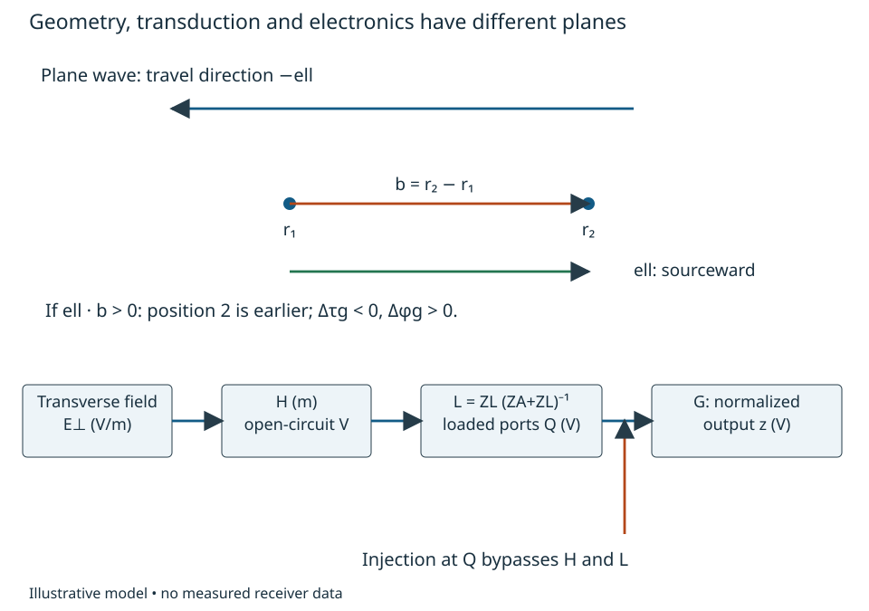
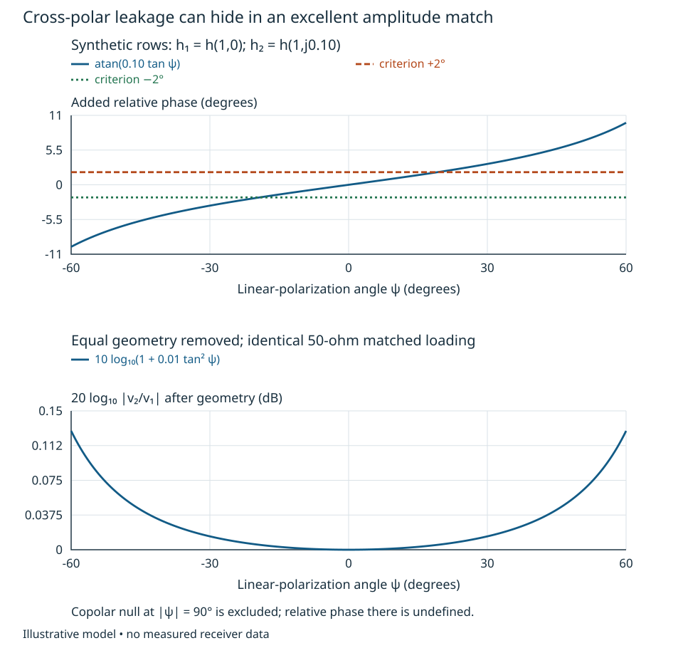
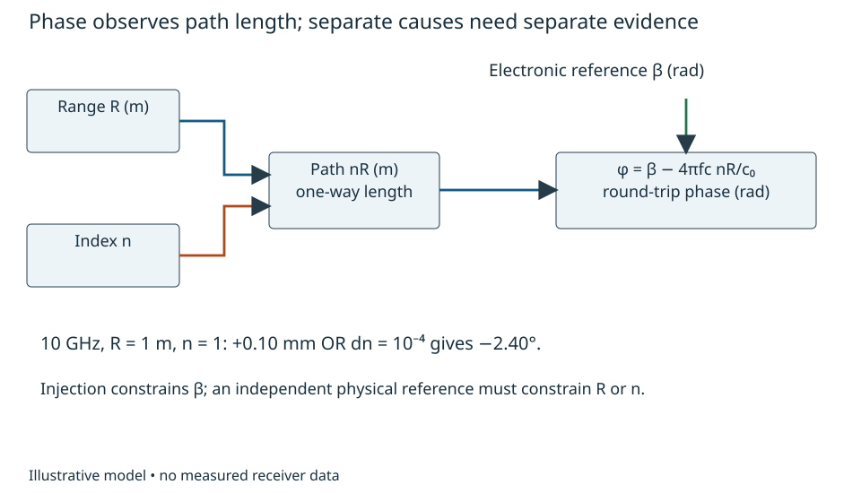

# Fields, geometry and physical transduction {#sec-fields-transduction}

Two receiver channels give identical results when driven by a splitter at their
input connectors. Will they give the intended relative phase when connected to
two antennas? The splitter establishes a relationship between electronic paths.
The incident wave must still propagate, project onto the antennas' polarization
responses and deliver voltage into their loads. Those operations can change both
amplitude and phase before the calibrated electronics ever see a signal.

This bounded treatment develops that missing bridge. After working through it,
the reader should be able to calculate a geometric phase and Doppler sign,
construct a two-polarization field-to-port model, test a scalar reduction against
a changed incident field, and identify an external-path uncertainty that internal
injection cannot determine. [Chapter 1](phase-comparison.qmd) supplies peak-scaled
complex envelopes and reference planes; [Chapter 4](covariance-quadratic-forms.qmd)
supplies vector and matrix operations. Geometry, antenna responses and sensor
coefficients used below are explicitly supplied models, not measured hardware.
Conventions remain local; detailed radiator synthesis and specialist sensor laws
are outside this unit.

## Propagation and geometry {#sec-field-geometry}

Use time dependence $\operatorname{Re}\{z(t)e^{j2\pi f_c t}\}$, with $f_c>0$ Hz.
Let $\boldsymbol\ell$ be a unit vector pointing **from the receiver toward the
source**. A plane wave travels in direction $-\boldsymbol\ell$. Relative to an
origin at $\mathbf r=0$, its electric-field envelope is

$$
 \mathbf E(\mathbf r,t)=\mathbf E_0
 e^{j k_c\boldsymbol\ell\cdot\mathbf r},\qquad
 k_c={2\pi f_c\over v},
$$

for a monochromatic plane wave in a homogeneous nondispersive medium with speed
$v=c_0/n$, where $c_0$ is vacuum speed and $n$ the constant refractive index. Here $\mathbf E_0$ has peak units V/m and is transverse:
$\boldsymbol\ell\cdot\mathbf E_0=0$. Surfaces of constant total phase move toward
$-\boldsymbol\ell$ as time increases; this checks the sign without memorizing a
steering-vector convention. For ports at $\mathbf r_1$ and $\mathbf r_2$, define
$\mathbf b=\mathbf r_2-\mathbf r_1$. Then, before antenna response or electronics,

$$
 \Delta\phi_g=k_c\boldsymbol\ell\cdot\mathbf b,
 \qquad \Delta\tau_g=-{\boldsymbol\ell\cdot\mathbf b\over v},
 \qquad \Delta\phi_g=-2\pi f_c\Delta\tau_g.
$$

$\Delta\tau_g$ is arrival delay at position 2 relative to position 1. A receiver
closer to the source receives earlier, so its delay is negative and its phase
advances. An electronic cable delay has the same phase-versus-frequency algebra
but a different physical cause and calibration access.

For a point source at distance $R(t)$, write the path phase as
$-2\pi f_cR(t)/v$. Its derivative divided by $2\pi$ gives
$f_D=-f_c\dot R/v$: recession lowers frequency. This is a first-order,
quasi-static path model, requiring $|\dot R|\ll v$ and negligible fractional
range change during propagation. A monostatic reflected path changes length by
$2\,dR$, giving $f_D=-2f_c\dot R/v$ and displacement phase
$d\phi=-4\pi f_c\,dR/v$. These are path-length results; arbitrary bistatic geometry
requires differentiating its actual transmit-plus-receive length. A common LO
does not remove geometric Doppler.

The geometry in @fig-field-port-paths fixes these signs and separates the field,
antenna and electronic planes. The lower chain will also be the noise-path
interface for the [physical-noise treatment](physical-disturbance-paths.qmd).

{#fig-field-port-paths fig-alt="Two positions separated by baseline b see a wave travelling opposite the sourceward vector ell. The earlier arrival at position 2 has positive relative phase. Below, transverse field passes through H to open-circuit voltages, then L to loaded ports Q, and orientation-normalized G to receiver outputs; an injection arrow enters at Q."}

The plane-wave approximation has a quantifiable limit. For a source at
$R\boldsymbol\ell$, expanding the exact distance gives

$$
 |R\boldsymbol\ell-\mathbf r|
 =R-\boldsymbol\ell\cdot\mathbf r+
 {\|\mathbf r\|^2-(\boldsymbol\ell\cdot\mathbf r)^2\over2R}
 +O(\|\mathbf r\|^3/R^2).
$$

The omitted quadratic phase has magnitude at most $k_ca^2/(2R)$ for
$\|\mathbf r\|\leq a\ll R$. At $f_c=1$ GHz, using illustrative $v=3.00\times10^8$
m/s, $a=0.15$ m and $R=10$ m gives 0.0236 rad (1.35 degrees). A 0.01 rad
curvature allocation would require approximately $R\geq23.6$ m under this bound;
it would not be justified simply by calling a ten-metre test a far-field test.
This is a geometric curvature criterion, not a complete antenna near-field
criterion. Reactive fields, source extent, scattering and amplitude variation
need their own assessment.

For a modulated wave of occupied bandwidth $B$, a single carrier phase in place
of a relative delay also requires small envelope distortion. A sufficient
edge-to-edge phase-spread bound is $2\pi B|\Delta\tau_g|\ll1$ for that pair.
If it fails, retain the frequency dependence
$\exp[j2\pi(f_c+\nu)\boldsymbol\ell\cdot\mathbf r/v]$, with offset $\nu$ Hz.
Narrowband phase steering is then an approximation to a delay, not its definition.
Coherent multipath instead sums distinct delayed, polarized fields. It can
produce fades and frequency-dependent phase even with stationary electronics.

## Vector field to receiver ports {#sec-field-ports}

Choose two real, orthonormal transverse basis vectors $\mathbf e_1,\mathbf e_2$
at each specified direction. The column $\mathbf E_\perp=(E_1,E_2)^T$ contains
complex electric-field components in V/m. A receiving linear structure maps
these components to open-circuit terminal voltages. Define its **receiving row**
$\mathbf h_i=(h_{i1},h_{i2})$, in metres, operationally by

$$
 v_{\mathrm{oc},i}=\mathbf h_i\mathbf E_\perp
 e^{jk_c\boldsymbol\ell\cdot\mathbf r_i},\qquad
 \mathbf v_{\rm oc}=\mathbf H(\boldsymbol\ell,f_c)\mathbf E_\perp.
$$

The spatial factor is included in row $i$ of $\mathbf H$ in the second expression.
This is a complex-linear receiving definition: the row times the field has no
additional conjugation. If a source instead specifies a polarization column
$\mathbf p_i$ by $v=\mathbf p_i^H\mathbf E_\perp$, our row is
$\mathbf h_i=\mathbf p_i^H$. Transmit-pattern conventions require their own
direction/basis translation. Hum's [receiving-antenna notes](https://www.waves.utoronto.ca/prof/svhum/ece422/notes/09a-receiving.pdf),
§3, motivate vector effective length and its voltage units; we define the receiving
row directly to avoid inheriting an ambiguous transmit/receive conjugation.

On rotating the transverse basis by a real orthogonal matrix $\mathbf U$, the
components become $\mathbf E'_\perp=\mathbf U^T\mathbf E_\perp$ and
$\mathbf H'=\mathbf H\mathbf U$. Thus $\mathbf H'\mathbf E'_\perp
=\mathbf H\mathbf E_\perp$: a coordinate change cannot change a terminal voltage.
A purported polarization model that fails this test has mixed conventions.

Effective response includes the installation, nearby structures and the other
antenna conductors in the specified open-circuit state. An isolated-element
pattern is not automatically an embedded array response. Likewise a phase centre
is a fitted geometric description over stated direction and frequency ranges,
not necessarily one immutable physical point. Moving a row's reference location
by $\delta\mathbf r$ requires multiplying its nonspatial response by
$\exp[-jk_c\boldsymbol\ell\cdot\delta\mathbf r]$ to preserve the same voltage.
The receiving manifold is the field-to-port matrix as a function of direction
and frequency. Only the complete manifold $\mathbf H$ is invariant to that bookkeeping choice.

Now attach loads. Define currents $\mathbf i$ flowing **out of** the antenna
network into the loads. With open-circuit source vector $\mathbf v_{\rm oc}$,
antenna impedance matrix $\mathbf Z_A$ and load matrix $\mathbf Z_L$, the source
vector in peak volts and both impedance matrices in ohms,

$$
 \mathbf v_L=\mathbf v_{\rm oc}-\mathbf Z_A\mathbf i
 =\mathbf Z_L\mathbf i,\qquad
 \mathbf v_L=\underbrace{\mathbf Z_L(\mathbf Z_A+\mathbf Z_L)^{-1}}_{\mathbf L}
 \mathbf v_{\rm oc},\qquad
 \mathbf z=\mathbf G\mathbf L\mathbf H\mathbf E_\perp.
$$

Assume a nonsingular loaded network at the frequency of interest, linear
small-signal operation and a fixed configuration. $\mathbf G$ maps the declared
loaded voltage planes Q to peak-scaled receiver output envelopes in volts.
Outputs are first normalized to a common spectral orientation using the
conversion/conjugation rules of Chapter 1. In those coordinates $\mathbf G$ is
complex-linear, with dimensionless voltage gains. An unnormalized upper-side
positive-IF extraction conjugates its input and cannot be represented by this
$\mathbf G$ alone. In general the matrix
order matters. Mutual impedances make $\mathbf L$ nondiagonal; changing one load
can change several port voltages. The network reasoning follows the impedance
definitions in Hum §1, but this loaded receiving equation is derived here.
The [physical-noise treatment](physical-disturbance-paths.qmd) adds noise sources
and active-device reverse-noise paths.

For an uncoupled antenna with real resistance $R_A$ and real load $R_L$,
$v_L=R_Lv_{\rm oc}/(R_A+R_L)$. Delivered average power is
$|v_L|^2/(2R_L)$; conjugate matching a complex antenna impedance gives available
power $|v_{\rm oc}|^2/(8\operatorname{Re}Z_A)$. Neither is simply a squared field
component. Mismatch and dissipation must accompany any field-to-power comparison.

## When a scalar channel is defensible {#sec-scalar-field-limit}

A scalar model can be exact for a restricted family of fields. If
$\mathbf E_\perp=\mathbf p\,s$, with fixed known polarization $\mathbf p$, then
$\mathbf z=\mathbf a s$, where $\mathbf a=\mathbf G\mathbf L\mathbf H\mathbf p$.
The scalar $s$ is a field amplitude in V/m if $\mathbf p$ is dimensionless; the
entries of $\mathbf a$ then have units metres. This reduction does not imply the
same $\mathbf a$ works at another direction, polarization, frequency or load.
For arbitrary incident polarizations, a fixed output-channel ratio exists only
when the corresponding rows of $\mathbf G\mathbf L\mathbf H$ are proportional
over the allowed input subspace. To see necessity, write the two response rows as $\mathbf m_1,\mathbf m_2$
and demand $z_2=\rho z_1$ for every allowed field. Then
$(\mathbf m_2-\rho\mathbf m_1)\mathbf E_\perp=0$ throughout the allowed
input subspace. The rows restricted to that subspace must therefore be
proportional; conversely that proportionality gives the same ratio wherever
$z_1\ne0$. This is a rank condition on the orientation-normalized response,
not an electronics matching condition. Near a response null, even a small absolute discrepancy can
make the ratio and its phase unusable.

Consider a synthetic receiving pair in vacuum with rounded speed
$v=c_0=3.00\times10^8$ m/s, at 1 GHz, baseline $b=0.15$ m on the x-axis,
and a source direction with $\ell_x=\sin30^\circ=1/2$. Geometry gives
$\Delta\tau_g=-0.250$ ns and $\Delta\phi_g=+90^\circ$. Assume uncoupled 50-ohm
antennas, 50-ohm loads and electronic gains already equalized to unity. Let the
nonspatial receiving rows be

$$
 \mathbf h_1=h(1,0),\qquad \mathbf h_2=h(1,j\epsilon),\qquad
 h=0.10\ {\rm m},\quad \epsilon=0.10.
$$

The second antenna's cross-polar voltage coefficient is 20 dB below its copolar
coefficient, in quadrature. These are illustrative receiving coefficients, not a
claimed antenna design. For a linearly polarized incident field
$\mathbf E_\perp=E(\cos\psi,\sin\psi)^T$, the loaded voltages are

$$
 v_{L1}={hE\over2}\cos\psi,\qquad
 v_{L2}={hE\over2}(\cos\psi+j\epsilon\sin\psi)e^{j\pi/2}.
$$

At $E=1$ mV/m peak and $\psi=45^\circ$, $|v_{L1}|=35.36$ microvolts and
$|v_{L2}|=35.53$ microvolts. Their powers into 50 ohms are 12.50 and 12.625 pW,
approximately $-79.03$ and $-78.99$ dBm. The relative phase is
$90^\circ+\tan^{-1}(0.10)=95.711^\circ$.

Suppose a demonstration requirement permits at most 2 degrees of field-induced
relative phase error beyond geometry. Calibration with $\psi=0$ would show zero
polarization error and equal responses; internal injection would also miss the
cross-polar path. At 45 degrees the design fails by a factor of 2.86 in phase
error despite only 0.043 dB amplitude-ratio error. Tightening electronic matching
cannot repair the missing field model. Within $|\psi|<90^\circ$ the error is
$\tan^{-1}(\epsilon\tan\psi)$, so the illustrative requirement restricts
$|\psi|\leq\tan^{-1}(\tan2^\circ/0.10)=19.25^\circ$.

@fig-polarization-error displays why an amplitude-only sanity check is misleading.
It stops before the copolar null, where a phase ratio loses its useful reference.

{#fig-polarization-error fig-alt="Phase error increases as arctangent of 0.1 tangent psi and crosses plus or minus 2 degrees near plus or minus 19.25 degrees. A second panel shows a much smaller amplitude-ratio error in dB over the plotted range. Both use polarization angle in degrees."}

Electronic injection at Q measures the applicable part of $\mathbf G$ relative
to its injection reference and impedance. It cannot establish $\mathbf H$,
$\mathbf Z_A$, actual geometry, scattering, polarization or a sensor's external
law. Even $\mathbf G$ can change if injection alters loading or operating level.
An over-the-air comparison must vary known directions and polarizations, retain
load/configuration information and independently assess source geometry and
multipath. One successful field condition does not validate a manifold.

For transfer, replace the quadrature leakage by a real coefficient:
$\mathbf h_2=h(1,0.10)$. At 45 degrees, determine the new ratio, phase and power.
The answer is a 1.10 amplitude ratio, zero added phase and a 1.21 power ratio;
the same leakage magnitude now has a different consequence. Next let a reflected
field with unknown polarization and delay join the direct field. Explain why one
frequency-independent complex scalar measured at boresight cannot generally
predict the combined response. The sum has two direction-dependent rows and
delay-dependent relative phase; additional field observations or a restricted
environment are needed.

## Physical sensing interfaces {#sec-physical-transduction}

A port can also encode a physical path rather than an arriving free-space source.
For a simple round-trip reflector, suppose a supplied quasi-static law is

$$
 z=A\exp\!\left[j\beta-j{4\pi f_c\over c_0}n(x,T)R(x,T)\right].
$$

$A>0$ is the output peak-envelope magnitude in volts. Here $c_0$ is vacuum
speed; $v=c_0/n$ would be the propagation speed in a uniform nondispersive
medium. $R$ is one-way geometric distance in metres, $n$ an effective refractive index,
$x$ the desired physical quantity and $T$ temperature. $\beta$ contains specified
electronic/reference-path phase. This single-path nondispersive model assumes
stable nonzero amplitude and a known reflector response. Materials, dispersion,
multiple reflections and temperature coefficients require external evidence.
Linearization at a stated operating point gives

$$
 d\phi=d\beta-{4\pi f_c\over c_0}(n\,dR+R\,dn).
$$

The observable is optical/electrical path length $nR$, not geometric distance
alone. Using the same rounded $c_0=3.00\times10^8$ m/s, in the synthetic vacuum limit
$n=1$, at 10 GHz a $+0.10$ mm displacement
gives $-0.04189$ rad, or $-2.40$ degrees. At $R=1$ m an index change $dn=10^{-4}$
gives exactly the same first-order phase change. The latter is an illustrative
perturbation, not an asserted material coefficient. One phase cannot distinguish
these causes. Wrapping adds a displacement ambiguity of $c_0/(2nf_c)=15$ mm in
this vacuum example; a local sensitivity is not an unambiguous range.

@fig-transduction-blind-path makes the independent interventions explicit.
An electronic reference can observe $\beta$ under an appropriate topology but
does not measure $n$ or $R$. Subtracting a slowly varying phase as “drift” may
subtract the intended displacement, just as a tracking residual can suppress
wanted phase in [Chapter 7](tracking-signal-retention.qmd).

{#fig-transduction-blind-path fig-alt="Range R and index n both feed the product nR and then phase with sensitivity minus 4 pi fc over vacuum speed c0. Electronic reference phase beta adds at the output. A physical reference must constrain range or index; connector injection reaches beta only."}

As a changed-assumption exercise, let the physical path be one way with an
independent transmitter phase. The path sensitivity halves, the vacuum wrap
distance doubles to 30 mm at 10 GHz, and transmitter phase becomes another
unknown. A valid distance inference now needs that reference phase as well as
the propagation law. Before improving the receiver's phase precision, establish
which physical variables the comparison can actually separate. The
[physical-noise treatment](physical-disturbance-paths.qmd) uses the same field
and loaded-port interfaces to construct disturbances and examine whether receiver
noise contributions are independent.
