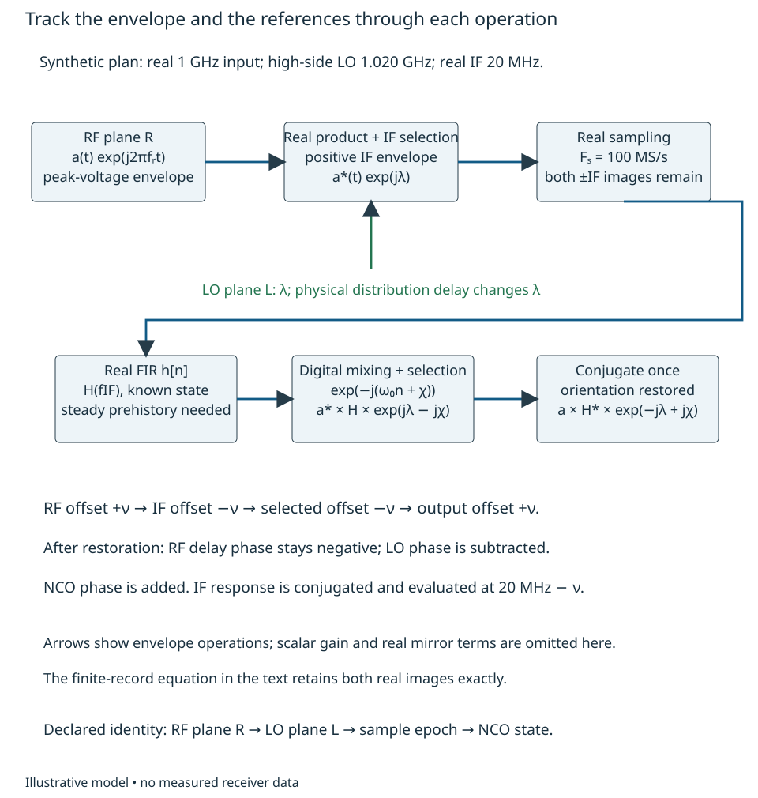
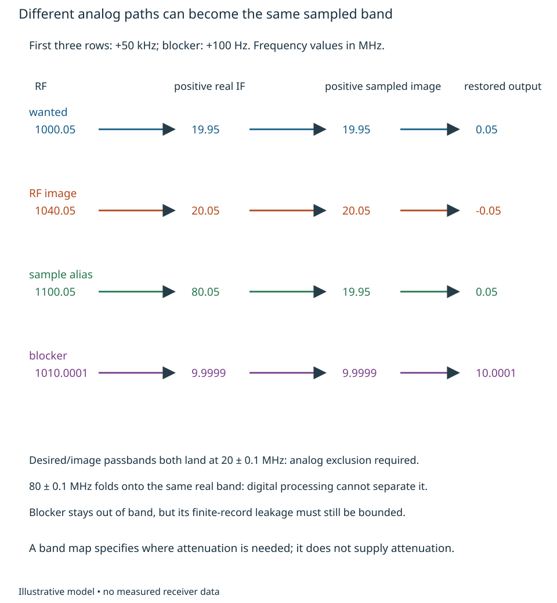
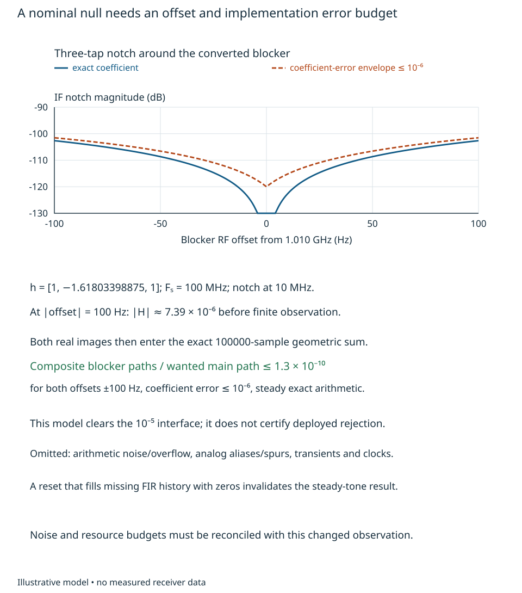
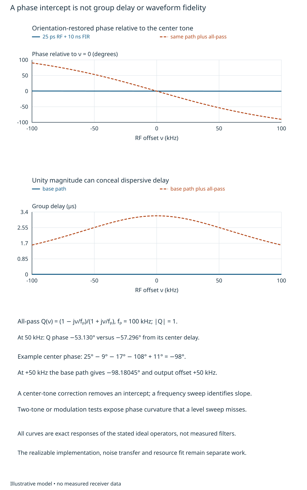

# Frequency, phase and delay transfer {#sec-transfer-plan}

A frequency plan can put every carrier in the intended band and still reverse a
bearing, conjugate a modulation or change phase at each restart. The engineering
question here is more specific: **what complex waveform does a declared RF input
produce at the comparison record, in each identified state?** A useful answer is
an annotated transfer law, with unwanted paths and validity conditions alongside
it. A list of center frequencies is insufficient.

We use the peak-voltage envelope and relative-phase ordering introduced in
[Chapter 1](phase-comparison.qmd):
$v_R(t)=\operatorname{Re}\{a(t)e^{j2\pi f_Rt}\}$ and channel $i$ relative to
reference channel 0 means $\arg(z_i z_0^*)$. The Fourier kernel is
$e^{-j2\pi ft}$. These remain local declared conventions, not new book-wide
notation. The reader needs complex multiplication, physical delay and the
finite-observation reasoning of [Chapter 3](observation-weighted-coherence.qmd).
The sampling interface is ideal until explicitly qualified below; converter
circuit design is not a prerequisite.

By the end, an engineer should be able to trace a tone and a modulation sideband,
calculate the output phase including reference paths, distinguish a constant
phase correction from delay correction, locate image/alias exclusions, and name
the state information required to compare records after reset. The worked plan
will supply the transfer interface used by the conditional architecture in
[Chapter 12](feasibility-architecture-allocations.qmd), without selecting hardware.

## Conversion and reference signs {#sec-conversion-signs}

Let the LO at mixer plane L be $2\cos(2\pi f_Lt+\lambda)$. The factor 2 simply
normalizes this ideal mathematical multiplier to unit difference-band voltage
gain; actual conversion gain has units, loading and drive conditions. Expand the
real RF signal as one half of an analytic component plus its conjugate. The
product contains components at $\pm(f_R+f_L)$ and $\pm(f_R-f_L)$.
Selecting the **positive-frequency difference band**, with nonoverlapping bands,
gives the following envelopes:

$$
b(t)=\begin{cases}
 a(t)e^{-j\lambda},& f_R>f_L,\\
 a^*(t)e^{j\lambda},& f_L>f_R.
\end{cases}
$$ {#eq-mixer-orientation}

Thus high-side conversion conjugates an arbitrary complex modulation. This is
not merely a minus sign attached to one test tone. For $a(t)=A e^{j2\pi\nu t}$,
the high-side IF is centered at $f_L-f_R$ with offset $-\nu$ and envelope phase
$-\arg A+\lambda$. For a phase-modulated waveform, every instantaneous modulation
phase changes sign. For amplitude modulation with a real envelope, that inversion
can be hidden by the test waveform.

[Analog Devices MT-080, Rev. 0, pp. 1–3](https://www.analog.com/media/en/training-seminars/tutorials/MT-080.pdf)
introduces sum/difference products and distinguishes high/low-side injection.
Its ideal multiplier is not a guarantee of practical mixer gain or linearity.
@eq-mixer-orientation is derived here with explicit envelope scaling.

Our synthetic plan has $f_R=1.000$ GHz, $f_L=1.020$ GHz and positive IF center
$f_I=20$ MHz. After a real IF filter with response $H(f)$, ideal real sampling at
$F_s=100$ MHz and digital mixing by
$e^{-j(\omega_0n+\chi)}$, $\omega_0=2\pi f_I/F_s$, the selected complex band
has the high-side orientation. Conjugating that band once restores the RF
orientation. For a single RF tone offset $\nu$, a physical RF delay $\tau_R$
and constant LO/NCO phases, its main-path complex amplitude at output is

$$
Z(\nu)=A e^{-j2\pi(f_R+\nu)\tau_R}
 H^*(f_I-\nu)e^{-j\lambda+j\chi}.
$$ {#eq-restored-transfer}

Here $A$ is the RF-plane peak phasor; any real positive scalar conversion gain
has been factored out. The IF filter precedes sampling. In the worked digital FIR
below, $H$ is instead its discrete-time steady response evaluated at analog
frequency modulo $F_s$; this substitution is valid only for the declared ideal
sampled path. Finite real-image terms are retained separately, rather than
silently included in a scalar $H$.

{#fig-frequency-transfer-orientation fig-alt="Envelope path showing high-side conjugation, real sampling, FIR response, digital mixing and the final conjugation that restores RF orientation. LO and NCO phases enter at different planes."}

The reference sensitivity follows directly. A positive LO phase perturbation
appears as a **negative** restored output phase perturbation. If the LO source
phase is $\lambda_s$ and its distribution delay is $\tau_L$, then
$\lambda=\lambda_s-2\pi f_L\tau_L$. Allowing an NCO phase perturbation,

$$
\delta\phi_i=-2\pi f_R\delta\tau_{R,i}
 +2\pi f_L\delta\tau_{L,i}-\delta\lambda_s+\delta\chi_i
$$ {#eq-transfer-path-sensitivity}

at the center RF tone; set $\delta\chi_i=0$ when the NCO state is held fixed. Common $\lambda_s$ cancels in an ideal simultaneous
relative comparison; unequal endpoint delays and their changes do not. Frequency
conversion does not convert every physical delay into an IF-frequency phase
error. The RF path is weighted by RF frequency and the LO path by LO frequency.

Reference multiplication and division also carry phase. For an ideal harmonic
multiplier of integer order $M$, a chosen harmonic has phase
$M\phi+\phi_{M,0}$, including its additive phase error. An ideal divide-by-$N$
output satisfies $N\theta=\phi$ modulo $2\pi$, so

$$
\theta=\frac{\phi}{N}+\frac{2\pi q}{N},\qquad q\in\{0,\ldots,N-1\}.
$$

The integer $q$ is an edge/state choice, not small noise. For centered small phase
fluctuations within one known state, multiplication/division scales phase PSD by
$M^2$ or $N^{-2}$ before additive disturbances; the offset-frequency variable is
unchanged in this ideal phase-process model. This statement supplies neither a
PLL transfer function nor deterministic divider initialization. A frequency
relation alone leaves $q$ undetermined.

## Bands and unwanted responses {#sec-frequency-exclusions}

Before making a scalar transfer claim, list every physical path that reaches the
observed band. For real sampling,
$e^{j2\pi(f+kF_s)n/F_s}=e^{j2\pi fn/F_s}$ for integer $k$.
The principal signed alias is $f_a=f-F_s\lfloor f/F_s+1/2\rfloor$ in
$[-F_s/2,F_s/2)$. A real waveform also contains the negative-frequency conjugate.
Folding to a positive plotted frequency therefore needs an additional orientation
check. This algebra, rather than a mnemonic about Nyquist zones, determines the
sign for an asymmetric modulation.

[MT-002, Rev. A, pp. 9–11](https://www.analog.com/media/en/training-seminars/tutorials/MT-002.pdf)
discusses zone inversion and analog filtering. Here alias placement is derived
for an ideal sampler; aperture response, converter noise and distortion remain
separate implementation inputs.

For the plan above, consider a receiver passband of $\pm100$ kHz around the wanted
carrier; the architecture's worked signal itself is a tone. The same digital band
receives an RF image at $1.040$ GHz through the 20 MHz IF. A signal near 1.100 GHz
produces an 80 MHz IF whose real sampled image lies at 20 MHz. The IF response
must be evaluated at **80 MHz before sampling**, not 20 MHz after folding. Once
these analog paths overlap in the samples, a downstream linear filter cannot
separate arbitrary independent waveforms with identical sampled support.

{#fig-frequency-exclusions fig-alt="Four frequency paths trace an RF sideband through positive IF, real-sampled folding and output orientation. Desired, image and alias paths overlap at the selected band; the blocker remains off-band."}

A first spur inventory should likewise propagate candidate products
$|m f_R\pm n f_L|$ through the sampler and digital selection. For example,
$2f_L-2f_R=40$ MHz lies outside a 20 MHz IF passband, but other residual products overlap after sampling:

| Residual analog product at the sampler | Frequency | Principal sampled alias | Consequence |
|---|---:|---:|---|
| RF + LO sum product | 2020 MHz | +20 MHz | Overlaps wanted; IF sum rejection required |
| LO feedthrough | 1020 MHz | +20 MHz | Overlaps wanted; isolation/IF rejection required |
| $2f_R-f_L$ nonlinear product | 980 MHz | −20 MHz | Real conjugate also overlaps; amplitude needs nonlinear evidence |

Frequencies here are at nominal centers; propagate each product's actual
sideband offsets and conjugations before accepting a modulation plan.
The finite inventory $|m|,|n|\le2$ is a useful first check, not an
exhaustive nonlinear model. Product amplitudes require part-specific drive,
loading, compression, isolation and multi-signal evidence; integer labels do not
predict them. Sum-band rejection and RF/IF image suppression must occur before
those paths alias or overload a stage. Digital rejection cannot repair clipping.

### A finite observation that can be exercised

The architecture requires composite blocker-to-record voltage transfer no larger
than $\eta_B=10^{-5}$, normalized to the wanted main response. Merely selecting
10 MHz for a blocker and 20 MHz for the wanted IF does not establish this.
At a noninteger record offset, a rectangular record leaks both real images.

As a reproducible **operator candidate**, use a real three-tap FIR before digital
mixing:

$$
h=[1,-2\cos(0.2\pi),1],\quad
H(f)=e^{-j\omega}[2\cos\omega-2\cos(0.2\pi)],\quad
\omega=2\pi f/F_s.
$$ {#eq-three-tap-notch}

It has a notch at 10 MHz and unit magnitude at 20 MHz. The latter response is
$e^{j108^\circ}$, with group delay one sample in its nonzero, constant-sign band.
The FIR needs two genuine preceding samples; discarding two initial outputs or
supplying valid continuous history is part of the observation definition.

Define the normalized record sum, for $N=100000$ samples, $T=N/F_s=1$ ms,

$$
D_N(f)=\frac1N\sum_{n=0}^{N-1}e^{j2\pi fn/F_s}
 =e^{j\pi(N-1)f/F_s}\frac{\sin(\pi Nf/F_s)}{N\sin(\pi f/F_s)}.
$$

At integer multiples of $F_s$, use the continuous limit 1. A real tone with
positive-frequency peak phasor $B$ after conversion but before this FIR gives,
**before final conjugation**,

$$
Y=e^{-j\chi}\{B H(f)D_N(f-f_I)
 +B^* H^*(f)D_N(-f-f_I)\}.
$$ {#eq-real-record}

This follows by substituting $x[n]=(B e^{j2\pi fn/F_s}+B^*e^{-j2\pi fn/F_s})/2$
into $2N^{-1}\sum(h*x)[n]e^{-j(\omega_0n+\chi)}$.
No random phase or favorable cancellation was assumed. Final $Z=Y^*$.
The second term explains why the exact finite real observation is generally a
map in both $B$ and $B^*$, rather than a complex scalar gain alone.

For wanted and blocker RF offsets each in $[-100,100]$ Hz, put
$f_w=20\text{ MHz}-\delta_w$ and $f_b=10\text{ MHz}-\delta_b$.
At the worst offset, $|H(f_b)|\le7.387\times10^{-6}$. If the middle coefficient
has error $|\epsilon_c|\le10^{-6}$, its additional response has magnitude at
most $10^{-6}$. Meanwhile the two blocker sums obey

$$
|D_N(f_b-f_I)|+|D_N(-f_b-f_I)|<1.383\times10^{-5}.
$$

To check this bound without a sweep, each numerator is at most $\sin(0.1\pi)$;
the two denominator sine magnitudes are at least
$\sin[\pi(0.1-10^{-6})]$ and $\sin[\pi(0.3-10^{-6})]$, respectively.
The wanted main coefficient is greater than 0.9836 including this coefficient
error. Thus the **sum** of blocker-path magnitudes relative to that main path is
less than $1.3\times10^{-10}$ in this steady, exact-arithmetic model, comfortably
below the supplied $10^{-5}$ interface. The wanted mirror/main ratio is bounded
by $3.4\times10^{-6}$; it is a separate signal-dependent error, not blocker
rejection. Its per-channel phase magnitude is at most $\arcsin(3.4\times10^{-6})$,
about $0.000195^\circ$, and it must be charged if retained.

{#fig-notch-observation fig-alt="Notch magnitude versus a small blocker frequency offset, showing the exact coefficient and a coefficient-error envelope, followed by the finite-observation rejection conditions."}

This example provides an executable transfer, not a selected filter or deployed
rejection guarantee. It omits arithmetic roundoff/overflow, reset transients,
additional analog aliases/spurs and clock error. The FIR changes noise transfer;
the architecture's effective $N_0$ must refer to this complete observation or be
recomputed from source spectra. It cannot simply be copied from a different
filter. Two delays and one constant multiply per input sample imply roughly
300 million constant multiplies/s for three 100 MS/s channels before any
optimization, plus the digital mixer/accumulation. Symmetry and fixed coefficients
may reduce cost; no implementation/power claim follows. The two-sample history
adds 20 ns of startup data, distinct from the FIR's 10 ns group delay and from
processing/transport latency. Those distinctions matter to the 0.6 ms processing
and 2.5 W envelopes in Chapter 12.

## Response over bandwidth {#sec-transfer-bandwidth}

Take the worked input tone phase $25^\circ$, RF delay $\tau_R=25$ ps,
LO phase $\lambda=17^\circ$ at L and NCO phase $\chi=11^\circ$ at the defined
sample origin. @eq-restored-transfer gives at the carrier

$$
\phi_Z=25^\circ-9^\circ-17^\circ-108^\circ+11^\circ=-98^\circ.
$$

For an RF sideband at $\nu=+50$ kHz, the IF is 19.95 MHz. Its FIR phase is
$108.18^\circ$, while the RF delay contributes $-9.00045^\circ$.
The restored tone therefore has offset **+50 kHz** and phase
$-98.18045^\circ$ at the declared origin. This is the sideband's waveform
phasor, not the output of a center-frequency 1 ms accumulation: that record has
a null at 50 kHz. Extracting this tone requires following its frequency, as in
the waveform check, or inspecting the complex waveform before accumulation. An independent real-waveform
mix/filter/sample calculation tests this result; an amplitude-only test cannot
show its orientation.

For a smooth nonzero main transfer $G(\nu)$, define equivalent envelope group
delay as $\tau_g=-[2\pi]^{-1}d\arg G/d\nu$. Because
$G(\nu)=e^{-j2\pi(f_R+\nu)\tau_R}H^*(f_I-\nu)$ up to constant reference phases,
the two reversals give

$$
\tau_g(\nu)=\tau_R+\tau_{g,H}(f_I-\nu).
$$

For this FIR, it is $10.025$ ns. The carrier phase intercept is **not**
$-2\pi f_R\tau_g$: the RF carrier and IF filter use different frequency origins.
A single-tone calibration removes an intercept but cannot establish the slope.
A differential slope $\Delta\tau$ produces phase error
$-2\pi\nu\Delta\tau$ after center correction; a $0.1^\circ$ limit at
$|\nu|=100$ kHz requires $|\Delta\tau|\le2.778$ ns under a pure-delay model.

Nor does unit magnitude imply undistorted modulation. Consider a further
orientation-restored equivalent all-pass response
$Q(\nu)=(1-j\nu/f_p)/(1+j\nu/f_p)$, $f_p=100$ kHz. It has magnitude 1,
phase $-2\arctan(\nu/f_p)$ and delay
$1/[\pi f_p(1+(\nu/f_p)^2)]$. At 50 kHz its phase is $-53.130^\circ$,
whereas extrapolating its center delay predicts $-57.296^\circ$.
The $4.166^\circ$ discrepancy affects relative sideband timing and waveform shape.
This is a stable causal first-order all-pass in the equivalent complex path,
not a specified RF component. A sweep or known asymmetric modulation is needed
to assess dispersion; a flat level response and a center phase correction miss it.
Even two chosen tones can conceal curvature. For this $Q$, the values at
$\nu=\pm50$ kHz exactly match a pure delay of 2.951672353 microseconds; both
responses also equal one at the center. Their phases differ by 16.260205° at
+100 kHz. Sweep the tone locations, use additional suitably placed frequencies,
or compare against an independently established delay. A fixed tone pair alone
identifies a secant slope and phase intercept, not general phase curvature.

{#fig-transfer-response fig-alt="Two plots compare orientation-restored phase and group delay of the basic RF/FIR path with the same path plus a unity-magnitude all-pass. The all-pass curves expose dispersion hidden by a center-tone calibration."}

## State-sensitive plans {#sec-transfer-states}

A plan has state coordinates as well as frequencies. In this example record the
LO/divider state, actual sample origin, NCO accumulator phase, filter history and
calibration reference planes. A positive one-sample shift means that sample
label $n$ now contains the old waveform at $n+1$ while the NCO label remains $n$.
Before restoration that advances a 20 MHz IF by $72^\circ$; after conjugation it
changes output phase by **−72°**. If the NCO/sample labels shift consistently,
the result differs: specify what moved before correcting it. A +90° NCO phase
change gives +90° restored phase. A divide-by-2 reference state change can give
180° LO change, hence −180° output change. Equal output frequencies in all three
cases do not imply a valid comparison to the prior calibration.

Actual hardware documentation makes these conditions concrete.
[AD9208 Rev. 0, p. 49 and pp. 78–81](https://www.analog.com/media/en/technical-documentation/data-sheets/AD9208.pdf)
separately describes NCO-accumulator synchronization, link latency, SYSREF timing
and multichip alignment. Its p. 49 SPI reset method is limited to NCOs on one
chip; the SYSREF method has enabling conditions. Page 78 requires distribution
skew, setup/hold and link-latency conditions. This is evidence of conditional
state mechanisms in that device/revision, not evidence that our synthetic
100 MS/s plan uses it or has deterministic RF phase. The p. 80 timestamp-mode
paragraph also contains apparently conflicting reset wording; no reset guarantee
is imported from it. Consult the relevant revision and implementation evidence
before depending on a mode.

Calibration should exercise what the measurement needs. A known RF phase change
at plane R tests conversion orientation; a positive frequency-offset change tests
modulation orientation and slope. A coherent RF sweep can identify differential
transfer over the usable band. Injection after an RF selector cannot identify
its phase, and no electronic injection establishes the antenna's field response.
A restart test must retain sample identity and reference/NCO state evidence, and
must distinguish constant offsets from invalid or settling records. These are
verification implications of the transfer, not a complete transition procedure.

To transfer the method, lower the LO to 980 MHz while keeping a positive 20 MHz
IF. Derive the low-side selected envelope and the NCO sign; determine whether the
final conjugation should remain. Trace the RF image at 960 MHz and a +50 kHz
wanted sideband. The low-side envelope is $a e^{-j\lambda}$, so ordinary negative
20 MHz digital mixing already restores the wanted orientation; retaining the
conjugation would reverse it. The wanted IF sideband is +50 kHz and the 960 MHz
image sideband is inverted. Finally, suppose only a center-tone calibration is
available and the extra all-pass is possible: the data cannot establish the
2.778 ns differential-delay envelope. The engineering choice stays conditional
until bandwidth-sensitive evidence or a justified physical bound is supplied.
