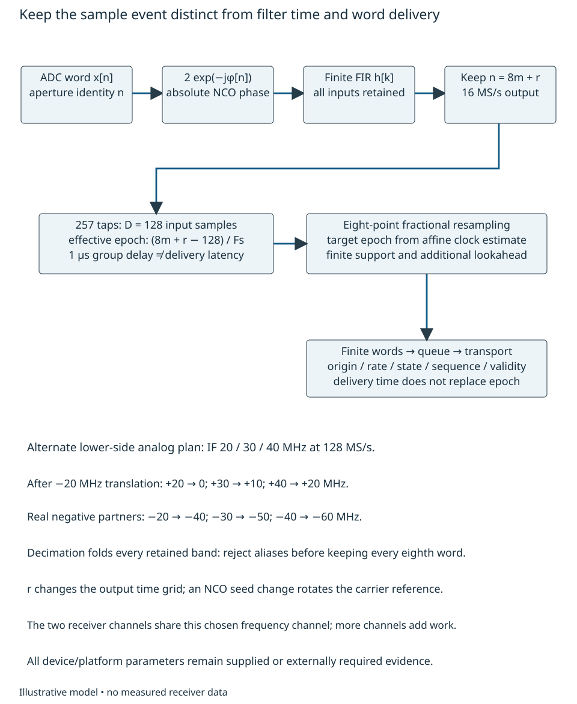
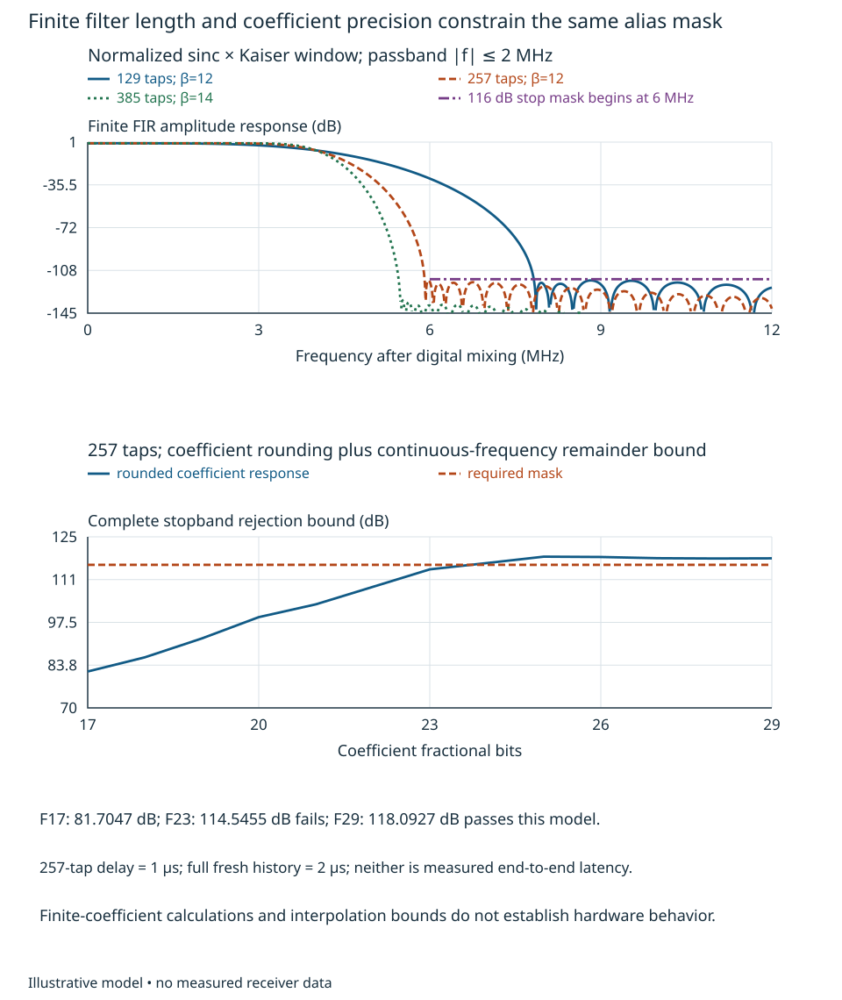
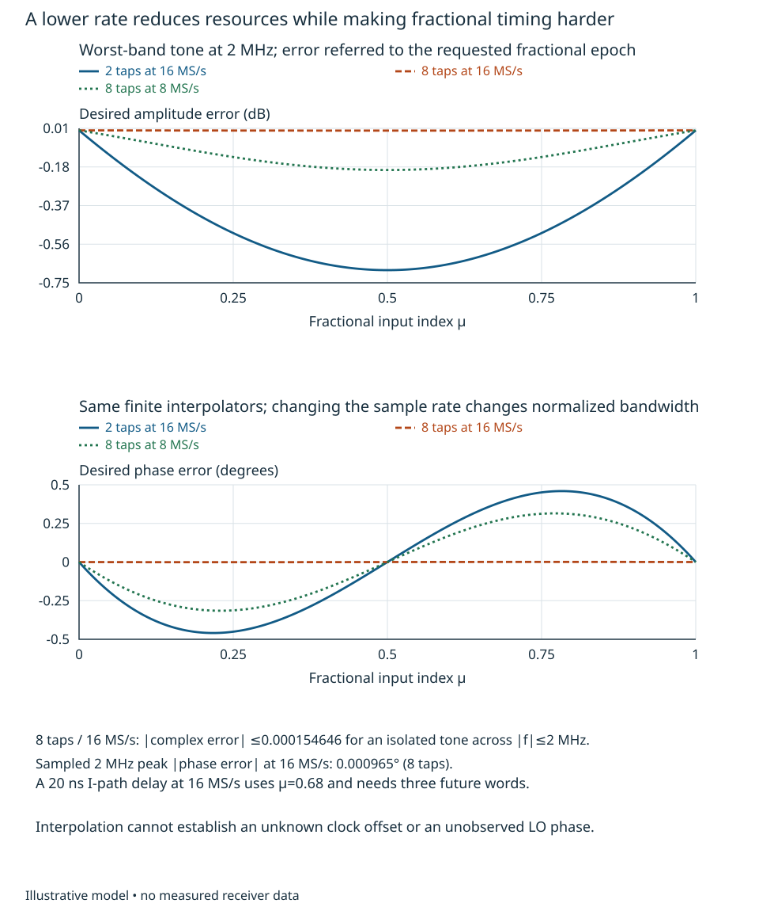
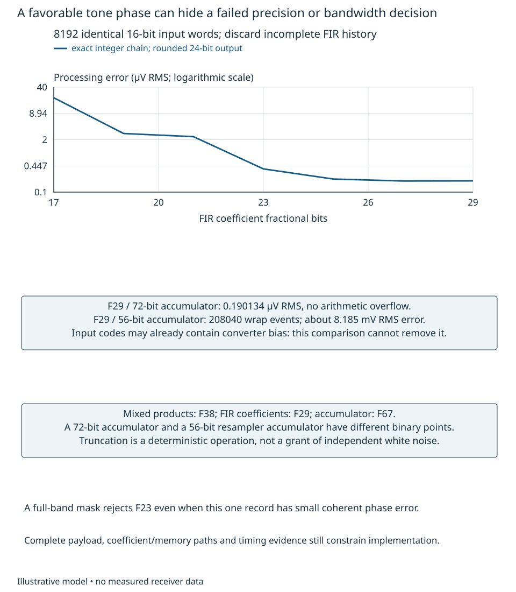
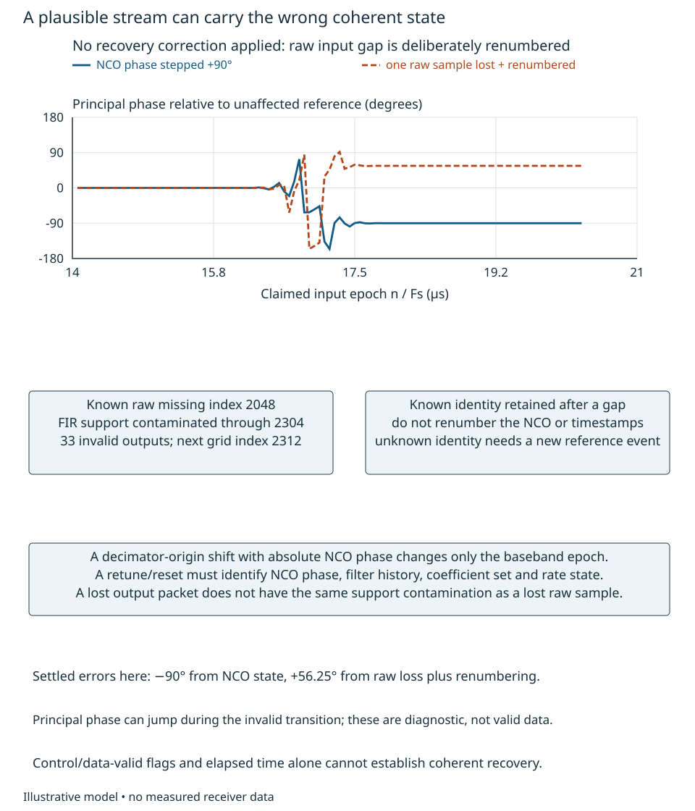
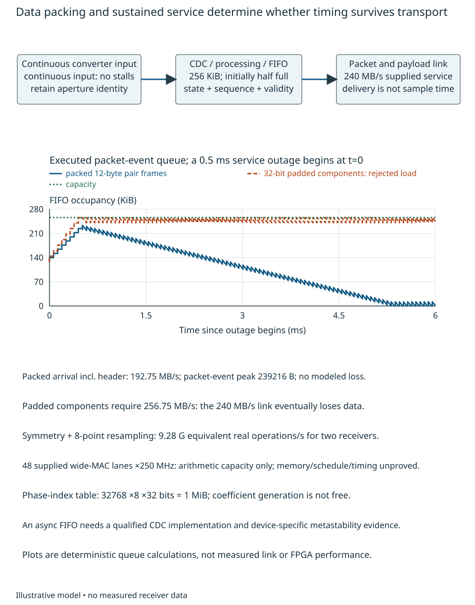

# Multirate processing and finite resources

A digitally clean-looking stream can still have the wrong phase, the wrong
sample epochs, aliased blockers or an unsustainable delivery rate. Our problem
is to turn an admitted converter stream into a **defined complex observation
whose sample identity survives finite filtering, rate change, arithmetic and
transport**. Chapters 11 and 17 establish conversion orientation and the sample
event; this treatment realizes a bounded processing chain at that interface.
The reader should be able to select a finite filter and rate, propagate phase
and epoch through the chain, compare finite-word and reference calculations,
and reject a platform or interface whose timing or resources cannot support
that observation. All new requirements and proposed hardware envelopes are
illustrative. Executed software records and one host timing experiment are
identified separately from hardware evidence.

## Translate and filter before discarding samples

Continue Chapter 17's explicitly alternate lower-side analog plan: desired IF
20 MHz, blockers 30 and 40 MHz, real samples at $F_s=128$ MS/s. This does not
replace Chapter 11's original high-side plan. Desired bandwidth is $20\pm2$ MHz;
nominal peak amplitudes are $A=7.943282$ mV wanted and $B=354.813389$ mV per
blocker. The earlier input-range, clock and analog-state qualifications remain
necessary. We first treat the supplied samples as exact values; later comparisons
use identical already-digitized words on both sides of a processing test.

A numerically controlled oscillator (NCO) supplies phase $\varphi[n]$. Form the
digitally downconverted sequence

$$
 v[n]=2x[n]e^{-j\varphi[n]},\qquad
 \varphi[n]={2\pi f_N n\over F_s}+\varphi_0. \tag{19.1}
$$

For a real cosine $A\cos(2\pi f_Nn/F_s+\theta)$ this gives the desired constant
$Ae^{j(\theta-\varphi_0)}$ plus a translated negative-frequency partner. The
factor two preserves Chapter 1's peak-voltage envelope scaling. It is not an
extra analog gain or a guarantee of headroom. Here $f_N=20$ MHz. Positive
20/30/40 MHz become 0/10/20 MHz; their real negative partners become
−40/−50/−60 MHz. All enter the digital filter. A real input's negative partner
cannot be omitted merely because the desired complex output is near zero.

With a length-$L$ finite impulse response (FIR) $h[k]$, decimation factor $M$
and origin $r\in\{0,\ldots,M-1\}$, retain

$$
 y[m]=\sum_{k=0}^{L-1}h[k]v[Mm+r-k]. \tag{19.2}
$$

Filtering followed by keeping every $M$th sample folds frequencies modulo
$F_o=F_s/M$. It does not suppress the folded content. To preserve the desired
$[-2,2]$ MHz interval at $M=8$, examine every unwanted interval
$\ell F_o+[-2,2]$ MHz. The nearest are 14–18 MHz and their negative partners.
For example, the negative 30 MHz input becomes −50 MHz and folds to −2 MHz.
As a different alias stress case, replace the 40 MHz blocker by 36 MHz: its
translated 16 MHz component falls directly at zero after decimation. These
are different input conditions; their error contributions must be recalculated.

Supply a conservative filter mask: at most 0.01 dB desired gain error for
$|f|\le2$ MHz, and at least 116 dB rejection for $6\le|f|\le64$ MHz before
keeping samples. The 6 MHz stop edge leaves transition and guard room for the
16 MS/s interface; it is stronger than the nearest desired-band alias condition.
If two $B$-sized coherent aliases alone share 0.01° of phase displacement, Chapter
12's phasor bound requires $20\log_{10}[2B/(A\sin0.01^\circ)]=114.1831$ dB.
The 116 dB mask adds margin in this illustrative interface allocation. Other
errors still require the complete source/path budget; these local criteria do
not grant several copies of a system allowance.

{#fig-processing-sample-paths fig-alt="Converter words with aperture identity pass through an absolute-phase NCO, finite FIR and every-eighth-sample selection. Boxes distinguish a one-microsecond group delay, finite fractional resampling and queued transport. Text traces all positive and negative IF partners before decimation."}

An ideal low-pass response of width $2f_c$ has inverse Fourier sequence
$2f_c\operatorname{sinc}[2f_c(k-D)/F_s]/F_s$, where
$\operatorname{sinc}u=\sin(\pi u)/(\pi u)$ and $D=(L-1)/2$. It has infinite
support. Truncating and tapering it trades transition width, sidelobes and
latency. Our reproducible candidate is

$$
 \begin{aligned}
 h_0[k]&={2f_c\over F_s}\operatorname{sinc}
        \!\left[{2f_c\over F_s}(k-D)\right]w[k],\\
 w[k]&={I_0\!\left(\beta\sqrt{1-[(k-D)/D]^2}\right)\over I_0(\beta)},
 \qquad h[k]={h_0[k]\over\sum_i h_0[i]},
 \end{aligned}\tag{19.3}
$$

for $0\le k<L$, $f_c=4$ MHz, $L=257$ and $\beta=12$. The Kaiser-window function
uses $I_0(u)=\sum_{q\ge0}(u^2/4)^q/(q!)^2$; thus every coefficient is specified
without a design library or an empirical order formula. Increasing the taper
parameter at fixed length also widens the transition: a larger number is not
a universal improvement. We evaluate the resulting finite response rather than
assuming that a window name certifies a mask.

For these real symmetric coefficients,
$H(f)=e^{-j2\pi fD/F_s}B(f)$ with $B$ real. Positive $B$ throughout the desired
band gives a group delay of $D/F_s=1$ μs and no unexplained phase curvature.
A baseband tone at frequency $\nu$ appears at an effective epoch

$$
 t_{\rm eff}[m]={Mm+r-D\over F_s}. \tag{19.4}
$$

That epoch is not the instant the MAC engine or link emits the word. Starting
with zero-filled history produces a mathematically defined transient; it is
not evidence of the assumed prehistory. For a steady-response claim require
257 identified fresh input words, so the first complete support is $n=256$,
2 μs after the input origin. Additional analog and clock recovery remains
external to that statement.

A frequency grid alone could miss a peak. For the centered response, the exact
second-derivative magnitude bound is

$$
 K_2=\left({2\pi\over F_s}\right)^2
       \sum_k(k-D)^2|h[k]|.
$$

Between grid points separated by $\Delta f$, linear interpolation has a complex
response remainder no larger than $K_2\Delta f^2/8$. The magnitude of the linear
interpolant is bounded by the larger endpoint magnitude. Here a 524288-point
FFT gives $\Delta f=244.140625$ Hz, with both mask edges exactly on the grid;
$K_2=1.27704\times10^{-12}$ Hz$^{-2}$ adds $9.51469\times10^{-9}$ in amplitude.
The finite-coefficient model then has a stopband rejection bound of **118.0997
dB**, versus the sampled maximum's 118.1664 dB. Direct sums provide independent
numerical checks at important frequencies. This mathematical bound assumes the
stated coefficients; it does not certify a device's arithmetic or clocks.

| Finite candidate | Consequence before word rounding |
|---|---|
| 129 taps, $\beta=12$ | About 0.2752 dB pass-edge loss and 30.12 dB sampled stop rejection: fails |
| 257 taps, $\beta=10$ | About 100.13 dB sampled stop rejection: fails |
| 257 taps, $\beta=12$ | Meets the supplied mask with the stated interpolation remainder |
| 385 taps, $\beta=14$ | About 137.83 dB sampled stop rejection, but 1.5 μs group delay and more work |

{#fig-processing-filter-precision fig-alt="The first plot compares three finite sinc-Kaiser filters and a stop mask beginning at six MHz. The second plots complete stopband rejection versus coefficient fractional bits, including a continuous-frequency interpolation remainder. Twenty-three fractional bits fail and twenty-nine pass the illustrative mask."}

Quantization changes the same coefficients and must be checked against the same
mask, as @fig-processing-filter-precision shows. In its lower panel, $F$ fractional
coefficient bits means a step of $2^{-F}$; the complete word allocation follows
in the numerical-realization section. For independent discrete
real input noise of variance $\sigma_x^2$, (19.1)–(19.2) give total complex noise
energy $4\sigma_x^2\sum h[k]^2$. Here $\sum h^2=0.0577190$. This does not make
the output proper or its successive samples independent: the normalized
adjacent-output covariance at $M=8$ is approximately **0.674041**. Colored,
cyclostationary or shared noise needs Chapter 3's actual observation weights
and Chapter 9's source paths, not an automatic $1/\sqrt{N_o}$ gain.

Equation (19.2) need not compute and discard seven full outputs. Substitute
$k=Mq+p$ and sum over $p=0,\ldots,M-1$ to obtain the equivalent polyphase groups
$h[Mq+p]v[M(m-q)+r-p]$. Every input still enters the stored history, while
only retained output dot products are evaluated. This is the distinction
emphasized in TI's integer-rate audio example [@tiSLAA193]; its hardware and
rate limits do not establish this RF implementation. Multiple frequency
channels can use separate NCO/filter chains. A shared alternative follows
directly for centers $f_\ell=f_0+\ell F_s/M$ and a common prototype $h$.
Writing $v_0[n]=2x[n]e^{-j2\pi f_0n/F_s}$, substitute $k=Mq+p$ to obtain

$$
 \begin{aligned}
 P_p[m]&=\sum_q h[Mq+p]v_0[M(m-q)+r-p],\\
 y_\ell[m]&=e^{-j2\pi\ell r/M}
        \sum_{p=0}^{M-1} e^{j2\pi\ell p/M}P_p[m].
 \end{aligned}
$$

The finite Fourier combination shares the prototype groups, but its sign and
origin factor are part of the coherent response. Every admitted input must
still enter history. A channelizer must preserve each channel's response,
phase origin, alias mask and rate contract; its resource savings require an
actual schedule. The executed resource example here has one selected frequency
channel in **two receiver channels**, not a free bank of many frequency channels.

## Resample known epochs with finite support

Chapter 16 provides clock estimates; a resampler does not create them. Let
$C_B(t)=\alpha t+\beta$ be B's clock coordinate in seconds relative to target
clock A. Suppose the already-propagated B baseband epoch labels are
$C_B=n/F_B$, including the FIR delay and decimator origin. To request A epoch
$t_m$, the required B input index is

$$
 q_m=F_B(\alpha t_m+\beta). \tag{19.5}
$$

A positive $\beta$ selects a later B index. Applying the inverse mapping here
would be an orientation error. If the labels have a different origin, insert
that origin explicitly before using (19.5). Physical RF/LO phase and unknown
propagation remain separate Chapter 16 observations; aligned baseband samples
do not establish their equality.

For $q=p+\mu$, $p=\lfloor q\rfloor$ and $0\le\mu<1$, two-point linear
interpolation uses $(1-\mu)u[p]+\mu u[p+1]$. On a complex tone of normalized
angular frequency $\omega$, its response relative to the requested epoch is
$(1-\mu)e^{-j\omega\mu}+\mu e^{j\omega(1-\mu)}$, not unity. At 2 MHz with
$F_B=16$ MS/s, $\mu=1/2$ loses 0.68769 dB. A better finite alternative uses
nodes $j=-3,\ldots,4$ and the polynomial basis

$$
 w_j(\mu)=\prod_{\substack{\ell=-3\\\ell\ne j}}^4
            {\mu-\ell\over j-\ell},\qquad
 \widehat u(q)=\sum_{j=-3}^4w_j(\mu)u[p+j]. \tag{19.6}
$$

Each basis polynomial equals one at its own node and zero at the other seven;
the combination therefore reproduces any polynomial through degree seven.
A sinusoid is not such a polynomial. Its exact residual transfer is
$R(\omega,\mu)=\sum_jw_j e^{j\omega(j-\mu)}$. Repeated integration of the eighth derivative bounds its divided difference
by $|\omega|^8/8!$. The resulting interpolation remainder for
$e^{j\omega q}$ is bounded in magnitude by
$|\omega|^8\prod_j|\mu-j|/8!$. Pairing nodes about $1/2$ shows the product is
maximal there: $(1/4)(9/4)(25/4)(49/4)=43.06640625$. Thus for an isolated tone
within $|f|\le2$ MHz at 16 MS/s,

$$
 |R-1|\le0.000154646. \tag{19.7}
$$

This implies at most 0.001344 dB loss and 0.008861° phase displacement before
word errors. Direct frequency/fractional-index checks give smaller maxima;
@fig-processing-fractional-delay shows why an unqualified two-point substitute
would fail. For modulation use the actual waveform norm and minimum-amplitude
conditions: phase near a desired zero cannot be bounded by a tone argument.
Noise transforms as $w^{\mathsf T}Cw$ for its actual sample covariance; only for
independent equal-variance input samples does the variance ratio reduce to
$\sum w_j^2$, equal to 0.745333 at $\mu=1/2$.

The eight support samples require lookahead through $p+4$ and valid history
back to $p-3$. No extrapolation is used here. For Chapter 18's 20 ns I-path
match at 16 MS/s, the target $n-0.32$ has $p=n-1$, $\mu=0.68$: the support is
$n-4$ through $n+3$. Waiting for those three future words adds delivery latency
while preserving the declared delayed target epoch. A finite I/Q correction
needs this residual, coefficient and state evidence in addition to its ideal fit.

{#fig-processing-fractional-delay fig-alt="Amplitude and phase error versus fractional sample index compare linear and eight-point interpolation at sixteen MS/s with eight-point interpolation at eight MS/s, all for a two-MHz tone. The lower rate makes the same finite interpolator substantially worse."}

Keeping $M=16$ instead of 8 would halve the output rate to 8 MS/s. The existing
filter still suppresses the nearest desired-band aliases at 6–10 MHz, although
the outer output region is not a new flat passband. The same eight-point
interpolator at 2 MHz now loses as much as **0.19503 dB** and has about **0.31512°**
phase error. Even a 16-point alternative gives about 0.01519° at some fractions
and needs its own precision/resource evidence. Lower delivery rate is useful,
but is not a complete design decision. We retain 16 MS/s for the demonstrated
band, finite interpolator and interface. Reducing to 4 MS/s with $M=32$ is a
stronger failure: the old transition overlaps wanted-band aliases. A 24 MHz
input translates to 4 MHz, has $|H|\simeq0.4999993$, and folds onto zero.
The filter that worked at another rate cannot undo that overlap.

An error in the supplied clock estimate also survives excellent interpolation.
With $\delta\alpha=\widehat\alpha-\alpha$ and
$\delta\beta=\widehat\beta-\beta$, the actual epoch error is
$(t_m\delta\alpha+\delta\beta)/\alpha$. Retain the offset/rate covariance
from Chapter 16 when propagating it; they need not be independent. Illustrative
bounds of 0.5 ns offset error and 20 ppb rate error over 10 ms permit about
0.7 ns, or **0.504° at 2 MHz**. Better filter arithmetic cannot supply the
missing timing evidence. A separate 0.01° timing allocation at that frequency
would need about 13.89 ps. A baseband DC tone's insensitivity to this time error
would not establish RF phase synchronization.

An executed asynchronous example uses $F_B=16$ MS/s,
$\alpha=1+20$ ppm, $\beta=10$ ns and
$s(t)=4e^{j(2\pi\,2{\rm MHz}\,t+0.2)}+
3e^{j(-2\pi\,0.75{\rm MHz}\,t-0.3)}$ mV. Construct B's input at true times
$(n/F_B-\beta)/\alpha$ and evaluate (19.5) for target indices 16–32749 from a
32768-sample source. The eight-point floating implementation gives **0.0091085%**
normalized record error. Quantizing its phase index to 15 fractional bits and
coefficients to 29 fractional bits gives **0.0091266%**. With the specified
24-bit input/output words below, the executed integer interpolator gives
**0.0104159%**. These pass an illustrative 0.02% processing-record criterion
for this waveform, with exact supplied clock estimates; they do not test the
0.7 ns clock-error envelope or qualify an actual asynchronous clock link.

## Allocate binary points before selecting word widths

A signed integer word $X$ with $F$ fractional bits represents $X2^{-F}$ in the
chosen voltage normalization. Its width controls range and its binary point
controls resolution. Neither follows from the phrase “24-bit processing.”
Rounding, truncation, saturation and wrapping are distinct operations.

For an NCO with a $b$-bit accumulator, integer step $K$ gives
$f_N=KF_s/2^b$. Selecting the nearest step bounds frequency error by
$F_s/2^{b+1}$; coherent phase accumulates that error over the observation.
The 20 MHz center is exactly $5F_s/32$, so its tuning word is exact. For a
changed center of $20$ MHz $+123.45$ Hz and a 10 ms observation:

| Accumulator bits | Nearest step | Frequency error | Downconverted phase error after 10 ms |
|---|---:|---:|---:|
| 32 | 671092782 | −0.00878067 Hz | +0.0316104° |
| 36 | 10737484517 | +0.000532556 Hz | −0.00191720° |
| 40 | 171799752267 | −0.0000495203 Hz | +0.000178273° |

The output sign is negative because (19.1) subtracts NCO phase. A supplied
0.005° NCO-frequency share rejects 32 bits for this retune and accepts 36/40
for further investigation. Phase-table and amplitude precision remain separate.
The examined MT-085 Rev. 0 pp. 2–4 distinguishes accumulator, tuning-word update
and phase-to-amplitude truncation [@adiMT085]. Its DDS/DAC examples are not
spur guarantees for this digital mixer. Loading a new frequency word can retain
phase when the accumulator is preserved; resetting or reseeding it is a
different operation with a different phase state.

The fixed reference case uses these explicit interfaces:

| Stage | Specified numerical representation |
|---|---|
| Converter word | Signed 16 bits, $F=15$; the *same words* enter floating and integer processing |
| NCO | 40-bit phase accumulator, nearest 24-bit phase address; sine/cosine signed 25 bits, $F=23$, including exact $+1$ |
| Twice-real-input mixer product | Exact signed 40-bit controlled range, $F=38$ |
| FIR coefficient | Signed 32 bits, $F=29$ |
| FIR accumulator | Signed 72 bits, $F=67$; range checked at every addition |
| FIR output | Nearest-even rounded signed 24 bits, $F=21$, range $[-4,4)$ V |
| Fractional interpolator | 15-bit fractional phase, signed 32-bit/$F=29$ coefficients, signed 56-bit/$F=50$ accumulator; rounded back to 24-bit/$F=21$ output |

The illustrative converter encoding rounds $2^{15}x[n]$ to nearest even and
clips to the signed range $[-32768,32767]$. This is a declared numerical rule,
not a characterized converter transfer curve.

The complete admitted three-tone peak bound is 0.717570 V. Mixer components
therefore need up to 1.43514 V; “complex baseband” does not excuse overflowing
the multiplier before filtering. The rounded filter has
$\sum|h|=1.532574745$, giving a conservative component bound about 2.20 V.
Including the eight-point interpolator's maximum absolute-weight sum
1.48828125 still fits the 24-bit/$F=21$ range, with the declared rounding margin.
These bounds require the stated input envelope; a generic full-range 24-bit
word is not automatically an admissible resampler input.

At the FIR binary point the corresponding absolute-sum bound is
$3.24583\times10^{20}$ integer units. It requires 70 signed bits; the selected
72-bit accumulator leaves arithmetic margin. The 56-bit resampler accumulator
has fewer fractional bits and a different range requirement: word widths alone
cannot be compared. A smaller accumulator's modulo wraps can occasionally
cancel by the final sum, so a favorable final output does not prove absence of
intermediate overflow. We instrument every addition in the specified model.

If FIR coefficients have rounding error $\delta h_k$, then
$|\delta H(f)|\le\sum|\delta h_k|\le L2^{-F-1}$. Actual response checks remain
necessary. Applying the grid/remainder method to the rounded 257-tap filter
produces **81.7047 dB** complete stop rejection at $F=17$,
**114.5455 dB** at $F=23$ and **118.0927 dB** at $F=29$. The first two fail the
116 dB mask, despite favorable behavior at some particular test frequencies.
The $F=29$ passband bound is approximately −0.00002345 to +0.000000465 dB.

Now execute the arithmetic. Generate 8192 samples of the admitted three-tone
waveform with phases $(0.3,1.1,-0.7)$ radians, quantize once to the supplied
16-bit converter words, and use identical words in both chains. Evaluate outputs
with complete history ($n\ge256$). The floating chain is a *digital reference*,
not ground truth about the RF field or ADC. Chapter 17's coherent quantization
bias can already exist in these words.
Error norms use only the 992 outputs with complete history; instrumented
overflow and clipping counts include the entire 1024-output execution.

| Integer case | Error versus floating digital reference | Consequence |
|---|---:|---|
| FIR $F=17$, 72-bit accumulator | 21.8716 μV RMS | Poor record fidelity and failed mask |
| FIR $F=23$, 72-bit accumulator | 0.376538 μV RMS | Favorable record, but failed complete mask |
| FIR $F=29$, 72-bit accumulator | 0.190134 μV RMS; 0.295698 μV maximum | No recorded overflow/clipping; conditional candidate |
| FIR $F=29$, 56-bit wrapping accumulator | 8.18509 mV RMS; 208040 wrap events | Fails decisively |

The selected case has approximately −0.00023082° coherent-mean processing phase
error on this record. Its RMS error relative to nominal wanted amplitude is
about 0.002394%, within the illustrative 0.02% record criterion. This result
cannot establish a general spur mask, receiver phase accuracy or complete
budget closure. Flooring the output instead of nearest-even rounding gives
mean digital-reference error about $-0.29313-j0.15119$ μV here. Truncation has
not created independent zero-mean white noise. Inputs, coefficients, operation
order and output rules are part of the result.

The stages also need a test together. Replace the wanted constant envelope by
$$
\begin{aligned}
a(t)=A[&0.4e^{j0.3}+0.3e^{j(2\pi0.5\,\mathrm{MHz}\,t+0.1)}\\
       &+0.2e^{j(-2\pi1\,\mathrm{MHz}\,t-0.4)}
       +0.1e^{j(2\pi1.5\,\mathrm{MHz}\,t+0.8)}],
\end{aligned}
$$
retain the two blockers, and encode 8192 real samples once. Execute the integer
NCO, FIR and decimator, then the
integer fractional interpolator at requested positions $q=k-0.32$ in the
trimmed, complete-history output, for $k=4,\ldots,987$. Against the same composed
floating digital reference, the 984 outputs have **0.00617915%** normalized
record error and fitted complex-gain phase **−0.000006253°**, with no recorded
overflow or clipping. Their effective epochs are
$1\,\mu\mathrm{s}+q/(16\,\mathrm{MS/s})$, from **1.230 μs to 62.6675 μs**;
delivery waits for the additional future support. This post-converter fixture
tests composition and sample identity. It does not qualify the earlier analog
driver at the new sidebands or establish a remote clock relation; the preceding
asynchronous example separately assumes that relation is known.

{#fig-processing-word-residuals fig-alt="RMS processing error versus coefficient fractional bits is plotted for the same sixteen-bit input record. Boxes contrast a seventy-two-bit FIR accumulator with a failing fifty-six-bit wrapping accumulator and state the binary points and converter-bias limitation."}

Before changing NCO frequency, decimation origin or coefficients, identify the
new state and its sample at application. A +90° NCO phase step rotates the
settled desired output by **−90°**. Dropping raw input index 2048 and then
renumbering later words makes the NCO use the wrong aperture index; its settled
20 MHz carrier error is **+56.25°**. Keeping the correct absolute NCO index
while merely changing $r$ is different: it changes the baseband epoch by
$\Delta r/F_s$, hence a baseband tone by $2\pi\nu\Delta r/F_s$, rather than
silently adding the IF carrier error.

If a known missing raw index is retained as an invalid marker, all FIR supports
containing it must be invalid. For missing $n=2048$, the $M=8$ outputs at
2048, 2056, …, 2304 comprise 33 contaminated supports; the next retained index
2312 has fresh support. The resampler must extend invalidity through its own
support too. An unknown count cannot be repaired by waiting 2 μs; obtain a new
identity/reference event. Losing an already filtered output packet creates a
different missing-data support and does not justify applying the raw-input rule.
No substituted value or continuous packet framing by itself restores coherence.

{#fig-processing-state-faults fig-alt="Phase versus claimed input epoch shows an NCO ninety-degree step settling to minus ninety degrees and a renumbered single raw-sample loss settling to plus fifty-six point two-five degrees. Boxes identify contaminated FIR supports, absolute-index preservation and distinct output-packet loss."}

## Establish service, buffering and platform evidence

A rate reduction saves computation only if the implementation evaluates the
retained outputs efficiently and can move the required data. For two receiver
channels and one selected frequency channel, the direct FIR requires
$2(2)(257)(16\,\mathrm{MS/s})=16.448$ billion real MACs/s: two real components per
complex output. Symmetry combines coefficient pairs with a preaddition, leaving
129 multiplications per real output and reducing that number to 8.256 billion.
The two real NCO products per input per receiver add 0.512 billion operations/s;
the eight-point complex resampler adds another 0.512 billion. The combined
symmetric lower count is therefore **9.28 billion equivalent real operations/s**,
versus 17.472 billion without symmetry. Preaddition adds a guard bit; the stated
wide products and accumulators must actually be supported.

Suppose a candidate engine supplies 48 *qualified wide-MAC equivalent lanes*
at 250 MHz, with the multiplications counted above supported at that rate.
Its arithmetic capacity is 12 billion/s and the simplified utilization is
77.33%. Thirty-two such lanes cannot supply 9.28 billion/s; even 64 lanes cannot
supply the nonsymmetric 17.472 billion/s. These are defensible rejection and
conditional-capacity decisions, not a count of FPGA DSP slices. A 40-by-32-bit
product, preadder and 72-bit accumulation may consume several physical blocks.
Memory ports, input/output scheduling, coefficient reload, clock enables,
latency, routing, clock uncertainty and thermal limits still need actual evidence.
Average arithmetic capacity alone is insufficient to establish a schedule.

The resampler's coefficients are also resources. Storing all 32768 fractional
phases with eight 32-bit coefficients requires **1 MiB**. Shared phase permits
broadcast to both components/channels where their epochs agree. A table,
polynomial coefficient generation or a different interpolator trades memory,
work, latency and numerical error; none is free. A table supplying eight
coefficients per 16 MS/s output reads 512 MB/s before distribution. Tap-history
access is distributed local register/memory traffic, not automatically one
external-memory transfer per MAC. Specify banking/ports and a worst-case
schedule before claiming feasibility.

An actual host execution provides a useful negative test. On the recorded
Ryzen 5 5600X / Linux / Python 3.14.8 / NumPy 2.5.4 environment, five timed runs
of this unoptimized exact-integer FIR/NCO reference on 8192 inputs take
0.11158–0.11468 s, median **0.113212 s**, or about **72360 input samples/s**.
The same record arrives in 64 μs at 128 MS/s. This implementation cannot serve
that real-time stream. The benchmark includes its modeled NCO and integer FIR,
not the later resampler or transport, and excludes record generation. It is
software timing in this host/load state, not a maximum CPU capability, an FPGA
measurement or a receiver experiment. Faster numerical agreement would still
not establish a hardware deadline.

The examined historical FIR Compiler PG149 v7.0 pp. 8–9, 16–19, 24–25 and 61–68
illustrates configuration-dependent timing, reset/history and handshake choices,
coefficient scaling, precision and architectural resource effects [@xilinxPG149].
It does not qualify a current core or the candidate engine here. AMD's examined
2026.1 isolated-core performance notes explicitly limit repeatability in a
larger design [@amdFIRResources2026]. Selecting a device requires its exact core,
configuration and tool versions; bit/cycle reference comparison, synthesized and
routed resource/timing reports, clock/reset/CDC analysis and sustained interface
tests. No such positive hardware qualification is supplied here.

Transport imposes a separate feasibility limit. Two receivers, each with 24-bit
I and Q, produce 96 bits or 12 bytes per pair frame. At 16 MS/s that is 192 MB/s.
A supplied illustrative packet layout with 1024 pair frames and a 48-byte header
adds 0.75 MB/s, for **192.75 MB/s**. This is a billing example, not a new
book-wide protocol. The actual format must carry the necessary epoch origin,
rate/origin, state, sequence and integrity/validity information. Padding every
component to 32 bits instead produces **256.75 MB/s**, exceeding an illustrative
qualified payload service of 240 MB/s. A nominal link bit rate is not its
qualified payload service.

A 256 KiB queue initially half full has 131072 bytes of headroom. In a fluid
arrival approximation, a 0.5 ms
outage of the 240 MB/s service accumulates **96375 bytes**, reaching **227447
bytes** and fitting the queue. After service resumes, the net drain is
47.25 MB/s; returning to the original occupancy takes **2.03968 ms**. Repeated
outages must allow recovery: their long-term duty factor must remain below
$1-192.75/240=19.6875\%$, with additional margin for actual bursts, headers and
service variation. No finite buffer solves a sustained average overload.
Periodic packet releases need burst margin as well. A complete packet contains
12336 bytes and is released every 64 μs in the supplied event model. At most
eight packets arrive during a 0.5 ms outage, or 98688 bytes. The executed
queue has 229760 bytes after those outage packets. Its next packet, 12 μs
after service resumes, sets the actual peak of **239216 bytes**, still below
262144. The executed finite-capacity event model captures this larger peak;
its occupancy has packet steps rather than a perfectly smooth slope. The padded
format already loses data in this event case. Additional DMA bunching or service
jitter would need a new arrival/service envelope. The fluid recovery time is an
engineering estimate, not an exact packet completion time.

A different failure occurs between two stages that consume and produce at
fixed, nearly equal sample rates. Suppose the consumer removes exactly
16 million pair frames/s, equivalent to 192.75 MB/s under the same billing,
while the producer is 20 ppm faster. The excess is 3855 bytes/s, consuming
the initial half-queue headroom in about **34.00 s** in a fluid approximation.
This is a separate clocked-consumer case: the earlier 240 MB/s link would still
have **47.246145 MB/s** spare service at that faster arrival rate and would not
accumulate a sustained backlog from this mismatch alone. A clock estimate and
appropriate rate conversion, or a changed consumption contract, is needed for
the fixed-rate stage; a finite FIFO alone cannot reconcile its clocks.

{#fig-processing-queues-resources fig-alt="Continuous converter input crosses a processing FIFO into a packet link. A finite-capacity queue plot compares packed and padded component formats during a half-millisecond outage. Text records arithmetic demand, coefficient-table memory and the need for qualified clock-domain crossing."}

Crossing clock domains needs a qualified asynchronous FIFO or equivalent
protocol, with coherent multibit transfer, synchronized control/pointers,
reset sequencing and device-specific metastability evidence. Independently
synchronizing each data bit does not preserve a word. A core's ready/valid
handshake transfers data only when both sides accept it; backpressure can
propagate upstream until an acquisition FIFO fills, but it cannot indefinitely
pause a continuous converter. Distinguish data present, numerical range valid,
filter support valid, identified sample epoch and coherent receiver state.
A forwarded metadata field is not automatically the effective epoch in (19.4).
Source-specific multirate metadata semantics must be examined rather than guessed.

The executed chain is supported by impulse, signed-tone/modulated, rate,
fractional-epoch, integer precision, NCO/reset and single-sample fault checks,
alongside the recorded host timing and deterministic queue calculations. These
establish bounded model behavior and reject several alternatives. They do not
establish causal hardware timing closure, link guarantees, measured converter
fidelity or full receiver compliance. Chapter 20 owns general correction
feasibility; Chapter 21 integrates complete startup, retune and recovery validity.

For transfer, halve the output rate while retaining the 2 MHz band and the old
interpolator: rebuild the alias mask, delay/epoch labels, word and memory costs,
and the fractional-response error before accepting the saved payload. Then
make the remote clock estimate stale, reset the NCO on only one receiver, and
lose one raw input without a known count. Identify which errors are bounded by
a filter calculation, which require new observations/state evidence, and which
prevent any coherent output from being declared valid. A fast, correctly framed
stream is only one part of that decision.

The next chapter develops general correction feasibility before channels are
combined. Chapter 13 supplies measurement freedoms and uncertainty; Chapter 23
uses them in calibration procedures and maintenance. The development supplements
remain outside the accepted canonical chapter sequence; their temporary rendered
numbers do not change these technical destinations.
