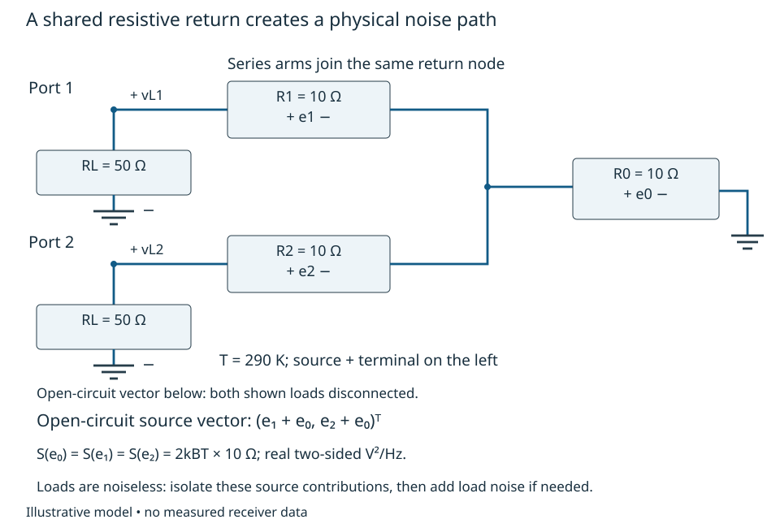
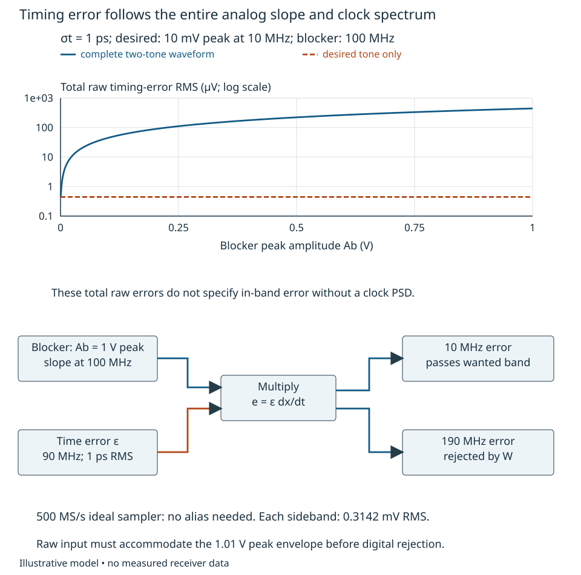

# Physical noise, blockers and timing disturbances {#sec-physical-disturbances}

A quiet terminated-input receiver can become noisy when an antenna, another
channel or a strong blocker is connected. Which physical source changed, and
through which path did its disturbance enter the reported observation? An
arbitrary covariance matrix cannot answer that question. Nor can a clock-jitter
number evaluated only at the wanted carrier.

This treatment constructs sources before combining them. The reader should be
able to convert thermal source voltage into delivered power, construct a coupled
noise matrix from a circuit or incident field, derive a blocker-dependent LO or
filter constraint, and test timing error against the complete analog waveform.
[Chapters 2–4](covariance-quadratic-forms.qmd) supply stochastic and matrix tools;
[Chapter 8](fields-geometry-transduction.qmd) supplies loaded field-to-port maps.
We use its fixed-configuration, orientation-normalized linear receiver interface.
All component values, spectra and targets below are synthetic teaching inputs.
None is a device guarantee or measured receiver result.

## Sources, loading and delivered noise {#sec-loaded-noise}

Keep two representations distinct. For a real centered stationary voltage $e(t)$,
use two-sided $S_e(f)$ over signed physical frequency $f$, in V²/Hz, with
$E[e^2]=\int_{-\infty}^{\infty}S_e(f)\,df$. A resistor $R$ at temperature $T$
has the classical open-circuit thermal model

$$
 S_e(f)=2k_BT R,
$$

over a finite band where resistance is approximately real, equilibrium holds and
$h_P|f|\ll k_BT$. Here $k_B=1.380649\times10^{-23}$ J/K is Boltzmann's constant
and $h_P$ denotes Planck's constant. The classical model is not extended to
infinite bandwidth. Analog Devices [MT-047](https://www.analog.com/media/en/training-seminars/tutorials/MT-047.pdf),
Rev. 0, p. 2 gives RMS voltage $\sqrt{4k_BTRB}$ for a one-sided bandwidth $B$;
the two-sided density above divides its positive-frequency density by two.

Attach a noiseless real load $R_L$. Circuit division gives
$S_{v_L}=2k_BTR\,[R_L/(R+R_L)]^2$ and $S_{p_L}=S_{v_L}/R_L$ W/Hz at signed
physical frequency. A real RF passband of positive-frequency width $B$ has a
negative-frequency image of equal width. For $R_L=R$, integrating both bands
gives delivered noise power $k_BTB$. At 290 K and $B=100$ kHz this is
$4.00388\times10^{-16}$ W, or approximately $-123.98$ dBm. Replacing the matched
load by $R_L=4R$ gives only $16/25=0.64$ of the matched power even though its
voltage is larger. High noise voltage and high delivered noise power are different
statements. The “noiseless load” computes only the source's contribution; a real
resistor load has its own thermal source and must be included when relevant.

For a peak-scaled complex envelope $z$ around positive carrier $f_c$, the local
analytic-signal construction instead gives $S_z(\nu)=4S_e(f_c+\nu)$ over its
retained offset band. The factor four comes from doubling positive-frequency
amplitude before shifting it to baseband. At a matched load this gives
$S_{z_L}=2k_BTR$, and power density $S_{z_L}/(2R)=k_BT$. This translation recovers
the same $k_BTB$ with one complex-envelope band of width $B$. It is a local
normalization declaration, not a new book-wide PSD default. Never add real
two-sided voltage densities to peak-envelope densities without translating them.

An active input also has internal disturbance sources. A selective equivalent
model uses an input-referred series voltage $e_n$ and current $i_n$ delivered
into an effective source impedance $Z_s$ with a declared positive direction.
Define the sensed equivalent noise as $n=e_n+Z_si_n$. At each frequency,

$$
 S_n=S_e+|Z_s|^2S_i+2\operatorname{Re}\{Z_s^*S_{ei}\},\qquad
 S_{ei}(f)=\int_{-\infty}^{\infty}E[e_n(t+\tau)i_n(t)^*]e^{-j2\pi f\tau}\,d\tau.
$$

This follows by expanding $|E_n+Z_sI_n|^2$; the cross-spectrum ordering is the
same $X Y^*$ convention as Chapter 3. It requires $|S_{ei}|^2\leq S_eS_i$.
The equivalent source locations and the impedance seen by them must be derived
from the actual input topology, including loading and reverse coupling. MT-047
pp. 1–3 supports the voltage/current-source representation and impedance
sensitivity; its simplified op-amp independence assumption is not a general RF
LNA model. Equal data-sheet noise figures do not supply a multichannel covariance.

For example, independent Poisson arrivals of charge $q$ at rate $\lambda=I/q$
produce, after removing the mean current, two-sided shot-noise density
$q^2\lambda=qI$ A²/Hz in the ideal impulse/current model. A finite pulse response
multiplies this by its squared normalized transform. MT-047 p. 2 gives the
corresponding one-sided $2qI$ form for suitable input junctions and cautions
against inferring it from net bias current in compensated circuits. Correlated
transport, excess noise and device bandwidth change that model. A flicker term
$K/|f|$ likewise needs lower and upper cutoffs and an evidence-based coefficient;
integrating it to zero frequency does not define a finite stationary variance.
Those are source-model boundaries, not problems that an optimizer can cure.

## Coupled networks and external fields {#sec-physical-covariance}

Stack physical source amplitudes into $\mathbf u$, give their cross-spectral
matrix $\mathbf S_u$, and solve the loaded circuit to obtain $\mathbf n=\mathbf T\mathbf u$.
Then

$$
 \mathbf S_n=\mathbf T\mathbf S_u\mathbf T^H.
$$

Chapter 4 owns this propagation identity. The engineering work here is deciding
what $\mathbf u$ and $\mathbf T$ physically contain. A common source uses one
column reaching multiple outputs. Mutually independent local sources have a
diagonal source matrix, but a nondiagonal transfer can still correlate outputs.
Conversely, device-internal source correlations belong in $\mathbf S_u$.
Positive semidefiniteness checks admissible second moments; it does not establish
that the chosen source powers and paths describe hardware.

Consider a reciprocal resistive two-port: each port connects through a 10-ohm
series resistor to a shared node; that node connects through another 10-ohm
resistor to ground. Both loads are noiseless 50-ohm observation loads. All three
source resistors are at 290 K. Equivalent series-noise sources have their
positive terminal facing the observation port for the two arms, and facing
the shared node for the return resistor. Open-circuit noise voltages are
$\mathbf v_{\rm oc}=(e_1+e_0,e_2+e_0)^T$, with independent resistor sources
$S_{e_0}=S_{e_1}=S_{e_2}=2k_BT(10\ \Omega)$. Its impedance and source matrices are

$$
 \mathbf Z_A=\begin{pmatrix}20&10\\10&20\end{pmatrix}\ \Omega,
 \qquad \mathbf S_{\rm oc}=2k_BT
 \begin{pmatrix}20&10\\10&20\end{pmatrix}\ \Omega.
$$

The off-diagonal term has a physical cause: the same resistor $e_0$ reaches
both ports. The open-circuit vector is defined with both loads disconnected;
the drawn loads apply only when calculating $\mathbf v_L$. This is a constructed circuit demonstration of thermal coupling,
not asserted antenna/LNA data. @fig-loaded-noise-paths shows the shared return
and the source decomposition used in the calculation.

{#fig-loaded-noise-paths fig-alt="Ports 1 and 2 each connect through a 10 ohm resistor to one common node, which returns through a third 10 ohm resistor to ground. Each port has a noiseless 50 ohm load. The shared resistor source e0 enters both open-circuit voltages; local e1 and e2 enter separately."}

With $\mathbf Z_L=50\mathbf I\ \Omega$, the Chapter 8 loading equation gives

$$
 \mathbf L={50\over4800}
 \begin{pmatrix}70&-10\\-10&70\end{pmatrix},\qquad
 {\mathbf S_L\over2k_BT}=
 \begin{pmatrix}9.33160&2.38715\\2.38715&9.33160\end{pmatrix}\ \Omega.
$$

The symmetric common voltage $(v_1+v_2)/\sqrt2$ sees impedance 30 ohms and
loading gain $50/(30+50)=0.625$; the differential voltage
$(v_2-v_1)/\sqrt2$ sees 10 ohms and gain $50/(10+50)=5/6$. Their spectral
coefficients after dividing by $2k_BT$ are respectively 11.71875 and 6.94444
ohms. Transforming those independent mode powers back gives the matrix above.
This second derivation also checks loading and the sign of the covariance.

For the unnormalized difference $d=v_2-v_1$, the true density is
$S_d/(2k_BT)=13.88889\ \Omega$. Using just the two diagonal entries as if they
were independent predicts 18.66319 ohms, an overestimate of 34.375 percent.
Multiplying by $2k_BT$ restores V²/Hz; a defined observation filter must still be
integrated to obtain an RMS voltage. At an open circuit the correlation coefficient
is 0.5; after loading it is about 0.2558. A covariance measured or calculated in
one load state is not automatically transferable to another.

External fields enter through the same receiving manifold as wanted fields.
For finitely many angular/polarization patches $\alpha$ with mutually uncorrelated
centered peak-scaled complex field-envelope vectors and matrices $\mathbf F_\alpha(\nu)$
in (V/m)²/Hz at offset $\nu$ from the positive RF carrier,

$$
 \mathbf S_{\rm field}=\sum_\alpha
 \mathbf G\mathbf L\mathbf H_\alpha\mathbf F_\alpha
 \mathbf H_\alpha^H\mathbf L^H\mathbf G^H.
$$

Here $\mathbf S_{\rm field}(\nu)$ is the peak-envelope voltage cross-spectrum
at the output $\mathbf z$ plane after $\mathbf G$; every transfer is evaluated
at physical frequency $f_c+\nu$. To combine it with the resistor example, first
translate its real two-sided loaded matrix to $4\mathbf S_L(f_c+\nu)$, then
propagate through the same electronics. Do not add the two representations
directly. A continuum is the corresponding angular integral when it converges. Angular
independence is an assumption; coherent reflections of the **same** source must
be summed as transfer paths before forming its outer product. For one scalar
interferer $u$ arriving along two coherent paths $\mathbf a$ and $\mathbf b$,
the covariance is $S_u(\mathbf a+\mathbf b)(\mathbf a+\mathbf b)^H$, including
cross terms. Adding $S_u\mathbf a\mathbf a^H+S_u\mathbf b\mathbf b^H$ loses them.
Receiver reverse-current noise can also propagate through the coupled input
impedance into another channel; independence of the devices alone does not remove
that path. Noise sources representing the same passive loss or thermal field
must not be counted twice. Actual arrays require measured or independently
supported impedance, embedded response, environment and active-noise parameters.

For transfer, cool only the common-return resistor from 290 K to 29 K,
assuming its impedance remains 10 ohms and the classical model still applies.
Recalculate $\mathbf S_{\rm oc}$ and $\mathbf S_L$. Source powers change but
the loading matrix does not. After normalization by $2k_B(290\ {\rm K})$,
the loaded cross term becomes approximately $-1.12847\ \Omega$. Independent
local sources reach opposite ports with opposite signs through $\mathbf L$;
the weaker shared source no longer dominates their negative cross term. This
synthetic nonequilibrium model shows why correlation sign cannot be inferred
from proximity. An implementation would need actual temperature, resistance and
thermal-path evidence.

## Reciprocal mixing: a blocker makes LO noise observable {#sec-reciprocal-mixing}

Use a separate power-normalized envelope $b(t)$, in $\sqrt{\rm W}$, for the blocker
after RF preselection, referred to a stated mixer input impedance. Its mean power
is $P_B=E|b|^2$. For a peak voltage across a real resistance $R_0$, this envelope
is $b=z/\sqrt{2R_0}$. With RF amplitude transfer $F$ in these fixed
power-normalized coordinates, $S_b(\nu)=|F(\nu)|^2S_{b_{\rm RF}}(\nu)$.
Thus 20 dB power attenuation means $|F|^2=0.01$, not an amplitude factor of 0.01.
Let the ideal conversion have unit power gain and common
spectral orientation. A small effective LO phase $\phi_{\rm eff}$ gives

$$
 b(t)e^{-j\phi_{\rm eff}(t)}
 \simeq b(t)-jb(t)\phi_{\rm eff}(t).
$$

The product term moves LO phase fluctuations onto the blocker. For a centered
stationary LO phase independent of a centered stationary blocker, its covariance factors
into blocker correlation times phase correlation. Fourier transformation gives
the convolution

$$
 S_{\rm rm}(f)=\int_{-\infty}^{\infty}
 S_b(\nu)S_{\phi,\rm eff}(f-\nu)\,d\nu,
 \qquad
 P_{\rm rm}=\int_{-\infty}^{\infty}|W(f)|^2S_{\rm rm}(f)\,df.
$$

Here $f,\nu$ are offsets from the wanted converted carrier, $W$ is the subsequent
observation transfer, $S_b$ is in W/Hz and $S_{\phi,\rm eff}$ is the two-sided
real-phase PSD in rad²/Hz. Finite supports or convergent integrals are required.
Deterministic narrow blockers can be treated directly as tones, or by a uniform
random initial phase for the stationary correlation derivation. A tone at offset
$\Delta$ gives $S_{\rm rm}(f)=P_BS_{\phi,\rm eff}(f-\Delta)$. If that density
is flat over the observation band, $P_{\rm rm}=P_BS_{\phi,\rm eff}(-\Delta)B_W$,
where $B_W=\int|W(f)|^2df$ Hz. This is a derived narrow-blocker/flat-spectrum limit,
not an assumption that all blockers or phase spectra are white.

The effective phase can include source/distribution phase plus noise created
after an accessible LO filter:
$\phi_{\rm eff}=H_0*\phi_0+\sum_r H_r*\eta_r$. The star here denotes filtering.
For independent branch sources its density is
$|H_0|^2S_{\phi_0}+\sum_r|H_r|^2S_{\eta_r}$; correlated branches require the full
cross-spectral sum. Analog Devices' [mixer-noise article](https://www.analog.com/en/resources/technical-articles/specifications-and-measurement-of-local-oscillator-noise-in-integrated-circuit-base-station-mixers.html),
“Mixer Noise Model” and “Effective Noise Floor of LO Driver,” explains the blocker
mechanism and internal LO-driver contributions. Its equation images are not used
to set our normalization or device values. The relationships here follow from
the specified envelope multiplication. A source-connector phase-noise test alone
cannot establish the effective internal spectrum.

Suppose a $-20$ dBm blocker reaches a preselector with 20 dB power attenuation at
$\Delta=1$ MHz. The mixer receives $P_B=10^{-7}$ W ($-40$ dBm). Let
$S_{\phi,\rm eff}=10^{-12}$ rad²/Hz across the relevant offsets and let $W=1$
on $[-50,50]$ kHz and zero elsewhere. Then $B_W=100$ kHz and
$P_{\rm rm}=10^{-14}$ W, or $-110$ dBm. A supplied $-115$ dBm reciprocal-noise
allocation requires $S_{\phi,\rm eff}\leq3.1623\times10^{-13}$ rad²/Hz, or at
least another 5 dB of blocker attenuation. This allocation concerns reciprocal
noise alone; thermal noise and gain/headroom have separate constraints.

In this example assume every LO branch is mutually independent and independent
of the blocker, with these spectra applying at the stated drive and load.
If an internal LO branch alone contributes $5\times10^{-13}$ rad²/Hz, improving
only the external oscillator cannot meet that allocation with the present
blocker. RF attenuation, the branch or the architecture must change. A post-mixer
notch that removes the blocker carrier does not remove its already generated
in-band pedestal. Filtering before and after multiplication are different actions.

@fig-reciprocal-noise-paths ties those interfaces to a finite-spectrum
counterexample. Keep the same total blocker power, but distribute it uniformly
over $\Delta\pm200$ kHz. Let the LO phase PSD be $S_0=10^{-12}$ inside
$|q+\Delta|\leq100$ kHz and $4S_0$ outside that interval over the offsets used
by this convolution. Take the same symmetric feature near $+\Delta$ and truncate
the real-phase PSD outside $|q|\leq2$ MHz. In every desired-band output slice,
half of the 400 kHz blocker overlaps low density and half overlaps high density.
Thus $S_{\rm rm}=2.5P_BS_0$ across the desired band and
$P_{\rm rm}=2.5\times10^{-14}$ W, or $-106.02$ dBm. Treating this finite-spectrum
blocker as the centre tone underestimates noise by 3.98 dB. Its attenuation
shortfall against $-115$ dBm is 8.98 dB. The shaped spectrum is synthetic, chosen
to expose the convolution; no real oscillator has been characterized.

{#fig-reciprocal-noise-paths fig-alt="Blocker passes through RF preselection, mixer and observation filter. Source LO phase and additive internal branch phase join at the mixer. A spectral plot against q plus Delta shows a central 200 kHz low-density interval and a 400 kHz blocker footprint, yielding average density 2.5 times the low value."}

For transfer, hold total blocker power fixed and move the observation band next
to the low/high-density boundary, or double the blocker width. Recompute the
overlap integral rather than multiplying the centre PSD by bandwidth. Also change
the assumption that blocker and LO are independent: a leakage signal derived
from the same oscillator can retain delayed phase correlation. Use the unequal
path treatment in [Chapter 3](observation-weighted-coherence.qmd) before forming
the residual product spectrum. The independent convolution is no longer a general
description of that self-referenced case.

## Timing error is driven by the complete waveform {#sec-waveform-timing}

Let the actual sample at nominal time $t_m$ observe the real analog input at
$t_m+\epsilon_m$. Taylor expansion gives

$$
 e_m=x(t_m+\epsilon_m)-x(t_m)
 =\epsilon_m\dot x(t_m)+O(\epsilon_m^2\ddot x).
$$

This construction precedes digital rejection and uses every analog component
present at that sampling plane. The remainder must be small on the relevant
waveform scales; a small time error relative to a low wanted frequency is
insufficient in the presence of a much higher-frequency blocker.
Kester's [MT-007](https://www.analog.com/media/en/training-seminars/tutorials/MT-007.pdf),
Rev. A, pp. 3–4 derives the slope error and its sine-input SNR limit. We retain
the full waveform and clock process instead of extending that sine formula
without its assumptions.

For two real channels, require zero-mean clock errors of finite variance,
waveforms with finite mean-square derivatives, jointly stationary channel
vectors, and independence of the entire clock-error vector from the entire
waveform vector. Retain only the first-order timing term, with a negligible
Taylor remainder over the intended observation. In particular require
$\int_{-\infty}^{\infty} f^2 S_{x_ix_i}(f)\,df<\infty$. A nonzero mean timing
offset is a separate deterministic skew, not included in this centered clock
model. For its centered first-order errors,

$$
 R_{e_i e_j}(\tau)=R_{\epsilon_i\epsilon_j}(\tau)
 R_{\dot x_i\dot x_j}(\tau),\qquad
 S_{e_i e_j}(f)=\int S_{\epsilon_i\epsilon_j}(\alpha)
 [2\pi(f-\alpha)]^2S_{x_i x_j}(f-\alpha)\,d\alpha.
$$

The derivative factor follows by differentiating both signals, or multiplying
their transforms by $j2\pi f$ before forming $XY^*$. Densities use signed analog
frequencies here; sample-time aliasing and the final observation filter must then
be applied. If clocks and signals share correlated generation, the four-factor
expectation need not factor. Deterministic inputs can instead require
time-dependent or periodically varying error covariance. Common clock error gives
$e_2-e_1=\epsilon(\dot x_2-\dot x_1)$, not automatic cancellation for different
slopes or analog waveforms.

For independent uniform tone phases and independent timing error of RMS
$\sigma_t$, a two-tone input $x=A_d\cos(2\pi f_dt+\theta_d)+
A_b\cos(2\pi f_bt+\theta_b)$ has total first-order mean-square timing error

$$
 \sigma_e^2={\sigma_t^2\over2}
 \left[(2\pi f_dA_d)^2+(2\pi f_bA_b)^2\right].
$$

Use $A_d=0.010$ V peak at 10 MHz, $A_b=1.0$ V peak at 100 MHz, and
$\sigma_t=1$ ps. The wanted tone alone predicts $0.4443$ microvolts RMS timing
error and 84.04 dB wanted-to-error ratio. Including the blocker gives approximately
$0.4443$ mV RMS error and 24.04 dB relative to the wanted tone's 7.071 mV RMS.
These are **total raw error** ratios. The clock PSD and following filters decide
how much error lands in the wanted band; total jitter alone cannot decide that.

For a concrete in-band contrast, let the time error be a 90 MHz sinusoid of
peak $\sqrt2\sigma_t$, with an independent uniform random phase, and assume an
ideal 500 MS/s sampler. Multiplying the blocker derivative by that time error
creates error sidebands at 10 and 190 MHz. Each has peak amplitude
$A_b(2\pi f_b)\sigma_t/\sqrt2=0.4443$ mV, hence 0.3142 mV RMS.
An ideal band selecting only the positive/negative 10 MHz pair retains the lower
sideband, giving a 27.05 dB wanted-to-timing-error ratio. The wanted tone's own
timing sidebands are at 80 and 100 MHz and are rejected in that observation.
No alias is needed for the blocker to contaminate the wanted band.
For a supplied wanted-to-timing-error allocation $\Gamma$ dB in this particular
90 MHz timing model, the retained sideband requires

$$
 \sigma_t\leq{\sqrt2 A_d\over 2\pi f_b A_b\,10^{\Gamma/20}}.
$$

At $\Gamma=40$ dB this is $\sigma_t\leq0.2251$ ps. It is an observation-specific
constraint; moving the clock spectrum can change it even at fixed RMS jitter.

@fig-waveform-timing displays the slope weighting and the explicit clock-to-error
spectral translation. The timing model is synthetic, not a claimed clock spur.
Here $2\pi f_b\sqrt2\sigma_t\approx8.89\times10^{-4}$ rad, so the first-order
expansion is small. An ideal raw input range must accommodate the full 1.01 V
peak envelope; a digital solution cannot restore samples clipped beforehand.

{#fig-waveform-timing fig-alt="A log-scale plot shows total raw timing-error RMS increasing with blocker amplitude, while a wanted-tone-only prediction remains constant. A lower schematic connects the 100 MHz blocker slope and 90 MHz time error to error sidebands at 10 and 190 MHz; the 10 MHz sideband passes the wanted observation."}

As a changed-assumption exercise, reduce the blocker before sampling by 20 dB
in **power**, leaving wanted amplitude unchanged. Its amplitude and timing-error
sideband drop by ten, so the in-band ratio improves from 27.05 to 47.05 dB.
Alternatively replace the 90 MHz clock component by a 1 MHz component of the same
RMS: blocker-error sidebands move to 99 and 101 MHz and this ideal 10 MHz
observation rejects them. The same integrated jitter then has a very different
effect. A clock requirement needs waveform, source correlations, spectral support,
filtering, state and sampling plane together. The
[extraction treatment](extraction-integration-rejection.qmd) uses these constructed
disturbances to ask what information can actually be retained.
