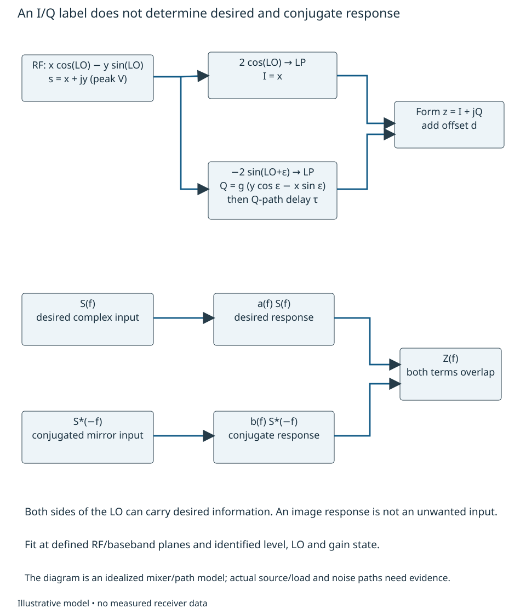
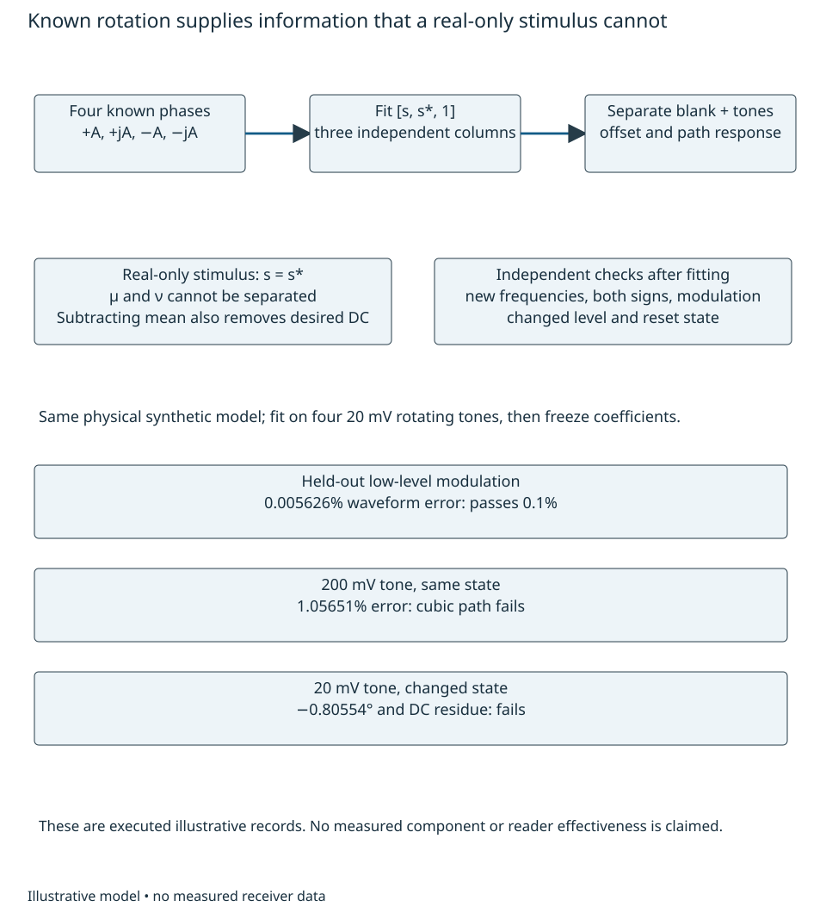
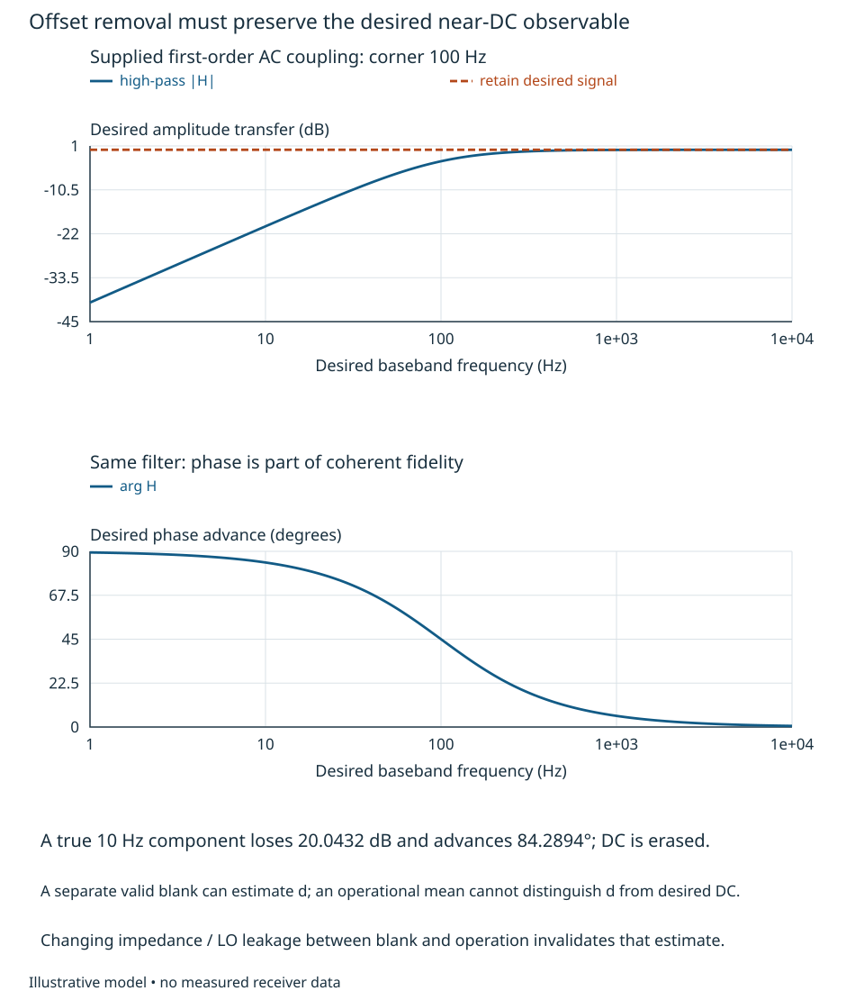

# Quadrature and conjugate-response fidelity

A receiver can report excellent image suppression after correction while losing
part of a legitimate modulation or erasing a slowly varying coherent return.
Our engineering question is **which I/Q correction preserves the specified
complex envelope over frequency, level and operating state?** The observable is
the desired complex response together with the conjugate response, referred to
a stated RF envelope and baseband epoch. A small spectral image alone is an
incomplete outcome. By the end of this treatment the reader should be able to
construct that pair of responses, choose an informative stimulus, estimate and
apply a bounded correction, and reject a correction that removes real desired
information. New numerical requirements and path parameters are illustrative.

## Follow real quadrature paths into a conjugate model

Use Chapter 1's peak-voltage envelope $s=x+jy$ and physical reconstruction
$r=x\cos\omega_Lt-y\sin\omega_Lt$. Multiplication by $2\cos\omega_Lt$ and
$-2\sin\omega_Lt$, followed by rejection of the sum-frequency products, gives
$I=x$, $Q=y$. These are analog operations; an ADC or digital downconverter is
not needed to understand quadrature. The LO phase and signal reference plane
must already be specified as in Chapter 11. Let the Q multiplier instead use
$-2g\sin(\omega_Lt+\epsilon)$, with relative voltage gain $g$ and phase error
$\epsilon$ in radians. Averaging the carrier products gives

$$
 I=x,\quad Q=g(y\cos\epsilon-x\sin\epsilon),\qquad
 z=I+jQ=\mu s+\nu s^*+d,
$$
$$
 \mu={1+g e^{-j\epsilon}\over2},\qquad
 \nu={1-g e^{j\epsilon}\over2}. \tag{18.1}
$$

The complex offset $d$ is added at the baseband output plane. LO self-mixing,
other coherent leakage, rectification and baseband offsets can contribute to it;
leakage displaced from the LO can instead be a rotating component. Its physical
path and state must be identified. Equation (18.1) factors out common gain and
delay; those remain relevant to comparisons between receivers. Reversing the
Q sign changes the model and conjugates the envelope.

Conjugation sends a component at $-f$ to $+f$. With real I/Q path impulse
responses $h_I,h_Q$, whose transforms satisfy $H(-f)=H(f)^*$, the linear model is

$$
 Z(f)=a(f)S(f)+b(f)S^*(-f)+D(f),
$$
$$
 a={H_I+g e^{-j\epsilon}H_Q\over2},\qquad
 b={H_I-g e^{j\epsilon}H_Q\over2}. \tag{18.2}
$$

The frequency $f$ is signed baseband frequency relative to the declared LO,
not RF frequency. The desired input at $+f$ and mirror input at $-f$ may both
carry wanted information; $b$ describes an erroneous transfer, not proof that
the mirror input is interference. For equal isolated input amplitudes define
the local image-rejection power ratio as $|a(f)|^2/|b(f)|^2$. One positive input
alone also generates an output at $-f$, with coefficient $b(-f)$; do not silently
substitute $b(f)$ when the paths have delay or dispersion. At $g=1$, $\epsilon=0$
and $H_I=H_Q$, $b=0$. Pure gain or quadrature error leaves a conjugate component.

{#fig-quadrature-path-pair fig-alt="Real RF reconstruction splits into an I mixer driven by twice cosine and a Q mixer driven by negative twice sine with phase error and relative gain. The Q path has a delay. A second diagram shows desired S at f and conjugated mirror S at minus f adding at Z of f."}

Chapter 2's covariance $C=E|s|^2$ and pseudo-covariance $P=E[s^2]$, after removing
the mean, explain another trap. Even for a correct receiver, real-valued random
modulation has $P=C$, not zero. For the memoryless model, direct expansion gives

$$
 P_z=\mu^2P+\nu^2P^*+2\mu\nu C. \tag{18.3}
$$

Thus a nonzero output pseudo-covariance can come from the desired signal, the
receiver, or both. A blind method that forces $P_z=0$ needs an independently
justified proper-input assumption and noise treatment. It can deform legitimate
improper modulation. We will use known stimuli instead of granting that assumption.

## Make response and leakage identifiable

For a memoryless fit with known inputs $s_k$, stack observations as rows
$[s_k,s_k^*,1]$ multiplying $[\mu,\nu,d]^{\mathsf T}$. This is an ordinary complex
linear fit of Chapter 5. If every $s_k$ is real, the first two columns coincide:
only $\mu+\nu$ is identifiable, even with infinitely many clean observations.
Four known phases $A,jA,-A,-jA$ have orthogonal columns, with Gram diagonal
$(4A^2,4A^2,4)$. They distinguish the three coefficients. Source phase error or
receiver-reference drift is then a nuisance to be measured, not attributed to
I/Q imbalance by convention. A known rotating tone supplies the same separation
when the observation covers its rotations; very small $|f|T$ can make a short
near-DC record poorly conditioned.

For frequency-dependent paths, apply a known tone $s=Ae^{j2\pi ft}$, with $A$
real and known. Remove an independently established offset or use orthogonal
whole-cycle projections. The measured complex coefficients at $+f,-f$ are
$Z_+/A=a(f)$ and $Z_-/A=b(-f)$. Reverse the input sideband for independent
verification of $a(-f),b(f)$. A calibration source's own conjugate leakage must
be below the intended residual or separately estimated. A shared LO can remove
relative drift during fitting while hiding the reference behavior that matters
in operation.

DC is especially ambiguous. Its observed mean is $\mu s_0+\nu s_0^*+d$.
Replacing $s_0$ by $s_0-c$ and $d$ by $d+\mu c+\nu c^*$ leaves that observation
unchanged. An operational mean cannot distinguish receiver offset from desired
DC. A separate blank can estimate $d$ only if its termination, LO coupling,
gain, temperature and settling preserve the relevant offset. Turning off the
wanted transmitter or substituting a load may change those paths. Phase cycling
and external witnesses offer other information; Chapter 23 owns their complete
calibration-validity treatment.

## Fit and apply a bounded physical correction

Consider a hypothetical pair whose I path has unity response and whose Q path
has an extra delay $\tau=20$ ns, with $g=1.05$, $\epsilon=3^\circ$ and
$d=3-j2$ mV. Add a weak physical Q-path cubic term:

$$
 \begin{aligned}
 I(t)&=x(t),\\
 Q(t)&=g[y(t-\tau)\cos\epsilon-x(t-\tau)\sin\epsilon]\\
     &\quad+\gamma y(t-\tau)^3,
 \qquad\gamma=0.5\ {\rm V}^{-2}.
 \end{aligned}\tag{18.4}
$$

The cubic term is a supplied model for a level-dependent failure, not a device
characteristic. A 20 mV peak calibration tone contributes fundamental Q gain
$3\gamma A^2/4=0.00015$ because $\sin^3u=(3\sin u-\sin3u)/4$.
The third harmonic is separately observable; a fit to fundamentals cannot certify
its absence. This model gives a realistic engineering obligation without
pretending to specify a mixer circuit or a usable part.

Generate four training tones at 0.25, 0.75, 1.25 and 1.75 MHz, one at a time,
at 16 MS/s over 4096 samples, with a separately supplied correct blank. These
are exact periodic synthetic records; the sample interface is ideal as declared
in Chapter 17. For each tone form

$$
 c(f)={Z_+(f)\over A}-\left[{Z_-(f)\over A}\right]^*
       =\left[g\cos\epsilon+{3\gamma A^2\over4}
                        -jg\sin\epsilon\right]e^{-j2\pi f\tau}. \tag{18.5}
$$

Here the common I response is unity by the supplied model; an unknown common
response would also have to be determined or factored out. Fit magnitude and
unwrapped phase versus frequency, reusing Chapter 5's delay-fit reasoning.
The fitted effective parameters are $\widehat g=1.05014979$,
$\widehat\epsilon=2.99957169^\circ$, $\widehat\tau=20.0000$ ns. They reproduce
training fundamentals; they are not the underlying linear $g,\epsilon$ because
the cubic contribution has been absorbed. Zero training residual is insufficient.

For the ideal memoryless linear model, conjugating (18.1) supplies a second
equation. Its determinant is $|\mu|^2-|\nu|^2=g\cos\epsilon$, giving

$$
 s={\mu^*(z-d)-\nu(z-d)^*\over |\mu|^2-|\nu|^2}. \tag{18.6}
$$

This explicitly mixes the observation with its conjugate. A single complex
scalar cannot perform the same correction. In the general frequency case the
paired unknowns are $[S(f),S^*(-f)]^{\mathsf T}$ and the two rows are
$[a(f),b(f)]$ and $[b^*(-f),a^*(-f)]$; their determinant and frequency response
must be considered together. Chapter 20 develops general feasible inverses.
Here we use the much narrower known-delay structure to avoid assuming a
frequency-by-frequency inverse is automatically realizable.

Delay the I path by $\widehat\tau$, subtract the estimated offset first, then use

$$
 \begin{aligned}
 \widehat x_\tau(t)&=I(t-\widehat\tau),\\
 \widehat y_\tau(t)&={Q(t)\over\widehat g\cos\widehat\epsilon}
               +\tan\widehat\epsilon\,\widehat x_\tau(t),\\
 \widehat s_\tau&=\widehat x_\tau+j\widehat y_\tau.
 \end{aligned}\tag{18.7}
$$

With exact linear parameters this recovers $s(t-\tau)$, not $s(t)$; all response
errors below are referred to that **delayed target plane**. Choosing common
latency permits delaying the earlier path instead of advancing the later one.
An analog delay match plus gain/crossfeed trim is one alternative. A sampled
implementation needs Chapter 19's finite delay realization, precision and state
rules; the executed reference uses an ideal periodic Fourier delay and does not
prove finite-filter or analog feasibility. Matching only at the LO center with
constant gain/phase trim leaves the differential delay. No overall timestamp
change can eliminate its remaining conjugate response.

At a held-out frequency of 1.875 MHz and 10 mV input, a constant trim gives
approximately **6.750°** desired phase error and only **18.47 dB** local image
rejection at the positive observation frequency. Delay match plus trim gives
about **85.41 dB** image rejection and a desired gain error of **−0.000466 dB**
for that tone. The latter small residual arises from changing the cubic
fundamental between 20 and 10 mV. It is a model prediction under exact source,
blank and delay assumptions, not a guaranteed correction floor.

{#fig-quadrature-band-correction fig-alt="Two plots over minus two to plus two MHz compare uncorrected response, constant quadrature trim and ideal delay match plus trim. The first plots conjugate response relative to desired response; the second plots desired phase relative to a target delayed by twenty ns. Constant trim fails away from the center."}

Correction also transforms additive noise. If the noise is added after the two
paths, with independent equal I/Q variances $\sigma^2$, and the ideal delay has
unit magnitude, (18.7) gives a total output-noise/input-noise energy ratio

$$
 G_n={1+1/\widehat g^2\over2\cos^2\widehat\epsilon}=0.956003.
 \tag{18.8}
$$

A ratio below one here reflects removal of excess Q voltage gain; it is not a
universal sensitivity improvement. With $g=0.1$ and the same phase error, the
ratio is about 50.64: inverse gain amplifies post-path noise. Noise originating
before the imbalance has different transfer and correlation, requiring Chapter
9's source/path construction and Chapter 12's full allocation. At $g=0$ or
$\cos\epsilon=0$ the static map loses a real dimension; (18.6) cannot restore it
without additional information. Prevention, different analog paths, narrower
bandwidth and characterized correction are meaningful alternatives.

## Check information retained beyond the fit

Use illustrative criteria of 0.05° desired phase error, 0.01 dB desired gain
error, 60 dB local image rejection, and 0.1% normalized waveform error. These are
separate diagnostic criteria to reconcile with the system budget, not grants
of several copies of one allowance. Freeze the four-tone coefficients and test
new positive and negative frequencies, phases, levels and waveforms. Sweeps
at $\pm0.125,\pm0.375,\ldots,\pm1.875$ MHz and 10 mV verify the predicted desired
and conjugate fundamentals independently of the fit frequencies. Include
harmonic/other-bin response in a waveform criterion rather than hiding it in
a favorable image ratio.

For a modulated test let

$$
 s(t)=s_0+\sum_{k=1}^3 A_ke^{j(2\pi f_kt+\theta_k)},\quad
 s_0=5+j3\ {\rm mV},
$$

with $(f_k/{\rm MHz},A_k/{\rm mV},\theta_k/{\rm rad})$
equal to $(0.375,9,0.1)$, $(-0.625,7,-0.4)$ and $(1.375,4,0.8)$.
The unequal signed bands and true DC are deliberately useful information.
Over the same 4096-sample periodic record define waveform error as
$\|\widehat s-s(t-\tau)\|_2/\|s-s_0\|_2$, retaining offset error in the numerator.
The physical mixer/cubic record and periodic-delay correction give **0.005626%**,
versus **5.7370%** for constant trim alone. The corrected mean differs from
$s_0$ by approximately $-j0.103$ μV, a small cubic residual rather than erasure
of the desired mean. These are executed synthetic calculations.

Now raise a single 0.375 MHz tone to 200 mV while keeping the old coefficients.
The cubic mechanism yields **1.05651%** waveform error, **0.06128 dB** desired
gain error and approximately **43.06 dB** image rejection: the frozen correction
fails. Alternatively keep the tone at 20 mV but change the state to $g=1.07$,
$\epsilon=4^\circ$, $\tau=24$ ns, $d=4-j1$ mV. Old coefficients and blank leave
approximately **−0.80554°** desired phase error and $1+j1.00595$ mV output mean.
A retuned/reset state needs new validity evidence; neither coefficient storage
nor a successful old fit establishes it.

{#fig-quadrature-training-validity fig-alt="Known four-phase input leads to a full three-column response and offset fit. A real-only input leaves conjugate response inseparable. Three boxes show passing held-out low-level modulation, failing high-level cubic error, and failing changed-state phase and offset."}

A misleading alternative is to AC-couple or continuously subtract an operational
mean, then report a smaller center-frequency spur. For a supplied first-order
high-pass corner $f_h=100$ Hz,

$$
 H(f)={jf\over f_h+jf},\qquad
 |H|={|f|\over\sqrt{f^2+f_h^2}}. \tag{18.9}
$$

A genuine 10 Hz desired component loses **20.0432 dB** and advances **84.2894°**;
DC is removed completely. Subtracting the exact finite-record mean is likewise
a projection that erases a constant desired component. Chapter 10 owns the
general signal-preserving rejection criterion. In contrast, a separately valid
blank followed by (18.7) retains a true 10 Hz tone and the desired DC to the
small nonlinear residual in this model. A rotating 10 mV tone plus $5+j3$ mV
DC, evaluated over one second at 1 kS/s using the same continuous path model,
gives approximately **0.00718593%** normalized waveform error with the old fit.
The lower simulation rate here resolves this particular slow waveform and its
cubic harmonics; it is not a proposed replacement converter for the MHz-band test.

{#fig-quadrature-near-dc fig-alt="Log frequency plots of a one-hundred-Hz first-order high-pass response show twenty dB attenuation and eighty-four degrees phase advance at ten Hz. The text distinguishes offset estimated from a valid blank from removal of the desired operational mean."}

The examined ADL5380 Rev. B pp. 3, 22 and 25–27 distinguish load/conditioned
I/Q specifications, quadrature paths and bandwidth-specific AC-coupled EVM
examples [@adiADL5380]. Its wideband modulation example cannot establish fidelity
for a desired 10 Hz return; no device number is adopted for our illustrative
paths. Nash's AN-1039 examines a *transmit modulator*, including changes of a
calibrated null with frequency and temperature [@nashAN1039]. It motivates
checking the correction envelope but does not validate this receiver model or
supply receiver sign conventions. AMD's PG269 v2.6 QMC section explicitly
separates correction circuitry from application-specific error detection
[@amdQMC2025]. An available correction block is not a completed estimator,
procedure or qualified subsystem. Source notes record exact examination limits.

Selecting hardware requires complex desired/conjugate response versus both
frequency signs, input level, LO drive, temperature, output loading and state;
post/pre-path noise and offsets; source-purity and blank-transfer uncertainty;
finite-delay/trim range, coefficient precision, headroom and recovery data.
Verify the full chain with held-out swept and modulated inputs, a real near-DC
signal and state transitions, retaining the original RF phase and sample epoch.
Chapter 23 integrates those procedures; none has been demonstrated on hardware
here. This bounded treatment supplies an estimated/applied model correction and
its counterexamples, not complete wideband calibration or device design.

For transfer, retain $g$ and $\epsilon$ but replace the pure Q delay by a
frequency-dependent notch and a weak delayed echo. Decide which training data
would identify the new paired response, whether a simple delay match is still
adequate, and which feasibility questions belong to Chapter 20. Then make the
desired modulation real-valued with unknown nonzero mean and make the blank
change the LO-to-RF coupling. Explain why output propriety and a vanishing DC
bin no longer establish signal fidelity, and name the additional observations
needed before retaining any correction claim.
