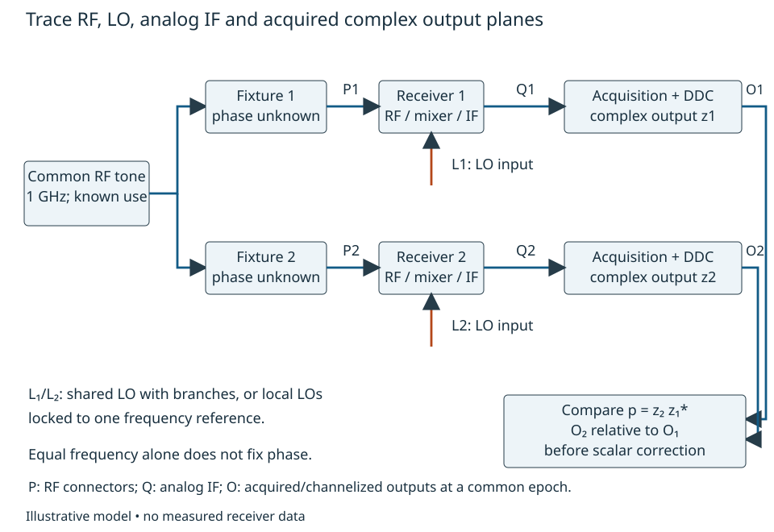
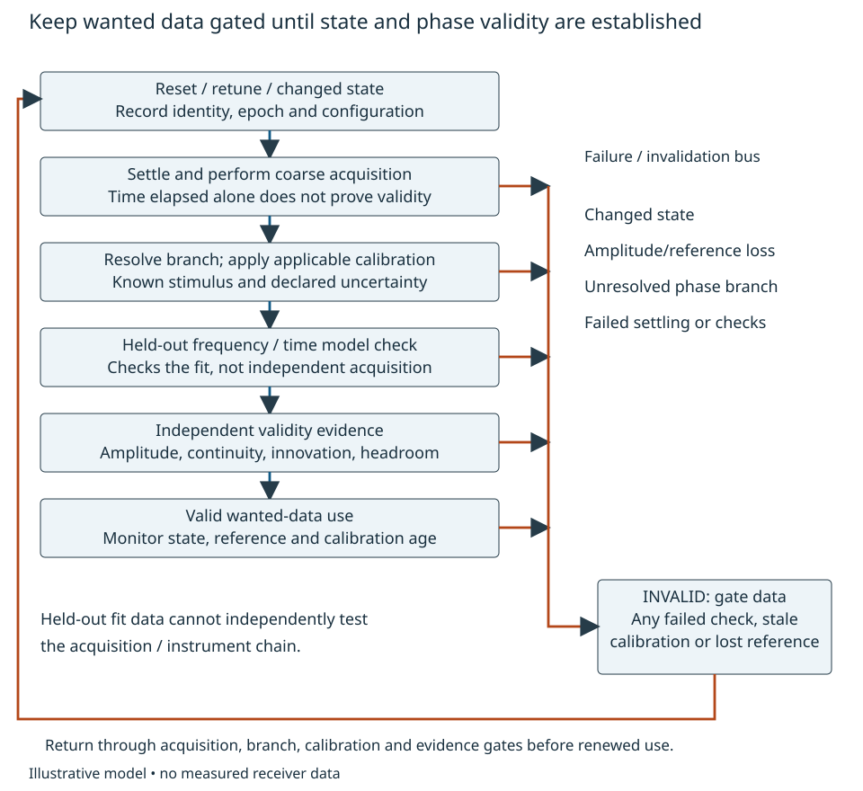

# Two channels: what remains coherent? {#sec-relative-phase}

**Development pilot, 2026-10-29.** Derivations and synthetic calculations below
are reviewable engineering work, not measured receiver performance. Conventions
are locally selected; human specialist acceptance and actual reader trials are
pending. The repository brief `project/pilots/relative-phase-stability.md` records
canonical destinations and boundaries.

## Start with a decision {#sec-phase-problem}

Two nominally identical receivers compare the phase of a tone at 1 GHz. Should
they distribute one LO, or synthesize two LOs locked to one frequency reference?
The useful answer depends on endpoint paths, observation time and what must
remain repeatable after a restart. Sharing a source does not remove everything
added after the split. A quiet display can also conceal a bad test reference.

Our teaching requirement is a band-selected continuous relative-phase standard
deviation below 1.5 degrees, plus no more than 0.5 degree deterministic drift
between calibrations. These are illustrative, separate limits; they are not a
customer specification or a universal coherence criterion. Restart behavior is
reported separately, without an invented repeatability limit. For each declared
event j define $r_j=\arg[\int_{5\,s}^{5.01\,s}p_j(t)dt]$, time zero being
that event, after its own valid-state checks. This 10 ms circular observation
samples restart repeatability; failed settling by 5 s is an invalid event, not an
omitted outlier. Use separate distributions for cold start, warm reset and retune.
The arbitrary 5 s teaching interval is not a hardware settling guarantee. Later we derive
what the same disturbances mean for a particular coherent combination.

Use two colocated heterodyne channels, a common 1 GHz calibration tone, fixed
gain and adequate signal level without overload. Choose the lower-side LO so
that the ideal difference-frequency complex signal retains RF phase and
subtracts LO phase. At an amplitude null phase is undefined. Reject such records;
do not manufacture a phase by unwrapping noise. No antenna, propagation inference,
wideband equalizer, converter selection or full PLL design is included.

{#fig-phase-planes}

The input planes P1/P2 are the RF connectors; L1/L2 are the LO mixer inputs;
O1/O2 are complex receiver outputs before correction, after acquisition and
per-tone channelization. Also define Q1/Q2 as the analog IF outputs immediately
before acquisition (not separately drawn in @fig-phase-planes). Acquisition
response from Q to O is included unless explicitly de-embedded. Report phase at O2 relative
to O1, referred to a specified stimulus relationship at P1/P2. The acquisition
system must compare simultaneous samples or explicitly correct their epoch.
Transport latency is not the analog sample epoch.

## Representations and the first physical model {#sec-phase-model}

Write a physical voltage as

$$v_i(t)=\operatorname{Re}\{z_i(t)e^{j2\pi f_c t}\}.$$

The envelope has peak-voltage scaling. Constant-envelope power into a stated
resistance R is $|z_i|^2/(2R)$; the envelope is not automatically power-normalized.
After ideal difference conversion and removal of the nominal IF rotation, use

$$z_i(t)=A_i(t)e^{j[\psi_i(t)-\ell_i(t)+\beta_i(t,q)]}+n_i(t).$$ {#eq-channel}

Here $\psi_i$ is the input phase at Pi, $\ell_i$ the LO endpoint phase at Li,
$\beta_i$ the remaining conversion/output phase, and q the operating state.
This is a narrowband model: approximately constant channel response across the
stimulus bandwidth, adequate isolation, negligible compression and image response.
Those are applicability assumptions, not conclusions from the computations.
A positive RF path delay contributes $-2\pi f_c\tau$; spectral inversion or an
opposite mixing side requires rederiving the sign in @eq-channel.

For nonzero signal amplitudes,

$$p(t)=z_2(t)z_1^*(t),\qquad \theta(t)=\arg p(t).$$

Without additive noise, the unwrapped relative phase is

$$\theta=\psi_2-\psi_1-(\ell_2-\ell_1)+(\beta_2-\beta_1).$$ {#eq-relative}

The desired input difference and receiver error are different unknowns. A common
calibration source does not establish equal input phase: its splitter and cables
create $\psi_2-\psi_1$. Receiver delay and fixture delay are confounded unless
another observation or characterization separates them.

For a signal phasor $Ae^{j\alpha}$, rotate the additive noise by $e^{-j\alpha}$:
$\arg(A+n')=\arctan[\operatorname{Im}n'/(A+\operatorname{Re}n')]$.
Expanding at $n'=0$ gives phase error $\eta\simeq\operatorname{Im}n'/A$.
Thus differential phase noise includes $\eta_2-\eta_1$, with covariance retained.
This approximation fails for fades, low SNR, appreciable AM/PM conversion and slips;
it does not imply Gaussian, white or independent noise.

A useful decomposition is $\theta(t)=d(t,q)+x(t)$ within a valid fixed state.
The deterministic part includes a phase intercept, $2\pi\Delta\nu t$, RF delay
change and deterministic supply/temperature response. The centered random part
contains explicitly filtered physical sources. State transitions need a separate
model; a random restart intercept is not stationary within-run noise.

## A short probability and spectral bridge {#sec-phase-statistics}

Expectation averages hypothetical repetitions under the model. Variance measures
squared deviations from that ensemble mean. Covariance tells whether deviations
in two quantities occur together. For real variables,
$\operatorname{var}(aX+bY)=a^2\operatorname{var}X+b^2\operatorname{var}Y+
2ab\operatorname{cov}(X,Y)$: expand the squared centered sum to obtain it.
Positive correlation therefore reduces a difference but increases a sum.
An observed time average estimates an ensemble quantity only under suitable
sampling and ergodic assumptions; a long record alone does not establish them.

For centered, jointly wide-sense stationary processes define

$$R_{ij}(\tau)=E[x_i(t+\tau)x_j^*(t)],\quad
S_{ij}(f)=\int_{-\infty}^{\infty}R_{ij}(\tau)e^{-j2\pi f\tau}\,d\tau.$$

Here f is offset frequency in Hz. The spectra are two-sided; phase PSD has units
rad²/Hz. The inverse transform uses the positive exponential. We assume the
integrals exist in the usual sense for the examples, rather than quietly using
a generalized PSD for an unbounded random walk.

Let $y_i=g_i*x_i$. Substituting both convolutions into the correlation, the lag
argument becomes $\tau-u+v$. Its Fourier transform yields
$S_{y_i y_j}=G_i S_{ij}G_j^*$. Therefore a linear combination with row vector h has

$$S_y=\sum_{ij}h_i S_{ij}h_j^*=\mathbf h\mathbf S\mathbf h^H.$$ {#eq-spectral}

A covariance/spectral matrix is Hermitian and positive semidefinite: for every
h, this variance or spectrum must be nonnegative. For a Hermitian two-by-two
matrix, nonnegative diagonal entries together with $|S_{12}|^2\le S_{11}S_{22}$
are necessary and sufficient for positive semidefiniteness. For larger matrices
pairwise bounds are only necessary: a three-by-three matrix with unit diagonal
and every off-diagonal entry -0.9 satisfies every pairwise bound but has eigenvalue
-0.8 along (1,1,1). Full positive semidefiniteness is required at each f, with
conjugate frequency symmetry for real processes and convergence of the relevant
observation integrals. These are mathematical admissibility conditions, not
evidence that hardware realizes the spectra. Complex cross-spectral phase
matters; replacing it with a real correlation coefficient can lose delay effects.

For two endpoints, write $\ell_i=G_i*r+v_i$ in phase perturbations. Then

$$S_{\Delta\ell}=|G_2-G_1|^2S_r+S_{v_2}+S_{v_1}
 -2\operatorname{Re}S_{v_2v_1}
 +2\operatorname{Re}\{(G_2-G_1)S_{r,v_2-v_1}\}.$$ {#eq-endpoints}

The last term disappears only with justified uncorrelated reference and branch
processes. Include the remaining receiver/input/measurement disturbances through
@eq-spectral rather than adding unconditional RMS numbers. Transfer functions
may be complex, dispersive and state dependent. They are phase-disturbance
responses around a valid operating point, not simply carrier insertion phase.

If both branches really are pure delays, their difference magnitude squared is
$4\sin^2(\pi f\Delta\tau)$. Factor out their common exponential and multiply by
the conjugate to obtain this identity. Only for $|\pi f\Delta\tau|\ll1$ may it be
replaced by $(2\pi f\Delta\tau)^2$; the relative leading error is approximately
$(\pi f\Delta\tau)^2/3$. Equal delays cancel that common source, not additive
branch noise. Equal cable lengths do not establish equal endpoint responses.

Phase deviation, frequency deviation and positive time advance satisfy
$\delta\nu=\dot\phi/(2\pi)$ and $a=\phi/(2\pi f_c)$. Where differentiable
stationary spectra are meaningful, $S_{\delta\nu}=f^2S_\phi$ and
$S_a=S_\phi/(2\pi f_c)^2$. Physical delay has the opposite phase sign.
No oscillator single-sideband L(f) conversion is needed here.

## Which statistic did the requirement mean? {#sec-phase-observation}

Let $x$ be the centered real unwrapped residual at O2 relative to O1 in a fixed
state, with deterministic terms reported separately. Define a normalized phase
observation $a(t)=\int w(u)x(t+u)du$; its transfer magnitude is $|W(f)|$.
For a rectangular average of duration T, it is $|\operatorname{sinc}(fT)|$,
where $\operatorname{sinc}(u)=\sin(\pi u)/(\pi u)$. Expansion of the double
integral of the covariance gives

$$\operatorname{var}a=\iint w(u)w(v)R_x(u-v)du\,dv
 =\int_{-\infty}^{\infty}S_x(f)|W(f)|^2df.$$ {#eq-observe}

These equalities require second-order stationarity and convergent integrals,
not Gaussianity. Here W acts on an **already extracted phase process**.
A phase-domain filter B may be cascaded by including $|B|^2$.
An analog or complex-signal filter cannot generally be inserted this way.

For a bounded small-perturbation bridge, write a derotated complex signal as
$z=A(1+\alpha+j\phi)+n$, with real small amplitude perturbation alpha and small
phase phi around a nonzero constant carrier. A complex baseband filter with
impulse response h has carrier gain $H_0=\int h(u)du\ne0$. Divide its output
by $AH_0$ and expand the argument at unity:

$$\phi_{\rm out}\simeq
 \operatorname{Im}\{(h/H_0)*(\alpha+j\phi+n/A)\}
 =\operatorname{Im}(h/H_0)*\alpha+
 \operatorname{Re}(h/H_0)*\phi+
 \operatorname{Im}\{(h/H_0)*n/A\}.$$

The real and imaginary parts here are of the *impulse response*. Only if its
normalized imaginary part vanishes does pure phase transfer reduce to that real
impulse response without AM-to-PM coupling. Both sidebands, additive-noise
quadratures and correlations can matter. For an analog IF filter first translate
its response about the carrier to obtain h; a carrier notch ($H_0=0$), large
excursions or fades invalidate this expansion. Ideal B below is post-extraction
phase filtering, not an analog or complex channel filter. Acquisition antialias
and digital channel filters precede extraction and need their own noise/image/
alias model. Quantitative alias, quantization and blocker/AM-to-PM budgets are
omitted; predictions assume them negligible or separately allocated.

These are observation predictions; a finite sample variance is an estimator with
its own uncertainty.

| Quantity | Precise operator and interpretation |
|---|---|
| Instantaneous variance | $R_x(0)=\int S_xdf$ of the declared process, or filtered process; may not exist |
| Increment at lag L | $x(t+L)-x(t)$; variance $2[R_x(0)-R_x(L)]=\int4\sin^2(\pi fL)S_xdf$ for real stationary x |
| Calibration residual | observation now minus observation at calibration epoch; includes their covariance and calibration error |
| Restart repeatability | distribution across specified independent restarts of a fixed post-settling circular-phase observation; retain between-run offsets |
| Coherent performance | functional of complex samples and application weights; derive below |

For two rectangular phase averages whose centers are separated by L, stationary
residual variance is $\int S_x|W_T|^2 4\sin^2(\pi fL)df$. Add calibration
estimation/fixture uncertainty and cross-covariance explicitly. Calling this
$2\operatorname{var}a$ assumes negligible correlation between the two averages.
In sampled form any linear phase statistic has variance
$\sum_{ij}w_iw_jR_x(t_i-t_j)$ and spectral gain
$|\sum_iw_i e^{j2\pi ft_i}|^2$; the supporting calculation compares these forms.

Subtracting a fitted slope/intercept from one finite record is another operator,
a projection depending on that record. It is not a universal high-pass filter,
and the reduced residual does not show that drift disappeared physically.
The choice of stability statistic matters for divergent clock noise
[@riley2008frequency, sec. 5.2.1]; we do not apply the stationary integrals above
to such noise merely by choosing a convenient low-frequency cutoff.

As a checkable process example, choose $R_x(\tau)=\sigma^2e^{-|\tau|/t_c}$.
Integrating its positive and negative lags gives
$S_x(f)=2\sigma^2t_c/[1+(2\pi ft_c)^2]$. The increment variance is
$2\sigma^2(1-e^{-L/t_c})$: zero at L=0 and twice the marginal variance at
large L. This covariance does not itself establish Gaussianity. A stationary
Gaussian realization sampled at spacing h can be generated by
$x_{k+1}=\rho x_k+\epsilon_k$, $\rho=e^{-h/t_c}$, with independent Gaussian
innovations of variance $\sigma^2(1-\rho^2)$ and stationary initial variance.
A random walk instead has increment variance proportional to L while its
absolute variance depends on start time. A deterministic spur must be propagated
as a waveform (or with an explicitly randomized phase), not silently mixed into
a smooth noise density.

## From phase to an engineering consequence {#sec-phase-combination}

For equal-amplitude, aligned channels, normalize their instantaneous combination
to ideal output power: $P(t)=|1+e^{j e(t)}|^2/4=[1+\cos e(t)]/2$.
Here e is the actual differential phase at the combiner, including calibration
bias. For a Gaussian real residual with mean b and variance v at that instant,

$$E[P]=(1+\cos b\,e^{-v/2})/2.$$ {#eq-combine}

To derive the Gaussian factor without a small-angle argument, let
$F(a)=E[e^{ja(x-b)}]$. The centered normal density g satisfies
$g'(u)=-ug(u)/v$. Differentiate F under the integral and integrate by parts;
the Gaussian boundary term vanishes and $F'(a)=-vaF(a)$. With $F(0)=1$, this
gives $F(a)=e^{-va^2/2}$ and $E[e^{jx}]=e^{jb-v/2}$. This is exact under Gaussianity,
without a small-angle expansion. Other distributions require their own
characteristic function. For small b and v the loss is approximately
$(b^2+v)/4$. Unequal amplitudes change the normalization and weighting.
The 1–10000 Hz filtered statistic used below predicts this physical combination
only if that is also the residual process at its input, or omitted contributions
are separately included. Measurement filtering does not remove physical errors.

Temporal coherent accumulation is a different question. For normalized real
weights $\sum w_k=1$, define $C=\sum w_ke^{je_k}$. Its mean complex amplitude is
$E[C]=\sum w_k E[e^{je_k}]$, but

$$E|C|^2=\sum_{kl}w_kw_l E[e^{j(e_k-e_l)}].$$ {#eq-accumulation}

For jointly Gaussian stationary centered e, the last expectation is
$\exp[-(R(0)-R(t_k-t_l))]$. This follows by applying the same Gaussian integral
to the increment whose variance is $2(R(0)-R(\tau))$. With deterministic phase,
multiply each term by $e^{j(d_k-d_l)}$. Without Gaussianity, second moments alone
cannot determine it.

A phase that is Gaussian but frozen during each record has marginal variance
$\sigma^2$, $|E[C]|^2=e^{-\sigma^2}$, yet $E|C|^2=1$.
Independent Gaussian phase samples of the same variance give
$E|C|^2=1/N+(1-1/N)e^{-\sigma^2}$ for equal weights. Equal marginal RMS phase
therefore does not specify temporal coherent performance. Neither example
establishes a radar, array or communications performance guarantee.

Finite-record uncertainty also needs temporal structure. If $\hat m=N^{-1}
\sum Y_k$, expand its variance to get
$\operatorname{var}\hat m=N^{-2}\sum_{ij}\operatorname{cov}(Y_i,Y_j)$.
For equal marginal variance $\sigma_Y^2$, this equals
$\sigma_Y^2/N+(2/N^2)\sum_{i<j}\operatorname{cov}(Y_i,Y_j)$.
Independence is sufficient but unnecessary: a zero *sum* of off-diagonal
covariances gives the usual result, including pairwise uncorrelated dependent
samples or cancelling nonzero covariances. Negative or positive sums can reduce
or increase it. Aggregate covariance determines the approximation. For nonlinear power
statistics, these covariances generally require fourth moments or a justified
full distribution. The tests use independent simulated records to estimate
Monte Carlo standard error; they do not count correlated samples as repetitions.

## A fair endpoint comparison {#sec-phase-architecture}

The common process r is expressed in equivalent LO-output phase radians. If a
physical reference at a different frequency is multiplied by N, its phase
transfer includes N and its PSD contribution includes N². The table assumes
the same output-equivalent common input in both alternatives; it does not equate
raw reference-port and LO-port PSDs. Extra common synthesis noise, unequal
multipliers or reference distribution responses must be added through the full
source/path model before applying the comparison to hardware.

For the shared LO, choose $G_i=e^{-j2\pi f\tau_i}$. For local locked synthesizers,
choose $G_i=e^{-j2\pi f\tau_i}/(1+jf/f_b)$, $f_b=100$ Hz. This stable first-order
reference response is an illustrative endpoint envelope, not a claim about any
PLL order, capture behavior or part. Each local synthesizer additionally has its
own aggregate output disturbance v: oscillator residual, internal buffers and
other uncorrelated terms. Its assumed *output* density already includes its
internal transfer. Do not filter it by G a second time. General unequal G and
correlations remain governed by @eq-endpoints.

Select real stationary Gaussian disturbances with two-sided $S_r=10^{-6}$
rad²/Hz and independent output branch spectra in $1\le |f|\le10000$ Hz, zero
outside this idealized model. B acts on extracted relative phase and is an
offline ideal band selector over that band.
It defines this comparison statistic, not a causal real-time filter. Records of
100 s at 100 ksample/s, with adequate acquisition antialias filtering, are a
proposed measurement realization; finite-window leakage must be evaluated before
comparing a real record to the ideal integral. Frequencies outside the band,
spurs and drift are explicitly outside this stochastic number.

| Declared envelope | Delay mismatch | Shared-LO branch density, each | Local-synth branch density, each |
|---|---:|---:|---:|
| Compact, quiet distribution | 10 ns | $10^{-9}$ rad²/Hz | $10^{-8}$ rad²/Hz |
| Exposed/noisy distribution | 100 ns | $10^{-7}$ rad²/Hz | $10^{-8}$ rad²/Hz |

The second case represents a distribution needing noisier endpoint buffering or
subject to additional independent disturbances; the local oscillators remain
locally shielded under the declared envelope. It does not assert a measured
100-fold degradation. Both architectures must meet the same signal, observation
and state conditions. The spectra are nonnegative and constructed from independent mathematical
sources through stable paths, so the model is stochastically admissible. This
does not establish hardware realizability. Their magnitudes, source mechanisms
and implementation feasibility require characterization.
At 1 GHz, 100 ns is an electrical-path mismatch, not an implied PCB trace length.

Using @eq-endpoints and twice the positive-frequency integral:

| Envelope | Shared LO variance, rad² | Local locked variance, rad² | Standard deviations, degrees | Conditional preference |
|---|---:|---:|---|---|
| Compact | 0.0000399986 | 0.000399960 | 0.3624 vs 1.1459 | Shared LO |
| Exposed | 0.00399986 | 0.000399960 | 3.6236 vs 1.1459 | Local synthesis |

The compact shared-LO case has only $2.63189\times10^{-9}$ rad² of common-path
leakage. Its branch contribution is $2b\times2(10000-1)=0.000039996$ rad².
This explicit accounting prevents a one-sided/two-sided factor-of-two error.

Both compact alternatives meet the illustrative 1.5-degree band limit. The
exposed shared LO fails; retaining it would require mitigation or a changed
allocation. The preference reversal is driven primarily by additive distribution
noise, not by a claim that a reference loop always rejects noise better. An
analytic budget check is $V=V_{\rm common}+39996b$; available branch density is
$(V_{\rm limit}-V_{\rm common})/39996$. At 1.5 degrees, the compact shared-LO
branch limit is approximately $1.71\times10^{-8}$ rad²/Hz per endpoint. Improving
the exposed branch below that scale restores conditional feasibility. Correlated
branch disturbances change this allocation and must be measured or bounded.

A hardware recommendation additionally needs power, isolation, drive, spectral
spurs, thermal response, reset behavior, cost and calibration downtime evidence.
No universal superiority follows from this table. It is a conditional selection
between supplied envelopes, not a component selection or compliance claim.

## Calibration, drift and implementation {#sec-phase-calibration}

Use a **fixed 990 MHz LO** throughout each calibration cycle. Inject a simultaneous
coherent comb at 999, 1000 and 1001.5 MHz; reserve 1000.5 MHz for a held-out test.
Both channels acquire complex I/Q at 32 Msample/s with an analog/complex passband
covering IF 9–11.5 MHz plus sidebands. Per-tone DDCs use identical frequencies
and common sample-index phase origins in both channels. Each channelizer must
suppress other tones before decimation to 100 ksample/s, with passband flat over
the 10 kHz phase sidebands. The total comb level must remain linear. These
100 ksample/s streams carry narrowband envelopes, not unchannelized MHz-spaced
tones. No LO retuning, NCO reset or gain-state change occurs between training
frequencies. Hardware meeting this interface is assumed, not verified.

The measured phase is referred from Pi to the selected Oi channelizer output,
including IF/acquisition response unless de-embedded. At fixed LO an RF sweep
changes IF by the same increment. For nondispersive differential RF, IF and
fixture delays its slope is
$-2\pi(\Delta\tau_{\rm RF}+\Delta\tau_{\rm IF}+\Delta\tau_{\rm fixture})$.
Constant LO-path phase contributes to the intercept, not this slope.
With dispersion the fit represents a local derivative of combined response.
Keeping IF fixed by retuning LO with RF instead gives ideal nondispersive
slope $-2\pi(\Delta\tau_{\rm RF}+\Delta\tau_{\rm fixture})
+2\pi\Delta\tau_{\rm LO}$: IF delay no longer contributes a frequency slope.
Frequency-dependent conversion response and tuning-state offsets need their own
terms. Independent unknown offsets at each tune make a delay fit unidentifiable.
Fixture slope is indistinguishable from receiver slope unless characterized.

Let $y_k=m(f_k)-\widehat c_{\rm fixture}(f_k)$, retaining correction uncertainty,
and define the intercept $b_0$ at the stated reference $f_0=1$ GHz:

$$y_k=b_0-2\pi(f_k-f_0)\Delta\tau_{\rm eff}+\epsilon_k.$$

For locally unwrapped equal-variance observations with zero cross-covariance,
minimize $\sum[y_k-b_{\rm mean}-a(f_k-\bar f)]^2$. Differentiation gives

$$\begin{aligned}
b_{\rm mean}&=\bar y,\\
a&=\frac{\sum(f_k-\bar f)(y_k-\bar y)}{\sum(f_k-\bar f)^2},\\
\widehat{\Delta\tau}_{\rm eff}&=-a/(2\pi),\\
\widehat b_0&=b_{\rm mean}+a(f_0-\bar f).
\end{aligned}$$ {#eq-phase-fit}

The intercept at the measurement mean frequency is **not** the intercept at f0
unless they coincide. The module returns named mean-frequency, mean-phase and
delay fields; its phase_at(f0) method performs the conversion. For asymmetric
999, 1000, 1001.5 MHz synthetic data with $b_0=0.3$ rad and delay 2 ns,
$\bar f=1000.1666667$ MHz and $b_{\rm mean}=0.2979056$ rad, while
$\widehat b_0=0.3$ rad. Held-out prediction at 1000.5 MHz checks this local line,
not a demonstrated calibration algorithm. Correlated errors require covariance
weighting and an appropriate uncertainty model.

Common phase state, adequate SNR and locally resolved wrapping are prerequisites.
On this 0.5 MHz grid, delays separated by 2 microseconds can give identical wrapped
samples after an intercept change. A justified local prior (for example
$|\Delta\tau_{\rm eff}|<1$ microsecond after fixture correction), or extra frequency
information, is needed. The code rejects explicitly wrapped data and supplied
mixed/missing state IDs; it cannot detect an unreported reset or infer an unwrap.
Constant fixture phase has the same confounding freedom as fixture slope.
Hold out time, frequency and state data and inspect curvature before using the fit.

Apply scalar unit-magnitude correction at the carrier. It does not repair
wideband delay, additive noise, lost samples or clipping. A coefficient step q
rad creates at most q/2 static error, not automatically white q²/12 noise.

### Thermal reference and maintenance allocation

The varying quantity here is **receiver RF delay from P2 to its mixer relative
to P1 to its mixer**, before fixed LO subtraction. Increasing
$\Delta\tau_{\rm RF}=\tau_2-\tau_1$ makes relative output phase more negative:
$\delta\theta=-2\pi f_{\rm RF}\delta\Delta\tau_{\rm RF}$.
An LO-path delay increase instead contributes positive output phase
$+2\pi f_{\rm LO}\delta\Delta\tau_{\rm LO}$; these sensitivities are different.
At 1 GHz RF the magnitudes for 2 ps/K and 30 ps/K over 2 K are 1.44 and
21.6 degrees. The assumed 30 ps/K and bounded 0.02 K/s rate give drift magnitude
0.216 degree/s, with no abrupt jumps during valid use.

Define epoch $t_n$ as the center of a known-stimulus snapshot of length T.
Estimate the average **locally unwrapped relative phase** at 1 GHz after fixture
correction, rather than phase of an averaged complex product. Linear drift
averages to its center value. With only a rate bound, additional snapshot-to-center
bias is at most $0.216T/4$ degree (the average $|t-t_n|$ is T/4).

Allocate snapshot standard uncertainty at most 0.05 degree: stochastic phase
average at most 0.04 degree and independent remaining fixture/acquisition/
estimator terms at most 0.03 degree. These concern an absolute phase estimate,
not the band statistic. The declared stochastic model is zero outside its band;
unknown slow noise would change the prediction. Integrating
$S_x(f)\operatorname{sinc}^2(fT)$ gives:

| Envelope and T | Phase-average SD | With independent 0.03-degree remaining SD |
|---|---:|---:|
| Compact shared LO, 10 ms | 0.025353 degree | 0.039278 degree |
| Local synthesis, 10 ms | 0.080173 degree | 0.085602 degree: fails allocation |
| Local synthesis, 50 ms | 0.034379 degree | 0.045628 degree |

The previously unqualified 10 ms snapshot is inadequate for local synthesis.
Use 10 ms for compact shared LO and 50 ms for local synthesis. Exposed shared
LO already fails the band limit. If the remaining 0.03-degree allocation or
settling is unattainable, hardware recalibration feasibility remains unestablished.

Declare 20 ms settling before each snapshot and 100 ms processing/application
time **after its end**. Gate wanted data over
$[t_n-T/2-0.020,\ t_n+T/2+0.100]$: 130 ms compact or 170 ms local invalid time.
These are interface assumptions, not hardware guarantees. A separate 100 s
validation record with coefficients frozen is not a maintenance snapshot.

For centers separated by P, the oldest correction just before next application
has age $P+T/2+0.100$. Including snapshot-center bias, the separate deterministic
0.5-degree allowance requires

$$0.216[P+T/2+0.100+T/4]\le0.5\ {\rm degree}.$$

Thus $P\le2.207315$ s for 10 ms and $P\le2.177315$ s for 50 ms.
Choosing P=2 s gives bounds 0.45522 and 0.46170 degree, with invalid fractions
6.5% and 8.5%. Matching to 2 ps/K increases the drift-only age scale to 34.72 s,
but latency and snapshot bias still apply. These bounds concern drift, not total
absolute error: standard uncertainty is not a deterministic bound. A random-walk
drift instead needs increment covariance and a probabilistic criterion.

### Constant uncertainty and time-varying updates

For frozen correction C in one valid segment, define local absolute residual
$e_a=X_a-C$, where $X_a$ is a specified phase average at use:

$$\operatorname{var}e_a=V_a+V_C-2\operatorname{cov}(X_a,C).$$ {#eq-absolute-phase}

If $C=X_{\rm cal}+\epsilon$, expand all covariances of use, calibration and
epsilon; independent epsilon does not make use and calibration independent.
Static fixture uncertainty and quantization affect absolute phase accuracy
across realizations. Independent 0.05-degree C and an instantaneous band-limited
X of 0.362364-degree SD give a **local absolute** SD of 0.365797 degree.
This is not a new selected-band SD.

For DC-rejecting phase operator B, $B(0)=0$, constant C over the analysis segment
gives $B[X-C]=BX$. For sampled weights the calibration variance contribution is
$(\sum w_k)^2V_C-2(\sum w_k)\operatorname{cov}(\sum w_kX_k,C)$, zero when
$\sum w_k=0$, even for correlated X and C. The compact band SD remains
0.362364 degree. Finite-record mean handling and edges must implement that
operator: cropping a constant to a window and Fourier transforming can leak it,
which is a different observation. Do not filter across update steps as if C
were constant.

For updates write $c(t)=\sum_n c_n p_n(t)$, where $p_n$ holds from application n
until application n+1. Residual $e(t)=X(t)-c(t)$ then has

$$R_c(t,u)=\sum_{nm}p_n(t)p_m(u)\operatorname{cov}(c_n,c_m),$$

and $R_e(t,u)=R_X(t,u)+R_c(t,u)-\operatorname{cov}(X(t),c(u))-\operatorname{cov}(c(t),X(u))$.
Use these two-time kernels with actual observation weights and invalid-data mask.
Periodic updates generally give a cyclostationary process, not a static variance
to add to a band integral. In the special model of independent zero-mean update
errors of variance $v_c$, period P, and a uniformly randomized grid origin
independent of X, $R_c(\tau)=v_c(1-|\tau|/P)_+$ and
$S_c(f)=v_cP\operatorname{sinc}^2(fP)$, the transform of that triangle.
This has nonzero power away from DC. Correlated updates/use require cross terms
where stationary spectra apply, or the two-time formulation otherwise. This
special update-error example does not model all receiver drift as stationary.

A blind correction that subtracts the measured current phase can remove the
wanted differential input phase too. Verify with an independently imposed known
phase step at P2. A calibration interval must contain a known stimulus, or an
extra observable separating wanted phase from drift. Lower displayed residual
is not sufficient evidence of improved sensing.

Translate the allocation into hardware obligations: characterize electrical
rather than geometrical matching at L1/L2, isolate LO branch loads, control return
currents and supply-to-phase sensitivity, place thermometers to resolve gradients,
restrain phase-sensitive cables and provide endpoint test access. For example,
an assumed 0.1 rad/V differential supply sensitivity and 10 mV change produce
0.001 rad, or 0.0573 degree; filtering or regulation must address the actual
aggressor spectrum and return path. The sensitivity is unverified. A uniform
chamber temperature does not establish gradient immunity.

{#fig-phase-states}

Define separate cold power-up, warm reset, partial-channel reset and retune
procedures. Record divider/PLL state where accessible, mixer/gain setting,
acquisition epoch, NCO phase if used, calibration version and settling criteria.
Frequency lock alone imposes no unique phase intercept. A run-dependent unknown
constant can leave within-run increments quiet and restart repeatability poor.
Do not unwrap across a reset and classify it as continuous drift.

For N genuinely independent restarts with zero observed invalid outcomes, the
one-sided upper failure probability at confidence $1-\alpha$ is
$1-\alpha^{1/N}$: solve $(1-p)^N=\alpha$. This binomial statement requires a
specified failure event and independent representative trials; it does not prove
deterministic phase. No restart trials have occurred here.

## Measurement and uncertainty: an executable protocol {#sec-phase-measurement}

For each source/fixture/receiver assignment, a small-error equation at tone F is

$$m(F,t)=D_F*s+\delta_{\rm wanted}(F,t)+c_{\rm fix}(F,t)
 +b_R(F,t,q)-\Delta\ell(F,t,q)+a_{\rm acq}(F,t)
 +i_{\rm inst}(F,t)+\eta(F,t).$$ {#eq-measurement}

Here $D_F=K_2-K_1$ is the unequal fixture transfer of source phase s,
$c_{\rm fix}$ is deterministic/uncertain splitter and cable phase, $b_R$ is
receiver RF/conversion/IF response excluding LO, and $\Delta\ell=\ell_2-\ell_1$.
Acquisition includes channel response and the linear sample-epoch contribution
$2\pi f_{\rm IF}(\epsilon_2-\epsilon_1)$ when sampling at $t+\epsilon_i$.
Instrument/reference phase is separate; eta collects justified small additive
phase errors. None is presumed independent. Apply the specified observation
and known-stimulus correction to this equation; do not discard common terms
without propagating their unequal paths.

| Intervention (output channel labels fixed) | Identifiable contribution under stability assumptions | Remaining ambiguity |
|---|---|---|
| Exchange characterized input fixture branches, same source/state | Fixture/source-path difference reverses; fixed receiver/LO/acquisition terms do not; half-difference extracts reversible contribution | Reconnection/drift and mixed source/fixture effects; internal terms stay combined |
| Exchange acquisition analog inputs/cables at fixed Q planes | Receiver output difference at Q reverses while acquisition/instrument channel asymmetry need not | Output fixture changes, loading, common instrument error |
| Exchange whole receiver channels | Receiver/LO terms move with their hardware; recompute all assignments | No generic sign flip isolates receiver if fixtures/clock/state also move |
| Change one LO delay, heat a branch, vary level | Test predicted sign/dependence of LO, thermal or noise/AM-to-PM terms | Other sensitive paths can respond too |
| Independently acquired comparison at Q1/Q2 | $m'=\delta_Q+a'+i'+\eta'$ observes the same receiver IF-output relationship | $m-m'$ cancels $\delta_Q$, testing acquisition/instrument difference, not absolute truth; shared paths retain common bias |

1. Use fixed LO and simultaneous-comb acquisition as above. Record physical P/L/O
   planes, channelizer/NCO response, state, temperatures, levels and coefficient
   epoch. Verify all-tone headroom, antialias response and channel rejection.
2. Characterize input/output fixture phase and slope with uncertainty. Collect
   10 ms or 50 ms simultaneous calibration snapshots according to the allocation,
   gating the stated settling and update intervals. Unknown fixture slope remains
   inseparable from receiver/acquisition slope.
3. In a separate validation run, freeze coefficients and collect 100 s per-tone
   complex envelopes at 100 ksample/s. Retain complex samples, amplitudes, flags,
   wrapped phase and epoch/state metadata. Distinguish phase of averaged product
   from averaged extracted phase. Specify phase filters, edges, window/leakage
   before comparing with ideal B. Do not add static uncertainty to its band result.
4. Fit only common-state locally unwrapped phases. Apply scalar 1 GHz correction
   and evaluate held-out 1000.5 MHz/time data, curvature and independently imposed
   wanted phase steps. A synthetic line fit establishes no fixture removal or
   physical phase-state control.
5. Execute paired swaps and perturbations with stable conditions or measured
   drift correction. Preserve assignments so every term in @eq-measurement
   can be traced; changes cannot be pooled as identical repetitions.
6. Use separate acquisition at Q1/Q2 for the differently referenced comparison;
   recomputing the same O samples cannot independently test Q-to-O acquisition.
   Give the second chain its own equation, uncertainty
   and cross-covariance. Disagreement diagnoses combined error; agreement does
   not establish accuracy when important paths are shared.
7. Execute restart/retune classes separately, using the 5–5.01 s observation and
   reporting invalid events. A fixed-state delay fit does not extend across
   unknown tuning offsets. Instruments, settling and lab execution are unverified.

For uncertainty, model the measurement process including corrections, fixtures
and covariance. First-order propagation is local and may fail for wrapped or
ambiguous quantities [@taylor1994uncertainty, app. A.1–A.3]. An illustrative
locally linear **absolute phase-result** budget (not the band statistic) has two phase terms of standard uncertainty 0.03 degree,
correlation 0.8, differenced; plus independent fixture and calibration terms
0.04 and 0.02 degree. Expansion gives

$$u_c^2=2(0.03)^2(1-0.8)+(0.04)^2+(0.02)^2
 =0.00236\ {\rm degree}^2,\quad u_c=0.04858\ {\rm degree}.$$

Twice this is 0.09716 degree; it is not automatically a 95% coverage interval.
The correlation and distributions are assumed, not measured. Ignoring covariance
would give 0.06164 degree; covariance with the opposite sign would increase the
uncertainty. Unknown fixture bias cannot be dismissed because repetitions agree.
Do not subtract an apparent instrument noise floor without a supported covariance
and measurement model. Untested offsets below 1 Hz and above 10 kHz cannot be
assigned zero merely because the teaching allocation excluded them.

A borderline test requires a declared decision rule. For an illustrative scalar
upper limit L and a justified error bound U, $\hat y+U\le L$ supports guarded
acceptance under that bound; $\hat y-U>L$ supports rejection; the overlap is
inconclusive. A standard uncertainty is not a guaranteed bound, and the rule for
phase variance requires uncertainty in that estimated statistic, not the phase
intercept budget above. No real compliance decision is made here.

## Check your reasoning and use this as a reference {#sec-phase-transfer}

Before consulting the diagnostics, produce a model, calculation and evidence
proposal for each task:

- Replace the shared source with independent references of equal marginal PSD.
  Which cross terms disappear? Does equal frequency establish restart phase?
- Keep phase variance fixed but make phase constant within each observation
  instead of rapidly fluctuating. Predict both $E[C]$ and $E|C|^2$.
- Double calibration separation L while keeping the averaging duration fixed.
  Determine whether residual variance doubles, saturates or follows another law.
- Increase signal bandwidth while keeping tone correction perfect. What phase
  slope remains, and what additional measurement/correction becomes necessary?
- A quiet ratio test becomes noisy with a different test reference. Construct two
  competing measurement models and an intervention that distinguishes them.

Diagnostics: independent references remove common-source cancellation; frozen
phase preserves within-record coherent magnitude; exponential covariance
saturates whereas random-walk increments grow; scalar correction leaves delay
slope; reference sensitivity can belong to the DUT, fixture or instrument.
A correct response must derive the changed observable, not just repeat these
phrases. Actual reader work and educational effectiveness remain unassessed.

For lookup: @sec-phase-model defines planes and signs; @eq-endpoints propagates
endpoint disturbances; @sec-phase-observation selects the statistic;
@sec-phase-architecture compares envelopes; @sec-phase-calibration treats
observability and cadence; @sec-phase-measurement specifies discriminating tests.
The supporting module reproduces selected mathematics; the explanation and
engineering decisions above stand without executing it.
