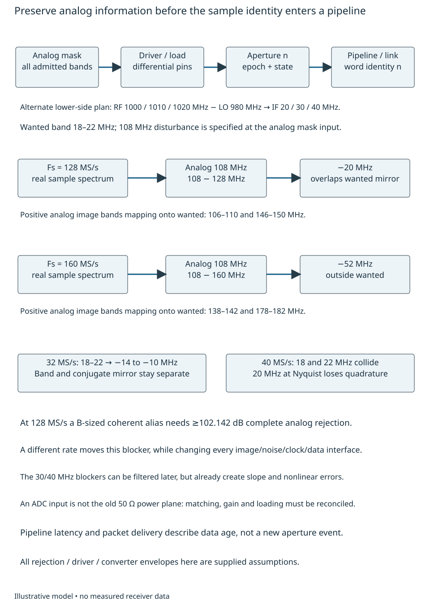
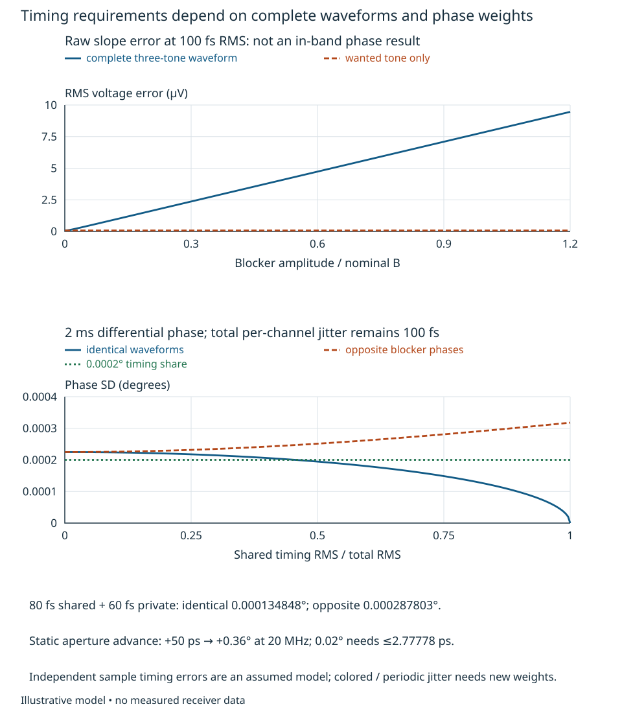
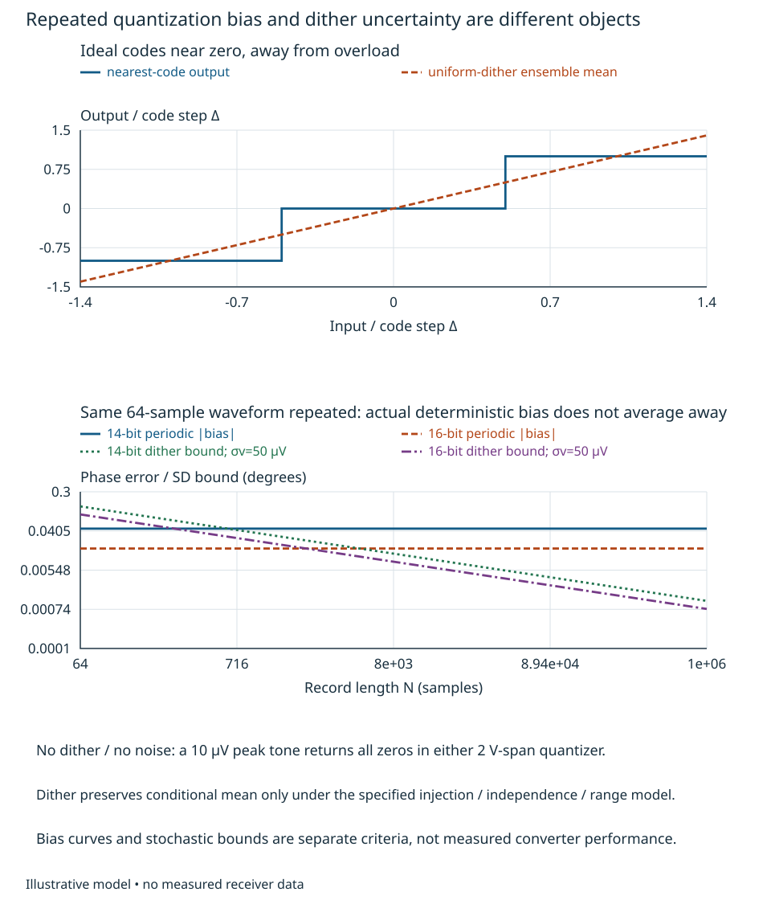
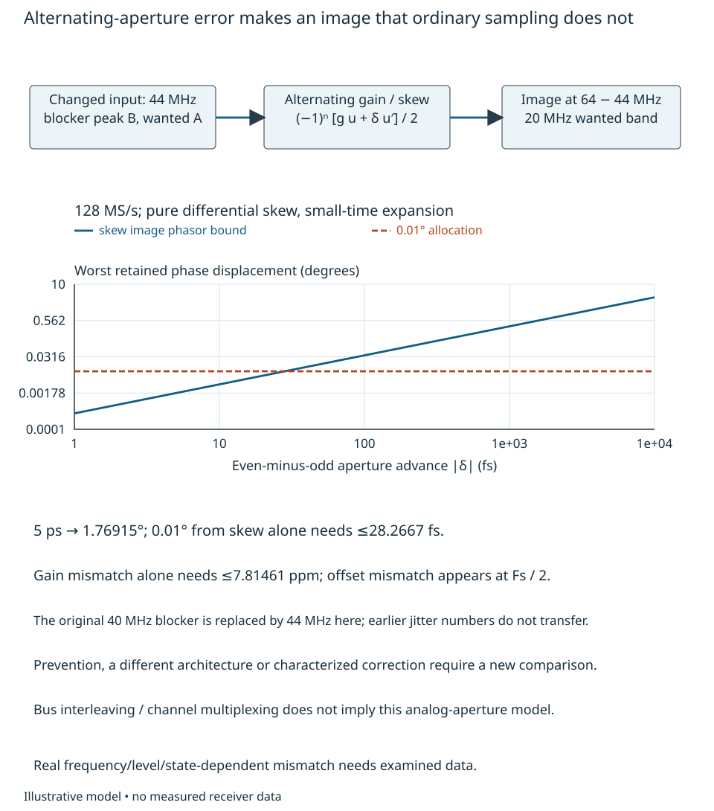
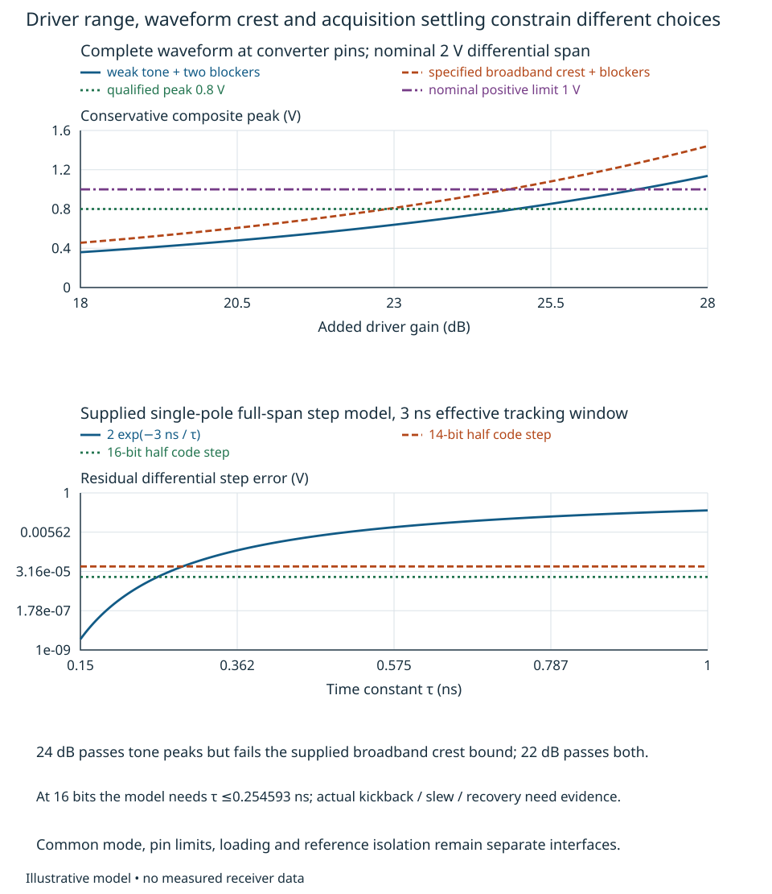

# Sampling and converter feasibility {#sec-converter-feasibility}

A converter that digitizes a large sine wave cleanly can still lose a weak
coherent return, translate an unwanted band onto it, or deliver accurately timed
data words for analog samples taken at the wrong epochs. The engineering question
is how to turn the analog and reference interfaces of Chapters 14–16 into
**compatible rate, range, driver, timing and validity requirements**.
We will compare conditional converter envelopes, rather than select a part by
bit count or a headline SNR. The reader should be able to calculate alias masks,
propagate complete-waveform timing error to a stated phase observation, recognize
correlated quantization, and identify which device characteristics still need
evidence. All new numerical requirements and component envelopes are illustrative.

## Choose the analog plane and the aliases together

Use Chapter 14's high-gain readout levels: wanted −56 dBm and two blockers
−23 dBm each at declared 50 Ω equivalent delivered-power planes. To make this a
specific converter exercise, choose an **alternate lower-side LO at 980 MHz**,
giving wanted IF 20 MHz and blocker IFs 30 and 40 MHz from RF
1.000/1.010/1.020 GHz. Chapter 11 supplies the conversion signs; its original
1.020 GHz high-side plan is not silently replaced. The quoted gains are supplied
interfaces for this alternative and require physical confirmation.

After matching and anti-alias filtering, suppose a differential driver gives
24 dB wanted/30/40 MHz voltage gain with losses already included. Matching
translates the old 50 Ω levels to voltage; it does not turn an ADC input into
a 50 Ω resistor. At the converter pins the peak differential amplitudes become
$A=7.943282$ mV wanted and $B=354.813389$ mV per blocker. The supplied converter
range is $-1\le u<1$ V differential, with a qualified composite-peak limit 0.8 V.
For arbitrary tone phases,

$$
 |u|_{\max}\le A+2B=0.717570\ \mathrm{V}.
$$

Thus 24 dB passes this peak interface; its maximum permissible value from the
same input is 24.9445 dB. This is a range calculation, not a distortion guarantee.
For a different specified modulation burst, let wanted RMS at this nominal gain
be 50 mV with a supplied peak/RMS bound of four over the observation interval.
Its peak plus the two blockers is $0.2+2B=0.909627$ V and fails. Reducing the driver
to 22 dB gives 0.722542 V and passes that peak test. A sine-like crest assumption
would give only $0.05\sqrt2+2B=0.780337$ V and incorrectly retain 24 dB.
The modulation's spectrum, peak bound and transition history must all describe
the actual burst, including out-of-band transients.

With ideal real sampling $T_s=1/F_s$, samples of a frequency $f$ and $f+kF_s$
are indistinguishable. For signed frequency reduced into
$[-F_s/2,F_s/2)$, set
$f_a=f-F_s\lfloor f/F_s+1/2\rfloor$. A real negative-frequency component is the
conjugate partner of the positive component; extracting it with the wrong
orientation reverses physical phase. Chapter 11 owns that translation.
For wanted band 18–22 MHz at $F_s=128$ MS/s, every band
$kF_s\pm[18,22]$ MHz needs an analog response/noise/interference assessment.
The nearby 30/40 MHz blockers are distinct after sampling, but still consume
range and create timing/nonlinear errors before their later rejection.

Bandpass sampling can also use a rate below twice the highest wanted frequency,
provided its translated band and conjugate mirror remain disjoint. At 32 MS/s,
18–22 MHz becomes −14 to −10 MHz: it is separable, and positive-frequency
extraction at 12 MHz conjugates the original lower-side envelope. At 40 MS/s,
18 and 22 MHz instead produce the same real sampled frequency, while the
20 MHz carrier is at Nyquist. For example,
$\cos(\pi n+\theta)=(-1)^n\cos\theta$ cannot distinguish $\theta$ from $-\theta$.
Although 40 MS/s exceeds twice the 4 MHz bandwidth, that placement loses
quadrature information. Rate, band position and image rejection must be
chosen together; neither bandwidth nor maximum analog frequency alone decides
bandpass-sampling feasibility.

An additional narrow 108 MHz disturbance folds to −20 MHz, directly onto the
real wanted band. If its unattenuated amplitude would equal $B$, and it alone
is allowed a 0.02° coherent phase-displacement allocation, the phasor bound of
Chapter 12 requires

$$
 B\,10^{-L_a/20}/A\le\sin(0.02^\circ),\qquad
 L_a\ge102.14185\ \mathrm{dB}. \tag{17.1}
$$

This is the required *complete analog rejection* from the specified disturbance
plane, not an asserted realizable filter. Digital filtering cannot separate it
once it occupies the wanted samples. At 160 MS/s, 108 MHz instead folds to
−52 MHz and can be rejected downstream, but 138–142 and 178–182 MHz now map
onto the wanted band. Increasing rate changes the mask, drive/settling, clock
and data/power costs; it does not remove the need for an analog mask.
Broadband noise also folds: the sampled noise density referred to analog Hz is
$\sum_k|H_a(f+kF_s)|^2S_u(f+kF_s)$ for the declared analog response $H_a$ and
two-sided input density $S_u$. This needs the whole admitted spectrum, not only
the largest known tone.

{#fig-converter-alias-interfaces fig-alt="Analog selection and a differential driver feed the sample aperture, then a pipeline and data words carrying aperture identity. Two rate lanes show the 108 MHz disturbance folding to minus20 MHz at 128 MS/s and minus52 MHz at 160 MS/s, with different wanted image bands."}

## Apply timing error to the actual phase observation

[Chapter 9's timing construction](physical-disturbance-paths.qmd#sec-waveform-timing)
gives $e_i[n]\simeq \epsilon_i[n]\dot u_i(nT_s)$; it owns the general
source/path and spectral convolution result. A small time error must be small
relative to **every** admitted analog frequency. For the three tones above,
averaging their orthogonal squared slopes gives

$$
 \overline{\dot u^2}=\tfrac12(2\pi)^2
       [f_w^2A^2+(f_1^2+f_2^2)B^2], \tag{17.2}
$$

with $f_w=20$, $f_1=30$, $f_2=40$ MHz. At 100 fs RMS independent sample-time
error this is 7.882288 μV RMS raw voltage error. The wanted-tone-only formula
would predict a 98.016 dB jitter-limited sine SNR; wanted voltage divided by the
*total* timing error gives only 57.057 dB. Neither is automatically an in-band
phase SNR: the timing spectrum and extraction weights determine what is retained.
For a broadband waveform the same calculation uses its measured or modeled
finite second spectral moment, $E[\dot u^2]=\int(2\pi f)^2S_u(f)\,df$, with
deterministic mean components handled separately. A broadband RMS voltage alone
does not provide that moment.

To calculate the observable, take two channels with equal wanted amplitude and
phase at the same aperture plane. Define an exactly coherent 2 ms record,
$N=256000$, and the phasor estimate
$Z_i=(2/N)\sum_n v_i[n]e^{-j\omega_wn}$. Here
$\omega_w=2\pi f_w/F_s$; this extraction rejects the nominal 30/40 MHz tones.
For small errors around $Z_i=A$, its phase error is

$$
 \eta_i=-{2\over NA}\sum_n
       \epsilon_i[n]\dot u_i(nT_s)\sin(\omega_wn). \tag{17.3}
$$

This uses Chapter 2's high-SNR phase linearization. It must be reconsidered near
zero amplitude, clipping, slips or a different observation window.
Construct the physical timing sources as
$\epsilon_1=c+a_1,\ \epsilon_2=c+a_2$, where all three sequences are centered,
mutually independent and independent of the waveforms, with independent samples.
Supply $\sigma_c=80$ fs, $\sigma_a=60$ fs; each channel then has 100 fs total.
This is an illustrative discrete aperture-error model. A shared oscillator with
colored or periodic jitter does not automatically satisfy it.

For identical complete waveforms, common $c$ cancels in $\eta_2-\eta_1$.
If both blockers instead have opposite phase in channel 2 while the wanted
phases remain equal, common jitter multiplies opposite blocker slopes and
does not cancel. Let $J_B=(2\pi)^2(f_1^2+f_2^2)B^2$. Orthogonality over the
64-sample waveform period gives

$$
 V_a={3\sigma_a^2(2\pi f_w)^2\over N}
             +{2\sigma_a^2J_B\over NA^2},\qquad
 V_c={4\sigma_c^2J_B\over NA^2}. \tag{17.4}
$$

For example, $\overline{\sin^4\omega_wn}=3/8$ supplies the wanted term;
$\overline{\sin^2\omega_wn\sin^2\omega_bn}=1/4$ supplies each blocker term.
In the opposite-phase case the common blocker difference is doubled before
squaring. The differential phase SDs are therefore **0.000134848°** for
identical waveforms and **0.000287803°** for opposite blockers. A supplied
0.0002° timing share passes the former and fails the latter, despite identical
individual jitter specifications. The phase of the blockers, clock spectra and
channel correlations are consequential characterization inputs.

A static differential aperture advance is different again: at the wanted tone,
$\Delta\phi=+2\pi f_w\Delta t$. A 50 ps advance gives +0.36°; a residual 0.02°
allocation permits only 2.77778 ps. The sign is positive because the sampler
observes a later phase, unlike a physical analog delay. Calibration can establish
a fixed offset only in its identified frequency/state/temperature envelope.
Kester's [MT-007, Rev. A, pp. 2–7](https://www.analog.com/media/en/training-seminars/tutorials/MT-007.pdf)
distinguishes aperture delay from jitter and derives the sine-input limit
[@kester2008aperture]. Its RSS clock/internal-jitter reduction needs the
uncorrelated-source condition; (17.3) retains correlations explicitly.

{#fig-converter-timing-observable fig-alt="Raw timing voltage error grows with blocker amplitude while the wanted-only prediction stays constant. A second plot varies the shared fraction of a fixed 100 fs jitter envelope, showing cancellation for identical waveforms and reinforcement for opposite blocker phases against a 0.0002 degree timing share."}

## Test quantization before calling it white noise

An ideal $b$-bit uniform converter over a 2 V span has step
$\Delta=2/2^b$ V and, away from endpoints, nearest-code rule
$Q(u)=\Delta\lfloor u/\Delta+1/2\rfloor$. Saturation and missing codes are
separate mechanisms. If error is approximately uniform over one code and
uncorrelated with the input, integration of $e^2/\Delta$ on
$[-\Delta/2,\Delta/2]$ gives $\sigma_q^2=\Delta^2/12$.
For a full-scale sine its RMS is $1/\sqrt2$ V, giving
$6.0206b+1.7609$ dB SNR over the full Nyquist interval.
White distribution in frequency and independence between samples/channels are
additional assumptions, not consequences of the number of bits.
For two independent white quantization errors, (17.3)'s phase projection gives
$\sigma_{\Delta\phi}=\Delta/(\sqrt{3N}A)$ radians: 0.00100474° at 14 bits and
0.000251184° at 16 bits for this 2 ms tone record.

Now actually quantize the repeated three-tone record. Use channel phases
$(\theta_w,\theta_{30},\theta_{40})=(0,0.2,-0.4)$ radians in channel 1 and
$(0.3,1.1,-0.7)$ in channel 2. At 128 MS/s the waveform and ideal quantization
error repeat every 64 samples. Direct phasor extraction gives relative phase
bias **−0.0456748°** at 14 bits and **−0.0165337°** at 16 bits relative to the
true 0.3 rad. Averaging another identical period does not change either bias;
both violate an illustrative 0.01° conversion-bias goal. At the still lower
level of 10 μV peak with no blockers/noise, both quantizers return zero for
every sample. There is no recovered phase to improve by averaging.
[MT-001, Rev. A, pp. 1–6](https://www.analog.com/media/en/training-seminars/tutorials/MT-001.pdf)
derives the ideal noise estimate and discusses signal-correlated quantization
[@kester2008mt001]. Our exact periodic example is a local calculation, not a
measurement or a general bias bound for these bit counts.

### Dither changes the model and spends noise and range

For a conditional remedy, inject independent uniform analog dither
$d[n]\in[-\Delta/2,\Delta/2]$ before an ideal quantizer, without subtracting it
after conversion. Provided no overload, let $u/\Delta=k+p$, $0\le p<1$.
The two possible neighboring output codes have probabilities $1-p,p$.
Consequently

$$
 E[Q(u+d)\mid u]=u,\qquad
 \operatorname{var}[Q(u+d)-u\mid u]=\Delta^2p(1-p)
                       \le\Delta^2/4. \tag{17.5}
$$

Thus the mean voltage is preserved, but the error is not universally white
$\Delta^2/12$. Independence of dither across samples/channels supplies the
diagonal conditional error covariance for this calculation. With additional
independent centered per-sample converter/driver noise of RMS $\sigma_v$,
conditioning on its value gives the conservative first-order differential
phase SD bound

$$
 \sigma_{\Delta\phi}\le{\sqrt{4\sigma_v^2+\Delta^2}\over A\sqrt N}.
 \tag{17.6}
$$

This follows from the squared sine weights in (17.3) and total conditional
variance. The mean analog-noise component and bounded quantization/dither
residual are uncorrelated by conditional zero mean; they are not presumed
independent quantization and dither noises to be blindly added. Require range
qualification for the signal plus prequantization noise plus dither: RMS noise
alone cannot exclude rare overload excursions.

| Supplied converter envelope | Bound at 2 ms | 0.002° stochastic conversion share? |
|---|---:|---|
| 14 bits; $\sigma_v=50$ μV | 0.00224964° | Fails |
| 16 bits; $\sigma_v=50$ μV | 0.00149052° | Passes conditionally |
| 16 bits; $\sigma_v=120$ μV | 0.00344903° | Fails |

These are comparisons of hypothetical complete noise envelopes, not devices.
The 16-bit/50 μV option merits further investigation only with appropriate
dither, range, linearity, bandwidth and state evidence. An actual ADC's analog
noise, DNL, reference coupling and distortion can dominate its ideal code step.
The timing, alias, deterministic-bias and stochastic shares here are separate
diagnostic interfaces requiring reconciliation with Chapter 12's complete budget.
They are not multiple new grants of the same task allowance.

Uniform dither needs a suitable analog injection path, known bandwidth and
distribution at the aperture, independence, calibration and additional peak
margin. Sharing otherwise valid uniform dither can preserve each channel's
conditional mean and marginal variance in (17.5), while changing cross-channel
covariance and invalidating (17.6). Filtering can retain the marginal distribution
while introducing temporal correlation; signal-dependent or nonuniform dither
can also change the marginal results. Rebuild the actual error covariance.
It cannot repair clipping, prior alias overlap or analog memory. The sub-LSB
counterexample's ensemble mean can be recovered under the dither model, but
with much poorer finite-record precision; adding noise is a decision with costs.

{#fig-converter-quantization fig-alt="Quantization curves show the ideal staircase and the input-preserving ensemble mean under uniform dither near zero. A logarithmic record-length plot contrasts the constant 14 and 16 bit periodic phase biases with conditional dither uncertainty bounds."}

Nonlinear conversion also needs the actual waveform. The cubic product
$2(30)-40=20$ MHz lands on the wanted IF; Chapter 14's weak-nonlinearity
construction applies at this new plane, with converter-specific coefficients.
INL and a single sine SFDR do not supply those coefficients over all levels.
For a two-aperture time-interleaved converter, a separate first-order model is

$$
 v[n]\simeq u(nT_s)+{(-1)^n\over2}
             [g\,u(nT_s)+\delta\,\dot u(nT_s)+o]. \tag{17.7}
$$

Here $g$ is the even-minus-odd fractional gain difference, $\delta$ the
even-minus-odd aperture advance in seconds, and $o$ the offset difference in
volts; the mean gains/delays/offset are factored out. Multiplication by
$(-1)^n$ shifts a spectrum by $F_s/2$. Gain and skew create images of a tone
at ratios $|g|/2$ and $\pi f|\delta|$; offset produces a component at $F_s/2$.
As a changed input case, replace the 40 MHz blocker by a 44 MHz blocker of
the same amplitude. Its interleaving image at $64-44=20$ MHz is retained even
though ordinary sampling keeps 44 MHz out of the wanted band.
At $\delta=5$ ps, its worst phase-displacement bound is 1.76915°.
Meeting a 0.01° share from skew alone needs $|\delta|\le28.2667$ fs; gain
mismatch alone needs $|g|\le7.81461$ ppm. Combined errors need a complex sum.
These severe bounds motivate blocker prevention, different converter architecture
or characterized interleaving correction; nominal sample rate alone is insufficient.

{#fig-converter-interleaving fig-alt="A two-aperture converter has alternating gain, offset and timing errors, represented by multiplication by minusone to the sample index. A 44 MHz blocker creates a 20 MHz image at 128 MS/s. A plot maps differential skew to retained phase bias and the stringent 0.01 degree limit."}

## Reconcile driver, clock, data and recovery evidence

A differential voltage span is not an input common-mode specification. For a
supplied $V_{\rm CM}=0.9$ V, the pins see $0.9\pm u/2$ V, or 0.541215–1.258785 V
at the three-tone peak. Check this against both ADC pin limits and the driver's
output swing under actual load, supply and temperature. The complete-waveform
slew bound is $2\pi[f_wA+(f_1+f_2)B]=157.053$ V/μs. A hypothetical 5 pF
differential capacitance alone needs up to 0.7853 mA charging current at that
slew; switched-capacitor kickback and reference settling require additional data.
Matched input networks, common-mode recovery and supply/reference isolation
cannot be certified by a 50 Ω gain or small-signal bandwidth.

For a *supplied single-pole settling approximation*, let a worst 2 V step
leave residual $2e^{-t_{\rm tr}/\tau}$ at the aperture. Requiring less than half
an ideal LSB in a 3 ns effective tracking window gives

$$
 \tau\le {3\ \mathrm{ns}\over(b+1)\ln2}.
$$

The 14/16-bit values are 0.288539/0.254593 ns, equivalent to ideal pole
bandwidths 551.589/625.134 MHz. These are necessary results in this assumed
step model, not actual amplifier bandwidth selections. Slew, nonlinear settling,
input switching, filter ringing and actual acquisition duration must be examined;
a multi-pole driver is not described by this one number.

{#fig-converter-driver-range fig-alt="Composite peak versus added driver gain compares the tone and broadband crest cases with a 0.8 volt limit. A settling plot shows residual error versus pole time constant at a three nanosecond tracking window, alongside 14 and 16 bit half-LSB criteria."}

The AD9643 Rev. G is useful examined evidence about interfaces, not our selected
converter. Its pp. 4–8 distinguish electrical conditions and typical/limit columns;
pp. 22–25 discuss switched inputs, common mode and clock behavior; pp. 26–27
separate pipeline/overrange indication from synchronization [@adiAD9643].
Its 10-clock overrange latency does not prove recovered analog phase.
Its interleaved *output format* does not establish the alternating-aperture
model of (17.7). No source noise, settling, power or jitter value is imported
as a guarantee for our envelopes.

Tag data by the aperture index and identified clock/divider state, then propagate
that identity through pipeline delay and transport. A deterministic word-delivery
latency does not establish the analog sample epoch or LO/NCO phase. A range flag
is delayed evidence, not predictive protection. Following overload, gain change,
clock-rate change or reset, require the intersection of Chapter 14's analog
recovery, converter/driver settling, clock state, sample identity and calibration
validity. None of those unmeasured additional conditions is granted by the earlier
176 μs analog-policy example. Chapter 19 develops the processing interface;
Chapter 21 owns complete state integration.

Before selecting actual hardware, obtain admitted-band amplitude/phase response,
input impedance/kickback and common-mode limits, converter/driver noise and
correlation, weak-plus-blocker distortion, swept interleaving response, clock
spectra/skew and state behavior, power/thermal limits and recovery records.
Verification should combine independently phased/modulated signals, near-code
inputs, changed rate/dither/state and a witness that does not share the unknown
timing error. Typical single-sine curves do not establish this operating envelope.

For transfer, retain total 100 fs jitter but replace its independent sample
errors by a periodic timing component whose difference from a blocker falls in
the wanted band. Use Chapter 9's convolution or direct waveform multiplication
and (17.3), rather than retaining (17.4). Then move to 160 MS/s: rebuild the
alias mask, waveform/code periodicity, clock/driver and data-rate requirements.
Finally make dither common to both channels, or let the clock divider restart
in an unidentified state. Identify which covariance, phase and validity claims
need new evidence before retaining the conditional converter choice.
