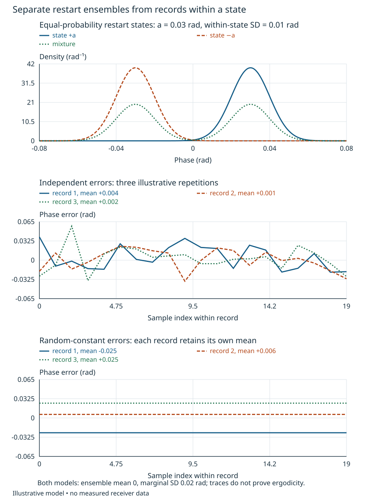
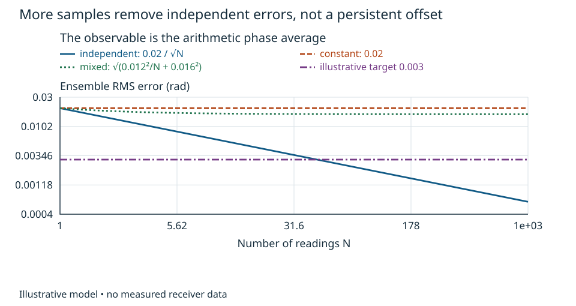
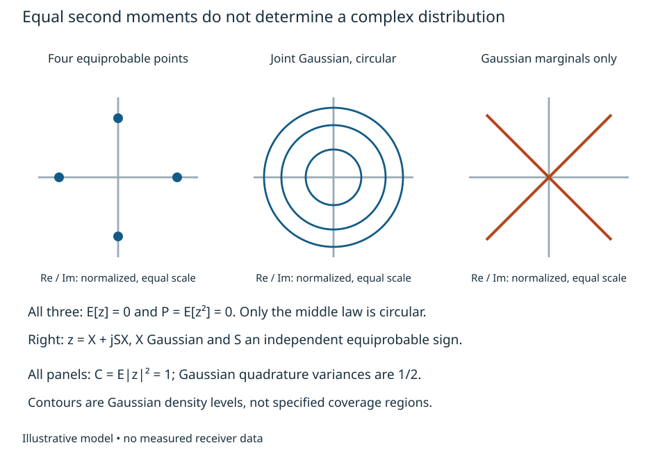
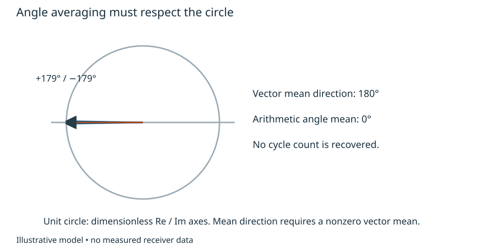
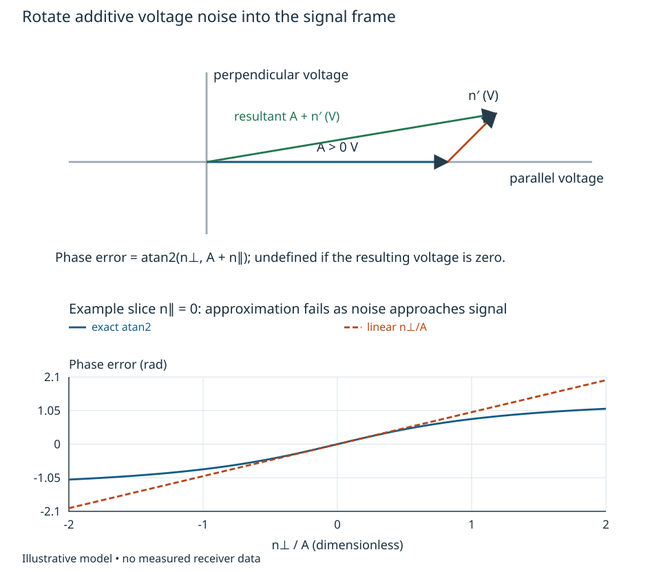

# Random signals and complex phase {#sec-scalar-stochastic-phase}

A two-channel phase reading is an observation of a receiver in a particular
state. A histogram of repeated readings does not by itself say how a longer
integration will behave. Consider two instruments with identical single-reading
phase variance. One changes independently between readings; the other keeps the
same unknown offset throughout an acquisition. Their averages have different
uncertainty even though their histograms can agree. We will develop the scalar
language needed to explain this distinction before introducing spectra.

The signal and phase comparison use the explicit local conventions of
[the phase-comparison unit](phase-comparison.qmd): a peak-voltage envelope at a
specified receiver output plane and channel 2 relative to channel 1. These are
local definitions, not adopted book-wide conventions. The following examples are
synthetic analytical models, not measured receiver performance.

## From repetitions to a probability model

Let an experiment include the trigger, calibration state, acquisition interval
and channel planes. A real random variable X maps each possible outcome of that
experiment to a number, here an unwrapped phase in radians. A discrete model assigns
probabilities p_i to values x_i, with p_i nonnegative and their sum one. Expectation
is the probability-weighted value E[X] = sum_i p_i x_i. A continuous density replaces
the sum with an integral; it has units inverse to those of X and integrates to one.
These are model expectations over repetitions, not instructions to average an
arbitrary record. Expectations below require the indicated moments to exist.

Write mu_X=E[X] and define

$$
\operatorname{var}X=E[(X-\mu_X)^2],\qquad
\operatorname{cov}(X,Y)=E[(X-\mu_X)(Y-\mu_Y)].
$$

Expanding the square gives var X = E[X²] - mu_X². Expanding the product gives
cov(X,Y) = E[XY] - mu_X mu_Y. Covariance has units rad² when both quantities are
phases. It measures a signed second-order association. Independence means the
joint probabilities factor; it implies zero covariance when moments exist, but
zero covariance does not imply independence. For example, choose X uniformly
on {-1,0,1} and Y=X². Then E[X]=E[XY]=0, so covariance vanishes although Y is
completely determined by X. Assigning independent Gaussian noise to every source
is a modeling decision requiring justification, not a consequence of the word noise.

Conditioning restricts the repetition ensemble. For a recorded state S=s,
E[X|S=s] averages only that state's outcomes. If half of restarts give mean +a
and half mean -a, with zero-mean within-state noise of variance v, the combined
variance is v+a² while each state's variance is v. More generally, subtract and
add the conditional mean inside X-E[X]; the cross term averages to zero given S:

$$
\operatorname{var}X=E[\operatorname{var}(X|S)]
 +\operatorname{var}(E[X|S]).
$$

A stable record within one restart state cannot establish repeatability between
restarts. Log reset and calibration history before interpreting its scatter.

The state-conditioned densities in @fig-ensemble-records separate within-state scatter from restart offsets. Its lower panels connect the ensemble to finite records: the constant-error model has the same marginal variance as independent errors, but each record retains its own offset. The three traces are illustrative realizations, not tests of stationarity.

{#fig-ensemble-records fig-alt="Conditional Gaussian phase densities form a wider mixture; independent record means fluctuate while each random-constant record keeps its offset."}

## Processes, records and a decision about averaging

A process X_k supplies a random variable for each sample time k times the sample
interval. Its joint distribution describes dependence between times. Wide-sense
stationarity requires constant mean and covariance depending only on lag; strict
stationarity requires all joint distributions to be invariant to time shift.
Neither condition guarantees that one long record estimates an ensemble quantity.
For that use one needs an appropriate ergodic or convergence property for the
statistic in question. A finite record cannot prove stationarity or ergodicity.

Let epsilon_k have zero mean, variance sigma² and covariance C_kl. Expanding the
square of the average yields the exact finite-sum identity

$$
\operatorname{var}\left({1\over N}\sum_{k=1}^N\epsilon_k\right)
 ={1\over N^2}\sum_{k,l=1}^N C_{kl}.
$$

Independent errors give sigma²/N. A random constant epsilon_k=B throughout a
record gives sigma². Both have identical Gaussian marginals if B and each
independent error are Gaussian with that variance. The random-constant process
is stationary but its record average is B, so it does not converge to the
ensemble mean zero. Deterministic drift and a coherent spur require explicit
models; relabeling them independent noise destroys their time structure.

For a worked decision, suppose a declared synthetic single-reading scatter is
0.02 rad RMS and the desired standard deviation of a 100-reading average is
0.003 rad. Independent errors predict 0.002 rad, meeting the illustrative target.
A record-constant error predicts 0.02 rad and fails. With independent contributions
u_k of RMS 0.012 rad and record-constant B of RMS 0.016 rad, independent of each
other, the single-reading variance is 0.0004 rad², but the average variance is
0.000144/100 + 0.000256 = 0.00025744 rad²: about 0.016045 rad RMS. More samples
will not remove B. The engineering decision is to characterize and constrain the
persistent component or change the reference procedure, rather than promise the
independent-sample improvement. This calculation says nothing about actual hardware
until those dependence and state assumptions are supported.

The curves in @fig-averaging-floor are ensemble predictions for the declared arithmetic average. The mixed model approaches a nonzero floor, so increasing sample count cannot meet the target without changing that persistent contribution.

{#fig-averaging-floor fig-alt="Independent noise decreases as one over square root N, record-constant noise stays fixed and mixed noise approaches 0.016 rad."}

## Complex and angle-valued observations

For a complex fluctuation z=x+jy after subtracting its mean, define covariance
C=E[|z|²] and pseudo-covariance P=E[z²]. Direct multiplication gives

$$
 C=E[x^2]+E[y^2],\qquad
 P=E[x^2]-E[y^2]+2jE[xy].
$$

Thus C alone loses quadrature imbalance and correlation. A proper scalar has
P=0; circular symmetry means the full distribution is unchanged by any complex
rotation. Circular symmetry with finite second moments implies zero mean and
P=0, but propriety alone does not imply circular symmetry. Equiprobable values
{1,j,-1,-j} have P=0 and yet are invariant only to discrete quarter-turns.
For a zero-mean jointly Gaussian real/imaginary pair, propriety does imply circular
symmetry; Gaussianity is the extra condition. Jointly Gaussian means that every real linear
combination of the quadratures is Gaussian, not merely that each histogram is
Gaussian. For such a pair, zero covariance implies independence. P=0 gives equal
quadrature variances and zero covariance, hence independent equal-variance Gaussian
quadratures and a rotationally invariant density. For contrast, X zero-mean nondegenerate Gaussian and
Y=SX with an independent equiprobable sign S have Gaussian marginals and P=0
for X+jY, yet occupy two diagonal lines; the pair is not jointly Gaussian. These definitions and that Gaussian
specialization are supported by Gallager's treatment, §7.8, definitions 7.8.2–3
and theorem 7.8.1 ([MIT course text](https://ocw.mit.edu/courses/6-450-principles-of-digital-communications-i-fall-2006/49163236e20779bae41639ff9dec1ac4_book_7.pdf)).

An angle Theta is defined modulo 2 pi. Readings near +179° and -179° have an
arithmetic mean near zero although their directions are near 180°. Define the
circular moment m=E[exp(j Theta)]; arg m is a mean direction only when m is
nonzero, and |m| is a concentration measure. It does not recover cycle count.
An unwrapped phase requires a continuity and acquisition model that can fail at
fades, gaps and slips. Increments phi(t+tau)-phi(t) require a stated unwrapping
rule; their complex exponential does not. Neither circular concentration nor
within-record variance measures unknown deterministic phase bias.

The supports in @fig-complex-distributions show what pseudo-covariance alone leaves unspecified. The circular construction in @fig-circular-mean then shows why ordinary angle averaging gives the wrong direction near the branch cut.

{#fig-complex-distributions fig-alt="Four discrete points, circular Gaussian contours and two diagonal supports all have zero pseudo-covariance but different distributions."}

{#fig-circular-mean fig-alt="Two nearly overlapping left-pointing unit vectors have a left-pointing vector mean although the arithmetic angle mean is zero."}

## When additive voltage noise becomes phase noise

At the declared output plane let z=A exp(j phi)+n, with A>0 and phi fixed
for this noise ensemble. The exact phase requires z nonzero. Rotate into the
signal frame: n exp(-j phi)=n_parallel+j n_perp. Then the exact principal phase
error is atan2(n_perp,A+n_parallel). For |n| much less than A, Taylor expansion
about zero gives

$$
\delta\phi\simeq {n_\perp\over A},\qquad
\operatorname{var}\delta\phi\simeq
 {\operatorname{var}n_\perp\over A^2}.
$$

A zero-mean circular additive noise with E[|n|²]=v has quadrature variance v/2;
therefore the local phase variance is v/(2A²), not v/A². This is a voltage-envelope
SNR convention A²/v. No universal RF noise-bandwidth conversion is implied.
For improper noise the rotated quadrature variance depends on signal orientation;
it must be calculated rather than replaced by v/2.

If phi is random, the same calculation must use moments conditional on phi
and A. Marginal circularity is insufficient: n=r exp(j Theta), phi=Theta with
uniform Theta has circular noise but zero rotated quadrature and zero phase error.
Independence of circular n from fixed-amplitude signal phase is one sufficient
condition for using v/2 after rotation.

For fixed A=1 V and independent equal-variance quadrature noises each of RMS
0.01 V, with both small compared with A and negligible large excursions, the
approximation gives 0.01 rad RMS. If A
falls to 0.01 V with unchanged noise the expansion parameter becomes order one:
that same formula is no longer a reliable prediction. A multiplicative phase
model A exp(j(phi+epsilon)) instead keeps amplitude fixed. It is not interchangeable
with additive voltage noise through a fade. Log amplitude, validity intervals and
phase slips along with the angle. A tracking or calibration interface must expose
invalid observations rather than present every angle as equally informative.

To transfer this reasoning, let epsilon_k=(-1)^k B, with B zero mean of
variance sigma². Keep the same arithmetic-average observable. Its variance is
zero for even N and sigma²/N² for odd N, because the alternating coefficients
sum to zero or minus one. Only the model changes. As a second check, take independent
quadrature noises of variances 0.0001 and 0.0004 V². Rotating signal phase by
90° interchanges the parallel and perpendicular variances; the phase observable
is unchanged, while its local predicted variance changes by a factor four. The next unit supplies observation weighting and spectra;
physical noise-network construction and general matrix inference remain later work.

The signal-frame construction in @fig-noise-phase identifies the perpendicular voltage that changes phase to first order. The exact curve bends away from that approximation as the noise becomes comparable to the signal; other parallel-noise slices can cross into a different quadrant.

{#fig-noise-phase fig-alt="Signal plus additive noise gives an atan2 phase; for zero parallel noise, arctangent approaches a finite angle while the linear prediction grows."}
