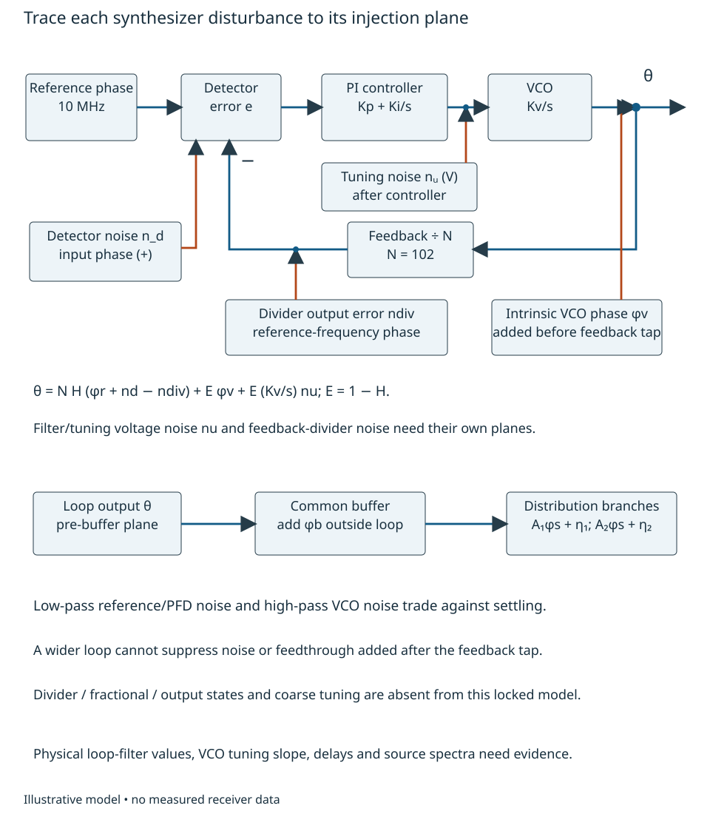
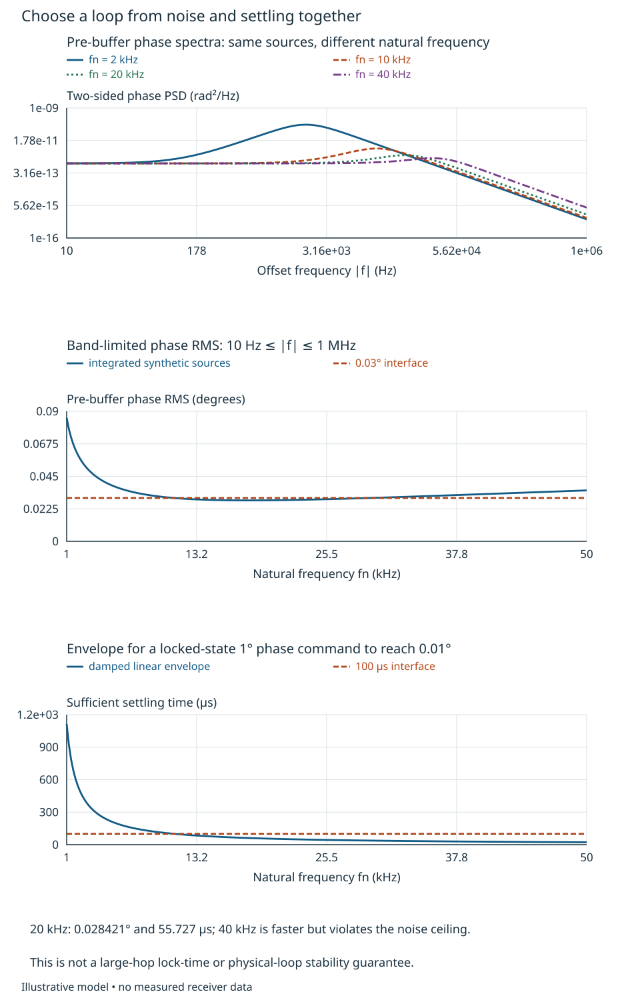
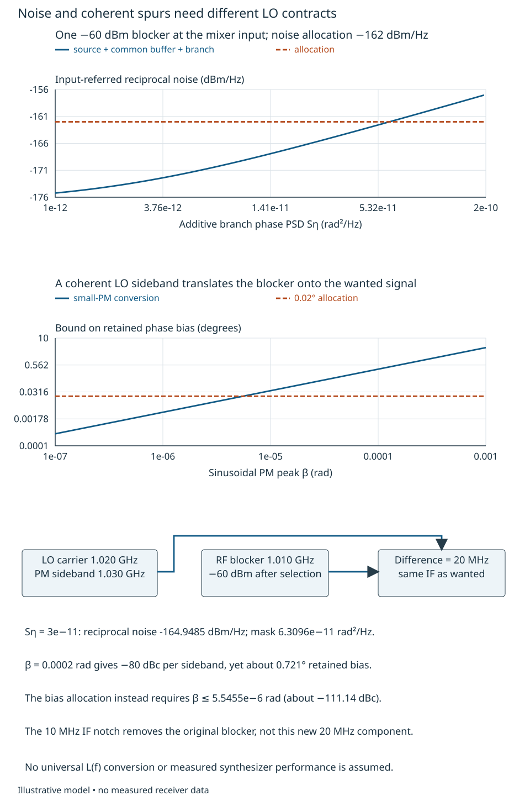
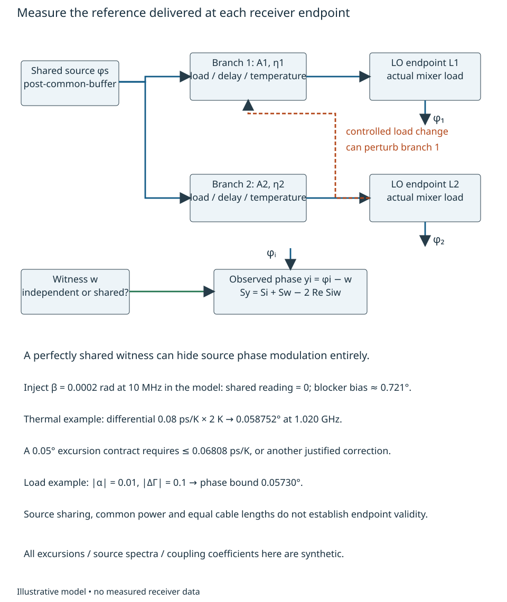

# Synthesis and endpoint reference distribution {#sec-synthesis-endpoints}

A synthesizer can meet a frequency command while delivering an unusable receiver
reference. Noise near a blocker, a coherent spur, distribution drift and an
unidentified output state have different consequences. The engineering question
is how to turn the [system allocations](feasibility-architecture-allocations.qmd)
into source, loop and endpoint contracts that can actually be tested.

Return to Chapter 11's 1.020 GHz LO, 1.000 GHz wanted signal and 1.010 GHz blocker.
At the selected mixer input, wanted power is −102 dBm and blocker power −60 dBm,
with declared 50 Ω delivered-power normalization. This is the single-blocker
reference-design thread; Chapter 14's two-blocker/pulse contrast does not silently
replace these values. We will derive an LO noise-density ceiling and a coherent
spur limit, compare locked-loop alternatives, and calculate distribution/load/
thermal constraints. The reader should then be able to distinguish an acceptable
source model from an evidenced endpoint, including what a correlated test
reference hides. The models and all numerical technology envelopes below are
illustrative. No synthesizer, buffer or distribution assembly is selected.

## Build the synthesis transfer at its actual planes {#sec-synthesis-transfer}

Chapter 7 develops ordinary phase feedback. Here its oscillator is multiplied in
frequency through a feedback divider. In a fixed, identified state, let $\theta$
be small VCO output phase in radians, $\phi_r$ reference phase at the phase detector,
and $n_d,n_{\rm div}$ equivalent additive detector and divider-output phase errors
at that same low-frequency plane. Positive $n_{\rm div}$ adds to the feedback
reading. Let $K_v$ be oscillator tuning sensitivity in rad/s/V, and $C(s)$ the
controller transfer in V/rad. Define $F=C K_v/s$ and $L=F/N$. The physical actions
are then

$$
\theta=F(\phi_r+n_d-\theta/N-n_{\rm div})
 +\phi_v+(K_v/s)n_u.
$$

Here $\phi_v$ is intrinsic oscillator phase added before the feedback tap, and
$n_u$ is tuning-port voltage noise added after the controller. Solve the feedback
relation with $H=L/(1+L)$ and $E=1/(1+L)=1-H$:

$$
\theta=NH(\phi_r+n_d-n_{\rm div})+E\phi_v+E(K_v/s)n_u.
$$ {#eq-synthesis-noise-paths}

Thus low-offset reference-plane phase is multiplied by $N$, oscillator phase is
suppressed where loop gain is large, and tuning-voltage noise has another transfer.
A common buffer after the tap instead adds its phase $\phi_b$ directly:
$\phi_s=\theta+\phi_b$. Moving noise between these planes changes the answer.
@fig-pll-source-paths displays the distinction. Frequency accuracy alone supplies
neither these spectra nor a known initial phase.

{#fig-pll-source-paths fig-alt="A reference drives a phase detector, PI controller and integrating VCO with divide-by102 feedback. Intrinsic oscillator phase is added before the feedback tap. A common buffer and separate endpoint branches lie after the loop. Each noise source keeps its own injection plane."}

For an ideal proportional-plus-integral controller $C=K_p+K_i/s$, choose
$K_vK_p/N=2\zeta\omega_n$ and $K_vK_i/N=\omega_n^2$. These definitions give

$$
H(s)=\frac{2\zeta\omega_n s+\omega_n^2}
 {s^2+2\zeta\omega_n s+\omega_n^2},\qquad
E(s)=\frac{s^2}{s^2+2\zeta\omega_n s+\omega_n^2}.
$$ {#eq-synthesis-pi}

The two poles have negative real part for $\zeta>0,\omega_n>0$. For $0<\zeta<1$
they are $-\zeta\omega_n\pm j\omega_n\sqrt{1-\zeta^2}$. The natural frequency
$f_n=\omega_n/(2\pi)$ is not the unity-loop-gain frequency or a universal noise
bandwidth. At low frequency, $H\to1$ and $E\to0$; at high frequency the reverse
holds. Ideal multiplying/dividing phase and spectra still uses Chapter 11's
$M$/$M^2$ and $1/D$/$1/D^2$ rules **within an identified state**.

For mutually independent centered stationary source phases, the pre-buffer PSD is

$$
S_\theta=N^2|H|^2(S_r+S_d+S_{\rm div})
 +|E|^2S_v+|E K_v/(j2\pi f)|^2 S_u.
$$

Every phase PSD here is real-phase **two-sided** density in rad²/Hz over real offset
$f$; $S_u$ is in V²/Hz. Correlated sources require Chapter 4's cross terms,
including the divider-error sign. The $f=0$ tuning-noise transfer is interpreted
by its limit. Fixed offsets, tuning history, discrete states and coherent spurs
are not Gaussian centered spectra. Manufacturer single-sideband plots require
an explicit normalization translation before substitution; no universal $L(f)$
convention is established here.

The PFD/divider architecture is described in [MT-086, Rev. 0, pp. 1–5](https://www.analog.com/media/en/training-seminars/tutorials/MT-086.pdf#page=1)
[@adiMT086]. Collins's [PLL discussion](https://www.analog.com/en/resources/analog-dialogue/articles/phase-locked-loop-pll-fundamentals.html)
connects in-band noise multiplication, fractional spurs and blocking [@collinsPLL].
Our normalized transfers and decisions are derived above; neither source's general
bandwidth recommendations are imported as a design rule.

### A loop choice that must satisfy two interfaces

Suppose the reference/detector/divider phase spectra are respectively
$(6,3,1)\times10^{-17}$ rad²/Hz, independent and flat on $|f|\le20$ MHz. Let
$S_v=10^{-3}/(f^2+1\ {\rm Hz}^2)$ rad²/Hz, where the numerator has units rad²·Hz;
this regularized model has finite low-frequency variance. Set all these spectra to
zero outside 20 MHz. Take $N=102$ (10 MHz to 1.020 GHz), $\zeta=1/\sqrt2$, and
omit tuning-voltage noise only for this **supplied** ideal comparison. Require
pre-buffer phase RMS at most 0.03° over $10\le|f|\le10^6$ Hz. This band-limited
interface is not an endpoint or application metric.

Also require a locked-state **1° output phase command** to settle within 0.01°
in 100 μs. From $E/s$, the command's residual divided by its step amplitude is

$$
e^{-\zeta\omega_n t}
\left[\cos\omega_dt-\frac{\zeta}{\sqrt{1-\zeta^2}}\sin\omega_dt\right],
\qquad\omega_d=\omega_n\sqrt{1-\zeta^2}.
$$

Its magnitude is bounded by $e^{-\zeta\omega_n t}/\sqrt{1-\zeta^2}$. Thus a
sufficient time for fractional error $\epsilon$ is
$t\ge\ln[1/(\epsilon\sqrt{1-\zeta^2})]/(\zeta\omega_n)$. Integrating the stated
PSD at both positive and negative offsets gives:

| $f_n$, kHz | Pre-buffer phase RMS, degrees | Sufficient 1 percent settling, μs | Both interfaces? |
|---:|---:|---:|---|
| 2 | 0.060705 | 557.267 | No |
| 10 | 0.030804 | 111.453 | No |
| 20 | 0.028421 | 55.727 | Yes, conditionally |
| 40 | 0.032623 | 27.863 | No |

Widening the loop suppresses oscillator noise but admits more multiplied
comparison-plane noise. The fastest candidate is not the quietest one.
@fig-pll-loop-tradeoff shows the competition rather than assuming a preferred
bandwidth. The calculation is reproducible by log-frequency quadrature of
$2\int_{10}^{10^6}S_\theta(f)df$, including its Jacobian when changing variable.

{#fig-pll-loop-tradeoff fig-alt="Four two-sided phase spectra correspond to2,10,20and40kHz natural frequencies. Integrated10Hz-to1MHz phase noise has a minimum near20kHz, while the sufficient small-command settling time decreases with natural frequency. The40kHz candidate exceeds0.03degree despite faster settling."}

To make this more than a normalized filter, supply $K_v=2\pi(20\ \mathrm{MHz/V})$.
The 20 kHz candidate requires $K_p=0.144250$ V/rad and
$K_i=12817.698$ V/(rad·s). An actual charge-pump/filter implementation must realize
that effective phase-to-voltage law with its detector gain, tuning range, loading
and noise. At this damping, solving $|L(j\omega_c)|=1$ gives
$\omega_c/\omega_n=\sqrt{1+\sqrt2}$, or $f_c=31.07548$ kHz. The ideal phase margin
is $\tan^{-1}(2\zeta\omega_c/\omega_n)=65.5302^\circ$. An additional pure loop
delay must be below **1.83516 μs** merely to retain 45° in this model; extra poles,
component tolerances and varying $K_v$ consume margin too. This necessary
small-signal analysis is not physical loop validation. A 10 MHz PFD is much faster
than this loop, but sampling, charge-pump pulses and parasitics still need assessment.

A large frequency hop adds band selection, tuning limits and cycle slips; it is
not the 1° linear phase command. For comparison, proportional-only feedback gives
the first-order model in Chapter 7 and a permanent phase lag for a frequency step.
The PI model has $E/s^2=1/(s^2+2\zeta\omega_ns+\omega_n^2)$, so its ramp-phase
tracking error decays, provided the trajectory remains locked. Declaring the
55.727 μs envelope to be a large-hop lock time would discard these conditions.

## Derive noise and spur masks from the blocker {#sec-lo-blocker-masks}

Chapter 9 gives the physical reciprocal-mixing convolution. For the selected
narrow blocker, a locally flat effective LO density produces input-referred
noise $N_{\rm rm}=P_BS_{\phi,\rm eff}(-\Delta)$ W/Hz. Allow 10 percent of Chapter
12's supplied $N_0=6.3095734\times10^{-19}$ W/Hz, so $N_{\rm rm}\le6.3095734
\times10^{-20}$ W/Hz (−162 dBm/Hz). With $P_B=10^{-9}$ W and $\Delta=10$ MHz,

$$
S_{\phi,\rm eff}(-10\ {\rm MHz})\le6.3095734\times10^{-11}\ {\rm rad^2/Hz}.
$$ {#eq-lo-mask}

Use an upper envelope across the wanted output band if the source is not flat;
for a finite-spectrum blocker return to the convolution. This allocation is
inside the complete floor, not an additional uncounted noise source. Noise from
internal LO buffers, distribution and the mixer-sensitive branch belongs in the
**effective** LO process. A later digital tone notch cannot remove a noise pedestal
already translated into the wanted band.

For example, append a common-buffer phase floor $2\times10^{-12}$ and independent
branch floor $S_\eta=3\times10^{-11}$ rad²/Hz, each flat on $|f|\le20$ MHz.
At 10 MHz the 20 kHz loop contributes only $1.83232\times10^{-17}$ rad²/Hz.
The endpoint density is therefore $3.2000018\times10^{-11}$, giving
**−164.94850 dBm/Hz**, below the allocated ceiling by 2.94850 dB. If a different
branch contributes $10^{-10}$, the result is **−159.91400 dBm/Hz** and fails.
The loop output's excellent pre-buffer RMS cannot rescue that branch.

If referred to the same complete observer as Chapter 12, the good example's
reciprocal mixing consumes about 5.072 percent of its marginal noise floor:
0.317 percent from the shared source/common buffer and 4.755 percent from each
independent branch. These are different physical source columns. They do not
establish Chapter 12's illustrative common fraction $q=0.02$, and their sum must
not simply be inserted as a new common $q$. Rebuild the source transfers,
including branch delays and blocker geometry, and reallocate the remaining
complete floor before claiming that correlated budget closes. The density
allocation alone does not supply that reconciliation.

A coherent spur needs a different calculation. Let LO phase contain
$\beta\cos(2\pi f_m t)$ with small peak $\beta$ radians. Expanding $e^{j\beta\cos}$
to first order produces sidebands of amplitude ratio $\beta/2$, or power ratio
$\beta^2/4$ each. For $f_m=10$ MHz, the 1.030 GHz upper LO sideband mixes the
1.010 GHz blocker directly to **20 MHz**, the wanted IF. The ordinary blocker
is at 10 MHz IF and is removed by Chapter 11's notch; the generated component
cannot be separated from wanted information by that notch.

The retained disturbance-to-wanted amplitude is
$r=\sqrt{P_B/P_S}\,\beta/2=125.89254\,\beta/2$ at the declared input planes.
A peak PM of $2\times10^{-4}$ rad produces −80 dBc per sideband, yet its
retained phase-bias bound is **0.72133°**. To fit a 0.02° allocation requires

$$
\beta\le 2\sin(0.02^\circ)\sqrt{P_S/P_B}
 =5.54546\times10^{-6}\ {\rm rad},
$$

or about **−111.14185 dBc** for the relevant sideband. These are small-PM
conditional results; amplitudes, phases and multiple coherent products must be
combined at their actual planes. @fig-lo-blocker-contract contrasts the density
and spur requirements. An integrated-noise number does not establish a narrow
spur bound or a mask at a particular blocker offset.

{#fig-lo-blocker-contract fig-alt="Reciprocal noise rises with additive branch phase density and crosses the minus162dBm-per-Hz allocation. A separate logarithmic plot maps peak PM to wanted-band phase bias; beta0.0002rad gives0.721degree and exceeds0.02degree. The diagram traces1.030GHz LO sideband minus1.010GHz blocker to20MHz IF."}

## Deliver the reference to its load {#sec-reference-distribution}

Let branch $i$ deliver small phase
$\phi_i(f)=A_i(f)\phi_s(f)+\eta_i(f)$. This is **phase-modulation transfer** around
the LO carrier, distinct from RF carrier insertion loss. With independent additive
branches, the endpoint difference $\Delta\phi=\phi_2-\phi_1$ has density

$$
S_{\Delta\phi}=|A_2-A_1|^2S_s+S_{\eta2}+S_{\eta1}.
$$

For pure branch delays, $A_i=e^{-j2\pi f\tau_i}$, so the common-source term is
$4\sin^2(\pi f\Delta\tau)S_s$. The offset frequency weights stochastic phase;
a change in carrier delay instead changes phase by $-2\pi f_L\delta\tau$.
Chapter 11's high-side restored output reverses that LO phase sign, but not its
magnitude or variance. Equal cable length alone establishes neither transfer.

Consider a 2 ms arithmetic average of endpoint phase difference within a stable,
identified state; its weight is $W(f)=\operatorname{sinc}(fT)$. This is a local
reference characterization observable, not automatically Chapter 12's nonlinear
RF extraction operator. Set $\Delta\tau=5$ ns. At $\zeta=1/\sqrt2$,
$|H|^2=(1+2x^2)/(1+x^4)\le(1+\sqrt5)/2$ for $x=f/f_n$, and
$S_v|E|^2\le10^{-3}/(2f_n^2)$. Including the common buffer, $S_s\le5\times10^{-12}$
rad²/Hz everywhere for the 20 kHz case. For the bound only, extend this constant upper spectral envelope over all
frequencies. Its windowed integral is finite; it is not a finite-variance
instantaneous white phase process. The difference of two averaging weights is
$1/T$ on each of their two nonoverlapping end intervals, and zero elsewhere.
For $|\Delta\tau|<T$, Parseval therefore gives its squared-weight integral as
$2|\Delta\tau|/T^2$. Multiplying by the constant upper density
$5\times10^{-12}$ bounds the common-source variance. The actual bounded spectrum
can only reduce that integral. Hence

$$
\operatorname{var}\overline{\phi_2-\phi_1}
 \le\frac{2S_\eta}{T}+\frac{2(5\times10^{-12})|\Delta\tau|}{T^2}.
$$ {#eq-endpoint-average-bound}

The first term also upper-bounds the finite 20 MHz white support. It gives
**0.009924°** SD for the good branch example. Using $10^{-10}$ for both independent branch floors
still gives only **0.018119°**, passing a hypothetical 0.02° averaged-difference
criterion while failing reciprocal mixing. Common noise can cancel in a comparison
and remain harmful in each receiver. Reset mixtures and carrier-delay drift are
not averaged away by this centered-phase calculation.

For a separate mean-excursion contract, require at most 0.05° under a bounded 2 K
common temperature departure. A differential carrier-delay coefficient of
0.08 ps/K produces $360(1.020\times10^9)(0.08\times10^{-12})(2)=0.058752^\circ$,
which fails. The coefficient must be at most **0.068083 ps/K**, or a justified
correction must bound the residual; 0.04 ps/K would give 0.029376°. These local
branch alternatives do not replace Chapter 12's illustrative thermal columns:
any proposed replacement must be propagated through its full correlated budget.
The stochastic SD, temperature bound and coherent-spur bias are distinct criteria,
not three new independent grants of task margin.

Loading can couple branches even when the source is shared. A minimal small-change
wave model is $V_1'=V_1(1+\alpha\Delta\Gamma_2)$, where $\Delta\Gamma_2$ is a load
reflection-coefficient change and complex $\alpha$ includes the complete reverse/
redistribution path. With $|\alpha|=0.01$ and $|\Delta\Gamma_2|=0.1$, the phase
bound is $\arcsin0.001=0.057296^\circ$, above 0.05°. Meeting that allocation alone
requires $|\alpha|\le0.00872665$, or −41.18305 dB in amplitude-ratio notation.
A component isolation specification cannot substitute for this complete path.
Test it by a controlled load change while preserving an appropriate witness.

Three endpoints needing 0 dBm each through 6 dB matched branch loss require
11.9432 mW from an ideal three-way source division: +10.7712 dBm at the common
source. That already accounts for the ideal 4.7712 dB power split. Adding 2 dB
**excess** splitter/distribution loss raises the requirement to **18.9287 mW**,
+12.7712 dBm. A supplied 10 percent RF/DC efficiency would spend 0.189287 W,
leaving only 0.210713 W of the earlier 0.4 W reference allowance for synthesis,
controls and other losses; actual quiescent power and efficiency are unknown.
Local branch drivers can change those losses but add noise, supply coupling and
power. Source impedance, output waveform, compression, return loss, isolation,
thermal response and actual mixer drive must be examined together. None of these
alternatives is established by counting the number of common clocks.

## Verify endpoints and identify synthesis state {#sec-reference-evidence}

The measured phase against witness $w$ is $y_i=\phi_i-w$. Chapter 4's covariance
rule gives $S_{y_i}=S_i+S_w-2\Re S_{iw}$, not automatically $S_i+S_w$. A perfectly
shared, delay-matched witness can cancel the source's phase entirely. In a
synthetic test with $\phi_i=\beta\cos(2\pi10^7t)$ and $w=\phi_i$, the reported
phase is zero even for the $\beta=0.0002$ rad spur that violates the blocker
allocation. An independent known witness, or calibrated deliberate modulation
and reference-path changes, is needed to identify that blind path. Different
measurements may legitimately serve endpoint difference and individual LO masks;
their reference topologies must establish which observable they support.
@fig-reference-endpoint-test places the controlled branch perturbation and
witness beside the delivered references.

{#fig-reference-endpoint-test fig-alt="A common source feeds two receiver LO branches with independent branch noise and different delay and load. A controlled load change on branch2 can perturb branch1. The witness feeds phase comparisons; sharing source phase can conceal it. Text records separate thermal and loading limits."}

Frequency ratios do not completely identify state. An ideal output divide-by-$D$
**outside the feedback loop** gives $\theta_o=\theta/D+2\pi q/D$; a divide-by-four
can have four phase choices until its state is established. Within a feedback
loop, the relevant tap and divider placement change which freedoms remain; do not
infer a quarter-cycle ambiguity from every internal divider. Fractional seeds,
band selection and phase-programming modes also have device-specific effects.

The ADF4351 Rev. A provides a consequential documented example: its phase-resync
discussion (p. 24) places resynchronization after frequency settling and requires
a timer based on worst-case lock time; its phase-adjust mode (p. 18) changes what
an update performs [@adiADF4351]. This supports conditional state analysis, not a
guarantee for our ideal 1.020 GHz oscillator or the receiver endpoints. Its
reference-feedthrough discussion (p. 23) also describes a path bypassing loop
filtering. No source noise, settling or output-power value is imported into our
numerical envelopes.

An endpoint verification plan therefore needs source/branch noise and narrow-spur
masks under actual loads; band/mode/state-specific phase-command and retune tests;
tuning slope, controller and delay corners; load/supply/temperature perturbations;
and witness cross-correlation/floor uncertainty. Preserve calibration state,
frequency plan, divider placement, reference planes and invalid intervals with
results. A lock-detect bit, fixed register word or repeatable digital framing
cannot replace an end-to-end phase test. Actual sequencing is developed in the
state/integration treatment. The reserved Chapter 16 treatment addresses remote
offset and path inference; until it is developed, the following navigation opens
the development supplements.

For transfer, replace the common source with independent local PLLs having the
same individual PSDs. Rebuild $S_{\Delta\phi}$ rather than retaining $|A_2-A_1|^2S_s$.
Then give their relative LO frequency an unestimated 0.2 Hz offset: in 2 ms it
adds 0.144° excursion, exceeding the separate 0.05° contract. Identify what
frequency/phase estimation evidence is missing. Finally raise the reference to
50 MHz, so an effective 1.020 GHz ratio is 20.4 rather than integer 102. Holding
comparison-plane phase density fixed would reduce its multiplied contribution
by 25, but fractional spurs, detector-noise dependence on comparison frequency,
state and frequency resolution change too. Specify the evidence needed to choose
that alternative, and explain why neither a lower nominal ratio nor a smaller
measured differential residual closes the original receiver budget by itself.
